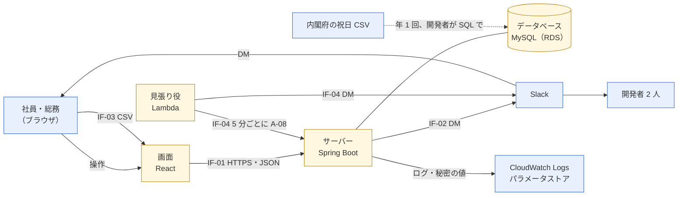

# インターフェース仕様書（v1.1）

| 項目 | 内容 |
|---|---|
| システム | 備品管理システム（equipment_management_system） |
| 版 | v1.1 2026-11-26 |
| もとにした資料 | 基本設計書 v1.11、機能一覧 v1.2、画面設計 v1.9、API設計 v1.5、データ設計 v1.0 |
| 状態 | 案（人の確認待ち）。確認が済んだら、「確定」に直す |

## 1. この資料について

このシステムが、**システムの外とどうやり取りするか**（インターフェース）を、1 か所にまとめた資料。新しい決まりは作らず、基本設計書・機能一覧・画面設計・API設計にある内容を、やり取りの相手ごとに並べ直している。

- 細かい決まり（入力欄ごとのチェック、エラーの文、API ごとの送る値・返す値）は、もとの設計書が正しい答え。この資料と食い違ったら、もとの設計書に合わせて、この資料を直す。
- 「インターフェース」とは、2 つのものの間でやり取りする、決まった形と手順のこと。

### 1.1 やり取りの一覧

| ID | やり取り | 相手 | 向き | 形 | この資料の章 |
|---|---|---|---|---|---|
| IF-01 | 画面と API | ブラウザの画面（React）とサーバー（Spring Boot） | 画面 → サーバー（返事は サーバー → 画面） | HTTPS ＋ JSON | 2章 |
| IF-02 | Slack の DM | 社内の Slack | サーバー → Slack | Slack の Web API | 3章 |
| IF-03 | CSV ファイル | 総務（ブラウザ経由）と Excel | ファイルの取り込み（画面 → サーバー）と、ダウンロード（サーバー → 画面） | CSV（multipart/form-data、text/csv） | 4章 |
| IF-04 | 見張り役 | 見張り役（AWS Lambda） | 見張り役 → サーバー（A-08）。見張り役 → Slack | HTTPS ＋ JSON、Slack の Web API | 5章 |
| IF-05 | そのほか | AWS の保管サービス、祝日データ | サーバー → AWS／開発者 → データベース | 6章を見る | 6章 |



アドレスは、CloudFront（AWS の入口）の 1 つのアドレスで、画面と API の両方を出す（基本設計書 2・3章）。自分たちのドメインは使わない。

## 2. IF-01 画面と API

### 2.1 基本の決まり

| 項目 | 決まり | もとの設計書 |
|---|---|---|
| 置き場所 | 画面と API を同じアドレスで出す。API のアドレスは /api/ で始まる | API設計 2.1 |
| やり取りの形 | JSON。文字コードは UTF-8。ファイルのアップロード・ダウンロードだけは別の形（4章） | API設計 2.1 |
| 操作の種類 | GET＝読む、POST＝作る・実行する、PUT＝変える、DELETE＝消す | API設計 2.1 |
| 日付・日時 | 日付は "2026-11-02"、日時は "2026-11-25T09:00:00+09:00"（日本時間）。画面に出すときは 2026/11/02 の形に直す | API設計 2.1 |
| 列名 | 英語の小文字から始め、単語の区切りを大文字にする（例：managementNo） | API設計 2.1 |
| ログイン状態 | ログインに成功すると、サーバーがクッキーでログイン状態を渡す。以後は、ブラウザがそのクッキーを自動で送る | API設計 2.2 |
| なりすまし対策 | POST・PUT・DELETE には、CSRF トークンを付ける。サーバーが XSRF-TOKEN というクッキーで渡し、画面が同じ値を、ヘッダーに付けて返す | API設計 2.2 |
| 権限の確認 | API を呼ぶたびに、サーバーが権限項目を確かめる。画面のボタンを隠すだけにしない | API設計 2.2、機能一覧 4章 |
| 強制ログアウト | ログインした日時が、パスワードを変えた日時より前なら、ログアウトさせる（ほかの端末の締め出し） | API設計 2.2 |
| 編集の衝突 | 変える API（PUT）は、画面を開いたときに受け取った version を送る。サーバーの version と違えば保存せず 409 を返す | API設計 2.7 |
| 一覧のページ分け | page（1 から）を受け取り、items・page・size・totalCount・totalPages を返す。1 ページの件数は S-06 が 20 件、ほかは 50 件 | API設計 2.5 |

### 2.2 返す値の形

どの API も、正常時もエラー時も、次の 4 つの項目を持つ形で返す。ファイルのダウンロードだけは例外（4章）。

```json
{ "status": 200, "message": "処理が正常に完了しました。", "data": { "...": "..." }, "errors": null }
```

| 項目 | 中身 |
|---|---|
| status | HTTP ステータスと同じ番号（数値） |
| message | 結果を表す文 |
| data | 正常時に返す中身。返すものがない API と、エラー時は null |
| errors | 入力欄ごと・CSV の行ごとのエラーの一覧（field・message、CSV のときは row も）。400 のときだけ入れ、ほかは null |

### 2.3 結果の番号（HTTP ステータス）

| 番号 | 意味 | 画面の動き |
|---|---|---|
| 200 | 成功 | ― |
| 201 | 作った | ― |
| 202 | 受け付けた（パスワード設定用のリンクの依頼 A-04。送れたかどうかは知らせない） | ― |
| 400 | 入力の誤り（必須が空、文字数オーバー、CSV の行のエラーなど） | 入力欄の下や赤の帯にメッセージを出す |
| 401 | ログインしていない（ログインが切れた） | S-01（ログイン）に移る |
| 403 | 権限がない | S-19（権限がない）を出す。ボタンの操作では、赤の帯 |
| 404 | 見つからない | S-19（見つからない）を出す。ボタンの操作では、赤の帯 |
| 409 | ぶつかった（先に保存された、すでに貸し出されている、すでに返却されている） | 赤の帯にメッセージを出す |
| 500 | サーバーの不具合 | S-19（問題が発生しました）を出す。詳しい中身はログにだけ残す |
| 503 | 動いていない（A-08 で、データベースにつながらないとき） | 見張り役が使う |

### 2.4 API の一覧

「権限」は、呼ぶのに必要な権限項目のコード。「ログイン」はログインしていれば誰でも、「なし」はログイン前でも呼べる。細かい形（送る値・返す値・エラー）は API設計 4章と、各 API の詳細設計（internaldesign/詳細設計/）にある。

| No. | 操作 | アドレス | 内容 | 権限 | 画面 |
|---|---|---|---|---|---|
| A-01 | POST | /api/auth/login | ログインする | なし | S-01 |
| A-02 | POST | /api/auth/logout | ログアウトする | ログイン | 共通ヘッダー |
| A-03 | GET | /api/auth/me | ログインしている人の情報と権限項目を返す | ログイン | 全画面 |
| A-04 | POST | /api/auth/password-reset-requests | パスワード設定用のリンクを依頼する | なし | S-02 |
| A-05 | POST | /api/auth/password-tokens/verify | リンクの合言葉が使えるか確かめる | なし | S-03 |
| A-06 | POST | /api/auth/password-tokens/use | 合言葉を使って新しいパスワードを決める | なし | S-03 |
| A-07 | PUT | /api/me/password | 自分のパスワードを変える | ログイン | S-04 |
| A-08 | GET | /api/health | アプリとデータベースが動いているかを答える（5章） | なし | 画面なし（見張り役） |
| B-01 | GET | /api/me/loans | 自分が借りている備品の一覧と、今月の確認の案内 | LOAN_SELF | S-05 |
| B-02 | POST | /api/me/loans | 備品を借りる | LOAN_SELF | S-06 |
| B-03 | POST | /api/me/loans/{貸出履歴のID}/return | 借りている備品を返す | LOAN_SELF | S-05 |
| B-04 | POST | /api/me/confirmations | 自分が借りている備品を「確認した」にする（1 件でも、まとめてでも） | CONFIRM_SELF | S-05 |
| B-05 | GET | /api/me/available-equipment | 借りられる備品（管理中・保管中）を探す | LOAN_SELF | S-06 |
| C-01 | GET | /api/equipment | 備品を探す（絞り込み・並び替え・ページ分け） | EQUIPMENT_VIEW | S-07 |
| C-02 | GET | /api/equipment/{備品のID} | 備品 1 件と、貸出履歴（新しい順に 5 件）を返す | EQUIPMENT_VIEW、EQUIPMENT_UPDATE のどちらか | S-08、S-09 |
| C-03 | POST | /api/equipment | 備品を登録する | EQUIPMENT_CREATE | S-09 |
| C-04 | PUT | /api/equipment/{備品のID} | 備品を変える | EQUIPMENT_UPDATE | S-09 |
| C-05 | DELETE | /api/equipment/{備品のID} | 備品を削除する | EQUIPMENT_DELETE | S-08 |
| C-06 | POST | /api/equipment/{備品のID}/confirmation | 備品を「確認した」にする | CONFIRM_ALL | S-07、S-08 |
| C-07 | POST | /api/equipment/{備品のID}/loans | 総務が、ほかの人の貸出を登録する | LOAN_MANAGE | S-08 |
| C-08 | POST | /api/equipment/{備品のID}/return | 総務が、返却を登録する | LOAN_MANAGE | S-08 |
| D-01 | GET | /api/loans | 貸出履歴を探す | LOAN_HISTORY_VIEW | S-10 |
| D-02 | PUT | /api/loans/{貸出履歴のID} | 貸出履歴を直す | LOAN_MANAGE | S-10 |
| D-03 | DELETE | /api/loans/{貸出履歴のID} | 貸出履歴を取り消す | LOAN_MANAGE | S-10 |
| E-01 | GET | /api/confirmation-csv/template | 確認用のテンプレート（CSV）をダウンロードする | CONFIRM_CSV | S-11 |
| E-02 | POST | /api/confirmation-csv | 確認日を入れた CSV を取り込む | CONFIRM_CSV | S-11 |
| E-03 | GET | /api/reminder-runs/latest | 直近の催促の結果（人数・成功・失敗）を返す | REMINDER_LOG_VIEW | S-12 |
| E-04 | GET | /api/reminder-logs | 催促の宛先ごとの記録を探す | REMINDER_LOG_VIEW | S-12 |
| K-01 | GET | /api/categories | 種別の一覧（使っている備品の数つき） | ログイン | S-06・S-07・S-09・S-13 |
| K-02 | POST | /api/categories | 種別を追加する | CATEGORY_MANAGE | S-13 |
| K-03 | PUT | /api/categories/{種別のID} | 種別を変える | CATEGORY_MANAGE | S-13 |
| K-04 | DELETE | /api/categories/{種別のID} | 種別を消す | CATEGORY_MANAGE | S-13 |
| G-01 | GET | /api/users | ユーザを探す | USER_VIEW | S-14 |
| G-02 | GET | /api/users/{ユーザのID} | ユーザ 1 人を返す | USER_VIEW、USER_UPDATE のどちらか | S-15 |
| G-03 | POST | /api/users | ユーザを登録する。パスワード設定用のリンクを DM で送る | USER_CREATE | S-15 |
| G-04 | PUT | /api/users/{ユーザのID} | ユーザを変える（権限を変えるには PERMISSION_MANAGE も要る） | USER_UPDATE | S-15 |
| G-05 | DELETE | /api/users/{ユーザのID} | ユーザを削除する | USER_DELETE | S-14 |
| G-06 | POST | /api/users/{ユーザのID}/password-link | パスワード設定用のリンクを送り直す | USER_UPDATE | S-15 |
| G-07 | GET | /api/users/options | 借用者を選ぶための候補を探す | LOAN_MANAGE | S-08、S-10 |
| H-01 | GET | /api/roles | 権限の一覧（含む権限項目・人数つき） | PERMISSION_VIEW、USER_VIEW、USER_CREATE、USER_UPDATE のどれか | S-14、S-15、S-16 |
| H-02 | GET | /api/roles/{権限のID} | 権限 1 つを返す | PERMISSION_VIEW、PERMISSION_MANAGE のどちらか | S-17 |
| H-03 | POST | /api/roles | 権限を作る | PERMISSION_MANAGE | S-17 |
| H-04 | PUT | /api/roles/{権限のID} | 権限を変える | PERMISSION_MANAGE | S-17 |
| H-05 | DELETE | /api/roles/{権限のID} | 権限を消す | PERMISSION_MANAGE | S-17 |
| H-06 | GET | /api/permissions | 権限項目の一覧（18 件） | PERMISSION_VIEW、PERMISSION_MANAGE のどちらか | S-17 |
| I-01 | POST | /api/imports/users | ユーザの CSV を取り込む | USER_CREATE | S-18 |
| I-02 | POST | /api/imports/equipment | 備品の CSV を取り込む | EQUIPMENT_CREATE | S-20 |
| I-03 | POST | /api/imports/loans | 今貸出中の情報の CSV を取り込む | LOAN_MANAGE | S-21 |

- API は全部で 48 個。リンクの合言葉は、アドレスに入れず、JSON の中で送る（A-05・A-06。ログに残さないため。API設計 3.1）。
- 開発とテストのときだけ動かす API（Slack の偽物、送った内容を読み出す API など）は、ここに含めない。本番の設定では動かない（API設計 6章）。

## 3. IF-02 Slack の DM

### 3.1 基本の方式

| 項目 | 方式 |
|---|---|
| Slack アプリ | 社内の Slack に、「備品管理」アプリを 1 つ作って入れる。催促・パスワード関係のお知らせ・見張り役の知らせのすべてに使う |
| 与える権限（スコープ） | chat:write（メッセージを送る）、users:read（Slack のユーザーの情報を読む）、users:read.email（メールアドレスからユーザーを探す） |
| 宛先の探し方 | ユーザに登録したメールアドレスで、Slack のユーザーを探す。会社のメールアドレスと、Slack に登録しているメールアドレスが同じ前提 |
| 送り方 | 見つかったユーザーに、アプリからメッセージを送る（アプリとの DM に届く）。リンクのプレビューは出さない設定にする |
| 本文に書かないもの | パスワード。パスワード設定用のリンクの合言葉は、DM に入れるリンクにだけ入れ、ログには出さない |
| アプリのアドレス | DM に入れるリンクのもとになるアドレスは、設定で持つ（開発は PC のアドレス、AWS は CloudFront のアドレス） |
| 秘密の値 | Slack のボットトークンは、プログラムや設定ファイルに書かない。開発は Git で管理しない secret.yml、AWS はパラメータストアに置く |
| 開発・テスト | 開発用に作った Slack のワークスペースに送る。自動テストでは、偽物に置き換えて送らない |

### 3.2 DM の種類（7 種類）

文面は画面設計 9章のとおり（この資料には写さない）。

| No. | いつ送るか | 宛先 | 送る元の動き | 失敗したとき |
|---|---|---|---|---|
| ① | パスワード再設定の依頼（S-02、A-04） | 依頼したメールアドレスのユーザー | サーバー（API） | ログに残す（画面には知らせない） |
| ② | ユーザ登録（S-15、G-03）。リンクの送り直し（G-06）も同じ | 登録されたユーザ | サーバー（API） | ログに残す |
| ③ | アカウントロック（パスワードを 5 回続けて間違えたとき） | ロックされたユーザ | サーバー（API） | ログに残す |
| ④ | パスワードの変更・再設定のあと（S-03・S-04） | 変更した本人 | サーバー（API） | ログに残す |
| ⑤ | 毎月の催促 | 未確認の備品を借りているユーザ（1 人に 1 通にまとめる） | サーバーの定期実行 | 催促履歴に「失敗」として残す（S-12 で見られる） |
| ⑥ | 見張り役が「止まっている」と判断したとき | 開発者 2 人 | 見張り役 | 設計書に決まりがない（8章 No.3） |
| ⑦ | 見張り役が「戻った」と判断したとき | 開発者 2 人 | 見張り役 | 設計書に決まりがない（8章 No.3） |

- ①〜④ は、パスワード関係のお知らせ。Slack のユーザーが見つからないなど、送れなかったときは、システムの記録（ログ）に残す。
- 一括登録（S-18）で入れたユーザには、DM を送らない。各自がログイン画面の「パスワードを忘れた」から、最初のパスワードを決める。

### 3.3 毎月の催促（⑤）の送り方

| 項目 | 決まり |
|---|---|
| 動く時刻 | 毎朝 9:00（日本時間）。サーバーの定期実行が動く |
| 送る日 | その月の 25 日。25 日が土日祝日なら、前の平日。祝日は、データベースの祝日の一覧で判定する |
| 送る条件 | ① 今日が平日。② 今日がその月の催促日か、それより後（同じ月の中）。③ その月の催促をまだ送っていない。②③ により、催促日にシステムが止まっていても、動き出したあとの平日 9:00 に送る。月が替わったら、前の月の分は送らない |
| 対象の備品 | 管理状態が「管理中」で「貸出中」の備品のうち、今月確認済みでないもの（最終確認日が未記入、または先月以前） |
| 宛先 | その備品の借用者。1 人に 1 通にまとめ、未確認の備品を並べて書く。保管中・不明の備品（総務が確認する）は対象外 |
| 結果 | 成功・失敗とも、催促履歴（reminder_runs・reminder_logs）に残す。同じ月に 2 回送らないための印も、reminder_runs で持つ |
| テスト | 送る日時と、今の日時は、設定やテストで変えられる（25 日を待たずに確かめるため） |

## 4. IF-03 CSV ファイル

### 4.1 共通の決まり

| 項目 | 決まり |
|---|---|
| アップロードの形 | multipart/form-data。項目名は file |
| ダウンロードの形 | text/csv。ファイルそのものを返し、2.2 の形にしない（エラーのときは 2.2 の形） |
| 大きさの上限 | 1MB（設定で変えられる。画面設計は S-11 に書いている。S-18・S-20・S-21 は 8章 No.4） |
| 拡張子 | .csv（S-11 の画面設計にある決まり。S-18・S-20・S-21 も同じと読んでいるが、画面設計 21章には書いていない。8章 No.4） |
| 文字コード | S-11 は、UTF-8 と Shift_JIS のどちらでも受け付ける。日本語版の Excel は、保存の形式によって文字コードが変わるため（「CSV（コンマ区切り）」は Shift_JIS、「CSV UTF-8」は UTF-8）。S-18・S-20・S-21 は書いていない（8章 No.4） |
| 1 行目 | 列名。S-11 は、テンプレートと同じ列名でなければエラー。S-18・S-20・S-21 も、1 行目を列名とする（画面設計 21章） |
| エラーの扱い | 1 行でもエラーがあれば、何も登録・更新しない。エラーの一覧（行番号・管理番号などの手がかり・理由）を返す（errors の row を使う） |
| 結果の出し方 | 成功なら件数を出す。エラーなら、更新していないことと、エラーの一覧を出す |

### 4.2 CSV の種類

| No. | ファイル | 向き | 画面・API | 権限 | 列 | 備考 |
|---|---|---|---|---|---|---|
| CSV-1 | 確認用テンプレート（確認用テンプレート_20261102.csv。日付はダウンロードした日） | サーバー → 総務 | S-11、E-01 | CONFIRM_CSV | 管理番号・種別・メーカー・モデル・前回の最終確認日・確認日（空で出す） | 管理中・保管中の備品を、管理番号の順に並べる。Excel で開いても文字化けしない形で出す |
| CSV-2 | 確認日を入れたファイル | 総務 → サーバー | S-11、E-02 | CONFIRM_CSV | CSV-1 と同じ列名。総務が書き込むのは「確認日」だけ | 確認日が空の行は更新しない。日付は 2026/11/02・2026/11/2・2026-11-02 の形を受け付ける |
| CSV-3 | ユーザの一括登録 | 総務 → サーバー | S-18、I-01 | USER_CREATE | 氏名（必須）、メールアドレス（必須。ファイルの中でも重複しない）、権限（権限の名前。空なら一般社員） | DM は送らない |
| CSV-4 | 備品の一括登録 | 総務 → サーバー | S-20、I-02 | EQUIPMENT_CREATE | 今の Excel の在庫シートの列（機能一覧 13章）。「＃」の付いた列（＃貸出状態・＃借用者・＃履歴不備）は読み飛ばす | 見出しが 2 段なら、上の段を消して列名の行を 1 行目にする。すでにある管理番号はエラー（上書きしない） |
| CSV-5 | 今貸出中の情報の一括登録 | 総務 → サーバー | S-21、I-03 | LOAN_MANAGE | 管理番号（必須）、借用者（氏名。必須）、貸出日（必須。今日以前）、返却予定日（貸出日以降） | 今の Excel の貸出履歴シートのうち、返却日が空の行だけを残す。ユーザ・備品を先に取り込む |

### 4.3 CSV-2 の行ごとのチェック（S-11）

| 場合 | 扱い |
|---|---|
| 確認日が空 | 更新しない（エラーにもしない） |
| 管理番号の備品がない | エラー「管理番号が見つかりません」 |
| 廃棄した備品 | エラー「廃棄した備品です」 |
| 不明の備品 | エラー「不明の備品です。見つかった場合は、備品の編集で管理状態を管理中に戻してください」 |
| 確認日が日付の形でない | エラー「確認日の形が正しくありません（例：2026/11/02）」 |
| 確認日が未来 | エラー「確認日に未来の日付は入れられません」 |
| 同じ管理番号が 2 行以上ある | エラー「同じ管理番号が複数の行にあります」 |
| 確認日が今の最終確認日より古い | 更新しない（エラーにもしない。日付が戻らないようにするため） |

ファイル自体のエラーは、「ファイルを選んでください」「CSVファイルを選んでください」「ファイルが大きすぎます（1MBまで）」「テンプレートの形と違います。テンプレートをダウンロードして使ってください」。S-18・S-20・S-21 の行ごとのチェックは、画面設計 21章のとおり。

## 5. IF-04 見張り役（Lambda）

アプリが止まっているのに気づけるよう、アプリとは別に動く見張り役が、アプリを呼んで確かめる。

### 5.1 見張り役 → サーバー（A-08）

| 項目 | 決まり |
|---|---|
| 呼ぶ先 | CloudFront のアドレスの GET /api/health（ログインは要らない） |
| 呼ぶ間隔 | 5 分ごと |
| 返す値 | 動いていれば 200。data は `{ "state": "UP" }`。データベースにつながらなければ 503（data は null）。版や設定などの詳しい情報は出さない |
| 失敗の基準 | 10 秒以内に 200 が返らなければ失敗とする |

### 5.2 見張り役 → Slack

| 項目 | 決まり |
|---|---|
| 「止まっている」と判断する | 2 回続けて失敗したとき。開発者 2 人に DM ⑥ を送る |
| 「戻った」と判断する | 止まっていると判断したあと、成功したとき。開発者 2 人に DM ⑦ を送る |
| 通知を繰り返さない | 状態が変わったときだけ DM を送る。止まっている間に、同じ通知を繰り返さない |
| 状態の持ち方 | 今の状態（動いている／止まっている）と、続けて失敗した回数を、パラメータストアに保存する（見張り役が書き換える） |
| 宛先 | 開発者 2 人のメールアドレス（Slack のユーザーを探すのに使う）。パラメータストアに置く |
| 使う Slack アプリ | 3章と同じ「備品管理」アプリ |

## 6. IF-05 そのほか

| やり取り | 相手 | 向き | 決まり |
|---|---|---|---|
| アプリの記録（ログ） | AWS の CloudWatch Logs | サーバー → AWS | AWS では、アプリのログを CloudWatch Logs に送り、90 日残す。開発は各自の PC のファイル。パスワード・合言葉・Slack のトークン・クッキーの中身は残さない（API設計 7章） |
| 秘密の値 | AWS の Systems Manager パラメータストア | AWS → アプリ・見張り役（起動時に読む） | Slack のトークン、データベースのパスワード、最初の総務のメールアドレスなどを置く（基本設計書 3章、API設計 6章） |
| 祝日のデータ | 内閣府の「国民の祝日」CSV | 開発者 → データベース | 年 1 回、開発者が SQL で入れる。画面は作らない（機能一覧 7章の 2。データ設計 5.13 holidays） |
| データベース | AWS の RDS for MySQL（開発は PC の MySQL） | サーバー ↔ データベース | アプリからだけつながる。毎日の自動バックアップを 7 日分残す（基本設計書 3・8章） |

## 7. 決めたこと

| No. | 決めたこと | 根拠 |
|---|---|---|
| 1 | 外部とのやり取りは、5 つ（IF-01〜IF-05）に分ける | 人の指示（2026-11-26）。範囲は Slack・CSV・画面と API・見張り役 |
| 2 | API の細かい形は、API設計.md と詳細設計を正とし、この資料には一覧と共通の決まりだけを書く | 二重管理を避けるため |
| 3 | DM の文面は、画面設計 9章を正とし、この資料には種類・宛先・失敗したときの動きだけを書く | 同上 |

## 8. 未決事項

なし（v1.0 時点）。ただし、次の点は、人の確認が要る。

| No. | 内容 | 案 |
|---|---|---|
| 1 | API の一覧（2.4）は、API設計 3章と同じ内容を写している。API設計が変わったときに、この資料も直す必要がある | 変えたときに、いっしょに直す（開発フローの「設計書を直したら関係する設計書も直す」のとおり）。必要なら、この資料の一覧をやめて、API設計 3章へのリンクだけにする |
| 2 | IF-05（そのほか）を、インターフェースとして書くか | 書く（AWS の保管サービスと祝日データは、システムの外とのやり取りのため） |
| 3 | 見張り役の DM（⑥⑦）が Slack に送れなかったときの動きが、設計書にない（見張り役が自分で気づける仕組みがない） | 設計書の決まりを待つ。見張り役の詳細設計（ZPOP-128 までに置き場所を決める）で決めるのが自然 |
| 4 | S-18・S-20・S-21 のファイルの条件（拡張子・上限・文字コード）が、画面設計 21章に書いていない。S-11（画面設計 14章）と同じにするか | 同じにする（1MB の上限は API設計 6章で、全 CSV の共通の設定として書いてある） |

## 変更履歴

| 版 | 日付 | 内容 |
|---|---|---|
| v1.0 | 2026-11-26 | 初版。基本設計書 v1.6、機能一覧 v1.1、画面設計 v1.8、API設計 v1.4、データ設計 v1.0 をもとに作成 |
| v1.1 | 2026-11-26 | 2.4 の API の一覧の権限を、API設計 v1.5 に合わせて直した（C-02・G-02・H-02・H-06・H-01）。もとにした資料の版を直した |
