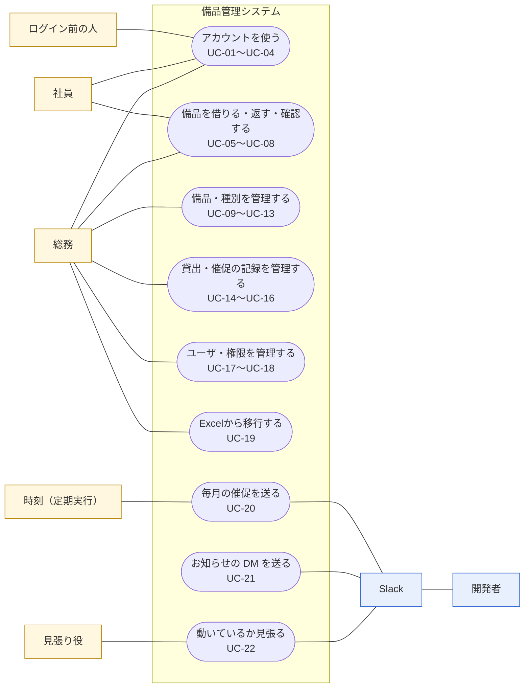
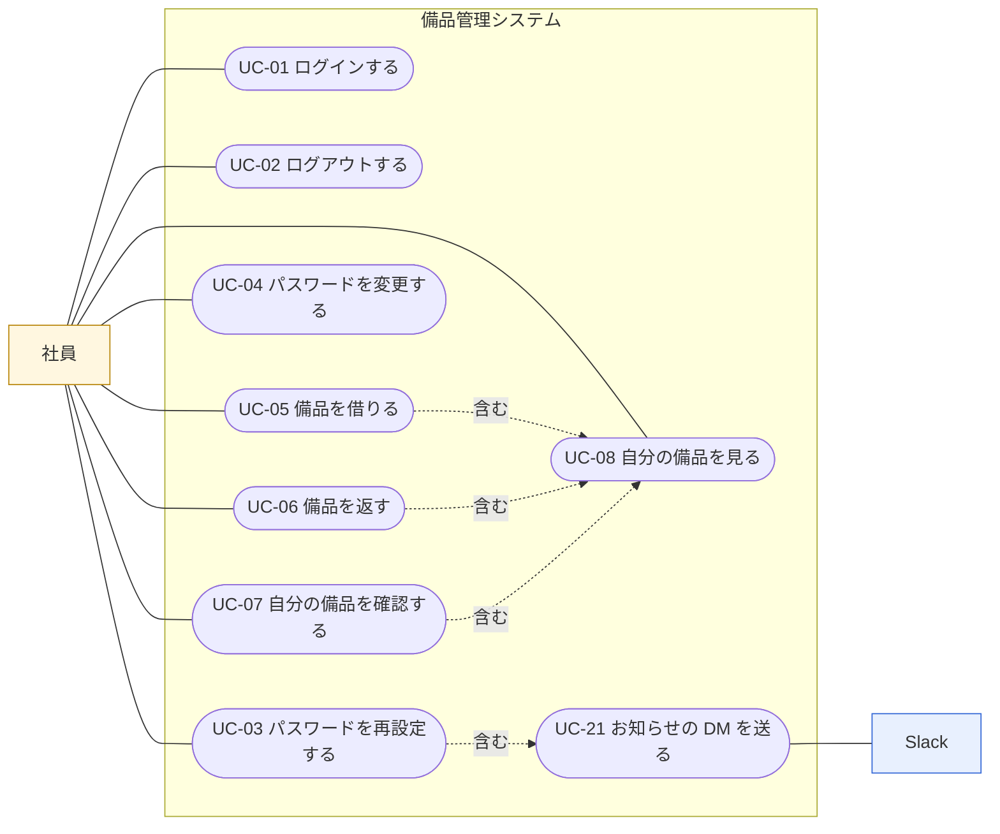
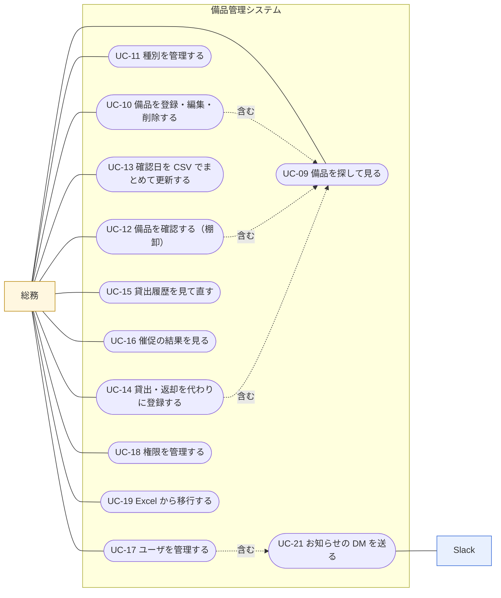
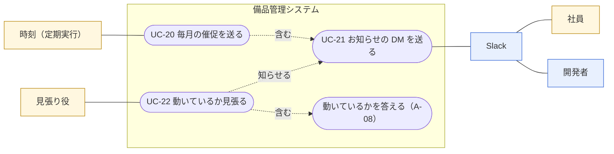

# ユースケース図（v1.0）

| 項目 | 内容 |
|---|---|
| システム | 備品管理システム（equipment_management_system） |
| 版 | v1.0 2026-11-26 |
| もとにした資料 | 要件定義書 3章・4章・5章、機能一覧 v1.1、画面一覧 v1.1、API設計 v1.4 |
| 状態 | 案（人の確認待ち）。確認が済んだら、「確定」に直す |

## 1. この資料について

このシステムで「だれが」「何をするか」を、図と表にまとめた資料。新しい決まりは作らず、ほかの設計書にある内容を、利用者の目線で並べ直している。

- **ユースケース**とは、利用者がシステムを使って達成したいこと（例：備品を借りる）。1つの機能が1つのユースケースとは限らない（1つのユースケースが、複数の機能や画面にまたがることもある）。
- 図は Mermaid（文字で図を書く書き方）で書いている。GitHub では、そのまま絵として表示される。
- 機能 ID（F-xx）は機能一覧、画面 ID（S-xx）は画面一覧、API の番号（A-xx など）は API設計、権限項目のコードはデータ設計5.3 のもの。

## 2. 登場人物

| 登場人物 | 中身 | 使い方 |
|---|---|---|
| 社員 | 一般社員の権限を持つ人。社員全員。スマートフォンで使うことが多い | 備品を借りる・返す・毎月確認する |
| 総務 | 総務の権限を持つ人。総務の担当者 | 備品・種別・貸出履歴・ユーザ・権限の管理。保管中の備品の確認（棚卸）。催促の結果を見る |
| ログイン前の人 | まだログインしていない人 | ログイン、パスワードの再設定（社員・総務のどちらも） |
| 時刻（定期実行） | 毎朝 9:00（日本時間）に、システムの中で自動で動く仕組み | 毎月の催促を始める。人は操作しない |
| Slack | 社内の Slack。システムの外にある別のサービス | システムが、DM を送るために使う |
| 見張り役 | アプリとは別に動く小さなプログラム（AWS の Lambda）。5 分ごとに、アプリが動いているかを確かめる | 止まったとき・戻ったときに、開発者へ知らせる |
| 開発者 | このシステムを作っている 2 人 | 見張り役の知らせを受け取る。祝日のデータを年 1 回入れる |

**権限について**：「社員」「総務」は、最初に用意する 2 つの権限（初期データ）の呼び名。権限は総務が画面から作り変えられるので（F-14・F-15）、実際に何ができるかは、持っている権限項目（18 個）で決まる。この資料の「社員」「総務」は、初期データの権限を持つ人として読む。総務は、社員ができることをすべてできる（総務も備品を借りる。画面一覧 5章 No.3）。

## 3. 全体図

システムの中にあるユースケースと、それを使う登場人物の関係。細かい図は 4〜6 章に分けた。

## 4. 社員のユースケース図

社員がすること。毎月の確認が中心になる。

- UC-05・UC-06・UC-07 は、どれも「自分の備品」画面（S-05）から始める。そのため、UC-08（自分の備品を見る）を含む形で描いた。
- UC-03 で、パスワード設定用のリンクを Slack の DM で受け取る（社員にとっては、DM を受け取るだけ。送るのはシステム）。
- 毎月の催促の DM（UC-20）を受けて、社員は DM のリンクから S-05 を開き、UC-07 を行う。

## 5. 総務のユースケース図

総務は、社員のユースケース（UC-01〜UC-08）もすべて使える。ここには、総務だけのものを描く。

- UC-10・UC-12・UC-14 は、備品一覧（S-07）か備品詳細（S-08）から始めるため、UC-09 を含む形で描いた。
- UC-17 でユーザを登録すると、パスワード設定用のリンクを DM で送る（機能一覧 F-13）。
- UC-19 は、システムを使い始めるときだけ使う（今の Excel から移すため）。ユーザ（S-18）→ 備品（S-20）→ 今貸出中の情報（S-21）の順に取り込む。

## 6. システム・外部サービスのユースケース図

人が操作せずに動くもの。

- UC-20 は、毎朝 9:00 に動き、その月の催促日（25 日。土日祝日なら前の平日）か、それより後で、まだ送っていなければ送る（基本設計書 7章）。
- 見張り役が送る DM（止まった・戻った）の宛先は開発者 2 人。ほかの DM の宛先は、社員か総務（本人）。
- 開発者は、見張り役の DM を受け取る人。年 1 回の祝日のデータの取り込み（機能一覧 7章の 2）は画面のない作業なので、ユースケースにしていない。

## 7. ユースケース一覧

| ID | ユースケース | 登場人物 | 機能 | 画面 | 必要な権限項目 |
|---|---|---|---|---|---|
| UC-01 | ログインする | ログイン前の人（社員・総務） | F-01 | S-01 | なし |
| UC-02 | ログアウトする | 社員・総務 | F-02 | 共通ヘッダー | なし |
| UC-03 | パスワードを再設定する（「パスワードを忘れた」から依頼し、DM のリンクから決める） | ログイン前の人（社員・総務） | F-03 | S-02、S-03 | なし |
| UC-04 | パスワードを変更する | 社員・総務 | F-04 | S-04 | なし |
| UC-05 | 備品を借りる（保管中の備品を選ぶ。借用者は自分、貸出日は登録した日） | 社員・総務 | F-18 | S-06 | LOAN_SELF |
| UC-06 | 備品を返す（返却日は登録した日。メモは任意） | 社員・総務 | F-19 | S-05 | LOAN_SELF |
| UC-07 | 自分の備品を確認する（1 件ずつ、またはまとめて「確認した」） | 社員・総務 | F-07 | S-05 | CONFIRM_SELF |
| UC-08 | 自分の備品を見る（借りている備品と、今月の確認の案内） | 社員・総務 | F-07、F-18、F-19 | S-05 | LOAN_SELF |
| UC-09 | 備品を探して見る（検索・絞り込み・棚卸対象・1 件の詳細と貸出履歴） | 総務 | F-05 | S-07、S-08 | EQUIPMENT_VIEW |
| UC-10 | 備品を登録・編集・削除する（廃棄・不明は管理状態を変えて行う） | 総務 | F-06 | S-09、S-08 | EQUIPMENT_CREATE／EQUIPMENT_UPDATE／EQUIPMENT_DELETE |
| UC-11 | 種別を管理する（追加・変更・削除） | 総務 | F-21 | S-13 | CATEGORY_MANAGE |
| UC-12 | 備品を確認する（棚卸。保管中の備品の最終確認日をその日にする） | 総務 | F-07 | S-07、S-08 | CONFIRM_ALL |
| UC-13 | 確認日を CSV でまとめて更新する（テンプレートをダウンロードし、確認日を入れて取り込む） | 総務 | F-08、F-09 | S-11 | CONFIRM_CSV |
| UC-14 | 貸出・返却を代わりに登録する（借用者・日付を指定する） | 総務 | F-18、F-19 | S-08 | LOAN_MANAGE |
| UC-15 | 貸出履歴を見て直す（誤った履歴の修正・取り消し） | 総務 | F-20 | S-10 | LOAN_HISTORY_VIEW（見る）、LOAN_MANAGE（直す） |
| UC-16 | 催促の結果を見る（いつ・だれに送ったか、送れなかった人はいないか） | 総務 | F-11 | S-12 | REMINDER_LOG_VIEW |
| UC-17 | ユーザを管理する（一覧・登録・編集・削除。登録すると DM でリンクを送る） | 総務 | F-12、F-13 | S-14、S-15 | USER_VIEW／USER_CREATE／USER_UPDATE／USER_DELETE（権限を選ぶには PERMISSION_MANAGE も要る） |
| UC-18 | 権限を管理する（一覧・登録・編集・削除） | 総務 | F-14、F-15 | S-16、S-17 | PERMISSION_VIEW／PERMISSION_MANAGE |
| UC-19 | Excel から移行する（ユーザ・備品・今貸出中の情報を CSV で取り込む） | 総務 | F-16 | S-18、S-20、S-21 | USER_CREATE／EQUIPMENT_CREATE／LOAN_MANAGE |
| UC-20 | 毎月の催促を送る（未確認の備品の借用者に、Slack の DM） | 時刻（定期実行）、Slack | F-10 | なし（結果は S-12） | なし（人は操作しない） |
| UC-21 | お知らせの DM を送る（パスワード関係・ロック・催促・見張り役の知らせ。7 種類） | システム、Slack | F-03、F-10、F-13 | なし | なし |
| UC-22 | 動いているか見張る（5 分ごとに A-08 を呼び、止まったら開発者に DM） | 見張り役、開発者、Slack | なし（基本設計書 8章） | なし | なし |

- 機能 F-17（備品一覧の CSV 出力）は、作らないと決めた機能なので、ユースケースにしていない（機能一覧 12章）。
- UC-08 は、社員が S-05 を開いて一覧を見る操作。UC-05〜UC-07 の途中で必ず通る。1 つのユースケースとして切り出したのは、DM のリンクから S-05 を開くだけの使い方（毎月の催促のあと）があるため。
- UC-12 の権限 CONFIRM_ALL は、総務がふだん確認する保管中の備品のほか、社員が長く休んでいるときの例外にも使える（機能一覧 8章）。

## 8. 決めたこと

| No. | 決めたこと | 根拠 |
|---|---|---|
| 1 | 登場人物は、権限の名前（一般社員・総務）ではなく、初期データの権限を持つ人の呼び名として書く | 権限は総務が作り変えられる（機能一覧 8章） |
| 2 | 総務は、社員のユースケースをすべて使える | 画面一覧 5章 No.3 |
| 3 | UC-20 の起動役は「時刻（定期実行）」とする。システムの中の仕組みだが、人が操作しない動きを図で見せるため、登場人物として描いた | 基本設計書 7章 |
| 4 | 開発者・見張り役・Slack を、登場人物として描く | 基本設計書 6〜8章 |

## 9. 未決事項

なし（v1.0 時点）。ただし、次の点は、人の確認が要る。

| No. | 内容 | 案 |
|---|---|---|
| 1 | UC-08（自分の備品を見る）を別のユースケースにしてよいか | 別にする（DM のリンクから開くだけの使い方があるため） |
| 2 | 「時刻（定期実行）」を登場人物に含めてよいか | 含める（図の見やすさのため） |

## 変更履歴

| 版 | 日付 | 内容 |
|---|---|---|
| v1.0 | 2026-11-26 | 初版。要件定義書 3〜5章、機能一覧 v1.1、画面一覧 v1.1、API設計 v1.4 をもとに作成 |
