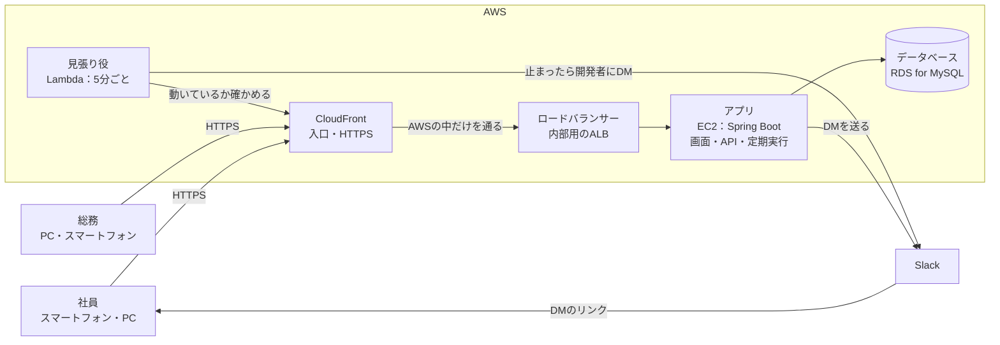

# 基本設計書（v1.2）

| 項目 | 内容 |
|---|---|
| システム | 備品管理システム（equipment_management_system） |
| 版 | v1.2 2026-11-09 |
| もとにした資料 | 要件定義書 1.0（総務の合意待ち） |
| 状態 | 確定（2026-11-03、開発者2人のレビュー済み）。要件定義書の総務との合意で変更が出た場合は、版を上げて直す |

## 1. 基本設計の資料一式

基本設計は、次の資料でできている。この資料（基本設計書）は、システム全体の作り方（方式）と、ほかの資料の案内をまとめたもの。

| 資料 | 版 | 中身 |
|---|---|---|
| 基本設計書（この資料） | v1.1 | システムの構成、AWSの構成、ログイン・Slack連携・定期実行の方式、機能以外の要件の実現方法、環境 |
| 機能一覧 | v1.0 | 20の機能、業務のルール、権限項目 |
| 画面一覧 | v1.0 | 19の画面、画面の移り方、スマートフォン対応 |
| データ設計 | v1.0 | 13のテーブル、テーブルどうしのつながり（ER図）。列の細かい決まりは詳細設計にあたる |

詳細設計にあたる資料は、画面設計（v1.1）、データ設計の列の決まり（v1.0）、API設計（v1.0）、テスト方針（v1.0）、CLAUDE.md。

## 2. システムの構成

利用者はスマートフォンかPCのブラウザで使う。入口はCloudFront（AWSの配信サービス）で、HTTPS（通信の暗号化）はCloudFrontが受け持つ。AWSの上で1つのアプリ（Spring Boot）が、画面のファイルを配ること、APIの受け付け、毎朝の定期実行（催促）をすべて受け持つ。

| 部品 | 役目 |
|---|---|
| CloudFront | 利用者からの通信の入口。CloudFrontが最初から持っているアドレス（例：https://d1234abcd.cloudfront.net の形）と証明書を使い、無料でHTTPSにする |
| ロードバランサー（内部用のALB） | CloudFrontから受けた通信をアプリに渡す。インターネットには出さず、CloudFrontからだけつながる（VPCオリジン＝CloudFrontがAWSの中の非公開の場所に直接つなぐ仕組み） |
| アプリ（EC2） | EC2＝AWSの仮想のサーバー。Spring Bootのアプリを1台で動かす。Reactで作った画面のファイルもここから配る |
| データベース（RDS for MySQL） | RDS＝AWSが管理してくれるデータベース。毎日の自動バックアップを使う |
| 見張り役（Lambda） | Lambda＝サーバーを用意せずに小さなプログラムを動かせるAWSの仕組み。5分ごとにアプリが動いているか確かめ、止まっていたら開発者にSlackのDMで知らせる（8章） |
| Slack | 社内のSlackに入れた「備品管理」アプリ。アプリと見張り役からSlackへDMの送信を頼む |

## 3. AWSの構成

| 項目 | 決めたこと | 理由 |
|---|---|---|
| HTTPS | CloudFrontが最初から持っているアドレスと証明書を使う。自分たちのドメインは取らない（Q1の回答） | 無料でHTTPSにできるため。CloudFrontの従量課金には、毎月1TBの通信と1,000万回のリクエストまでの無料枠がある。このシステムの使い方なら、無料枠に収まる見込み |
| アドレス | 「https://（英数字）.cloudfront.net」の形になり、自分では選べない | 社員は、SlackのDMのリンクか、ブックマークから開く。あとで自分たちのドメインに変えたくなったら、CloudFrontに足すことができる |
| CloudFrontからアプリまで | 内部用のALBを、VPCオリジンとしてCloudFrontにつなぐ。ALBとアプリは、インターネットから直接つながらないようにする | CloudFrontからアプリまでの通信が、インターネットを通らずにAWSの中だけを通るようにするため（パスワードを送るため） |
| アプリを動かす場所 | EC2を1台。外への通信（Slackへの送信など）ができる場所に置き、入ってくる通信はALBからだけ受け付ける | 利用者が社内の人だけで、台数を増やす必要がないため。外への通信のために、費用のかかる仕組み（NATゲートウェイ）を使わずに済むため |
| データベース | RDS for MySQL を1台（1か所の設備だけで動かす形）。アプリからだけつながる | 費用を抑えるため。止まったときの目標（要件定義書12章「平日のうちに復旧」）には、自動バックアップからの戻しで足りる |
| 秘密の情報 | Slackのトークン、データベースのパスワードなどは、AWSの Systems Manager パラメータストア（秘密の値を暗号化して保管する仕組み）に置き、アプリと見張り役が起動時に読む | プログラムや設定ファイルに書かないため（CLAUDE.md 5章） |
| 環境の数 | AWSには1つだけ作り、シナリオテストのあと、データを入れ直して本番として使う（Q2の回答） | 費用を抑えるため |
| 費用 | AWSの料金計算ツールで見積もる（WBSの3.5）。かかるのは主に、ALB・EC2・RDSの時間ごとの料金と、EC2の公開アドレスの料金 | ドメインの費用はかからない |

**CloudFrontを通すための注意（実装のとき）**

| 項目 | 決めたこと |
|---|---|
| キャッシュ | CloudFrontは、ページの中身を一時的に保存して配る（キャッシュ）ことができるが、このシステムでは使わない。ログインした人ごとに中身が変わるため |
| そのまま渡すもの | クッキー、CSRFトークンの見出し（X-XSRF-TOKEN）、アドレスの後ろの条件（?以降）を、そのままアプリに渡す |
| アプリから見た通信 | アプリには、利用者がHTTPSで来たことが伝わるよう、CloudFrontとALBが付ける見出しを信用する設定にする。クッキーにHTTPSのときだけ送る設定（Secure）を付けるため |
| リンクのアドレス | DMに入れるリンクのアドレスは、設定ファイルに書いたCloudFrontのアドレスで作る（画面設計5章・API設計の決まりと同じ） |

**動かし続けることについて**：毎朝9:00に催促の確認が動くため、アプリとデータベースは止めずに動かし続ける。費用を抑えるために夜間止める運用はしない。

## 4. ソフトウェアの構成

| 部分 | 使うもの |
|---|---|
| 言語 | Java 21（開発はTemurin、AWSではAmazon Corretto） |
| サーバーの部品 | Spring Boot、Spring Security（ログインと権限）、MyBatis（データベースの読み書き）、Flyway（テーブルの作成・変更） |
| 画面 | React、TypeScript。作った画面のファイルは、Spring Bootと一緒に配る |
| データベース | MySQL 8（文字コード utf8mb4、照合順序 utf8mb4_ja_0900_as_cs_ks。データ設計2章） |
| 作る道具 | Gradle（サーバー）、npm（画面） |
| 使わないもの | AI機能、メール送信。Docker は、開発のPCで MySQL を動かすためだけに使う（9章）。サーバー・画面と AWS では使わない |

## 5. ログインと権限の方式

| 項目 | 方式 |
|---|---|
| ログイン | メールアドレスとパスワード。ログイン状態はクッキー（ブラウザに保存される小さな情報）で持つ（セッション） |
| ログインしたままにする | Spring Securityの仕組みを使い、60日間有効な合言葉をクッキーとデータベースに持つ（データ設計5.9） |
| パスワードの保存 | 元に戻せない形に変換して保存する（bcrypt）。決まりは画面設計8章 |
| ロック | 5回続けて失敗したらロック。解除はパスワード再設定だけ（画面設計2.1） |
| パスワード再設定 | 合言葉入りのリンクをSlackのDMで送る。30分で無効（画面設計5・6章） |
| 権限 | 権限項目（18個）をプログラムで決め、その組み合わせ（権限）を画面で作る。APIを呼ぶたびにサーバーで確かめ、変更は次の操作から効く（機能一覧8章） |
| なりすまし対策 | CSRFトークン（ほかのサイトから勝手に操作させる攻撃を防ぐ合言葉）を使う（API設計2.2） |

## 6. Slack連携の方式

| 項目 | 方式 |
|---|---|
| Slackアプリ | 社内のSlackに「備品管理」アプリを1つ作って入れる。催促とパスワード関係のお知らせの両方に使う |
| 与える権限（スコープ） | chat:write（メッセージを送る）、users:read.email（メールアドレスからユーザーを探す） |
| 宛先の探し方 | ユーザに登録したメールアドレスで、Slackのユーザーを探す |
| DMの送り方 | 見つかったユーザーに、アプリからメッセージを送る（アプリとのDMに届く）。リンクのプレビューは出さない設定にする（画面設計9章） |
| 送れなかったとき | 催促は催促履歴に「失敗」として残す。パスワード関係は、システムの記録（ログ）に残す |
| 開発・テスト | 開発用に作ったSlackのワークスペース（無料で作れる）に送る。自動テストでは送らずに偽物に置き換える |
| 見張り役からの通知 | 見張り役（Lambda）も同じSlackアプリを使い、開発者2人にDMを送る。宛先の2人のメールアドレスは、パラメータストアに置く |

## 7. 定期実行（Slack催促）の方式

1. アプリの中で、毎朝9:00（日本時間）に催促の処理が動く（Springの定期実行の仕組み）。
2. その月の催促日を計算する。25日が土日祝日なら、前の平日にずらす（祝日はデータベースの祝日の一覧で判定する。データ設計5.13）。
3. 次の3つをすべて満たすときだけ送る。
    1. 今日が平日（土日祝日でない）。
    2. 今日がその月の催促日か、それより後（同じ月の中）。
    3. その月の催促をまだ送っていない（データ設計5.10の reminder_runs で確かめる）。
4. 3の2と3により、催促日にシステムが止まっていても、動き出したあとの平日9:00に送る（要件定義書12章の案）。月が替わったら、前の月の分は送らない。
5. 送った結果（成功・失敗）を催促履歴に残す。

テストでは、今の日時を好きな日に止めて確かめる（テスト方針3章）。

## 8. 機能以外の要件の実現方法

要件定義書12章の案を、どう実現するか。

| 要件 | 実現方法 |
|---|---|
| スマートフォンとPCのブラウザで使える | 画面をスマートフォンの大きさに合わせて作る（画面一覧7章）。アプリのインストールは不要 |
| 社外から使える | CloudFrontをインターネットの入口にし、ログインと権限で守る（3章） |
| 止まったら平日のうちに復旧 | 見張り役（Lambda）が5分ごとにアプリの「動いているか」を答えるAPI（データベースにつながるかも含めて確かめる）を呼ぶ。2回続けて答えがなければ、開発者2人にSlackのDMで「止まっています」と知らせ、戻ったら「戻りました」と知らせる（Q2の回答）。データが壊れたときは、自動バックアップから戻す |
| バックアップを毎日・7日分 | RDSの自動バックアップを、保存期間7日で使う |
| 記録を消さずに残す | 貸出履歴・催促履歴は削除しない。ほかのデータも論理削除にする（データ設計2章） |
| 3秒以内に表示 | 一覧はページを分けて表示し（20件か50件ずつ）、よく探す列に索引を付ける（データ設計6章） |
| 通信の暗号化 | CloudFrontでHTTPSにする。CloudFrontからアプリまではAWSの中だけを通す（3章） |
| だれがいつ変えたか | 主なテーブルに、作った人・変えた人と日時を残す（データ設計2章） |
| アプリの記録（ログ） | アプリのログは、AWSの CloudWatch Logs に送って残す。パスワードや合言葉は書き出さない |
| AWSの費用の見張り | 請求アラート（費用が決めた金額を超えそうなときに知らせる設定）を入れる（WBSの7.1） |

## 9. 環境

| 環境 | 場所 | データベース | 使う目的 |
|---|---|---|---|
| 開発 | 各自のPC（それぞれ決めたドライブの development フォルダ） | equipment_dev（開発用）、equipment_test（自動テスト用） | 実装、単体テスト、結合テスト |
| AWS | AWS（3章）。1つだけ作る | RDS for MySQL | シナリオテスト、その後の本番 |

開発用のPCでは、MySQL だけを Docker（Docker Desktop）で動かす。版（8.4.13）と設定（文字コード・照合順序・データベース・利用者）は Server の compose.yaml に書き、2人のPCで自動で同じになる。Java・Node.js・Eclipse は、PCに直接入れる。版のそろえ方と入れ方は、環境構築手順書に書く。

- Docker は、アプリを、そのアプリに必要なものごと「コンテナ」という箱に入れて動かす道具。MySQL を PC に直接入れるのと比べて、版と設定を2人でそろえやすく、要らなくなったら箱ごと消せる。
- MySQL は、PC の 127.0.0.1 の 3306番で待つ。アプリの接続先の設定は、PC に直接入れたときと同じ。
- AWS では、これまでどおり RDS for MySQL を使う（Docker は使わない）。

## 10. 未決事項

なし（v1.1時点）。要件定義書の合意の結果によって直すことがある。

**決まったこと（v1.0の未決事項）**

| No. | 決まった内容 | 反映先 |
|---|---|---|
| Q1 | 自分たちのドメインは取らない。CloudFrontのアドレスと証明書を使って、無料でHTTPSにする | 2章、3章 |
| Q2 | AWSの環境は1つにし、シナリオテストのあと本番として使う。サーバーが止まったときは、開発者2人にSlackのDMで知らせる | 3章、8章 |

## 変更履歴

| 版 | 日付 | 内容 |
|---|---|---|
| v1.0 | 2026-11-02 | 初版。システム構成、AWS構成、方式、機能以外の要件の実現方法、環境をまとめ、基本設計の資料一式を確定 |
| v1.1 | 2026-11-02 | Q1・Q2の回答を反映。HTTPSを自分たちのドメインなしで行う形（CloudFront）に変え、止まったときに開発者へDMする見張り役（Lambda）を足した |
| v1.1 | 2026-11-03 | 開発者2人のレビューで確定。「仮決め」の印を外した（内容の変更なし） |
| v1.2 | 2026-11-09 | 開発のPCの MySQL を Docker で動かす形に変えた（4章、9章）。PC に MySQL を直接入れると重くなったため。サーバー・画面と AWS は変えない |
