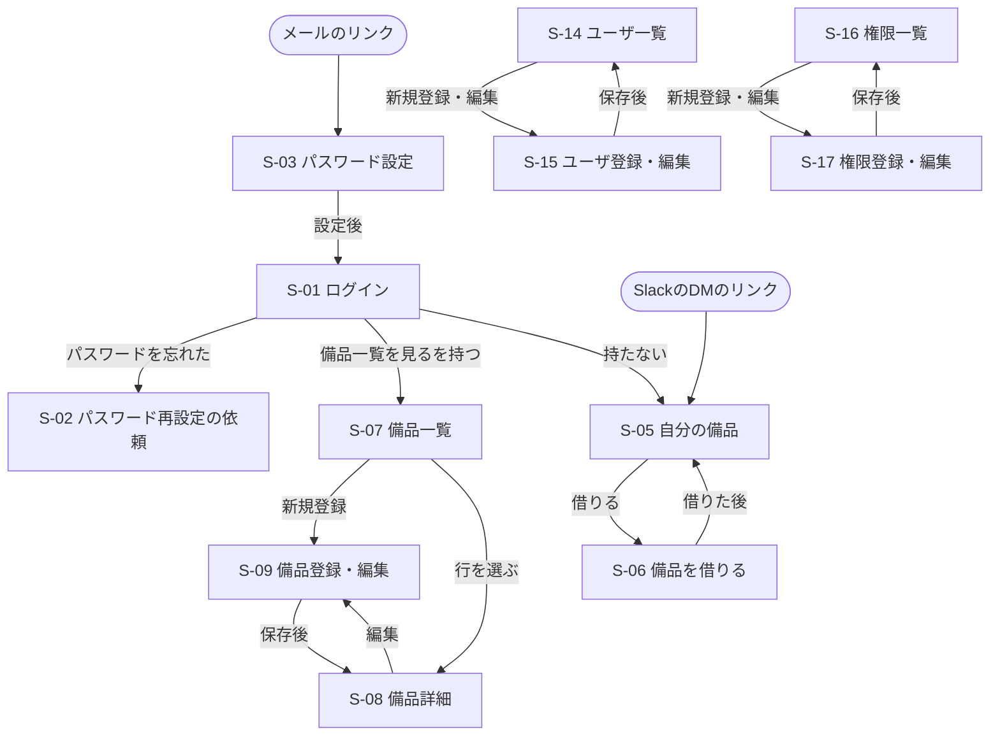

# 画面一覧（v1.0）

| 項目 | 内容 |
|---|---|
| システム | 備品管理システム（equipment_management_system） |
| 版 | v1.0 2026-11-02 |
| もとにした資料 | 機能一覧 v0.4 |
| 状態 | 確定（2026-11-03、開発者2人のレビュー済み）。要件定義書の総務との合意で変更が出た場合は、版を上げて直す |

## 1. 考え方

- 1つの画面に、関係する機能をまとめる。ちょっとした入力（返却のメモ、削除の確認など）は、画面を移らずにその場で開く小さな入力窓（ダイアログ）で行う。
- 画面の上に共通のヘッダー（画面上部の帯）を置き、メニューとログアウト（F-02）を並べる。メニューには、その人の権限で使える画面だけを出す。
- 一般社員がふだん使うのは「自分の備品」と「備品を借りる」の2画面だけにする。
- スマートフォンからの利用が多い前提で作る。どの画面がどこまでスマートフォンに合わせるかは7章。
- F-10 Slack催促は自動で動くので、画面はない（結果は催促履歴で見る）。

## 2. 画面一覧

「区分」：ログイン前＝ログインしなくても開ける画面／共通＝全員が使う画面／社員＝備品を借りる人が使う画面（総務も使う）／総務＝総務の権限を持つ人が使う画面

| ID | 区分 | 画面名 | この画面でできること | 機能ID | 開くのに必要な権限項目 |
|---|---|---|---|---|---|
| S-01 | ログイン前 | ログイン | メールアドレスとパスワードでログインする。「ログインしたままにする」にチェックすると、60日間ログインしたままになる（6章Q3）。「パスワードを忘れた」からS-02へ | F-01 | なし |
| S-02 | ログイン前 | パスワード再設定の依頼 | メールアドレスを入れて、パスワード設定用のリンクを依頼する | F-03 | なし |
| S-03 | ログイン前 | パスワード設定 | メールのリンクから開き、新しいパスワードを2回入れて決める。パスワード初期化とユーザ登録の両方で使う | F-03、F-13 | なし（リンクの合言葉で確かめる） |
| S-04 | 共通 | パスワード変更 | 今のパスワードと新しいパスワードを入れて変える | F-04 | なし（ログイン中なら全員） |
| S-05 | 社員 | 自分の備品 | 自分が借りている備品の一覧。各備品の「確認した」「返す」ボタンと、借りている備品をまとめて確認済みにする「まとめて確認した」ボタン。「借りる」からS-06へ。今月確認済みでない備品には印を付ける | F-07、F-19 | 備品を借りる・返す（自分） |
| S-06 | 社員 | 備品を借りる | 保管中の備品を、種別・管理番号・メーカー・モデルで探して選び、返却予定日（任意）を入れて借りる | F-18 | 備品を借りる・返す（自分） |
| S-07 | 総務 | 備品一覧 | 検索・絞り込み（管理状態・貸出状態・今月確認済みかどうか・種別）。今のExcelと同じ色分け。各行の「確認した」ボタン。「新規登録」からS-09へ、行を選ぶとS-08へ | F-05、F-07 | 備品一覧を見る |
| S-08 | 総務 | 備品詳細 | 1つの備品の情報と、その備品の貸出履歴を見る。「編集」からS-09へ。削除、総務による貸出・返却の登録（借用者と日付を指定）をここから行う | F-05、F-06、F-18、F-19、F-20 | 備品一覧を見る |
| S-09 | 総務 | 備品登録・編集 | 備品の項目を入れて登録・変更する。管理状態を廃棄にするときは廃棄日も入れる | F-06 | 備品を登録する、または備品を編集する |
| S-10 | 総務 | 貸出履歴 | すべての貸出履歴を、管理番号・借用者・期間で探す。誤った履歴を修正する | F-20 | 貸出履歴を見る |
| S-11 | 総務 | 最終確認日の一括更新 | テンプレートをダウンロードし、埋めたファイルをアップロードする。取り込みの結果（更新した件数、エラーの行と理由）を表示する | F-08、F-09 | 最終確認日をCSVで一括更新する |
| S-12 | 総務 | 催促履歴 | いつ・だれに送ったか、送れなかったかを見る | F-11 | 催促履歴を見る |
| S-13 | 総務 | 種別管理 | 種別（頭文字と名前）の一覧。追加・変更・削除はダイアログで行う | F-21 | 種別を管理する |
| S-14 | 総務 | ユーザ一覧 | ユーザを氏名・メールアドレス・権限で探す。「新規登録」と各行の「編集」からS-15へ。削除もここから行う | F-12、F-13 | ユーザを見る |
| S-15 | 総務 | ユーザ登録・編集 | メールアドレス・氏名・権限を入れて登録・変更する。権限の欄は「権限を管理する」を持つ人だけが変えられる | F-13 | ユーザを登録する、またはユーザを編集する |
| S-16 | 総務 | 権限一覧 | 権限と、それぞれに含まれる権限項目、割り当てられている人数を見る。「新規登録」と各行の「編集」からS-17へ | F-14 | 権限を見る |
| S-17 | 総務 | 権限登録・編集 | 権限の名前を入れ、権限項目にチェックを付けて登録・変更する。削除もここから行う | F-15 | 権限を管理する |
| S-18 | 総務 | 一括登録（移行） | 備品・ユーザ・今貸出中の情報のCSVを取り込む。結果（登録した件数、エラーの行と理由）を表示する | F-16 | 備品を登録する、ユーザを登録する、貸出・返却を管理する（取り込むデータに応じて） |
| S-19 | 共通 | エラー | 権限がない、ページが見つからない、システムの不具合などのときに表示する | ― | なし |

**主なダイアログ（その場で開く小さな入力窓）**

| 開く画面 | ダイアログ | 内容 |
|---|---|---|
| S-05 | 返す | 返却日（登録した日）を確かめ、メモ（破損などの特記事項）を任意で入れる |
| S-08 | 貸出・返却の登録（総務） | 借用者・日付を指定して、貸出または返却を登録する |
| S-08、S-14、S-17 | 削除の確認 | 「本当に削除しますか」と確かめる |
| S-10 | 貸出履歴の修正 | 誤った貸出日・返却日・借用者などを直す |
| S-13 | 種別の追加・変更 | 頭文字と名前を入れる |

## 3. 機能と画面の対応

すべての機能が、どこかの画面で使えることの確認用。

| 機能ID | 機能名 | 画面 |
|---|---|---|
| F-01 | ログイン | S-01 |
| F-02 | ログアウト | 共通ヘッダー |
| F-03 | パスワード初期化 | S-02、S-03 |
| F-04 | パスワード変更 | S-04 |
| F-05 | 備品一覧 | S-07、S-08 |
| F-06 | 備品登録/削除/編集 | S-08（削除）、S-09 |
| F-07 | 手動での備品確認日更新 | S-05（自分の分）、S-07（すべて） |
| F-08 | 確認用CSVテンプレートのダウンロード | S-11 |
| F-09 | CSVアップロードでの備品確認日更新 | S-11 |
| F-10 | Slack催促（自動） | 画面なし（結果はS-12） |
| F-11 | 催促履歴 | S-12 |
| F-12 | ユーザ一覧 | S-14 |
| F-13 | ユーザ登録/編集/削除 | S-14（削除）、S-15、S-03（最初のパスワード） |
| F-14 | 権限一覧 | S-16 |
| F-15 | 権限登録/編集/削除 | S-17 |
| F-16 | 備品・ユーザのCSV一括登録 | S-18 |
| F-18 | 貸出登録（借りる） | S-06（自分）、S-08（総務） |
| F-19 | 返却登録（返す） | S-05（自分）、S-08（総務） |
| F-20 | 貸出履歴 | S-08（その備品の分）、S-10（すべて） |
| F-21 | 種別一覧・登録/編集/削除 | S-13 |

## 4. 画面遷移図

矢印は「この画面からこの画面へ移れる」ことを表す。共通ヘッダーのメニューからは、権限のある画面ならどこへでも移れる（図では省略）。GitHubでは、下の図がそのまま絵として表示される（Mermaid という、文字で図を書く書き方）。

メニューから開く画面：S-04 パスワード変更、S-05 自分の備品、S-07 備品一覧、S-10 貸出履歴、S-11 最終確認日の一括更新、S-12 催促履歴、S-13 種別管理、S-14 ユーザ一覧、S-16 権限一覧、S-18 一括登録（移行）

## 5. 決めたこと

1. ログイン後の最初の画面は、「備品一覧を見る」を持つ人はS-07、持たない人はS-05（機能一覧F-01のとおり）。
2. SlackのDMに「自分の備品」画面（S-05）へのリンクを入れる。ログインしていなければ、ログインのあとS-05に移る。
3. 総務も備品を借りるので、総務のメニューにもS-05・S-06を出す。
4. 備品の登録と編集、ユーザの登録と編集、権限の登録と編集は、それぞれ同じ画面を使う（入力する項目がほぼ同じため）。
5. 削除は、確認のダイアログを出してから行う。
6. 一覧の画面は、件数が多いときはページを分けて表示する（例：50件ずつ）。

## 6. 未決事項

なし（v0.3時点）。

**決まったこと（v0.2の未決事項）**

| No. | 決まった内容 | 反映先 |
|---|---|---|
| Q3 | 「ログインしたままにする」を使えるようにし、期間は60日間とする。ログイン画面のチェック欄にチェックしたときだけ有効にする。ログアウトしたとき、パスワードを変えた・再設定したときは解除する | S-01、機能一覧F-01 |
| Q4 | QRコードで「借りる」画面を開く仕組みは作らない | ― |

**決まったこと（v0.1の未決事項）**

| No. | 決まった内容 | 反映先 |
|---|---|---|
| Q1 | スマートフォンでも使う。スマートフォンからの利用のほうが多いかもしれない | 1章、7章 |
| Q2 | S-05に「まとめて確認した」ボタンを付ける | S-05 |

## 7. スマートフォン対応（案）

| 対応 | 画面 | 内容 |
|---|---|---|
| スマートフォン優先 | S-01〜S-06、S-19 | スマートフォンの画面を先に考えて作り、PCでも使えるようにする。ボタンは指で押しやすい大きさにし、横にスクロールしなくても使えるようにする |
| スマートフォンでも見られる | S-07、S-08、S-10、S-12 | PCを前提に作るが、スマートフォンでも表示が崩れないようにする（広い表は横にスクロールして見る）。総務が備品の前で確認するときに使えるようにするため |
| PCだけ | S-09、S-11、S-13〜S-18 | PCで使う前提にする。入力する項目が多い画面や、ファイルを扱う画面のため |

## 変更履歴

| 版 | 日付 | 内容 |
|---|---|---|
| v0.1 | 2026-11-02 | 初版。機能一覧 v0.4 をもとに作成 |
| v0.2 | 2026-11-02 | Q1・Q2の回答を反映。スマートフォン対応（7章）を追加し、S-05に「まとめて確認した」ボタンを足した |
| v0.3 | 2026-11-02 | Q3・Q4の回答を反映。ログインしたままにする期間を60日間とした。QRコードは作らない。未決事項がなくなり、画面の洗い出しを完了 |
| v1.0 | 2026-11-02 | 基本設計の完成版とした（内容の変更なし） |
| v1.0 | 2026-11-03 | 開発者2人のレビューで確定。「仮決め」の印を外した（内容の変更なし） |
