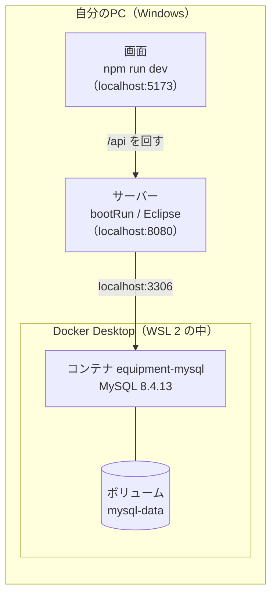

# Docker Desktop 手順書（v1.0）

| 項目 | 内容 |
|---|---|
| システム | 備品管理システム（equipment_management_system） |
| 版 | v1.0 2026-11-13 |
| Jira | なし |
| もとにした資料 | 環境構築手順書 v2.1 の1・4・5・6・7章、Server の compose.yaml・.env.example・docker/mysql/init/、詳細設計 common.md 4章 |
| 状態 | 作成中。コマンドと表示（版、ボリュームの名前、イメージの大きさ、コンテナが `healthy` になること）は、Linux の Docker 29.9.2 で確かめた。Windows の画面の操作（インストーラーの選び方、.wslconfig、設定画面）は、環境構築手順書 v2.1 の手順4に書いてあるとおりで、この手順書を書いた人は Windows で動かしていない。2人目のPCで通して確かめる |

開発用の Windows のPCに、Docker Desktop を入れ、MySQL を動かし、毎日使い、困ったときに直すための手順書。

- この手順書は、環境構築手順書の手順4・5と6・7章を、Docker だけに絞って、初めての人にも分かるようにくわしく書き直したもの。道具の版や決まりの正本は、環境構築手順書。食い違ったときは、環境構築手順書が正しい。
- 手順の番号は、この手順書の中だけのもの。環境構築手順書の「手順4」（Docker Desktop を入れる）は、ここの2・3章に、「手順5」（MySQL のコンテナを作る）は、ここの4章に当たる。

## 1. Docker とは（この開発での使い方）

### 1.1 用語

| 用語 | 意味 |
|---|---|
| Docker | アプリを、そのアプリに必要なものごと「箱」に入れて動かす道具 |
| コンテナ | その箱。この開発では、MySQL が入った箱が1つ（名前は `equipment-mysql`） |
| イメージ | コンテナのもとになるファイル一式。MySQL のイメージ（`mysql:8.4.13`）は、展開すると約 1.1GB。最初の起動のときに、インターネットから自動でダウンロードされる |
| ボリューム | コンテナを消しても残る、データの置き場所。この開発では、MySQL の `mysql-data`（データベースの中身が入る）。Docker Desktop や `docker volume ls` では、Server のフォルダ名を小文字にした `equipmentmanagementsystem_server_mysql-data` という名前で出る |
| Docker Desktop | Windows で Docker を使うためのアプリ。画面（ダッシュボード）で、コンテナの動き具合を見たり、止めたりできる |
| WSL 2 | Windows の中で Linux を動かす仕組み。Docker Desktop は、この中で Docker を動かす |
| Docker Compose | 「どのイメージを、どの設定で動かすか」を1つのファイルに書いておき、1つのコマンドで動かす仕組み。`docker compose ...` と打つ |
| compose.yaml | その設定のファイル。Server のフォルダにある。MySQL の版・文字コード・メモリの上限などが書いてある。2人のPCで、自動で同じ設定になる |
| .env | MySQL のパスワードを書くファイル。Server のフォルダに各自が作る。Git で管理しない（公開しない） |

### 1.2 どこに何があるか

Docker を使うのは **MySQL だけ**。サーバー（Spring Boot）・画面（Vite）・Eclipse は、これまでどおり PC で直接動かす（環境構築手順書 1.1）。



- MySQL には、PC の中（127.0.0.1）からだけつなげる。ほかのPCからは、つなげない（compose.yaml の `ports`）。
- 中のデータベースは2つ：`equipment_dev`（開発用）と `equipment_test`（自動テスト専用。開発用でテストしない。CLAUDE.md 6章）。アプリ用のユーザ `equipment` が、どちらも使える。
- データベースとユーザは、**最初に起動したときだけ**作られる。2回目からは、ボリュームに残っているものを使う。

## 2. 入れる前に確かめる

| 確かめること | 方法・決まり |
|---|---|
| Windows の版 | Windows 11、または Windows 10 の 22H2 以降。`Win + R` で `winver` と打つと分かる |
| 会社で使ってよいか | Docker Desktop は、従業員 250 人未満かつ年間売上 1,000 万ドル未満の会社なら無料で使える。それより大きい会社は、有料の契約が要る。会社の規模が当てはまるかを、先に確かめる（環境構築手順書 手順4-1） |
| 直接入れた MySQL がないか | 動いていると 3306番がぶつかって、MySQL のコンテナが起動しない。ある人は、先に環境構築手順書の5章で止める |
| 空き | MySQL のイメージ（約 1.1GB）と、データの分のディスクの空き。メモリは、手順 3-3 で上限を決める |

## 3. Docker Desktop を入れる

### 3-1. 入れる

1. https://www.docker.com/products/docker-desktop/ から、Windows 用（AMD64）の Docker Desktop をダウンロードして入れる（管理者の権限が要る）。
2. 入れるときの「Configuration」の画面では、次を選ぶ（どちらも最初から選ばれている）。
   - 「Per-user installation (Recommended)」：自分のユーザーにだけ入れる。管理者の権限が要らない
   - 「WSL 2」：Windows の中で Linux を動かす仕組み
   - 「Allow Windows Containers」は使わないので、印を付けない
   - 古い版のインストーラーで「Use WSL 2 instead of Hyper-V」と出たら、それに印を付ける
3. WSL が入っていない PC では、管理者のパスワードを聞かれることがある。
4. 入れ終わったら PC を再起動し、Docker Desktop を起動する。アカウントの登録（サインイン）は、しなくても使える。

「仮想化が無効」というエラーが出たら、PC の BIOS（電源を入れた直後に動く設定画面）で、仮想化（Intel VT-x、AMD-V など）を有効にする。やり方は PC の機種で違う。

### 3-2. 動いていることを確かめる

Docker Desktop を起動して、画面の左下が緑（Engine running）になるまで待つ。そのあと、**新しく開いた** PowerShell で次を打つ。

```powershell
docker --version
docker compose version
docker info
```

**完了条件**：最初の2つが版を表示し、`docker info` がエラーにならない。

- 版は最新でよい（環境構築手順書 1.1）。作者が確かめたときは、Docker 29.9.2・Docker Compose v5.6.1 だった。
- `docker info` が `error during connect` などで失敗するときは、Docker Desktop がまだ動いていない（6章）。
- `docker` が見つからないときは、PowerShell を開き直す（入れる前に開いていた PowerShell には、入れた道具の場所が伝わらないため）。

### 3-3. 使うメモリの上限を決める（PC を重くしないため）

上限を決めないと、Docker Desktop（WSL 2）は PC のメモリの半分ほどまで使うことがある。

1. 自分のユーザーのフォルダ（`%UserProfile%`。例：`C:\Users\<ユーザー名>`）に、メモ帳で `.wslconfig` という名前のファイルを作り、次を書いて保存する。「ファイルの種類」を「すべてのファイル」にして、`.wslconfig.txt` にならないようにする。

   ```ini
   [wsl2]
   memory=2GB
   ```

2. PowerShell で `wsl --shutdown` を打つ。
3. Docker Desktop を起動し直す。

- MySQL のコンテナ自体も、compose.yaml で 1GB までに決めてある。2GB は、Docker Desktop が動くための分を足した値。
- PC のメモリが 16GB 以上あり、ほかでも Docker を使う人は、もっと大きくしてよい。

### 3-4. PC の起動のときに自動で起動しない（任意）

使わないときに PC を重くしたくない人は、Docker Desktop の Settings →「General」→「Start Docker Desktop when you sign in to your computer」の印を外す。外したら、開発を始めるときに自分で Docker Desktop を起動する（5章）。

## 4. MySQL のコンテナを作る

### 4-1. .env を作る

1. Server のフォルダで、`.env.example` をコピーして `.env` を作る。
2. `MYSQL_ROOT_PASSWORD`（MySQL の管理者のパスワード）と `MYSQL_PASSWORD`（アプリ用のユーザ `equipment` のパスワード）を、自分で決めて書く。
3. `MYSQL_PORT` は 3306 のままにする。

- `MYSQL_PASSWORD` は、Server の `secret.yml` の `spring.datasource.password` にも、同じ値を書く（環境構築手順書 手順6）。サーバー（Spring Boot）は .env を読まないため。
- .env は Git で管理しない。**Claude Code に中身を見せない。会話や Slack に書かない。**

### 4-2. 作って起動する

Server のフォルダで次を打つ。

```powershell
docker compose up -d
```

- `-d` は、裏で動かす指定。PowerShell を閉じても MySQL は動き続ける。
- 最初は、MySQL のイメージのダウンロードで数分かかる。2回目からは、すぐ終わる。
- 最初の起動のときだけ、データベース2つとユーザ `equipment` が作られる。

### 4-3. 動いているかを確かめる

```powershell
docker compose ps
```

STATUS が `healthy` になるまで、30秒ほど待つ。`starting` の間は、まだ準備中。

**完了条件**：`equipment-mysql` の STATUS が `healthy`（例：`Up 12 seconds (healthy)`）になる。

## 5. 毎日の使い方

### 5.1 始める・終わる

| いつ | することと、コマンド（Server のフォルダで） |
|---|---|
| 始めるとき | Docker Desktop を起動し（自動で起動する設定なら要らない）、`docker compose up -d`。動いたままなら、何もしなくてよい |
| 確かめるとき | `docker compose ps` で `healthy` |
| 終わるとき | `docker compose stop`（MySQL を止める。データは残る）。そのあと Docker Desktop を終わらせると、PC のメモリが空く |

### 5.2 コマンドの違い

| コマンド（Server のフォルダで） | すること | データ |
|---|---|---|
| `docker compose up -d` | MySQL を起動する（なければ作る） | 残る |
| `docker compose stop` | MySQL を止める | 残る |
| `docker compose down` | コンテナを消す（次の `up -d` で作り直す） | 残る（ボリュームは消えない） |
| `docker compose down -v` | コンテナとデータを両方消す | **消える** |

- **`docker compose down -v` は、データベースの中身がすべて消える。** 次の `up -d` で、データベースとユーザが作り直される。テーブルと開発用のユーザは、サーバーを起動すると Flyway（テーブルを作る仕組み）が作り直す。使う前に、本当に消してよいかを人に確かめる（Server の CLAUDE.md 3章）。
- 迷ったときは、`stop` と `up -d` だけで足りる。

### 5.3 Docker Desktop の画面で見る

Docker Desktop を開き、左の「Containers」を選ぶと、`equipment-mysql` が一覧に出る。

- 実行中かどうかが分かる。再生・停止のボタンで、起動・停止もできる（`docker compose` のコマンドと同じ結果になる）。
- コンテナを選ぶと、MySQL のログが読める。

### 5.4 ログと中のデータベースを見る

```powershell
docker compose logs --tail 30 mysql
docker compose exec mysql mysql -u equipment -p
```

- 1つめは、MySQL の最後のログ30行を出す。起動に失敗したときの手がかりになる。`ready for connections` と出ていれば、つながる準備ができている。
- 2つめは、MySQL の中に入る。パスワードは、4-1 で決めた `MYSQL_PASSWORD`。入ったら `SHOW DATABASES;` で `equipment_dev` と `equipment_test` が出る。`exit` で抜ける。
- パスワードは、コマンドの中に書かず、聞かれてから入力する（画面に残さないため）。

## 6. つまずいたとき

| 出たもの | 原因と直し方 |
|---|---|
| `docker` が見つからない | PowerShell を開き直す。それでも出ないときは、Docker Desktop が入っていない、または入れたあとで再起動していない |
| `docker info` が `error during connect` などで失敗する | Docker Desktop が動いていない。スタートメニューから起動し、左下が緑（Engine running）になるまで待つ |
| 「仮想化が無効」「WSL 2 が入っていない」と出て Docker Desktop が起動しない | BIOS の仮想化を有効にする（3-1）。WSL が古いときは、PowerShell で `wsl --update` を打つ |
| `docker compose up -d` で `.env に MYSQL_ROOT_PASSWORD を書いてください`（または `MYSQL_PASSWORD`）と出る | Server のフォルダに .env がない、または値が空。4-1 |
| `docker compose up -d` で `ports are not available`・`address already in use`（3306） | PC に直接入れた MySQL が 3306番を使っている。環境構築手順書の5章で止める |
| `docker compose ps` で `healthy` にならない（`unhealthy` のまま、または `starting` のまま変わらない） | `docker compose logs --tail 30 mysql` でログを読む。メモリ不足のときは、3-3 の上限を大きくする |
| `Communications link failure`（サーバーやテストで） | MySQL が動いていない、または準備中。Docker Desktop を起動し、`docker compose up -d` → `docker compose ps` で `healthy` を待つ |
| `Access denied for user 'equipment'` | secret.yml のパスワードが、.env の `MYSQL_PASSWORD` と違う。または secret.yml の場所が違う（build.gradle と同じフォルダに置く）。**コンテナを作ったあとで .env のパスワードを変えても、MySQL の中のパスワードは変わらない**（最初の起動のときだけ使われるため）。変えたいときは、`docker compose down -v`（データも消える）→ `docker compose up -d` で作り直す |
| `Unknown database 'equipment_test'`（テストが失敗する） | 最初の起動の前に docker/mysql/init がなかった（古い Server で作った）など。`docker compose down -v` → `docker compose up -d` で作り直す |
| PC が重い | 3-3 のメモリの上限を確かめる。使わないときは `docker compose stop` で MySQL を止め、Docker Desktop も終わらせる |
| Docker Desktop を入れたら、会社の利用条件が心配 | 2章の表。会社の規模が当てはまるかを、人に確かめる |

## 7. 版を上げるとき

MySQL の版は、Server の compose.yaml の `image: mysql:<版>` で決まる。勝手に変えない。2人で相談して決め、Server のプルリクエストにする（環境構築手順書 9章）。

8.4 系の中で上げる場合（例：8.4.13 → 8.4.14）、データはそのまま使える。compose.yaml が変わったものを取ってきたら、Server のフォルダで `docker compose up -d` を打つ。新しい版のイメージを取ってきて、コンテナを作り直す（ボリュームのデータはそのまま）。

## 変更履歴

| 版 | 日付 | 内容 |
|---|---|---|
| v1.0 | 2026-11-13 | 初版。環境構築手順書 v2.1 の手順4・5と6・7章のうち、Docker に関わる所を、初めての人にも分かるように、1つにまとめた |
