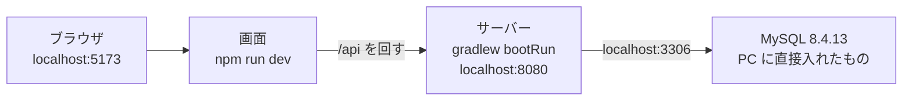

# はじめての環境構築ガイド（v2.0）

| 項目 | 内容 |
|---|---|
| システム | 備品管理システム（equipment_management_system） |
| 版 | v2.0 2026-11-14 |
| Jira | なし |
| もとにした資料 | 環境構築手順書 v3.0、skill env-setup（Document の .claude/skills/env-setup/SKILL.md）、CLAUDE.md 3・4・6・7章、Server の secret.example.yml、Server の CLAUDE.md 3章、Client の CLAUDE.md 3章 |
| 状態 | 作成中。MySQL を Docker で動かす形（v1.1）をやめ、PC に直接入れる形にした（v2.0）。コマンドと設定値は、Linux の環境で、設定を付けない素の MySQL 8.4.13 に、手順 7 の SQL を流して確かめた（サーバーのテスト 235 件、画面のテスト 112 件のうち 100 件成功・12 件スキップ、開発用の起動と /api/health）。Windows の画面の操作と、MySQL の zip の入れ方（手順 6）は、環境構築手順書に書いてあるとおりで、この手順書を書いた人は Windows では動かしていない。7章（Claude Code に手伝ってもらう場合）は、skill env-setup の内容と決まりから書いたもので、新しい Windows の PC では通していない。この手順書だけを見て、初めての人が通せるかを、1人に確かめてもらう |

**このプロジェクトに初めて入る人が、自分の Windows の PC に開発環境を一から作るための手順書。** プログラミングやデータベースに慣れていなくても進められるように、用語はその場で説明している。

- 開発に Claude Code（AI の道具）は**要らない**。使いたい人だけ、手順 14 で入れる。Claude Code に環境づくりを手伝ってもらうときに、どこまで任せられるかは、7章に書いた。
- 道具の版や決まりの正本は、環境構築手順書。この手順書と食い違ったときは、環境構築手順書が正しい。

## 1. 何を作るのか（全体像）

### 1.1 入れるもの

| 道具 | 何のための道具か | 版 |
|---|---|---|
| Git for Windows | ソースの履歴を管理する道具（Git）を、Windows で使えるようにしたもの。ソースを GitHub から取ってくるのに使う | 問わない |
| Java（Eclipse Temurin） | サーバー（API のプログラム）を動かすのに要る。Temurin は、無料で使える Java の配布元の1つ | **21** |
| MySQL Community Server | データベース（備品や貸出の記録をしまっておく場所）の製品。サーバーがつなぐ先になる。PC に直接入れて、Windows のサービス（PC の起動で自動で動くプログラム）として動かす | **8.4.13** |
| Node.js | 画面（ブラウザに出る部分）を作る道具（npm という部品の管理の道具が付いてくる） | **24.12.0** |
| Eclipse | サーバーのソースを読み書きするエディタ（ソースを編集するアプリ）。ほかのエディタでもよい | 2025-09 以降 |
| Claude Code | AI が開発を手伝う道具。**任意** | 最新 |

- サーバーの組み立ての道具（Gradle）、サーバーと画面の部品（Spring Boot、React など）、テストの道具（Playwright）は、自分で入れなくてよい。ソースの中に版が書いてあり、手順 9・11 で自動で入る。**版を勝手に変えない**（CLAUDE.md 3章）。

### 1.2 できあがりの姿



- ブラウザで開く画面と、API を動かすサーバーと、データベース（MySQL）が、すべて**自分の PC の中**で動く。ほかの人の PC や会社のサーバーには、つながらない。
- MySQL も、Java などと同じように、PC に直接入れる。Docker は使わない（CLAUDE.md 3章）。

### 1.3 3つのリポジトリ

リポジトリは、GitHub 上のソースの保管場所のこと。このシステムは、3つに分かれている。**3つとも、同じフォルダの中に並べて**取ってくる（設計書の中のパスが、この並び方を前提にしているため）。

| リポジトリ | 中身 |
|---|---|
| EquipmentManagementSystem_Server | サーバー（Spring Boot の API、データベースの設定、サーバーのテスト） |
| EquipmentManagementSystem_Client | 画面（React、画面のテスト） |
| EquipmentManagementSystem_Document | 設計書、手順書、テストの証跡（結果の記録） |

## 2. 始める前に

| 確かめること | 決まり |
|---|---|
| Windows の版 | Windows 11、または Windows 10 の 22H2 以降。`Win + R` を押して `winver` と打つと分かる |
| 管理者の権限 | 道具を入れるときに要る。自分で判断して行う |
| ディスクの空き | 道具とデータで、数 GB は要る |
| すでに PC にある MySQL、以前に Docker で動かした MySQL | **3306番を取り合う**。MySQL が1つだけ動くように、手順 4 で片づける |
| ネットワーク | 道具と部品を、インターネットからたくさんダウンロードする。会社のネットワークで外への接続が制限されているときは、人に相談する |

**この手順書での約束**
- コマンドは **PowerShell**（Windows に入っているコマンドの入力画面。スタートメニューで「PowerShell」と打つと出る）で打つ。
- `<development>` は、自分で決めた作業用のフォルダの名前に読み替える（手順 2）。
- 各手順の最後の「**完了条件**」を満たしたことを確かめてから、次に進む。
- **パスワードは、メモ帳などのファイルにだけ書く。Slack・メール・会話・Claude Code に書かない。**

## 3. 手順

### 手順1：Git を入れる

1. https://git-scm.com/ から Git for Windows をダウンロードして入れる。設定は、すべて最初のままでよい。
2. PowerShell を**新しく開いて**、次を打つ。

```powershell
git --version
```

**完了条件**：`git version 2.…` のように版が出る。

- 道具を入れる前から開いていた PowerShell には、入れた道具の場所が伝わらない。「見つからない」と出たら、PowerShell を開き直す。

### 手順2：作業用のフォルダを作る

1. 自分で決めた場所に、`development` という名前のフォルダを作り、その中に `workspace` フォルダを作る。
   - 場所は、**ドライブの直下や、短い英数字だけの名前**にしておくと、あとで困りにくい（例：`C:\development\workspace`）。日本語や空白を含む場所は避ける（推奨。この手順書を書いた人が、特定のエラーを確かめたわけではない）。
   - ドライブ名や個人のフォルダの名前は、設計書やソースには書かない（CLAUDE.md 5章）。人それぞれ違ってよい。
2. PowerShell で、そのフォルダに移る。

```powershell
cd C:\development\workspace
```

（`C:\development\workspace` は、自分で作った場所に読み替える）

**完了条件**：`pwd` と打つと、`workspace` フォルダの場所が出る。

### 手順3：3つのリポジトリを取ってくる

「クローン」は、GitHub 上のリポジトリを、自分の PC に丸ごとコピーすること。3つとも公開されているので、GitHub のアカウントがなくても取ってこられる（ソースを直して GitHub に送るには、アカウントと、リポジトリへの招待が要る。その手順はこの手順書では扱わない）。

`workspace` フォルダの中で、次の3つを打つ。

```powershell
git clone https://github.com/sekiyak611/EquipmentManagementSystem_Server.git
git clone https://github.com/sekiyak611/EquipmentManagementSystem_Client.git
git clone https://github.com/sekiyak611/EquipmentManagementSystem_Document.git
```

**完了条件**：`workspace` の中に、次の3つのフォルダが並んでいる。

```
<development>\workspace
├─ EquipmentManagementSystem_Server
├─ EquipmentManagementSystem_Client
└─ EquipmentManagementSystem_Document
```

- フォルダの名前は、そのままにする（変えない）。
- 取ってきた直後は、`release/main` というブランチ（ソースの枝。このプロジェクトの親になる枝）になっている。このままでよい。
- すでに取ってあるときは、各フォルダで `git fetch` のあと `git switch release/main` と `git pull` で最新にする。

### 手順4：今ある MySQL・Docker の MySQL を片づける（ある人だけ）

このプロジェクトの MySQL は、手順 6 で PC に直接入れ、3306番で動かす。3306番は、MySQL が1つしか使えない。次の人は、ここで片づける。どちらでもない人は、この手順を飛ばす。テーブルは、あとで自動で作り直されるので、どの MySQL にも残すべきデータはない（手で入れたデータが要る人は、先に控える）。

1. PowerShell で `Get-Service *mysql*` と打つ。何も出ず、Docker も使っていなければ、飛ばしてよい。
2. **以前、Docker で MySQL を動かしていた人**（2026-11-09〜11-14 の手順）。次を打って、コンテナ（Docker の箱）を止める。

```powershell
docker stop equipment-mysql
```

   Docker Desktop は、ほかで使わなければ、Windows の「設定」→「アプリ」からアンインストールしてよい（くわしくは環境構築手順書の5章）。
3. **PC に直接入れた MySQL がある人**（例：`MySQL84`、`MYSQL80`）。`Get-Service *mysql*` で、名前と状態（Status）を確かめる。
   - 8.4.13 のサービスが止まっているだけなら、そのまま使える。管理者の PowerShell で `Set-Service MySQL84 -StartupType Automatic` と `Start-Service MySQL84` を打ち（名前は確かめたものにする）、`mysql --version` が `8.4.13` を含むことを確かめる。手順 6 を飛ばし、手順 7 へ進む。
   - 8.0 など、別の版なら、環境構築手順書の5章の「8.0 から 8.4 への入れ替え」で、先に消す。

**完了条件**：古い版の MySQL と、Docker の MySQL（`equipment-mysql`）が、動いていない。

### 手順5：Java 21 を入れる

1. https://adoptium.net/temurin/releases/ を開き、OS「Windows」、アーキテクチャ「x64」、種類「JDK」、版「**21**」の `.msi`（Windows の標準的なインストーラー）をダウンロードして入れる。
2. 入れるときの機能の選択で、「Add to PATH」が有効になっていることを確かめる。「PATH」は、どのフォルダからでも `java` と打てば動かせるようにする設定。
3. PowerShell を**新しく開いて**、次を打つ。

```powershell
java -version
```

**完了条件**：`openjdk version "21.0.…"` のように、`21.` で始まる版が出る。

- 古い版の Java が先に出るときは、Windows の環境変数 Path（設定画面で「環境変数」と検索する）の中で、Java 21 のフォルダが上にあるかを確かめる。

### 手順6：MySQL 8.4.13 を入れる

MySQL を、zip（展開するだけで入る形式）で、手順 2 の `development` フォルダの中に入れる。PC のほかの場所を汚さず、置き場所と設定を、手順書のとおりにそろえやすい。すでにインストーラー（MSI）で 8.4.13 を入れ、3306番のサービスで動いている人は、そのまま使ってよい（手順 7 へ進む）。

**6-1. zip をダウンロードして確かめる**

1. https://dev.mysql.com/downloads/mysql/ で、版「8.4.13」、OS「Microsoft Windows」の「Windows (x86, 64-bit), ZIP Archive」（ファイル名 `mysql-8.4.13-winx64.zip`。「Debug Binaries & Test Suite」ではない方）をダウンロードする。新しい版が出て一覧から消えていたら、https://downloads.mysql.com/archives/community/ から 8.4.13 を探す。
2. ファイルが正しいかを確かめる。MD5（ファイルの中身から計算する値。1バイトでも違えば別の値になる）を、公式のダウンロードページの値と比べる。

```powershell
Get-FileHash .\mysql-8.4.13-winx64.zip -Algorithm MD5
```

   環境構築手順書に書いてある値は `7B94489D5524DEA9B27097068BEA25A8`。公式の値と同じなら正しい。違ったら使わず、ダウンロードし直す。

**6-2. development フォルダに展開する**

zip を `<development>` に展開する（エクスプローラーで右クリック →「すべて展開」で、展開先に `<development>` を指定）。展開できたら、次の形になる。

```
<development>
├─ mysql-8.4.13-winx64\     MySQL の本体（bin\mysqld.exe などがある）
├─ mysql-data\              データの置き場所（空のフォルダを自分で作る。中の equipment は 6-4 で MySQL が作る）
└─ workspace\               リポジトリ（手順 3）
```

フォルダが `mysql-8.4.13-winx64\mysql-8.4.13-winx64\bin` のように二重になったら、中の方を `<development>` の直下に移す。あわせて、`<development>` の中に、空の `mysql-data` フォルダを作る。

**6-3. 設定ファイル（my.ini）を作る**

メモ帳で次の内容のファイルを作り、`<development>\mysql-8.4.13-winx64\my.ini` という名前で保存する。「ファイルの種類」を「すべてのファイル」にし（`my.ini.txt` にならないように）、文字コードは「UTF-8」（BOM なし）にする。`<development>` の所は、自分のフォルダに書き換える。フォルダの区切りは `/` で書く（例：`C:/development`）。

```ini
[mysqld]
basedir=<development>/mysql-8.4.13-winx64
datadir=<development>/mysql-data/equipment
port=3306
bind-address=127.0.0.1
```

- `basedir` は MySQL の本体の場所、`datadir` はデータの置き場所。
- `bind-address=127.0.0.1` は、この PC からの接続だけを受け付ける設定。

**6-4. データの置き場所を作る（初期化）**

PowerShell で次を打つ（`<development>` は自分のフォルダに書き換える）。

```powershell
& "<development>\mysql-8.4.13-winx64\bin\mysqld.exe" --defaults-file="<development>\mysql-8.4.13-winx64\my.ini" --initialize-insecure --console
```

`--initialize-insecure` は、root（管理者）のパスワードを空にして初期化する指定。パスワードは、手順 7 の最初で決める。それまでは、`bind-address` のとおり、この PC からしかつながらない。

**6-5. Windows のサービスに登録して起動する**

PowerShell を「管理者として実行」で開き（スタートメニューで PowerShell を右クリック）、次を打つ。

```powershell
& "<development>\mysql-8.4.13-winx64\bin\mysqld.exe" --install MySQL84 --defaults-file="<development>\mysql-8.4.13-winx64\my.ini"
net start MySQL84
```

- `--install MySQL84` は、MySQL を「MySQL84」という名前で Windows のサービスに登録する指定。PC を起動すると、自動で動くようになる。
- 登録が終わったら、管理者の PowerShell は閉じる。

**6-6. Path に足す**

Windows の環境変数 Path に、`<development>\mysql-8.4.13-winx64\bin` を足す（どのフォルダからでも `mysql` と打てるようにする設定）。

1. スタートメニューで「環境変数」と探し、「環境変数を編集」（自分のユーザーの環境変数）を開く。
2. 「Path」を選んで「編集」→「新規」で、上のフォルダを足す。
3. MySQL 8.0 など、ほかの MySQL の bin が Path に残っていたら外す。

**完了条件**：**新しく開いた** PowerShell で、次の2つを確かめる。

- `mysql --version` を打つと、`Ver 8.4.13` を含む行が出る。
- `Get-Service *mysql*` を打つと、`MySQL84` が `Running` になっている。

### 手順7：データベースとユーザを作る

PowerShell で `mysql -u root --skip-password` を打ってつなぐ（手順 6 の 6-4 で、root のパスワードを空にしたため）。つながったら、次の SQL を流す。1行目で root のパスワードを決める。`（…）` の所は、自分で決めた文字に置き換える。パスワードは、**英数字だけ**で、12文字以上にするとつまずかない（記号を使うと、書き方で意味が変わることがある。推奨）。本物のサービスのパスワードを使い回さない。**この SQL を、パスワードごと、会話や Claude Code に貼らない。**

```sql
ALTER USER 'root'@'localhost' IDENTIFIED BY '（root のパスワード。自分で決める）';
CREATE DATABASE equipment_dev  CHARACTER SET utf8mb4 COLLATE utf8mb4_ja_0900_as_cs_ks;
CREATE DATABASE equipment_test CHARACTER SET utf8mb4 COLLATE utf8mb4_ja_0900_as_cs_ks;
CREATE USER 'equipment'@'localhost' IDENTIFIED BY '（equipment のパスワード。自分で決める）';
CREATE USER 'equipment'@'127.0.0.1' IDENTIFIED BY '（同じパスワード）';
CREATE USER 'equipment'@'::1'       IDENTIFIED BY '（同じパスワード）';
GRANT ALL PRIVILEGES ON equipment_dev.*  TO 'equipment'@'localhost', 'equipment'@'127.0.0.1', 'equipment'@'::1';
GRANT ALL PRIVILEGES ON equipment_test.* TO 'equipment'@'localhost', 'equipment'@'127.0.0.1', 'equipment'@'::1';
```

- インストーラーで MySQL を入れた人は、root のパスワードを入れるときに決めてある。`mysql -u root -p` でつなぎ、1行目（`ALTER USER`）を飛ばす。
- `equipment_dev` は開発用、`equipment_test` は自動テスト専用（テストのたびに、テーブルを消して作り直す）。2つを分ける。
- ユーザ `equipment` を3つ作るのは、MySQL が、つなぐ元の呼び名（`localhost`・`127.0.0.1`・`::1`）ごとに、別のユーザとして扱うため。アプリが自分の PC につなぐときに、どの呼び名に見えるかは PC の設定で変わるので、3つとも作る。パスワードは、3つとも同じにする。`::1` は、IPv6（新しい形のアドレス）での「自分自身」。
- 照合順序（文字の比べ方の決まり）は `utf8mb4_ja_0900_as_cs_ks`（データ設計 2章）。

**完了条件**：8行とも `Query OK` が出る。`exit` で抜けたあと、次を打ち、`equipment` のパスワードを入れると、`equipment_dev` と `equipment_test` が出る。

```powershell
mysql -u equipment -p -e "SHOW DATABASES;"
```

- 次からは、管理者としてつなぐときは `mysql -u root -p` を使う。
- **`equipment` のパスワードは、手順 8 でもう1か所に書く。忘れないように控える。**

### 手順8：secret.yml を作る

サーバー（Spring Boot）が、データベースにつなぐためのパスワードなどを読むファイル。

1. Server のフォルダ（`build.gradle` があるフォルダ）で、見本をコピーして `secret.yml` を作り、開く。

```powershell
Copy-Item secret.example.yml secret.yml
notepad secret.yml
```

2. 次のように、値を書く（コロン `:` の右に半角スペース1つ。字下げ（行の頭の空白）は、見本のまま変えない）。

| 項目 | 書く値 |
|---|---|
| `spring.datasource.username` | `equipment` |
| `spring.datasource.password` | 手順 7 で決めた `equipment` のパスワード（root のパスワードではない） |
| `app.initial-admin-email` | **メールアドレスの形（`@` を1つ含む）の値。** 自分のメールアドレスか、`admin@example.com` のようなダミーでよい。**最初の起動のときに空のままだと、サーバーが起動しない**（データベースに最初のデータを入れるために必要）。`soumu@example.com` と `ippan@example.com` は、開発用のユーザ（手順 12）が使うので避ける |
| `app.slack.bot-token` | **空のままでよい**（Slack の通知を使う作業になってから、決まった人が書く） |

3. 保存する。ファイル名が `secret.yml.txt` になっていないかを確かめる。

**完了条件**：Server のフォルダに `secret.yml` がある。

- `secret.yml` は、Git で管理されない（GitHub に送られない）ファイル。**他人に見せない。**

### 手順9：サーバーのテストと起動を確かめる

Server のフォルダで、次を打つ。

```powershell
.\gradlew.bat test
```

`gradlew.bat` は、サーバーを組み立てる道具（Gradle）を、必要な版のまま自動で用意して動かすファイル。**最初は、Gradle と部品のダウンロードで数分かかる。** テストは、`equipment_test` のデータベースを作り直しながら動く（`equipment_dev` には触らない）。

**完了条件**：`BUILD SUCCESSFUL` が出る。

続けて、サーバーを起動する。

```powershell
.\gradlew.bat bootRun
```

起動には少し時間がかかる。画面に `Started EquipmentApplication` のような文が出たら、ブラウザで http://localhost:8080/api/health を開く。確かめたら、PowerShell で `Ctrl + C` を押して止める（あとで画面と一緒に使うときは、動かしたままにする）。

**完了条件**：`/api/health` を開くと、`"state":"UP"` を含む文が出る。

- 最初の `bootRun` のときに、開発用のデータベース `equipment_dev` に、テーブルと開発用のユーザが自動で作られる（Flyway という、データベースの作り方を管理する仕組みが行う）。

### 手順10：Node.js 24.12.0 を入れる

1. https://nodejs.org/dist/v24.12.0/ から、`node-v24.12.0-x64.msi` をダウンロードして入れる。設定は、最初のままでよい。
2. PowerShell で `npm` を使えるようにする。Windows の最初の設定では、PowerShell は署名のないスクリプトを動かさないので、`npm` が「デジタル署名されていません」というエラーになる。次を**1回だけ**打つ（今のユーザーだけの設定。管理者の権限は要らない）。

```powershell
Set-ExecutionPolicy -Scope CurrentUser -ExecutionPolicy RemoteSigned
```

   `RemoteSigned` は、「インターネットから取ってきたスクリプトには署名が要る。自分の PC にあるスクリプトは動かしてよい」という設定。この設定を変えたくない人は、代わりに `npm.cmd`・`npx.cmd` と打つか、コマンドプロンプト（cmd）で打つ。
3. PowerShell を**新しく開いて**、確かめる。

```powershell
node -v
npm -v
```

**完了条件**：`node -v` が `v24.12.0` を表示し、`npm -v` も版を表示する。

- package.json の決まりは「22.22.0 以上」だが、2人の開発では 24.12.0 にそろえている。

### 手順11：画面を起動する

1. Client のフォルダに移り、部品を入れる。

```powershell
cd C:\development\workspace\EquipmentManagementSystem_Client
npm install
npx playwright install chromium
```

   - `npm install`：画面に使う部品（React など）を、決まった版で入れる。
   - `npx playwright install chromium`：画面のテストで使うブラウザ（Chromium）を入れる。Playwright は、ブラウザを自動で操作して画面を試すテストの道具。
2. **別の PowerShell を開いて**、サーバーを起動しておく（手順 9 の `.\gradlew.bat bootRun`。Server のフォルダで打つ。すでに動いていればそのままでよい）。MySQL も動いている（`Get-Service *mysql*` で `Running`）ことを確かめる。
3. Client のフォルダで、画面を起動する。

```powershell
npm run dev
```

4. ブラウザで http://localhost:5173 を開く。

**完了条件**：ログイン画面が出る。

- 画面の `/api` で始まる呼び出しは、画面の開発用サーバーが、サーバー（8080番）に回す。画面だけを起動しても、サーバーが動いていないとログインできない。

### 手順12：ログインして確かめる

開発用のデータベースには、サーバーを最初に起動したときに、次の2人のユーザーが自動で入っている（開発とテスト専用。本番には入らない）。

| メールアドレス | パスワード | 権限 |
|---|---|---|
| soumu@example.com | devpass-1234 | 総務 |
| ippan@example.com | devpass-1234 | 一般社員 |

- このパスワードは、設計書（詳細設計 common.md 4章）に書いてある、開発専用の決まった値。本物の秘密の情報ではない。
- 手順 8 で書いた `app.initial-admin-email` の人（関谷 海仁）は、パスワードが空で、そのままではログインできない。上の2人を使う。

**確かめること**
1. 総務（soumu@example.com）でログインできる。
2. メニューから「種別管理」を開き、種別を足す・直す・消せる。
3. 一般社員（ippan@example.com）でログインすると、「種別管理」のメニューが出ない。

**完了条件**：ログインできて、「種別管理」が開ける（総務）。

### 手順13：画面のテストを確かめる

**開発用に起動したサーバー・画面は、先に止める**（`Ctrl + C`）。Playwright は、すでに動いているサーバーをそのまま使う。動かしたままだと、開発用のデータベース（`equipment_dev`）でテストが動き、データが変わってしまう。

Client のフォルダで、次を打つ。

```powershell
npx playwright test
```

テスト用の設定（`equipment_test`）で、サーバーと画面が**自動で**起動し、ブラウザでテストが動く。数分かかる。

**完了条件**：`failed` が 0 になる（`passed` と `skipped` が出る。スキップは、PC の画面だけで確かめるテストを、スマートフォンの設定では動かさないもの。正常）。

- 画面のテストは Server も使うので、Server の準備（手順 7・8）が済んでいる必要がある。
- サーバーは、隣の Server のフォルダの `gradlew.bat`（Windows ではこの名前）で、自動で起動される。

### 手順14：Eclipse と Claude Code（それぞれ使う人だけ）

**Eclipse に Server を取り込む**（Eclipse を使う人）

1. Eclipse（2025-09 以降）を入れる。ワークスペース（Eclipse の作業フォルダ）は、手順 2 の `workspace` フォルダにする。
2. 「ウィンドウ」→「設定」→「Gradle」の「Java ホーム」に、Java 21 のフォルダを指定する。
3. 「ファイル」→「インポート」→「Gradle」→「既存の Gradle プロジェクト」で、Server のフォルダを指定する。**「Gradle」の項目から取り込む。** ほかの取り込み方（普通の Java プロジェクトなど）だと、部品の場所が Eclipse に伝わらず、`import` がすべて赤くなる。
4. プロジェクトの名前が、フォルダ名と同じ `EquipmentManagementSystem_Server` になっていることを確かめる（変えない）。

**完了条件**：Eclipse のプロジェクトに、エラーの印（赤い×）がない。

- 赤い×が大量に出るときは、プロジェクトを右クリック →「Gradle」→「Gradle プロジェクトのリフレッシュ」→ 「プロジェクト」→「クリーン」を試す。それでも直らないときは、Gradle の Java ホームが 21 か、「コンソール」に同期のエラーが出ていないかを確かめる。
- 画面（Client）は、VS Code など、好きなエディタで開いてよい。

**Claude Code（AI の道具）を使う人**

Claude Code を使うには、有料のプラン（Pro・Max・Team・Enterprise）か、Claude Console（API）のアカウントが要る。

1. コマンドプロンプト（cmd）で、次を打つ（管理者の権限は要らない）。

```bat
curl -fsSL https://claude.ai/install.cmd -o install.cmd && install.cmd && del install.cmd
```

2. Server か Client のフォルダで、次を打ってログインする。設計書を読めるように、Document のフォルダも一緒に渡す。

```powershell
claude --add-dir ../EquipmentManagementSystem_Document
```

3. Claude Code が、Git の危ない操作（取り込み、強制 push など）を動かせないようにする設定は、Server と Client の `.claude/settings.json` に入っていて、リポジトリと一緒に取ってきている。ファイルがあることを確かめる（なければ、Document の `internaldesign/settings.json` を、そこに写す）。

**守ること：パスワードと Slack のトークンは、Claude Code に見せない。** `secret.yml` の中身を読ませない。会話に書かない。

## 4. 毎日の開発の始め方・終わり方

| いつ | すること |
|---|---|
| 始めるとき | ① MySQL が動いていることを確かめる（`Get-Service MySQL84` が `Running`。PC を起動すると、自動で動く）。 ② Server のフォルダで `.\gradlew.bat bootRun`（Eclipse なら、`EquipmentApplication` を右クリック →「実行」→「Spring Boot アプリケーション」）。 ③ Client のフォルダで `npm run dev`。 ④ http://localhost:5173 を開く |
| テストするとき | サーバーと画面を止めてから、Server で `.\gradlew.bat test`、Client で `npx playwright test` |
| 終わるとき | サーバーと画面を `Ctrl + C` で止める。MySQL は、止めなくてよい。止めたいときは、管理者の PowerShell で `Stop-Service MySQL84` |

- データベースを消す操作（`DROP DATABASE` など）は、データが消える。本当に消してよいか、人に確かめてから使う。
- 最新のソースにするときは、3つのフォルダで `git fetch` のあと `git pull`（`release/main` にいるとき）。

## 5. 完了チェックリスト

| No. | 確かめること | 確かめ方 |
|---|---|---|
| 1 | Git が入っている | `git --version` |
| 2 | 3つのリポジトリが並んでいる | フォルダを見る |
| 3 | Java 21 | `java -version` が `21.` で始まる |
| 4 | MySQL 8.4.13 がサービスで動いている | `mysql --version` が `8.4.13`、`Get-Service *mysql*` で `MySQL84` が `Running`。ほかの MySQL・Docker の MySQL は動いていない |
| 5 | データベース2つとユーザがある | `mysql -u equipment -p -e "SHOW DATABASES;"` で、`equipment_dev` と `equipment_test` が出る |
| 6 | `secret.yml` がある | Server のフォルダにある（中身は人に見せない） |
| 7 | サーバーのテストが通る | `.\gradlew.bat test` が `BUILD SUCCESSFUL` |
| 8 | サーバーが起動する | http://localhost:8080/api/health が `"state":"UP"` |
| 9 | Node.js 24.12.0 | `node -v` が `v24.12.0` |
| 10 | 画面が開く | http://localhost:5173 でログイン画面が出て、soumu@example.com でログインできる |
| 11 | 画面のテストが通る | `npx playwright test` で `failed` が 0 |
| 12 | Eclipse に取り込めた（使う人だけ） | プロジェクトにエラーの印がない |

## 6. つまずいたとき

| 出たもの | 原因と直し方 |
|---|---|
| `git`・`java`・`mysql`・`node` が「見つからない」 | PowerShell を開き直す（入れる前から開いていた PowerShell には、入れた道具の場所が伝わらない）。それでも出ないときは、入れたあとで PC を再起動していないか、Path が合っているかを確かめる（`mysql` は、手順 6 の 6-6） |
| `mysql --version` が 8.0 など、別の版を表示する | Path に、古い MySQL の bin が残っているか、8.4 の bin より上にある。手順 6 の 6-6 を確かめ、PowerShell を開き直す |
| 手順 6 の 6-4・6-5 で `VCRUNTIME140.dll` が見つからない | MySQL が使う Windows の部品（Microsoft Visual C++ 再頒布可能パッケージ）がない。Microsoft の公式サイトから入れる（管理者の権限が要る） |
| 手順 6 の 6-4 で「datadir の中にファイルがある」というエラー | 前に初期化した `<development>\mysql-data\equipment` が残っている。中身が要らないことを確かめてから消し、やり直す |
| 手順 6 の 6-5 で `Install/Remove of the Service Denied!` | PowerShell を管理者として開いていない。「管理者として実行」で開き直す |
| 手順 6 の 6-5 で `The service already exists!` | 同じ名前（`MySQL84`）のサービスがもうある。インストーラーで 8.4 を入れたことがあるなら、そのまま使ってよい（手順 7 へ） |
| `net start MySQL84` で起動しない | 3306番を、ほかの MySQL（8.0 のサービス、Docker の `equipment-mysql`）がもう使っている。手順 4 で止める。`my.ini` の `basedir`・`datadir` の書き間違い（`\` でなく `/`）も確かめる。`<development>\mysql-data\equipment` の中の `.err` の名前のファイルに、理由が書いてある |
| サーバーが起動しない。「最初の総務の担当者のメールアドレス（app.initial-admin-email）が設定されていません」と出る | `secret.yml` の `app.initial-admin-email` が空。メールアドレスの形の値（`@` を1つ含み、空白や `'` `"` `\` を含まない）を書く。手順 8 |
| `Access denied for user 'equipment'` | `secret.yml` のユーザ名・パスワードが、手順 7 で作ったものと違う。または `secret.yml` の場所が違う（`build.gradle` と同じフォルダに置く） |
| `Access denied for user 'equipment'@'127.0.0.1'`（または `'::1'`）。パスワードは合っている | 手順 7 で、`equipment` のユーザを、3つの呼び名（`localhost`・`127.0.0.1`・`::1`）のすべてで作っていない。`mysql -u root -p` でつなぎ、`SELECT user, host FROM mysql.user;` で確かめ、足りない行だけ、手順 7 の `CREATE USER` と `GRANT` を流す |
| `Access denied for user '（Windows のユーザー名）'@'localhost' (using password: NO)` | `secret.yml` がない、または置き場所が違う。手順 8 のとおり、Server のフォルダ（`build.gradle` と同じフォルダ）に作る |
| `Communications link failure`、`Connection refused` | MySQL が動いていない。管理者の PowerShell で `Start-Service MySQL84`（名前は `Get-Service *mysql*` で確かめる） |
| テストが `Unknown database 'equipment_test'` で失敗する | 手順 7 の `CREATE DATABASE` を流していない。`mysql -u root -p` でつないで流す |
| `Port 8080 was already in use` | 8080番を使う別のアプリ（起動したままのサーバーなど）がある。止めてから起動する |
| `npm`・`npx` が「デジタル署名されていません」 | PowerShell の実行ポリシー。手順 10 の2 |
| 画面は開くが、ログインできない・通信エラーになる | サーバーが動いていない。手順 9 の `bootRun` を動かしてから、画面をもう一度開く |
| 画面のテストで、開発用のデータが変わった・消えた | 開発用に起動したサーバーを、Playwright がそのまま使った。手順 13 のとおり、止めてからテストする |
| テストの名前などの日本語が、PowerShell で文字化けする | 画面の文字コードの違いで、結果には影響しない。サーバーのテストのレポート（`build/reports/tests/test/index.html`）では、正しく読める。気になるときは、テストの前に `chcp 65001` を打つ |
| Eclipse で赤い×が大量に出る、Spring Boot が認識されない | 手順 14 の Eclipse。Gradle のプロジェクトとして取り込めているか、リフレッシュしたか、Gradle の Java ホームが 21 かを確かめる |
| PC が重い | 使わないときは、管理者の PowerShell で `Stop-Service MySQL84` で MySQL を止める。PC の起動で自動で動かしたくないときは、`Set-Service MySQL84 -StartupType Manual` |

それでも分からないときは、**画面に出た文（エラー）と、どの手順で出たか**を、詳しい人に伝える。パスワードを含む部分は、伏せて伝える。

## 7. Claude Code に手伝ってもらう場合

Claude Code に、この手順書の確かめと、コマンドを動かす部分を手伝ってもらえる。ただし、**インストール、リポジトリの取得、パスワードを書く作業は、人が行う**（決まりと、管理者の権限が要るため）。Claude Code は、手順を1つずつ案内し、人が終えたら確かめのコマンドを動かして、結果を伝える。

### 7.1 使い方

1. 手順 1〜3（Git、フォルダ、3つのリポジトリの取得）と、手順 14 の Claude Code のインストールを、人が先に行う。**リポジトリの取得より前は、`/env-setup` を使えない**（Document のリポジトリの中にあるため）。
2. Document のフォルダで `claude` と打って起動し、`/env-setup` と打つ。`/env-setup` は、環境づくりを手伝う Claude Code の手順書（skill）。Server・Client がまだ動かなくても使える。
3. Claude Code が、終わっていない所を見つけ、1つずつ案内する。人が「できた」と言うと、確かめのコマンドを動かす。ほかのフォルダを読む許可を聞かれたら、人が判断して許可する。
4. 最後に、Claude Code が、できた所・できていない所の表を返す。

### 7.2 どこまで任せられるか

| 手順 | Claude Code が動かす | 人が行う |
|---|---|---|
| 1 Git | `git --version` で確かめる | インストール |
| 2・3 フォルダ、リポジトリの取得 | `ls ..` で、3つが並んでいるかを確かめる | フォルダを作る。クローン（環境構築では、Claude Code は Git の作業をしない） |
| 4 今ある MySQL・Docker の MySQL | `Get-Service *mysql*` で、動いているかを確かめる | 管理者の PowerShell で止める、Docker の MySQL を止める |
| 5 Java | `java -version` で確かめる | インストール |
| 6 MySQL のインストール | `mysql --version` と `Get-Service *mysql*` で確かめる | zip のダウンロードと展開、`my.ini`、サービスへの登録、Path（管理者の権限が要る） |
| 7 データベースとユーザ | 終わったかを人に聞く（Claude Code は、MySQL に root でつながない） | パスワードを決め、SQL を流す |
| 8 secret.yml | `secret.yml` があるかを確かめる（**中身は読まない**）。パスワードが手順 7 と同じかは、人に聞く | `secret.yml` を作り、値を書く |
| 9 サーバー | `gradlew test`、`bootRun` を動かし、`/api/health` を確かめて、止める | ― |
| 10 Node.js | `node -v` と `npm -v` で確かめる | インストール、PowerShell の実行ポリシーの設定 |
| 11 画面の起動 | `npm install` と `npx playwright install chromium` を動かす | ブラウザで画面を開く |
| 12 ログイン | ― | ブラウザでログインして確かめる |
| 13 画面のテスト | 開発用のサーバーが動いていないことを確かめてから、`npx playwright test` を動かす | ― |
| 14 Eclipse | 人に、エラーの印がないかを聞く | 取り込み |

### 7.3 守られること

- Claude Code は、`secret.yml` の**中身を読まず、表示しない**。MySQL に root でつながない。人も、パスワードを Claude Code との会話に書かない。
- Claude Code は、環境構築では、Git のコマンドを動かさない。
- Claude Code は、決まった版（Java 21、Node.js 24.12.0、MySQL 8.4.13）と違うものを勧めない。違う版が入っていたら、人に伝えて相談する。
- データベースを消す操作（`DROP DATABASE` など）は、人に確かめてから案内する。
- 2回試してもうまくいかないときは、エラーの文をそのまま人に見せて相談する。

### 7.4 注意

- **`/env-setup` は、環境構築手順書 v3.0 の順番を正本にしている。** この手順書（はじめての環境構築ガイド）の番号とは、一部ずれている。順番が違うときは、この手順書を見ながら、Claude Code の案内と照らし合わせる。
- **`app.initial-admin-email`（手順 8）は、中身を Claude Code が読めない。** `/env-setup` は、`secret.yml` を作る手順で、書くよう案内するが、書いたかどうかは人に聞くだけになる。書き忘れると、手順 9 の `bootRun` が止まる。止まったときは、エラーの文（「最初の総務の担当者のメールアドレス…が設定されていません」）を Claude Code に見せれば、直し方を案内してもらえる。
- 手順 12（開発用のユーザーでのログイン）は、`/env-setup` の確かめに入っていない。人が行う。
- Claude Code に見せるエラーの文からは、パスワードを含む部分を除く。

## 変更履歴

| 版 | 日付 | 内容 |
|---|---|---|
| v2.0 | 2026-11-14 | MySQL を Docker で動かす形をやめ、PC に直接入れる形にした（環境構築手順書 v3.0）。手順 4（今ある MySQL・Docker の片づけ）、手順 6（MySQL の入れ方）、手順 7（データベースとユーザの作り方）、手順 8（`.env` をやめた）、2・4〜7章を直した。Docker Desktop手順書は取り下げた |
| v1.1 | 2026-11-13 | 7章「Claude Code に手伝ってもらう場合」を足した（手順ごとに、Claude Code が動かす所と人が行う所、守られること、注意）。冒頭の説明から7章へ案内した |
| v1.0 | 2026-11-13 | 初版。環境構築手順書 v2.1 を、初めての人が一から1人で進められるように、順番・用語の説明・コマンドの形に書き直した。Claude Code を任意にした。`secret.yml` の `app.initial-admin-email` が、初めてサーバーを起動するときに要ること、開発用のログインのユーザー、Eclipse の取り込みでつまずく所を足した |
