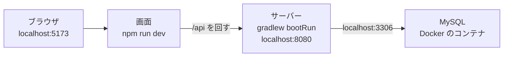

# はじめての環境構築ガイド（v1.0）

| 項目 | 内容 |
|---|---|
| システム | 備品管理システム（equipment_management_system） |
| 版 | v1.0 2026-11-13 |
| Jira | なし |
| もとにした資料 | 環境構築手順書 v2.1、Docker Desktop手順書 v1.0、CLAUDE.md 3・4・6章、Server の compose.yaml・.env.example・secret.example.yml、Server の CLAUDE.md 3章、Client の CLAUDE.md 3章 |
| 状態 | 作成中。コマンドと設定値は、Linux の環境で確かめた（Docker で MySQL を起動、サーバーのテスト 235 件、画面のテスト 100 件成功・12 件スキップ）。Windows の画面の操作は、環境構築手順書 v2.1 に書いてあるとおりで、この手順書を書いた人は Windows では動かしていない。この手順書だけを見て、初めての人が通せるかを、1人に確かめてもらう |

**このプロジェクトに初めて入る人が、自分の Windows の PC に開発環境を一から作るための手順書。** プログラミングや Docker に慣れていなくても進められるように、用語はその場で説明している。

- 開発に Claude Code（AI の道具）は**要らない**。使いたい人だけ、手順 14 で入れる。
- 道具の版や決まりの正本は、環境構築手順書。この手順書と食い違ったときは、環境構築手順書が正しい。
- Docker Desktop の入れ方と使い方を、もっとくわしく知りたいときは Docker Desktop手順書を見る。

## 1. 何を作るのか（全体像）

### 1.1 入れるもの

| 道具 | 何のための道具か | 版 |
|---|---|---|
| Git for Windows | ソースの履歴を管理する道具（Git）を、Windows で使えるようにしたもの。ソースを GitHub から取ってくるのに使う | 問わない |
| Java（Eclipse Temurin） | サーバー（API のプログラム）を動かすのに要る。Temurin は、無料で使える Java の配布元の1つ | **21** |
| Docker Desktop | MySQL（データベース）を動かすために使う。Docker は、アプリを「箱」（コンテナ）に入れて動かす道具 | 最新 |
| Node.js | 画面（ブラウザに出る部分）を作る道具（npm という部品の管理の道具が付いてくる） | **24.12.0** |
| Eclipse | サーバーのソースを読み書きするエディタ（ソースを編集するアプリ）。ほかのエディタでもよい | 2025-09 以降 |
| Claude Code | AI が開発を手伝う道具。**任意** | 最新 |

- サーバーの組み立ての道具（Gradle）、サーバーと画面の部品（Spring Boot、React など）、テストの道具（Playwright）は、自分で入れなくてよい。ソースの中に版が書いてあり、手順 9・11 で自動で入る。**版を勝手に変えない**（CLAUDE.md 3章）。

### 1.2 できあがりの姿



- ブラウザで開く画面と、API を動かすサーバーと、データベース（MySQL）が、すべて**自分の PC の中**で動く。ほかの人の PC や会社のサーバーには、つながらない。
- MySQL だけ Docker で動かす。サーバーと画面は、Docker に入れず PC で直接動かす（Eclipse で動かしやすく、ファイルの読み書きが速いため。環境構築手順書 1.1）。

### 1.3 3つのリポジトリ

リポジトリは、GitHub 上のソースの保管場所のこと。このシステムは、3つに分かれている。**3つとも、同じフォルダの中に並べて**取ってくる（設計書の中のパスが、この並び方を前提にしているため）。

| リポジトリ | 中身 |
|---|---|
| EquipmentManagementSystem_Server | サーバー（Spring Boot の API、データベースの設定、サーバーのテスト） |
| EquipmentManagementSystem_Client | 画面（React、画面のテスト） |
| EquipmentManagementSystem_Document | 設計書、手順書、テストの証跡（結果の記録） |

## 2. 始める前に

| 確かめること | 決まり |
|---|---|
| Windows の版 | Windows 11、または Windows 10 の 22H2 以降。`Win + R` を押して `winver` と打つと分かる |
| 管理者の権限 | 道具を入れるときに要る。自分で判断して行う |
| Docker Desktop の利用条件 | 従業員 250 人未満かつ年間売上 1,000 万ドル未満の会社なら、無料で使える。それより大きい会社は、有料の契約が要る。当てはまるかを、先に確かめる |
| ディスクの空き | 道具とデータで、数 GB は要る（MySQL のイメージだけで約 1.1GB。**イメージ**は、コンテナのもとになるファイル一式） |
| PC に直接入れた MySQL | **動いていると、手順 7 で衝突する**。「4. PC に直接入れた MySQL を止める」を先に行う |
| ネットワーク | 道具と部品を、インターネットからたくさんダウンロードする。会社のネットワークで外への接続が制限されているときは、人に相談する |

**この手順書での約束**
- コマンドは **PowerShell**（Windows に入っているコマンドの入力画面。スタートメニューで「PowerShell」と打つと出る）で打つ。
- `<development>` は、自分で決めた作業用のフォルダの名前に読み替える（手順 2）。
- 各手順の最後の「**完了条件**」を満たしたことを確かめてから、次に進む。
- **パスワードは、メモ帳などのファイルにだけ書く。Slack・メール・会話・Claude Code に書かない。**

## 3. 手順

### 手順1：Git を入れる

1. https://git-scm.com/ から Git for Windows をダウンロードして入れる。設定は、すべて最初のままでよい。
2. PowerShell を**新しく開いて**、次を打つ。

```powershell
git --version
```

**完了条件**：`git version 2.…` のように版が出る。

- 道具を入れる前から開いていた PowerShell には、入れた道具の場所が伝わらない。「見つからない」と出たら、PowerShell を開き直す。

### 手順2：作業用のフォルダを作る

1. 自分で決めた場所に、`development` という名前のフォルダを作り、その中に `workspace` フォルダを作る。
   - 場所は、**ドライブの直下や、短い英数字だけの名前**にしておくと、あとで困りにくい（例：`C:\development\workspace`）。日本語や空白を含む場所は避ける（推奨。この手順書を書いた人が、特定のエラーを確かめたわけではない）。
   - ドライブ名や個人のフォルダの名前は、設計書やソースには書かない（CLAUDE.md 5章）。人それぞれ違ってよい。
2. PowerShell で、そのフォルダに移る。

```powershell
cd C:\development\workspace
```

（`C:\development\workspace` は、自分で作った場所に読み替える）

**完了条件**：`pwd` と打つと、`workspace` フォルダの場所が出る。

### 手順3：3つのリポジトリを取ってくる

「クローン」は、GitHub 上のリポジトリを、自分の PC に丸ごとコピーすること。3つとも公開されているので、GitHub のアカウントがなくても取ってこられる（ソースを直して GitHub に送るには、アカウントと、リポジトリへの招待が要る。その手順はこの手順書では扱わない）。

`workspace` フォルダの中で、次の3つを打つ。

```powershell
git clone https://github.com/sekiyak611/EquipmentManagementSystem_Server.git
git clone https://github.com/sekiyak611/EquipmentManagementSystem_Client.git
git clone https://github.com/sekiyak611/EquipmentManagementSystem_Document.git
```

**完了条件**：`workspace` の中に、次の3つのフォルダが並んでいる。

```
<development>\workspace
├─ EquipmentManagementSystem_Server
├─ EquipmentManagementSystem_Client
└─ EquipmentManagementSystem_Document
```

- フォルダの名前は、そのままにする（変えない）。
- 取ってきた直後は、`release/main` というブランチ（ソースの枝。このプロジェクトの親になる枝）になっている。このままでよい。
- すでに取ってあるときは、各フォルダで `git fetch` のあと `git switch release/main` と `git pull` で最新にする。

### 手順4：PC に直接入れた MySQL を止める（入れている人だけ）

このプロジェクトの MySQL は、Docker の中で動かす。ふだん使っている MySQL（8.0 など）が PC に直接入って動いていると、同じ 3306番を取り合って、Docker の MySQL が起動しない。入れていない人は、この手順を飛ばす。

1. PowerShell で `Get-Service *mysql*` と打つ。何も出なければ、入っていない（飛ばしてよい）。
2. 出た名前（例：`MySQL80`、`MySQL84`）の、状態（Status）が `Running`（動いている）なら止める。PowerShell を「管理者として実行」で開き、名前を読み替えて打つ。

```powershell
Stop-Service MySQL84
Set-Service MySQL84 -StartupType Disabled
```

`Disabled` は、PC を起動しても動かないようにする設定。

3. このプロジェクトのために、その MySQL に残すデータはない（テーブルは、あとで自動で作り直される）。手で入れたデータが要る人は、先に控えておく。

**完了条件**：`Get-Service *mysql*` で、`Running` のものがない。

### 手順5：Java 21 を入れる

1. https://adoptium.net/temurin/releases/ を開き、OS「Windows」、アーキテクチャ「x64」、種類「JDK」、版「**21**」の `.msi`（Windows の標準的なインストーラー）をダウンロードして入れる。
2. 入れるときの機能の選択で、「Add to PATH」が有効になっていることを確かめる。「PATH」は、どのフォルダからでも `java` と打てば動かせるようにする設定。
3. PowerShell を**新しく開いて**、次を打つ。

```powershell
java -version
```

**完了条件**：`openjdk version "21.0.…"` のように、`21.` で始まる版が出る。

- 古い版の Java が先に出るときは、Windows の環境変数 Path（設定画面で「環境変数」と検索する）の中で、Java 21 のフォルダが上にあるかを確かめる。

### 手順6：Docker Desktop を入れる

1. https://www.docker.com/products/docker-desktop/ から、Windows 用（AMD64）の Docker Desktop をダウンロードして入れる。
2. 入れるときの「Configuration」の画面では、「Per-user installation (Recommended)」（自分のユーザーにだけ入れる）と、「WSL 2」（Windows の中で Linux を動かす仕組み）を選ぶ（最初から選ばれている）。「Allow Windows Containers」には印を付けない。
3. 入れ終わったら PC を再起動し、Docker Desktop を起動する。サインイン（アカウントの登録）は、しなくてよい。
4. **PC を重くしないために、メモリの上限を決める。** 自分のユーザーのフォルダ（例：`C:\Users\<ユーザー名>`）に、メモ帳で `.wslconfig` という名前のファイルを作り、次を書いて保存する。「ファイルの種類」を「すべてのファイル」にして、`.wslconfig.txt` にならないようにする。

```ini
[wsl2]
memory=2GB
```

   保存したら、PowerShell で `wsl --shutdown` を打ち、Docker Desktop を起動し直す。
5. Docker Desktop の画面の左下が緑（Engine running）になるまで待ってから、PowerShell を**新しく開いて**確かめる。

```powershell
docker --version
docker compose version
docker info
```

**完了条件**：最初の2つが版を表示し、`docker info` がエラーにならない。

- 「仮想化が無効」と出て起動しないときは、PC の BIOS（電源を入れた直後に動く設定画面）で、仮想化（Intel VT-x、AMD-V など）を有効にする。やり方は PC の機種で違う。
- くわしい説明と、つまずいたときの表は、Docker Desktop手順書にある。

### 手順7：MySQL を動かす

MySQL の版（8.4.13）と設定は、Server のフォルダの `compose.yaml` に書いてある。誰の PC でも、自動で同じになる。

1. Server のフォルダに移る。

```powershell
cd C:\development\workspace\EquipmentManagementSystem_Server
```

2. パスワードを書くファイル `.env` を、見本をコピーして作る。

```powershell
Copy-Item .env.example .env
notepad .env
```

3. メモ帳が開くので、次の2つの `=` の右に、**自分でパスワードを決めて**書き、保存する。`MYSQL_PORT` は 3306 のままにする。
   - `MYSQL_ROOT_PASSWORD`：MySQL の管理者（root）のパスワード
   - `MYSQL_PASSWORD`：アプリ用のユーザ `equipment` のパスワード。**手順 8 で、もう1か所に同じものを書く。忘れないように控える**
   - パスワードは、**英数字だけ**で、12文字以上にするとつまずかない（記号を使うと、設定ファイルの書き方で意味が変わることがある。推奨）。本物のサービスのパスワードを使い回さない。
   - メモ帳で保存するとき、ファイル名が `.env.txt` になっていないか確かめる（エクスプローラーの「表示」で「ファイル名拡張子」を出すと分かる）。
4. MySQL を起動する。

```powershell
docker compose up -d
```

   `-d` は、裏で動かす指定。最初は MySQL のイメージ（約 1.1GB）のダウンロードで数分かかる。最初の起動のときだけ、データベース2つ（`equipment_dev` は開発用、`equipment_test` はテスト専用）とユーザ `equipment` が作られる。
5. 30秒ほど待ってから、確かめる。

```powershell
docker compose ps
```

**完了条件**：`equipment-mysql` の STATUS が `healthy`（例：`Up 20 seconds (healthy)`）になる。`starting` の間は、まだ準備中。

- `.env` は、Git で管理されない（GitHub に送られない）ファイル。**他人に見せない**。

### 手順8：secret.yml を作る

サーバー（Spring Boot）が、データベースにつなぐためのパスワードなどを読むファイル。`.env` はサーバーが読まないので、同じパスワードを、ここにも書く。

1. Server のフォルダ（`build.gradle` があるフォルダ）で、見本をコピーして `secret.yml` を作り、開く。

```powershell
Copy-Item secret.example.yml secret.yml
notepad secret.yml
```

2. 次のように、値を書く（コロン `:` の右に半角スペース1つ。字下げ（行の頭の空白）は、見本のまま変えない）。

| 項目 | 書く値 |
|---|---|
| `spring.datasource.username` | `equipment` |
| `spring.datasource.password` | 手順 7 の `MYSQL_PASSWORD` と**同じ**パスワード |
| `app.initial-admin-email` | **メールアドレスの形（`@` を1つ含む）の値。** 自分のメールアドレスか、`admin@example.com` のようなダミーでよい。**最初の起動のときに空のままだと、サーバーが起動しない**（データベースに最初のデータを入れるために必要）。`soumu@example.com` と `ippan@example.com` は、開発用のユーザ（手順 12）が使うので避ける |
| `app.slack.bot-token` | **空のままでよい**（Slack の通知を使う作業になってから、決まった人が書く） |

3. 保存する。ファイル名が `secret.yml.txt` になっていないかを確かめる。

**完了条件**：Server のフォルダに `secret.yml` がある。

- `secret.yml` も Git で管理されない。**他人に見せない。**

### 手順9：サーバーのテストと起動を確かめる

Server のフォルダで、次を打つ。

```powershell
.\gradlew.bat test
```

`gradlew.bat` は、サーバーを組み立てる道具（Gradle）を、必要な版のまま自動で用意して動かすファイル。**最初は、Gradle と部品のダウンロードで数分かかる。** テストは、`equipment_test` のデータベースを作り直しながら動く（`equipment_dev` には触らない）。

**完了条件**：`BUILD SUCCESSFUL` が出る。

続けて、サーバーを起動する。

```powershell
.\gradlew.bat bootRun
```

起動には少し時間がかかる。画面に `Started EquipmentApplication` のような文が出たら、ブラウザで http://localhost:8080/api/health を開く。確かめたら、PowerShell で `Ctrl + C` を押して止める（あとで画面と一緒に使うときは、動かしたままにする）。

**完了条件**：`/api/health` を開くと、`"state":"UP"` を含む文が出る。

- 最初の `bootRun` のときに、開発用のデータベース `equipment_dev` に、テーブルと開発用のユーザが自動で作られる（Flyway という、データベースの作り方を管理する仕組みが行う）。

### 手順10：Node.js 24.12.0 を入れる

1. https://nodejs.org/dist/v24.12.0/ から、`node-v24.12.0-x64.msi` をダウンロードして入れる。設定は、最初のままでよい。
2. PowerShell で `npm` を使えるようにする。Windows の最初の設定では、PowerShell は署名のないスクリプトを動かさないので、`npm` が「デジタル署名されていません」というエラーになる。次を**1回だけ**打つ（今のユーザーだけの設定。管理者の権限は要らない）。

```powershell
Set-ExecutionPolicy -Scope CurrentUser -ExecutionPolicy RemoteSigned
```

   `RemoteSigned` は、「インターネットから取ってきたスクリプトには署名が要る。自分の PC にあるスクリプトは動かしてよい」という設定。この設定を変えたくない人は、代わりに `npm.cmd`・`npx.cmd` と打つか、コマンドプロンプト（cmd）で打つ。
3. PowerShell を**新しく開いて**、確かめる。

```powershell
node -v
npm -v
```

**完了条件**：`node -v` が `v24.12.0` を表示し、`npm -v` も版を表示する。

- package.json の決まりは「22.22.0 以上」だが、2人の開発では 24.12.0 にそろえている。

### 手順11：画面を起動する

1. Client のフォルダに移り、部品を入れる。

```powershell
cd C:\development\workspace\EquipmentManagementSystem_Client
npm install
npx playwright install chromium
```

   - `npm install`：画面に使う部品（React など）を、決まった版で入れる。
   - `npx playwright install chromium`：画面のテストで使うブラウザ（Chromium）を入れる。Playwright は、ブラウザを自動で操作して画面を試すテストの道具。
2. **別の PowerShell を開いて**、サーバーを起動しておく（手順 9 の `.\gradlew.bat bootRun`。Server のフォルダで打つ。すでに動いていればそのままでよい）。MySQL も動いている（`docker compose ps` が `healthy`）ことを確かめる。
3. Client のフォルダで、画面を起動する。

```powershell
npm run dev
```

4. ブラウザで http://localhost:5173 を開く。

**完了条件**：ログイン画面が出る。

- 画面の `/api` で始まる呼び出しは、画面の開発用サーバーが、サーバー（8080番）に回す。画面だけを起動しても、サーバーが動いていないとログインできない。

### 手順12：ログインして確かめる

開発用のデータベースには、サーバーを最初に起動したときに、次の2人のユーザーが自動で入っている（開発とテスト専用。本番には入らない）。

| メールアドレス | パスワード | 権限 |
|---|---|---|
| soumu@example.com | devpass-1234 | 総務 |
| ippan@example.com | devpass-1234 | 一般社員 |

- このパスワードは、設計書（詳細設計 common.md 4章）に書いてある、開発専用の決まった値。本物の秘密の情報ではない。
- 手順 8 で書いた `app.initial-admin-email` の人（関谷 海仁）は、パスワードが空で、そのままではログインできない。上の2人を使う。

**確かめること**
1. 総務（soumu@example.com）でログインできる。
2. メニューから「種別管理」を開き、種別を足す・直す・消せる。
3. 一般社員（ippan@example.com）でログインすると、「種別管理」のメニューが出ない。

**完了条件**：ログインできて、「種別管理」が開ける（総務）。

### 手順13：画面のテストを確かめる

**開発用に起動したサーバー・画面は、先に止める**（`Ctrl + C`）。Playwright は、すでに動いているサーバーをそのまま使う。動かしたままだと、開発用のデータベース（`equipment_dev`）でテストが動き、データが変わってしまう。

Client のフォルダで、次を打つ。

```powershell
npx playwright test
```

テスト用の設定（`equipment_test`）で、サーバーと画面が**自動で**起動し、ブラウザでテストが動く。数分かかる。

**完了条件**：`failed` が 0 になる（`passed` と `skipped` が出る。スキップは、PC の画面だけで確かめるテストを、スマートフォンの設定では動かさないもの。正常）。

- 画面のテストは Server も使うので、Server の準備（手順 7・8）が済んでいる必要がある。
- サーバーは、隣の Server のフォルダの `gradlew.bat`（Windows ではこの名前）で、自動で起動される。

### 手順14：Eclipse と Claude Code（それぞれ使う人だけ）

**Eclipse に Server を取り込む**（Eclipse を使う人）

1. Eclipse（2025-09 以降）を入れる。ワークスペース（Eclipse の作業フォルダ）は、手順 2 の `workspace` フォルダにする。
2. 「ウィンドウ」→「設定」→「Gradle」の「Java ホーム」に、Java 21 のフォルダを指定する。
3. 「ファイル」→「インポート」→「Gradle」→「既存の Gradle プロジェクト」で、Server のフォルダを指定する。**「Gradle」の項目から取り込む。** ほかの取り込み方（普通の Java プロジェクトなど）だと、部品の場所が Eclipse に伝わらず、`import` がすべて赤くなる。
4. プロジェクトの名前が、フォルダ名と同じ `EquipmentManagementSystem_Server` になっていることを確かめる（変えない）。

**完了条件**：Eclipse のプロジェクトに、エラーの印（赤い×）がない。

- 赤い×が大量に出るときは、プロジェクトを右クリック →「Gradle」→「Gradle プロジェクトのリフレッシュ」→ 「プロジェクト」→「クリーン」を試す。それでも直らないときは、Gradle の Java ホームが 21 か、「コンソール」に同期のエラーが出ていないかを確かめる。
- 画面（Client）は、VS Code など、好きなエディタで開いてよい。

**Claude Code（AI の道具）を使う人**

Claude Code を使うには、有料のプラン（Pro・Max・Team・Enterprise）か、Claude Console（API）のアカウントが要る。

1. コマンドプロンプト（cmd）で、次を打つ（管理者の権限は要らない）。

```bat
curl -fsSL https://claude.ai/install.cmd -o install.cmd && install.cmd && del install.cmd
```

2. Server か Client のフォルダで、次を打ってログインする。設計書を読めるように、Document のフォルダも一緒に渡す。

```powershell
claude --add-dir ../EquipmentManagementSystem_Document
```

3. Claude Code が、Git の危ない操作（取り込み、強制 push など）を動かせないようにする設定は、Server と Client の `.claude/settings.json` に入っていて、リポジトリと一緒に取ってきている。ファイルがあることを確かめる（なければ、Document の `internaldesign/settings.json` を、そこに写す）。

**守ること：パスワードと Slack のトークンは、Claude Code に見せない。** `secret.yml` と `.env` の中身を読ませない。会話に書かない。

## 4. 毎日の開発の始め方・終わり方

| いつ | すること |
|---|---|
| 始めるとき | ① Docker Desktop を起動する（自動で起動する設定なら要らない）。 ② Server のフォルダで `docker compose up -d`（動いたままなら何もしなくてよい）。 ③ Server のフォルダで `.\gradlew.bat bootRun`（Eclipse なら、`EquipmentApplication` を右クリック →「実行」→「Spring Boot アプリケーション」）。 ④ Client のフォルダで `npm run dev`。 ⑤ http://localhost:5173 を開く |
| テストするとき | サーバーと画面を止めてから、Server で `.\gradlew.bat test`、Client で `npx playwright test` |
| 終わるとき | サーバーと画面を `Ctrl + C` で止める。Server のフォルダで `docker compose stop`（MySQL を止める。データは残る）。Docker Desktop を終わらせると、PC のメモリが空く |

- **`docker compose down -v` は、データベースの中身がすべて消える。** 本当に消してよいか、人に確かめてから使う。
- 最新のソースにするときは、3つのフォルダで `git fetch` のあと `git pull`（`release/main` にいるとき）。

## 5. 完了チェックリスト

| No. | 確かめること | 確かめ方 |
|---|---|---|
| 1 | Git が入っている | `git --version` |
| 2 | 3つのリポジトリが並んでいる | フォルダを見る |
| 3 | Java 21 | `java -version` が `21.` で始まる |
| 4 | Docker Desktop が動いている | `docker info` がエラーにならない。PC に直接入れた MySQL が動いていない |
| 5 | MySQL のコンテナが動いている | Server のフォルダで `docker compose ps` が `healthy` |
| 6 | `.env` と `secret.yml` がある | Server のフォルダにある（中身は人に見せない） |
| 7 | サーバーのテストが通る | `.\gradlew.bat test` が `BUILD SUCCESSFUL` |
| 8 | サーバーが起動する | http://localhost:8080/api/health が `"state":"UP"` |
| 9 | Node.js 24.12.0 | `node -v` が `v24.12.0` |
| 10 | 画面が開く | http://localhost:5173 でログイン画面が出て、soumu@example.com でログインできる |
| 11 | 画面のテストが通る | `npx playwright test` で `failed` が 0 |
| 12 | Eclipse に取り込めた（使う人だけ） | プロジェクトにエラーの印がない |

## 6. つまずいたとき

| 出たもの | 原因と直し方 |
|---|---|
| `git`・`java`・`docker`・`node` が「見つからない」 | PowerShell を開き直す（入れる前から開いていた PowerShell には、入れた道具の場所が伝わらない）。それでも出ないときは、入れたあとで PC を再起動していないか、Path が合っているかを確かめる |
| `docker info` が `error during connect` などで失敗する | Docker Desktop が動いていない。起動して、左下が緑（Engine running）になるまで待つ |
| 「仮想化が無効」「WSL 2 が入っていない」と出て Docker Desktop が起動しない | BIOS の仮想化を有効にする（手順 6）。WSL が古いときは、PowerShell で `wsl --update` を打つ |
| `docker compose up -d` で `.env に MYSQL_ROOT_PASSWORD を書いてください` と出る | Server のフォルダに `.env` がない、または値が空。手順 7 |
| `docker compose up -d` で `ports are not available`・`address already in use`（3306） | PC に直接入れた MySQL が 3306番を使っている。手順 4 |
| `docker compose ps` で `healthy` にならない | `docker compose logs --tail 30 mysql` でログを読む。メモリ不足のときは、手順 6 の `.wslconfig` の `memory` を大きくする |
| サーバーが起動しない。「最初の総務の担当者のメールアドレス（app.initial-admin-email）が設定されていません」と出る | `secret.yml` の `app.initial-admin-email` が空。メールアドレスの形の値（`@` を1つ含み、空白や `'` `"` `\` を含まない）を書く。手順 8 |
| `Access denied for user 'equipment'` | `secret.yml` のパスワードが、`.env` の `MYSQL_PASSWORD` と違う。または `secret.yml` の場所が違う（`build.gradle` と同じフォルダに置く）。**コンテナを作ったあとで `.env` のパスワードを変えても、MySQL の中のパスワードは変わらない**（最初の起動のときだけ使われるため）。変えたいときは、人に確かめてから `docker compose down -v`（データも消える）→ `docker compose up -d` で作り直す |
| `Communications link failure`、`Connection refused` | MySQL が動いていない、または準備中。`docker compose up -d` のあと、`docker compose ps` で `healthy` を待つ |
| `Port 8080 was already in use` | 8080番を使う別のアプリ（起動したままのサーバーなど）がある。止めてから起動する |
| テストが `Unknown database 'equipment_test'` で失敗する | 最初の MySQL の起動の前に、`docker/mysql/init` がなかったなど。人に確かめてから `docker compose down -v` → `docker compose up -d` で作り直す |
| `npm`・`npx` が「デジタル署名されていません」 | PowerShell の実行ポリシー。手順 10 の2 |
| 画面は開くが、ログインできない・通信エラーになる | サーバーが動いていない。手順 9 の `bootRun` を動かしてから、画面をもう一度開く |
| 画面のテストで、開発用のデータが変わった・消えた | 開発用に起動したサーバーを、Playwright がそのまま使った。手順 13 のとおり、止めてからテストする |
| テストの名前などの日本語が、PowerShell で文字化けする | 画面の文字コードの違いで、結果には影響しない。サーバーのテストのレポート（`build/reports/tests/test/index.html`）では、正しく読める。気になるときは、テストの前に `chcp 65001` を打つ |
| Eclipse で赤い×が大量に出る、Spring Boot が認識されない | 手順 14 の Eclipse。Gradle のプロジェクトとして取り込めているか、リフレッシュしたか、Gradle の Java ホームが 21 かを確かめる |
| PC が重い | `.wslconfig` のメモリの上限を確かめる。使わないときは `docker compose stop` で MySQL を止め、Docker Desktop も終わらせる |

それでも分からないときは、**画面に出た文（エラー）と、どの手順で出たか**を、詳しい人に伝える。パスワードを含む部分は、伏せて伝える。

## 変更履歴

| 版 | 日付 | 内容 |
|---|---|---|
| v1.0 | 2026-11-13 | 初版。環境構築手順書 v2.1 を、初めての人が一から1人で進められるように、順番・用語の説明・コマンドの形に書き直した。Claude Code を任意にした。`secret.yml` の `app.initial-admin-email` が、初めてサーバーを起動するときに要ること、開発用のログインのユーザー、Eclipse の取り込みでつまずく所を足した |
