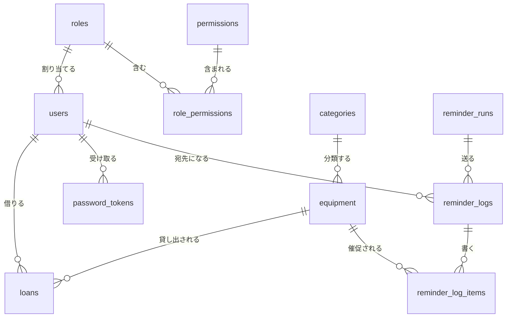

# データ設計（v1.0）

| 項目 | 内容 |
|---|---|
| システム | 備品管理システム（equipment_management_system） |
| 版 | v1.0 2026-11-02 |
| もとにした資料 | 機能一覧 v1.0、画面設計 v1.1、基本設計書 v1.1 |
| データベース | MySQL 8（AWSではAmazon RDS for MySQLを想定） |
| 状態 | 詳細設計の完成版。「仮決め」と書いた所は、2人のレビューで異論がなければ決定として扱う |

## 1. この資料について

システムが覚えておくデータを、データベースの中で、どんな表（テーブル）に、どんな列で持つかを決める。Claude Codeは、この資料をもとにテーブルを作るSQL（データベースへの命令文）と、データを読み書きするプログラム（MyBatis）を作る。

- テーブル名・列名は、プログラムで使うため英語（小文字と「_」）で付ける。日本語の名前も並べて書く。
- テーブルの作成と変更は、Flyway（テーブルの変更をファイルで管理し、順番に自動で当てる道具。Spring Bootと組み合わせて使える）で行う。2人の開発者のPCと、AWSのデータベースを同じ形にそろえやすくするため。

## 2. 全テーブルに共通する決まり

| 項目 | 決まり | 理由 |
|---|---|---|
| 文字コード | utf8mb4 | 日本語や記号を正しく保存するため |
| 照合順序（文字の比べ方の決まり） | utf8mb4_ja_0900_as_cs_ks | MySQL 8の標準（utf8mb4_0900_ai_ci）では、大文字と小文字、ひらがなとカタカナ、「ハ」「バ」「パ」が同じ文字とみなされる。そのままだと、別の名前の種別や別の管理番号が「重複している」と扱われてしまう。utf8mb4_ja_0900_as_cs_ks は、これらを区別する日本語向けの比べ方 |
| 画面での検索 | 大文字・小文字を区別せずに探す | 上の比べ方は大文字・小文字を区別するので、検索のときはプログラムで両方を小文字にそろえてから比べる（「lenovo」で「Lenovo」が見つかるように） |
| ID（行の番号） | どのテーブルも id 列（BIGINT＝大きな整数、自動で1ずつ増える）を持つ。権限項目・祝日を除く | |
| 削除 | 論理削除。deleted_at（削除した日時）に値が入っている行は「削除済み」とみなす。物理的には消さない | 機能一覧4章の共通ルール |
| 同時に編集したときの備え | version 列（数値）を持ち、保存のたびに1増やす。保存するときに、画面を開いたときの version と違えば保存しない | 画面設計12章「ほかの人が先に保存していたとき」。この仕組みを楽観ロックと呼ぶ |
| 記録用の列 | created_at（作った日時）、created_by（作った人のユーザID）、updated_at（最後に変えた日時）、updated_by（最後に変えた人のユーザID）を持つ。自動で動くもの（催促）や、移行のときなど、人がいない場合は created_by を空にする | だれがいつ変えたかを追えるようにするため |
| 日時 | 日本時間で保存する（DATETIME型） | 画面に出すのも日本時間なので、変換の間違いを防ぐため |
| 重複できない列と削除 | 「削除済みの行は重複に数えない」ために、削除されていない行だけ値が入る計算列（生成列）を作り、その列に重複禁止（UNIQUE）を付ける | MySQLには「削除されていない行だけで重複を禁止する」機能がないため。UNIQUEは空（NULL）の重複を許すので、削除済みの行はぶつからない |

列の表の見方：「必須」は空を許さない（NOT NULL）。「型」の VARCHAR(50) は「50文字までの文字」、DATE は日付、DATETIME は日時、BOOLEAN は「はい／いいえ」。

## 3. テーブル一覧

| No. | テーブル名 | 日本語名 | 中身 | 関係する機能 |
|---|---|---|---|---|
| 1 | users | ユーザ | ログインする人。氏名・メールアドレス・パスワード・権限 | F-01〜F-04、F-12、F-13 |
| 2 | roles | 権限 | 名前を付けた「できること」の組み合わせ | F-14、F-15 |
| 3 | permissions | 権限項目 | 1つ1つの「できること」。18行で固定 | F-15 |
| 4 | role_permissions | 権限と権限項目の対応 | どの権限が、どの権限項目を含むか | F-15 |
| 5 | categories | 種別 | 備品の種類（PC、モニターなど） | F-21 |
| 6 | equipment | 備品 | 備品の情報 | F-05、F-06 |
| 7 | loans | 貸出履歴 | だれが・いつ借りて・いつ返したか | F-18〜F-20 |
| 8 | password_tokens | パスワード設定用のリンク | リンクに含める合言葉（トークン）と期限 | F-03、F-13 |
| 9 | persistent_logins | ログインしたままにする | 「ログインしたままにする」の記録。Spring Securityが決めた形のテーブル | F-01 |
| 10 | reminder_runs | 催促の実行 | 毎月の催促を1回動かした記録 | F-10、F-11 |
| 11 | reminder_logs | 催促の宛先 | 1回の催促で、だれに送り、成功したか | F-10、F-11 |
| 12 | reminder_log_items | 催促した備品 | 1通のDMに書いた備品 | F-10、F-11 |
| 13 | holidays | 祝日 | 内閣府の祝日CSVから取り込んだ祝日 | F-10 |

貸出状態（保管中／貸出中）と借用者は、テーブルの列としては持たず、貸出履歴から決める（機能一覧5章の2）。

## 4. テーブルどうしのつながり（ER図）

ER図＝テーブルどうしのつながりを表した図。線の端の記号は「1つ」「0か1つ」「0以上」などの数を表す。GitHubでは、下の図がそのまま絵として表示される。

## 5. テーブルの中身

### 5.1 users（ユーザ）

| 列名 | 日本語名 | 型 | 必須 | 説明 |
|---|---|---|---|---|
| id | ID | BIGINT | ○ | 主キー（行を見分けるための番号）。自動で増える |
| name | 氏名 | VARCHAR(50) | ○ | |
| email | メールアドレス | VARCHAR(254) | ○ | ログインとSlackの宛先探しに使う。保存するときに小文字にそろえる（仮決め） |
| email_active | 重複チェック用 | VARCHAR(254) | | 生成列。削除されていなければ email、削除済みなら空。UNIQUE |
| password_hash | パスワード | VARCHAR(100) | | パスワードをハッシュ化した値。ユーザ登録の直後は、まだパスワードを決めていないので空 |
| role_id | 権限 | BIGINT | ○ | roles.id を指す（外部キー＝ほかのテーブルの行を指す列） |
| failed_login_count | ログインの失敗回数 | INT | ○ | 最初は0。5になったらロック（画面設計2.1） |
| locked_at | ロックした日時 | DATETIME | | 空ならロックされていない |
| session_valid_after | ログインが有効になる境目 | DATETIME | | パスワードを変えた・再設定した日時を入れる。これより前にログインした端末は、次の操作でログアウトさせる（機能一覧6章の8） |
| deleted_at | 削除した日時 | DATETIME | | |
| version | 版 | INT | ○ | 楽観ロック用 |
| created_at ほか | 記録用の列 | | | 2章 |

### 5.2 roles（権限）

| 列名 | 日本語名 | 型 | 必須 | 説明 |
|---|---|---|---|---|
| id | ID | BIGINT | ○ | 主キー |
| name | 権限の名前 | VARCHAR(30) | ○ | |
| name_active | 重複チェック用 | VARCHAR(30) | | 生成列（2章）。UNIQUE |
| is_default | 既定の権限 | BOOLEAN | ○ | 「権限を管理する」を持たない人がユーザを登録したときに付く権限（一般社員）。true の行は削除できない（機能一覧8章の6）。true にできるのは1行だけ |
| deleted_at、version、記録用の列 | | | | 2章 |

### 5.3 permissions（権限項目）

プログラムが「この操作をしてよいか」を確かめるときに使う名前（コード）を持つ。行はFlywayで最初に入れ、画面からは変えない（機能一覧8章の1）。

| 列名 | 日本語名 | 型 | 必須 | 説明 |
|---|---|---|---|---|
| code | コード | VARCHAR(50) | ○ | 主キー。下の表のコード |
| name | 名前 | VARCHAR(50) | ○ | 画面に出す名前 |
| group_name | 区分 | VARCHAR(20) | ○ | 備品／貸出／確認／ユーザ・権限。S-17でまとめて並べるのに使う |
| sort_order | 並び順 | INT | ○ | |

| code | name | group_name | 総務 | 一般社員 |
|---|---|---|---|---|
| EQUIPMENT_VIEW | 備品一覧を見る | 備品 | ○ | |
| EQUIPMENT_CREATE | 備品を登録する | 備品 | ○ | |
| EQUIPMENT_UPDATE | 備品を編集する | 備品 | ○ | |
| EQUIPMENT_DELETE | 備品を削除する | 備品 | ○ | |
| CATEGORY_MANAGE | 種別を管理する | 備品 | ○ | |
| LOAN_SELF | 備品を借りる・返す（自分） | 貸出 | ○ | ○ |
| LOAN_MANAGE | 貸出・返却を管理する | 貸出 | ○ | |
| LOAN_HISTORY_VIEW | 貸出履歴を見る | 貸出 | ○ | |
| CONFIRM_SELF | 最終確認日を更新する（自分） | 確認 | ○ | ○ |
| CONFIRM_ALL | 最終確認日を更新する（すべて） | 確認 | ○ | |
| CONFIRM_CSV | 最終確認日をCSVで一括更新する | 確認 | ○ | |
| REMINDER_LOG_VIEW | 催促履歴を見る | 確認 | ○ | |
| USER_VIEW | ユーザを見る | ユーザ・権限 | ○ | |
| USER_CREATE | ユーザを登録する | ユーザ・権限 | ○ | |
| USER_UPDATE | ユーザを編集する | ユーザ・権限 | ○ | |
| USER_DELETE | ユーザを削除する | ユーザ・権限 | ○ | |
| PERMISSION_VIEW | 権限を見る | ユーザ・権限 | ○ | |
| PERMISSION_MANAGE | 権限を管理する | ユーザ・権限 | ○ | |

「権限を見る」「権限を管理する」のコードを ROLE_ で始めないのは、Spring Securityが ROLE_ で始まる名前を特別な意味（役割）として扱うため。

### 5.4 role_permissions（権限と権限項目の対応）

| 列名 | 日本語名 | 型 | 必須 | 説明 |
|---|---|---|---|---|
| role_id | 権限 | BIGINT | ○ | roles.id を指す |
| permission_code | 権限項目 | VARCHAR(50) | ○ | permissions.code を指す |

主キーは role_id と permission_code の組み合わせ。権限を編集したときは、その権限の行を入れ替える。

### 5.5 categories（種別）

| 列名 | 日本語名 | 型 | 必須 | 説明 |
|---|---|---|---|---|
| id | ID | BIGINT | ○ | 主キー |
| name | 名前 | VARCHAR(20) | ○ | |
| name_active | 重複チェック用 | VARCHAR(20) | | 生成列（2章）。UNIQUE |
| initial | 頭文字 | CHAR(1) | | 半角の英大文字1文字。空でもよい |
| initial_active | 重複チェック用 | CHAR(1) | | 生成列（2章）。UNIQUE |
| deleted_at、version、記録用の列 | | | | 2章 |

### 5.6 equipment（備品）

| 列名 | 日本語名 | 型 | 必須 | 説明 |
|---|---|---|---|---|
| id | ID | BIGINT | ○ | 主キー |
| management_no | 管理番号 | VARCHAR(30) | ○ | 形は自由（画面設計12章） |
| management_no_active | 重複チェック用 | VARCHAR(30) | | 生成列（2章）。UNIQUE |
| category_id | 種別 | BIGINT | ○ | categories.id を指す |
| maker | メーカー | VARCHAR(50) | | |
| model | モデル | VARCHAR(100) | | |
| serial_no | シリアルNo | VARCHAR(100) | | |
| size | サイズ | VARCHAR(20) | | 例：21インチ前後 |
| resolution | 解像度 | VARCHAR(20) | | 例：1920 × 1080 |
| height_adjustable | 昇降 | BOOLEAN | | true＝あり、false＝なし、空＝未設定 |
| pivot | ピボット | BOOLEAN | | 同上 |
| purchased_on | 購入日 | DATE | | |
| warranty_until | 保証期日 | DATE | | |
| status | 管理状態 | VARCHAR(10) | ○ | MANAGED（管理中）／DISPOSED（廃棄）／MISSING（不明）。この3つ以外は入らないようにする（CHECK制約） |
| disposed_on | 廃棄日 | DATE | | status が DISPOSED のときだけ入る（CHECK制約） |
| last_confirmed_on | 最終確認日 | DATE | | |
| note | 備考 | VARCHAR(500) | | |
| deleted_at、version、記録用の列 | | | | 2章 |

### 5.7 loans（貸出履歴）

| 列名 | 日本語名 | 型 | 必須 | 説明 |
|---|---|---|---|---|
| id | ID | BIGINT | ○ | 主キー |
| equipment_id | 備品 | BIGINT | ○ | equipment.id を指す |
| user_id | 借用者 | BIGINT | ○ | users.id を指す |
| lent_on | 貸出日 | DATE | ○ | |
| due_on | 返却予定日 | DATE | | 貸出日以降（CHECK制約） |
| returned_on | 返却日 | DATE | | 空なら貸出中。貸出日以降（CHECK制約） |
| memo | メモ | VARCHAR(200) | | 返却のときの特記事項 |
| active_equipment_id | 二重貸出の防止用 | BIGINT | | 生成列。返却日が空で、取り消されていない行だけ equipment_id が入る。UNIQUE |
| deleted_at | 取り消した日時 | DATETIME | | 画面設計13章の「取り消し」 |
| version、記録用の列 | | | | 2章。created_by が「登録した人」（画面設計13章） |

**二重貸出の防ぎ方**：active_equipment_id に重複禁止を付けているので、1つの備品に「貸出中」の行は1つしか作れない。2人がほぼ同時に同じ備品を借りようとしても、データベースが2人目を止める。プログラムはそのエラーを受けて「この備品はすでに貸し出されています」と出す（画面設計4章）。

期間の重なりのチェック（画面設計13章）は、データベースでは決められないので、プログラムで行う。

### 5.8 password_tokens（パスワード設定用のリンク）

| 列名 | 日本語名 | 型 | 必須 | 説明 |
|---|---|---|---|---|
| id | ID | BIGINT | ○ | 主キー |
| user_id | ユーザ | BIGINT | ○ | users.id を指す |
| token_hash | 合言葉のハッシュ | CHAR(64) | ○ | 合言葉そのものは保存しない。SHA-256（データを決まった長さの値に変換する計算方法の1つ）で変換した値を保存する。UNIQUE |
| purpose | 用途 | VARCHAR(10) | ○ | RESET（再設定）／REGISTER（ユーザ登録）／LOCK（ロック） |
| expires_at | 有効期限 | DATETIME | ○ | 再設定・ロックは30分後、ユーザ登録は3日後 |
| used_at | 使った日時 | DATETIME | | 「設定する」を押したときに入れる |
| revoked_at | 無効にした日時 | DATETIME | | 同じ人に新しいリンクを送ったときに、それより前のリンクに入れる（画面設計5章） |
| created_at | 作った日時 | DATETIME | ○ | 「同じメールアドレスへの依頼は5分に1回まで」の判定にも使う |

合言葉は推測されにくい長さで作るため、パスワードと違って、保存には速い計算方法（SHA-256）を使ってよい。

### 5.9 persistent_logins（ログインしたままにする）

Spring Securityの「ログインしたままにする」の仕組み（PersistentTokenBasedRememberMeServices）が使うテーブル。テーブル名と列名は、Spring Securityが決めた形にそろえる。

| 列名 | 型 | 必須 | 説明 |
|---|---|---|---|
| username | VARCHAR(254) | ○ | ログインに使うメールアドレス。Spring Securityの見本では64文字だが、メールアドレスが入るように254文字に広げる |
| series | VARCHAR(64) | ○ | 主キー。端末ごとの番号 |
| token | VARCHAR(64) | ○ | 合言葉 |
| last_used | TIMESTAMP | ○ | 最後に使った日時 |

パスワードを変えた・再設定したときは、その人の行をすべて消す（「ログインしたままにする」を解除する）。

### 5.10 reminder_runs（催促の実行）

| 列名 | 日本語名 | 型 | 必須 | 説明 |
|---|---|---|---|---|
| id | ID | BIGINT | ○ | 主キー |
| target_month | 対象の月 | CHAR(7) | ○ | 例：2026-11。UNIQUE（同じ月に2回送らないため。サーバーが2台以上動いていても、1回だけになるようにする） |
| started_at | 始めた日時 | DATETIME | ○ | |
| finished_at | 終えた日時 | DATETIME | | |
| success_count | 成功した人数 | INT | ○ | |
| failure_count | 失敗した人数 | INT | ○ | |

### 5.11 reminder_logs（催促の宛先）

| 列名 | 日本語名 | 型 | 必須 | 説明 |
|---|---|---|---|---|
| id | ID | BIGINT | ○ | 主キー |
| run_id | 催促の実行 | BIGINT | ○ | reminder_runs.id を指す |
| user_id | 宛先 | BIGINT | ○ | users.id を指す |
| sent_at | 送った日時 | DATETIME | ○ | |
| result | 結果 | VARCHAR(10) | ○ | SUCCESS（成功）／FAILURE（失敗） |
| failure_reason | 失敗の理由 | VARCHAR(200) | | 画面設計15章の例のような文 |

### 5.12 reminder_log_items（催促した備品）

| 列名 | 日本語名 | 型 | 必須 | 説明 |
|---|---|---|---|---|
| log_id | 催促の宛先 | BIGINT | ○ | reminder_logs.id を指す |
| equipment_id | 備品 | BIGINT | ○ | equipment.id を指す |

主キーは log_id と equipment_id の組み合わせ。

### 5.13 holidays（祝日）

| 列名 | 日本語名 | 型 | 必須 | 説明 |
|---|---|---|---|---|
| holiday_on | 日付 | DATE | ○ | 主キー |
| name | 祝日の名前 | VARCHAR(50) | ○ | 例：勤労感謝の日 |

年1回、内閣府の「国民の祝日」CSVを開発者が取り込む（機能一覧7章の2）。

## 6. 検索を速くするための索引（インデックス）

索引＝本の索引のように、データを早く探すための仕組み。主キーとUNIQUEの列には自動で付くので、それ以外に付けるもの。

| テーブル | 列 | 使う場面 |
|---|---|---|
| equipment | status, last_confirmed_on | 備品一覧の絞り込み、棚卸対象、テンプレートの作成 |
| equipment | category_id | 種別で絞り込む、種別を使っている備品を数える |
| loans | equipment_id, lent_on | 備品詳細の貸出履歴、貸出状態の判定 |
| loans | user_id, returned_on | 自分の備品、催促の対象探し |
| password_tokens | user_id, created_at | 5分に1回までの判定、古いリンクを無効にする |
| reminder_logs | run_id | 催促履歴 |
| users | role_id | 権限を使っている人数 |

## 7. 最初に入れるデータ

Flywayで、テーブルを作るのと同じタイミングで入れる。

| テーブル | 入れるデータ |
|---|---|
| permissions | 5.3の18行 |
| roles | 「総務」（is_default＝false）と「一般社員」（is_default＝true） |
| role_permissions | 5.3の表の○のとおり |
| categories | A：PC、B：ヘッドセット、C：マウス、D：カメラ、E：モニター、F：アダプタ |
| users | 最初の総務の担当者1人：関谷 海仁（権限は総務、パスワードは空。Q1の回答）。本人がログイン画面の「パスワードを忘れた方はこちら」から最初のパスワードを決める。メールアドレスは、プログラムに書かず、環境（開発用のPC、AWS）ごとの設定で渡す |

最初のパスワードをプログラムやSQLに書かないのは、だれでも読める場所にパスワードが残るのを防ぐため。

## 8. 未決事項

なし（v0.2時点）。

**決まったこと（v0.1の未決事項）**

| No. | 決まった内容 | 反映先 |
|---|---|---|
| Q1 | 最初に入れる総務の担当者は、関谷 海仁 | 7章 |

**仮決めしたこと（違っていれば教えてください）**

1. メールアドレスは、保存するときに小文字にそろえる（「Yamada@…」と「yamada@…」を同じ人として扱うため）。
2. 列名・テーブル名は英語にする（プログラムで扱いやすくするため）。
3. 日時は日本時間で保存する。

## 変更履歴

| 版 | 日付 | 内容 |
|---|---|---|
| v0.1 | 2026-11-02 | 初版。機能一覧 v0.12・画面設計 v1.0 をもとに作成 |
| v0.2 | 2026-11-02 | Q1の回答を反映（最初の総務の担当者） |
| v1.0 | 2026-11-02 | 詳細設計の完成版とした（内容の変更なし） |
