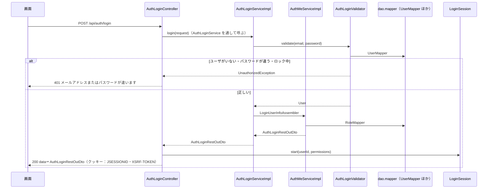
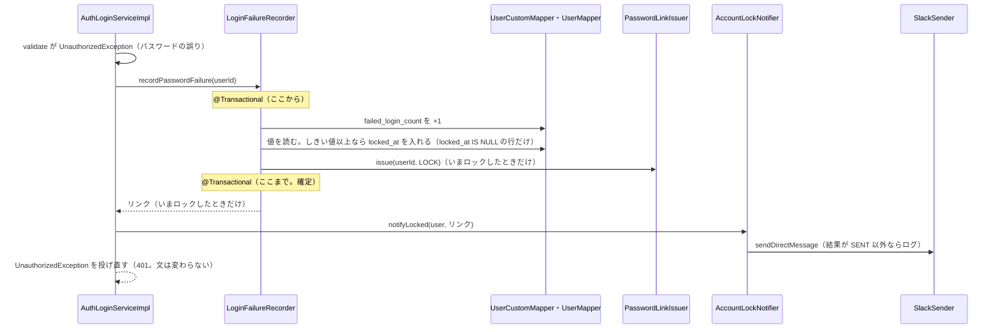

# API詳細設計：A-01 ログイン

| 項目 | 内容 |
|---|---|
| 版 | v2.3 2026-11-16 |
| Jira | ZPOP-55、ZPOP-124（アカウントロック）、ZPOP-61（クラスの移動）、ZPOP-125（ログインしたままにする） |
| 状態 | 作成中 |
| まとまり | [auth](auth.md) |
| もとにした設計書 | API設計.md v1.1 の2.2・2.4・3.1・4.1・7章、画面設計.md v1.1 の2章・2.1・9章（③）、機能一覧.md v1.1 の6章（12）、データ設計.md v1.0 の5.1〜5.4・5.8、基本設計書.md v1.5 の5・6章 |

## 1. API基本情報

写したもと：API設計.md v1.1 の3.1

| 項目 | 内容 |
|---|---|
| ID | A-01 |
| 名前 | ログイン |
| 操作 | POST |
| URL | /api/auth/login |
| 内容 | ログインする |
| 権限項目 | なし（ログイン前でも呼べる。SecurityConfig で許可） |
| 使う画面 | S-01（[S-01_ログイン.md](S-01_ログイン.md)） |
| controller のメソッド | AuthLoginController#login |
| service のメソッド | AuthLoginService#login（中身は AuthLoginServiceImpl） |
| validator のメソッド | AuthLoginValidator#validate |

## 2. リクエスト定義

写したもと：API設計.md v1.1 の4.1、画面設計.md v1.1 の2章

### 2.1 パスの値

なし

### 2.2 クエリ（URL の ? の後ろ）

なし

### 2.3 本文（JSON）

dto：`api.auth の model.LoginRequest`

| 項目名 | 型 | 必須 | 制約 | 説明 |
|---|---|---|---|---|
| email | 文字 | ○ | 254文字まで。メールアドレスの形 | ログインに使うメールアドレス。大文字・小文字は区別しない（小文字にそろえて探す） |
| password | 文字 | ○ | 空でない | パスワード。ログには出さない |
| rememberMe | 真偽 | | ― | 「ログインしたままにする」。true なら、60日間ログインしたままにする（クッキー `remember-me`。common.md 3.17。ZPOP-125）。false・ない場合は、この端末の前のクッキーがあれば消す |

```json
{ "email": "yamada@example.com", "password": "（パスワード）", "rememberMe": true }
```

### 2.4 ファイル（CSV を受け取る API だけ）

なし

## 3. レスポンス定義

写したもと：API設計.md v1.1 の2.4・4.1・4.2

### 3.1 成功

| status | message |
|---|---|
| 200 | 処理が正常に完了しました。 |

data は A-03 と同じ形（[A-03_ログイン中の人の情報.md](A-03_ログイン中の人の情報.md) の3章。RestOutDto：`AuthLoginRestOutDto`（中身は common.security.LoginUserInfoAssembler で作る））。

あわせて、次のクッキーを渡す。

| クッキー | 中身 |
|---|---|
| JSESSIONID（セッション） | ログイン状態。プログラムから読めない（HttpOnly）。本番では HTTPS のときだけ送る（Secure。application-prod.yml） |
| XSRF-TOKEN | なりすまし対策の合言葉を新しくしたもの（3.2 の8） |

### 3.2 失敗

9章のとおり。

## 4. 処理フロー

1. AuthLoginController が受け取る。`@Valid` で入力チェック（6章）。
2. 権限の確認はしない（ログイン前の API）。
3. AuthLoginController が AuthLoginService#login を呼ぶ（中身は AuthLoginServiceImpl）。
4. AuthLoginServiceImpl が AuthLoginValidator#validate を呼ぶ。AuthLoginValidator は次を確かめる（5章の No.1〜4）。
   1. メールアドレスを小文字にそろえ、UserMapper#selectByExample（andEmailEqualTo・andDeletedAtIsNull） で、削除されていないユーザを探す。
   2. ユーザがいない、パスワードが空（password_hash が NULL）、パスワードが違う、ロック中（locked_at が入っている）のどれかなら、UnauthorizedException（「メールアドレスまたはパスワードが違います」）を投げる。
   3. ユーザがいない・パスワードが空のときも、決まった仮のハッシュでパスワードの照らし合わせを1回行う（かかる時間で登録の有無が分からないように）。
5. AuthLoginServiceImpl が common.security.LoginUserInfoAssembler#assemble（中身は AuthMeServiceImpl。A-03 と同じ形を作る）を呼び、ユーザの権限の名前（RoleMapper#selectByPrimaryKey）と権限項目（RolePermissionMapper#selectByExample（andRoleIdEqualTo）。並び順は permissions.sort_order）を読み、AuthLoginRestOutDto を作る。
6. AuthLoginServiceImpl がログに「ログインしました（userId）」を INFO で残す。失敗のときは 4 で WARN「ログインできませんでした（理由）」を残す（userId が分かるときは付ける。メールアドレス・パスワードは出さない）。
7. AuthLoginController が LoginSession#start を呼ぶ（common.md 3.10）。
   1. すでにセッションがあれば、セッションの番号を変える（セッション固定攻撃＝他人にあらかじめ渡したセッションの番号で、ログイン後に乗っ取る攻撃、を防ぐ）。
   2. LoginUser（ユーザID、ログインした日時＝Clock の今）と権限項目で、ログイン状態を作り、セッションに保存する。
   3. なりすまし対策の合言葉（XSRF-TOKEN）を作り直す（ログイン前に渡した合言葉を、ログイン後に使わせない）。
   4. rememberMe が true なら、「ログインしたまま」のクッキー（`remember-me`。60日間）を渡し、persistent_logins に1行作る（common.md 3.17の1）。false・ない場合は、この端末の前のクッキーと行があれば消す（3.17の判断 No.2）。
8. `ApiResponse.ok(AuthLoginRestOutDto)` で返す。



### 4.1 パスワードを間違えた回数を数える・ロックする（ZPOP-124）

写したもと：画面設計.md v1.1 の2.1・9章の③、機能一覧.md v1.1 の6章の12

AuthLoginServiceImpl は、validate が UnauthorizedException を投げたとき、それを受け取って、次の1つだけを調べる。

- **ユーザがいて、パスワードがあり（password_hash が NULL でない）、ロックされていない（locked_at が空）** なら、「パスワードを間違えた」ので、回数を数える（下の1〜4）。この条件のとき、validate が投げる理由は、パスワードの誤りだけ（ほかの理由は、この条件に当てはまらない）。
- それ以外（登録のないメールアドレス、削除されたユーザ、パスワードがまだない、ロック中）は、数えない（画面設計 2.1 の5。ロック中は、何度間違えても、数えず、DMも送らない）。

どちらの場合も、そのあと、同じ UnauthorizedException をそのまま投げ直す（画面に出る文・401 は変わらない。R-1）。

数えるとき（LoginFailureRecorder#recordPasswordFailure。`@Transactional`。1つのまとまりで行う）：

1. UserCustomMapper#incrementFailedLoginCount で、failed_login_count を1増やす（`failed_login_count = failed_login_count + 1`。ロックされていない行だけ）。
2. 増やしたあとの値を UserMapper#selectByPrimaryKey で読み、設定（`app.lock-threshold`。5）以上なら、ロックする。UserMapper#updateByExampleSelective で locked_at に今（Clock）を入れる（`id = ? AND locked_at IS NULL`。1件変わったときだけ「いま、ロックした」）。同時に何回も間違えられても、ロックするのは1回で、DMも1通だけ送る。
3. いまロックしたら、common.passwordlink.PasswordLinkIssuer#issue（用途 LOCK。有効期限 30分。common.md 3.14）で、パスワード設定用のリンクを作る。同じ人の、前のリンクは無効になる。
4. このまとまりを確定する（commit）。

そのあと（確定したあと。Slack は `@Transactional` の外で送る。CLAUDE.md 5章）、いまロックしたときだけ、AccountLockNotifier が、SlackSender（common.md 3.13）でDMを送る（画面設計 9章の③）。送れなかったとき（USER_NOT_FOUND・FAILED）は、ログに WARN で残すだけで、ロックはそのまま（画面設計 9章の注意3）。

ログインに成功したとき（validate が通ったあと）、failed_login_count が0より大きければ、0に戻す（LoginFailureRecorder#resetFailures。`@Transactional`）。0のときは、書き換えない（毎回のログインで書かないため）。

パスワードを再設定して、ロックを解除する（locked_at を空にし、failed_login_count を0に戻す）のは、A-06（ZPOP-60）で作る。

**ロックのDM（画面設計 9章の③）**

| 項目 | 内容 |
|---|---|
| 宛先 | そのユーザのメールアドレス（Slack に登録しているものと同じ） |
| 見出し | 【備品管理】アカウントをロックしました |
| 本文 | パスワードを5回（`app.lock-threshold`）続けて間違えたため、アカウントをロックしたこと。パスワード設定用のリンク（有効期限30分。`app.password-link.lock-validity` を「分」で書く）。自分で間違えた覚えがなければ、だれかが試した可能性があるので、パスワードを設定し直すこと。期限が切れたら、ログイン画面の「パスワードを忘れた方はこちら」から設定できること。パスワードは書かない |



## 5. 条件分岐・業務ルール

| No. | 条件・ルール | 写したもと | 守る場所（クラス.メソッド） | 守れないとき | 同じルールを書いているほかの機能 |
|---|---|---|---|---|---|
| 1 | 登録されていない・削除されたメールアドレスではログインできない | API設計 4.1 | AuthLoginValidator#validate | 9章の No.4 | なし |
| 2 | パスワードが違えばログインできない（bcrypt で照らし合わせる） | API設計 4.1、基本設計書 5章 | AuthLoginValidator#validate | 9章の No.4 | なし |
| 3 | パスワードがまだない（password_hash が NULL）人はログインできない | データ設計 5.1（ユーザ登録の直後は空） | AuthLoginValidator#validate | 9章の No.4 | なし |
| 4 | ロック中の人は、正しいパスワードでもログインできない | 画面設計 2章・2.1 | AuthLoginValidator#validate | 9章の No.4 | なし |
| 5 | どの理由でも、同じ返し方・同じ文にする | auth.md R-1 | AuthLoginValidator#validate | ― | なし |
| 6 | メールアドレスは小文字にそろえて探す | auth.md R-6 | AuthLoginValidator#validate | ― | user（G-03・G-04 で保存するとき） |
| 7 | 同じメールアドレスで、5回続けてパスワードを間違えたら、そのユーザをロックする（時間がたっても自動では解除しない） | 画面設計 2.1 の1・機能一覧 6章の12 | LoginFailureRecorder#recordPasswordFailure（しきい値は `app.lock-threshold`） | 401（文は同じ。9章の No.4） | なし（解除は A-06） |
| 8 | 登録のないメールアドレスでの失敗、ロック中の失敗は、数えない | 画面設計 2.1 の5 | AuthLoginServiceImpl（4.1） | ― | なし |
| 9 | ログインに成功したら、失敗の回数を0に戻す | 画面設計 2.1 の5 | LoginFailureRecorder#resetFailures | ― | なし |
| 10 | ロックしたら、本人にSlackのDM（③）で、ロックしたことと、パスワード設定用のリンクを知らせる。画面の文は変えない | 画面設計 2.1 の3・4、9章の③ | AccountLockNotifier#notifyLocked | 送れなかったときはログ（ロックはそのまま） | なし |

## 6. バリデーション仕様

写したもと：画面設計.md v1.1 の2章（メッセージは一字も変えずに写す）

| 項目 | 決まり | メッセージ | 確かめる場所 |
|---|---|---|---|
| email | 必須 | 「メールアドレスを入力してください」 | dto の `@NotBlank` |
| email | 254文字まで | 「メールアドレスの形が正しくありません」 | dto の `@Size(max = 254)`（12章の No.1） |
| email | メールアドレスの形 | 「メールアドレスの形が正しくありません」 | dto の `@Email` |
| password | 必須 | 「パスワードを入力してください」 | dto の `@NotBlank` |
| email・password | 登録されている組み合わせ | 「メールアドレスまたはパスワードが違います」（401） | AuthLoginValidator#validate（業務チェック） |

## 7. DB操作仕様

写したもと：データ設計.md v1.0 の5.1〜5.4

| No. | mapper のメソッド | 操作 | テーブル | 条件 | 読む・書く列 | 件数 |
|---|---|---|---|---|---|---|
| 1 | UserMapper#selectByExample（andEmailEqualTo・andDeletedAtIsNull） | SELECT | users | email = ?（小文字にそろえた値） AND deleted_at IS NULL | id, name, email, password_hash, role_id, locked_at, session_valid_after | 0〜1件 |
| 2 | RoleMapper#selectByPrimaryKey | SELECT | roles | id = ? | name | 1件 |
| 3 | RolePermissionMapper#selectByExample（andRoleIdEqualTo） | SELECT | role_permissions | role_id = ? | permission_code | 0〜18件 |
| 4 | PermissionMapper#selectByExample（andCodeIn。orderByClause は sort_order） | SELECT | permissions | code IN (3 の値)（`<foreach>`） ORDER BY sort_order | code | 0〜18件 |
| 5 | UserCustomMapper#incrementFailedLoginCount（手で書く Mapper） | UPDATE | users | id = ? AND locked_at IS NULL AND deleted_at IS NULL | failed_login_count（+1）、updated_at | 0〜1件 |
| 6 | UserMapper#selectByPrimaryKey | SELECT | users | id = ? | failed_login_count | 1件 |
| 7 | UserMapper#updateByExampleSelective（andIdEqualTo・andLockedAtIsNull） | UPDATE | users | id = ? AND locked_at IS NULL | locked_at、updated_at | 0〜1件（1件のときだけ、いまロックした） |
| 8 | UserMapper#updateByExampleSelective（andIdEqualTo） | UPDATE | users | id = ? | failed_login_count（0）、updated_at | 1件（ログイン成功のとき。回数が0より大きいときだけ） |
| 9 | PasswordTokenMapper の insert・update | INSERT・UPDATE | password_tokens | common.passwordlink が行う（common.md 3.14） | ― | ロックしたときだけ |

- 複数のテーブルの突き合わせ方：3 で権限項目のコードを読み、4 でその並び順を permissions から読む（JOIN を使わない）。3 が0件なら 4 は出さない。
- 削除済みを除く条件：users は deleted_at IS NULL。roles は、ユーザに割り当てている権限は削除できない（画面設計 20章）ので条件を付けない。
- 5〜9 は、パスワードを間違えたとき・ロックしたとき・成功して回数を戻すときだけ（1〜4 は、これまでどおり、毎回）。
- 5 を手で書く Mapper にした理由：`failed_login_count + 1`（今の値を使って増やす書き方）は、Example（MyBatis Generator が作る条件の部品）では書けない。読んでから書くと、同時に間違えたときに回数が合わなくなる。
- 更新した行の updated_at には今（Clock）を入れ、updated_by は空（システムが変えたため）、version は増やさない（12章の No.9）。

## 8. トランザクション・排他制御

| 項目 | 内容 |
|---|---|
| @Transactional | AuthLoginServiceImpl#login には付けない。回数を数える・ロックする・リンクを作る（4.1）は、LoginFailureRecorder#recordPasswordFailure（`@Transactional`）の中で行う。login が UnauthorizedException を投げても、回数が元に戻らないように、数えるまとまりは login とは別にして、先に確定する（12章の No.8）。回数を0に戻すのは、LoginFailureRecorder#resetFailures（`@Transactional`） |
| 楽観ロック（version） | 使わない（回数の増やし方は SQL の `+ 1`。ロックは `locked_at IS NULL` の行だけ） |
| 同時に操作されたとき | 同じ人が同時に間違えても、回数は1ずつ増える。しきい値に届いて、ロックするのは1つのリクエストだけ（`locked_at IS NULL` の条件で、変わった件数が1のとき）で、リンクとDMも1つだけ |
| Slack を送るタイミング | ロックを確定したあとに送る（`@Transactional` の外。4.1） |

## 9. エラー処理仕様

写したもと：API設計.md v1.1 の2.3・2.4・4.1、画面設計.md v1.1 の2章

| No. | 場面 | 投げる例外 | status | message | errors |
|---|---|---|---|---|---|
| 1 | 入力の誤り | （Bean Validation） | 400 | 入力内容に誤りがあります。 | 入力欄ごとのメッセージ（6章） |
| 2 | JSON の形が壊れている | （Spring） | 400 | 入力内容に誤りがあります。 | null |
| 3 | CSRF の合言葉がない・違う | （Spring Security） | 403 | この操作を行う権限がありません。 | null |
| 4 | メールアドレスかパスワードが違う、削除されたユーザ、パスワードがまだない、ロック中 | UnauthorizedException | 401 | メールアドレスまたはパスワードが違います | null |

```json
{ "status": 401, "message": "メールアドレスまたはパスワードが違います", "data": null, "errors": null }
```

## 10. 認証・認可仕様

| 項目 | 内容 |
|---|---|
| ログイン | 要らない（SecurityConfig の PUBLIC_POST_APIS） |
| 権限項目 | なし（`@PreAuthorize` を付けない） |
| 対象の確かめ（IDOR） | ID を受け取らない |

## 11. 外部API連携仕様

Slack のDM（ロックしたときだけ。画面設計 9章の③）：common.slack.SlackSender（common.md 3.13）。ロックを確定したあとに、AccountLockNotifier が送る。送れなかったときは、ログに WARN を残すだけで、ロックも画面の返事（401）も変えない。

## 12. 設計書にない判断

| No. | 判断 | 理由 | 外から見えるか | 人の確認 |
|---|---|---|---|---|
| 1 | メールアドレスが254文字を超えたときは「メールアドレスの形が正しくありません」を出す | 画面設計 2章は、決まりが3つ（空でない・254文字まで・形）でメッセージが2つ。254文字を超えるメールアドレスは形として正しくないため | はい | 済（2026-11-10） |
| 2 | ~~rememberMe は受け取るが使わない~~（ZPOP-125 で、60日間のクッキーを作るようにした。3.17） | ZPOP-125 で作った | ― | 済（2026-11-10。ZPOP-125 で変更） |
| 3 | ユーザがいない・パスワードがないときも、仮のハッシュで照らし合わせを1回行う | 照らし合わせ（bcrypt）は時間がかかるので、しないと返事の速さで登録の有無が分かってしまうため（R-1） | いいえ | 済（2026-11-10） |
| 4 | ログインに成功したら、XSRF-TOKEN を作り直す | ログイン前に渡した合言葉を、ログイン後に使い回させないため（Spring Security の通常のログインと同じ動き） | いいえ（画面はクッキーを毎回読むので影響しない） | 済（2026-11-10） |
| 8 | 回数を数えるまとまり（`@Transactional`）を、login とは別のクラス（LoginFailureRecorder）にし、先に確定する | login は UnauthorizedException を投げる。同じまとまりの中で数えると、例外で元に戻され、回数が増えない。別のクラスにすれば、数えるまとまりは、例外が投げられる前に確定する（Spring の `@Transactional` は、別のクラスを呼んだときに効く） | いいえ | 済（2026-11-15。ZPOP-124 の作り方として人が決めた） |
| 9 | ロック・回数の書き換えでは、updated_at だけ変え、updated_by は空、version は増やさない | システムが変えるので updated_by は空（データ設計 2章）。version を増やすと、ユーザを編集している総務の保存（G-04）が、ロックのたびに 409 になってしまうため | いいえ | |
| 10 | ロック中に間違えても、回数を増やさず、DMも送らない | 回数が際限なく増えるのを防ぐため。DMを何度も送ると、本人を困らせ、Slack の送信も増える（画面設計 2.1 の1は「5回」でロックとだけ書いている） | いいえ | |
| 11 | ロックのDM（③）の本文の言葉を、画面設計 9章の「本文に書くこと」から作った | 9章は、本文に書く内容だけを決めていて、文そのものは決めていないため（4.1 の表） | **はい**（Slack に出る文） | |
| 12 | DMを送れなかったとき（Slack のユーザーが見つからない・送信の失敗）は、ログだけ残し、ロックも画面の返事も変えない | 画面設計 9章の注意3。他人に登録の有無を知らせないため（画面設計 2.1 の4） | いいえ | |
| 13 | パスワード設定用のリンクのアドレスを `<app.base-url>/password-set?token=<合言葉>` にした（common.md 3.14） | 画面設計・画面一覧に S-03 のアドレスの決まりがない。S-02 は `/password-reset`（S-01 の12章の No.1）なので、S-03 は `/password-set` にした。S-03 を作るとき（ZPOP-105）に、同じアドレスで画面を作る | **はい**（DMのリンクの形） | |

## 変更履歴

| 版 | 日付 | 内容 |
|---|---|---|
| v1.0 | 2026-11-08 | 初版（ZPOP-55） |
| v1.1 | 2026-11-10 | mapper をテーブルごとに分けた（auth.md 4章の No.3）。12章の判断を人が確かめた（済） |
| v1.2 | 2026-11-10 | controller と service を API 1本に1つずつにした（AuthLoginController・AuthLoginService。返す値は common.security.LoginUserInfoAssembler#assemble で作る） |
| v2.0 | 2026-11-15 | パッケージ構成の変更で、api.auth.login に作り直した（2026-11-15）。クラス名・パッケージ・Mapper のメソッドを新しい形（controller・service・validator・model、dao の Mapper と Example、手で書く Mapper、common の部品）に書き換えた。外から見た動きは変わらない。業務チェック（パスワードの照らし合わせ）は、読んだユーザが要るので AuthLoginValidator（ValidatorDto は AuthLoginValidatorDto）にした。返す値の組み立ては、A-03 と同じなので common.security.LoginUserInfoAssembler にした |
| v2.1 | 2026-11-15 | ZPOP-124：アカウントロックを作った。A-01 が、パスワードを間違えた回数を数え、5回続けたらロックし、本人にSlackのDM（画面設計 9章の③。パスワード設定用のリンク入り）を送る。パスワード設定用のリンクを作る部品（common.passwordlink）も、このタスクで作った（common.md 3.14）。4.1・5章の No.7〜10・7章の No.5〜9・8章・11章・12章の No.8〜13 を足した |
| v2.2 | 2026-11-15 | ZPOP-61：失敗を数えるクラス（AuthLoginFailureRecorder → common.security.LoginFailureRecorder）とロックのDM（AuthLoginLockNotifier → common.security.AccountLockNotifier）を、A-07 も使うので common.security に移し、名前を変えた（動きは変えない。common.md 3.16）。 |
| v2.3 | 2026-11-16 | ZPOP-125：rememberMe が true のとき、60日間の「ログインしたまま」のクッキーを渡すようにした（2.3・4章の7・12章 No.2）。 |
