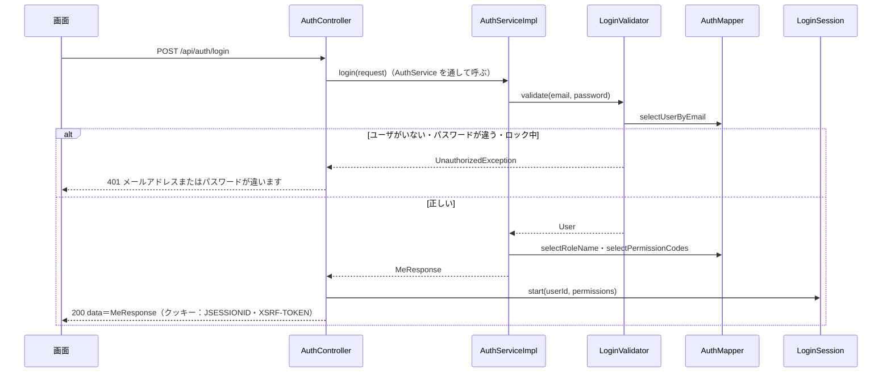

# API詳細設計：A-01 ログイン

| 項目 | 内容 |
|---|---|
| 版 | v1.0 2026-11-08 |
| Jira | ZPOP-55 |
| 状態 | 作成中 |
| 機能 | [auth](auth.md) |
| もとにした設計書 | API設計.md v1.1 の2.2・2.4・3.1・4.1・7章、画面設計.md v1.1 の2章・2.1、データ設計.md v1.0 の5.1〜5.4、基本設計書.md v1.1 の5章 |

## 1. API基本情報

写したもと：API設計.md v1.1 の3.1

| 項目 | 内容 |
|---|---|
| ID | A-01 |
| 名前 | ログイン |
| 操作 | POST |
| URL | /api/auth/login |
| 内容 | ログインする |
| 権限項目 | なし（ログイン前でも呼べる。SecurityConfig で許可） |
| 使う画面 | S-01（[S-01_ログイン.md](S-01_ログイン.md)） |
| controller のメソッド | AuthController#login |
| service のメソッド | AuthService#login（中身は AuthServiceImpl） |
| validator のメソッド | LoginValidator#validate |

## 2. リクエスト定義

写したもと：API設計.md v1.1 の4.1、画面設計.md v1.1 の2章

### 2.1 パスの値

なし

### 2.2 クエリ（URL の ? の後ろ）

なし

### 2.3 本文（JSON）

dto：`dto.auth.LoginRequest`

| 項目名 | 型 | 必須 | 制約 | 説明 |
|---|---|---|---|---|
| email | 文字 | ○ | 254文字まで。メールアドレスの形 | ログインに使うメールアドレス。大文字・小文字は区別しない（小文字にそろえて探す） |
| password | 文字 | ○ | 空でない | パスワード。ログには出さない |
| rememberMe | 真偽 | | ― | 「ログインしたままにする」。今回は受け取るだけで使わない（ZPOP-125） |

```json
{ "email": "yamada@example.com", "password": "（パスワード）", "rememberMe": true }
```

### 2.4 ファイル（CSV を受け取る API だけ）

なし

## 3. レスポンス定義

写したもと：API設計.md v1.1 の2.4・4.1・4.2

### 3.1 成功

| status | message |
|---|---|
| 200 | 処理が正常に完了しました。 |

data は A-03 と同じ形（[A-03_ログイン中の人の情報.md](A-03_ログイン中の人の情報.md) の3章。dto：`dto.auth.MeResponse`）。

あわせて、次のクッキーを渡す。

| クッキー | 中身 |
|---|---|
| JSESSIONID（セッション） | ログイン状態。プログラムから読めない（HttpOnly）。本番では HTTPS のときだけ送る（Secure。application-prod.yml） |
| XSRF-TOKEN | なりすまし対策の合言葉を新しくしたもの（3.2 の8） |

### 3.2 失敗

9章のとおり。

## 4. 処理フロー

1. AuthController が受け取る。`@Valid` で入力チェック（6章）。
2. 権限の確認はしない（ログイン前の API）。
3. AuthController が AuthService#login を呼ぶ（中身は AuthServiceImpl）。
4. AuthServiceImpl が LoginValidator#validate を呼ぶ。LoginValidator は次を確かめる（5章の No.1〜4）。
   1. メールアドレスを小文字にそろえ、AuthMapper#selectUserByEmail で、削除されていないユーザを探す。
   2. ユーザがいない、パスワードが空（password_hash が NULL）、パスワードが違う、ロック中（locked_at が入っている）のどれかなら、UnauthorizedException（「メールアドレスまたはパスワードが違います」）を投げる。
   3. ユーザがいない・パスワードが空のときも、決まった仮のハッシュでパスワードの照らし合わせを1回行う（かかる時間で登録の有無が分からないように）。
5. AuthServiceImpl が、ユーザの権限の名前（AuthMapper#selectRoleName）と権限項目（AuthMapper#selectPermissionCodes。並び順は permissions.sort_order）を読み、MeResponse を作る。
6. AuthServiceImpl がログに「ログインしました（userId）」を INFO で残す。失敗のときは 4 で WARN「ログインできませんでした（理由）」を残す（userId が分かるときは付ける。メールアドレス・パスワードは出さない）。
7. AuthController が LoginSession#start を呼ぶ（common.md 3.10）。
   1. すでにセッションがあれば、セッションの番号を変える（セッション固定攻撃＝他人にあらかじめ渡したセッションの番号で、ログイン後に乗っ取る攻撃、を防ぐ）。
   2. LoginUser（ユーザID、ログインした日時＝Clock の今）と権限項目で、ログイン状態を作り、セッションに保存する。
   3. なりすまし対策の合言葉（XSRF-TOKEN）を作り直す（ログイン前に渡した合言葉を、ログイン後に使わせない）。
8. `ApiResponse.ok(MeResponse)` で返す。



## 5. 条件分岐・業務ルール

| No. | 条件・ルール | 写したもと | 守る場所（クラス.メソッド） | 守れないとき | 同じルールを書いているほかの機能 |
|---|---|---|---|---|---|
| 1 | 登録されていない・削除されたメールアドレスではログインできない | API設計 4.1 | LoginValidator#validate | 9章の No.4 | なし |
| 2 | パスワードが違えばログインできない（bcrypt で照らし合わせる） | API設計 4.1、基本設計書 5章 | LoginValidator#validate | 9章の No.4 | なし |
| 3 | パスワードがまだない（password_hash が NULL）人はログインできない | データ設計 5.1（ユーザ登録の直後は空） | LoginValidator#validate | 9章の No.4 | なし |
| 4 | ロック中の人は、正しいパスワードでもログインできない | 画面設計 2章・2.1 | LoginValidator#validate | 9章の No.4 | なし |
| 5 | どの理由でも、同じ返し方・同じ文にする | auth.md R-1 | LoginValidator#validate | ― | なし |
| 6 | メールアドレスは小文字にそろえて探す | auth.md R-6 | LoginValidator#validate | ― | user（G-03・G-04 で保存するとき） |

## 6. バリデーション仕様

写したもと：画面設計.md v1.1 の2章（メッセージは一字も変えずに写す）

| 項目 | 決まり | メッセージ | 確かめる場所 |
|---|---|---|---|
| email | 必須 | 「メールアドレスを入力してください」 | dto の `@NotBlank` |
| email | 254文字まで | 「メールアドレスの形が正しくありません」 | dto の `@Size(max = 254)`（12章の No.1） |
| email | メールアドレスの形 | 「メールアドレスの形が正しくありません」 | dto の `@Email` |
| password | 必須 | 「パスワードを入力してください」 | dto の `@NotBlank` |
| email・password | 登録されている組み合わせ | 「メールアドレスまたはパスワードが違います」（401） | LoginValidator#validate（業務チェック） |

## 7. DB操作仕様

写したもと：データ設計.md v1.0 の5.1〜5.4

| No. | mapper のメソッド | 操作 | テーブル | 条件 | 読む・書く列 | 件数 |
|---|---|---|---|---|---|---|
| 1 | AuthMapper#selectUserByEmail | SELECT | users | email = ?（小文字にそろえた値） AND deleted_at IS NULL | id, name, email, password_hash, role_id, locked_at, session_valid_after | 0〜1件 |
| 2 | AuthMapper#selectRoleName | SELECT | roles | id = ? | name | 1件 |
| 3 | AuthMapper#selectPermissionCodes | SELECT | role_permissions | role_id = ? | permission_code | 0〜18件 |
| 4 | AuthMapper#selectSortedPermissionCodes | SELECT | permissions | code IN (3 の値)（`<foreach>`） ORDER BY sort_order | code | 0〜18件 |

- 複数のテーブルの突き合わせ方：3 で権限項目のコードを読み、4 でその並び順を permissions から読む（JOIN を使わない）。3 が0件なら 4 は出さない。
- 削除済みを除く条件：users は deleted_at IS NULL。roles は、ユーザに割り当てている権限は削除できない（画面設計 20章）ので条件を付けない。
- 書き換えはしない（失敗の回数を数えるのは ZPOP-124）。

## 8. トランザクション・排他制御

| 項目 | 内容 |
|---|---|
| @Transactional | 付けない（読むだけ） |
| 楽観ロック（version） | 使わない |
| 同時に操作されたとき | 読むだけなので、影響はない |
| Slack を送るタイミング | 送らない（ロックの DM は ZPOP-124） |

## 9. エラー処理仕様

写したもと：API設計.md v1.1 の2.3・2.4・4.1、画面設計.md v1.1 の2章

| No. | 場面 | 投げる例外 | status | message | errors |
|---|---|---|---|---|---|
| 1 | 入力の誤り | （Bean Validation） | 400 | 入力内容に誤りがあります。 | 入力欄ごとのメッセージ（6章） |
| 2 | JSON の形が壊れている | （Spring） | 400 | 入力内容に誤りがあります。 | null |
| 3 | CSRF の合言葉がない・違う | （Spring Security） | 403 | この操作を行う権限がありません。 | null |
| 4 | メールアドレスかパスワードが違う、削除されたユーザ、パスワードがまだない、ロック中 | UnauthorizedException | 401 | メールアドレスまたはパスワードが違います | null |

```json
{ "status": 401, "message": "メールアドレスまたはパスワードが違います", "data": null, "errors": null }
```

## 10. 認証・認可仕様

| 項目 | 内容 |
|---|---|
| ログイン | 要らない（SecurityConfig の PUBLIC_POST_APIS） |
| 権限項目 | なし（`@PreAuthorize` を付けない） |
| 対象の確かめ（IDOR） | ID を受け取らない |

## 11. 外部API連携仕様

なし

## 12. 設計書にない判断

| No. | 判断 | 理由 | 外から見えるか | 人の確認 |
|---|---|---|---|---|
| 1 | メールアドレスが254文字を超えたときは「メールアドレスの形が正しくありません」を出す | 画面設計 2章は、決まりが3つ（空でない・254文字まで・形）でメッセージが2つ。254文字を超えるメールアドレスは形として正しくないため | はい | まだ |
| 2 | rememberMe は受け取るが使わない | ログインしたままにする は ZPOP-125 で作る | はい（チェックしても60日間にならない） | まだ |
| 3 | ユーザがいない・パスワードがないときも、仮のハッシュで照らし合わせを1回行う | 照らし合わせ（bcrypt）は時間がかかるので、しないと返事の速さで登録の有無が分かってしまうため（R-1） | いいえ | まだ |
| 4 | ログインに成功したら、XSRF-TOKEN を作り直す | ログイン前に渡した合言葉を、ログイン後に使い回させないため（Spring Security の通常のログインと同じ動き） | いいえ（画面はクッキーを毎回読むので影響しない） | まだ |

## 変更履歴

| 版 | 日付 | 内容 |
|---|---|---|
| v1.0 | 2026-11-08 | 初版（ZPOP-55） |
