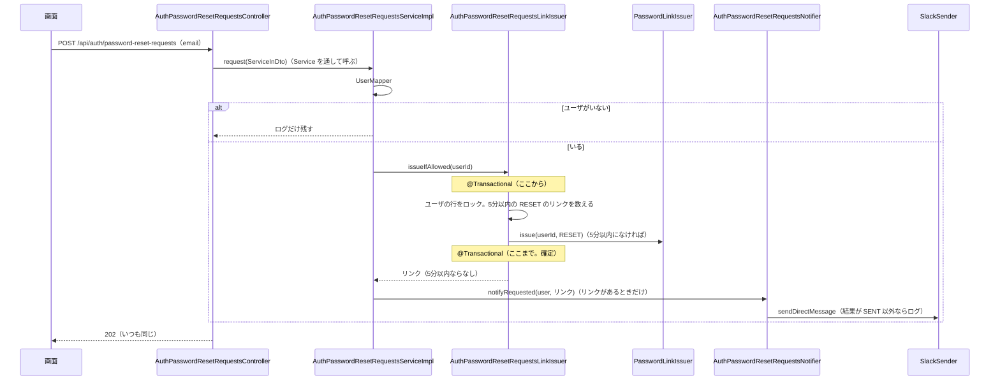

# API詳細設計：A-04 パスワード設定用のリンクの依頼

| 項目 | 内容 |
|---|---|
| 版 | v1.0 2026-11-15 |
| Jira | ZPOP-58 |
| 状態 | 作成中 |
| まとまり | [auth](auth.md)（api.auth） |
| もとにした設計書 | API設計.md v1.1 の2.4・3.1・4.3・6章・7章、画面設計.md v1.1 の5章（S-02）・9章（①）、機能一覧.md v1.1 の6章（1・2・6）、データ設計.md v1.0 の5.8・8章 |

## 1. API基本情報

写したもと：API設計.md v1.1 の3.1

| 項目 | 内容 |
|---|---|
| ID | A-04 |
| 名前 | パスワード設定用のリンクの依頼 |
| 操作 | POST |
| URL | /api/auth/password-reset-requests |
| 内容 | パスワード設定用のリンクを依頼する |
| 権限項目 | なし（ログイン前でも呼べる。SecurityConfig の PUBLIC_POST_APIS に、すでに入っている） |
| 使う画面 | S-02（ZPOP-104。まだない） |
| パッケージ | api.auth.passwordresetrequests（API_パッケージとクラス名_決定版.md のとおり） |
| クラス名の頭（`<頭>`） | AuthPasswordResetRequests |
| Controller のメソッド | `controller.AuthPasswordResetRequestsController#request` |
| Service のメソッド | `service.AuthPasswordResetRequestsService#request`（中身は `AuthPasswordResetRequestsServiceImpl`） |
| Validator のメソッド | なし（業務チェックがない。どの場合も 202 を返し、守れないときに止めるものがないため。5章） |

## 2. リクエスト定義

写したもと：API設計.md v1.1 の4.3、画面設計.md v1.1 の5章

### 2.1 パスの値

なし

### 2.2 クエリ（URL の ? の後ろ）

なし

### 2.3 本文（JSON）

RestInDto：`controller.AuthPasswordResetRequestsRestInDto`（形式のチェック。6章）

| 項目名 | 型 | 必須 | 制約 | 説明 |
|---|---|---|---|---|
| email | 文字 | ○ | 254文字まで。メールアドレスの形 | パスワード設定用のリンクを受け取るメールアドレス。大文字・小文字は区別しない（小文字にそろえて探す） |

```json
{ "email": "yamada@example.com" }
```

### 2.4 ファイル（CSV を受け取る API だけ）

なし

### 2.5 Service に渡す値（ServiceInDto）

ServiceInDto：`service.AuthPasswordResetRequestsServiceInDto`。DB と照らして確かめることがないので、チェック用アノテーションは付けない。

| 項目名 | 型 | もと | 付けるチェック用アノテーション（common.validation） |
|---|---|---|---|
| email | 文字 | RestInDto の email | なし |

## 3. レスポンス定義

写したもと：API設計.md v1.1 の2.4・4.3、画面設計.md v1.1 の5章

### 3.1 成功

| status | message |
|---|---|
| 202 | 処理が正常に完了しました。 |

登録の有無・5分以内の依頼・DMを送れたかにかかわらず、**いつも同じ**（data は null。登録の有無などが返す値から分からないようにするため。画面設計 5章）。RestOutDto は作らない。

```json
{
  "status": 202,
  "message": "処理が正常に完了しました。",
  "data": null,
  "errors": null
}
```

画面に出す文（「登録されているメールアドレスであれば、SlackのDMでパスワード設定用のリンクを送りました。届かない場合は、総務に連絡してください。」）は、S-02（ZPOP-104）が出す。このAPIは返さない。

### 3.2 失敗

9章のとおり。

## 4. 処理フロー

1. AuthPasswordResetRequestsController が受け取る。`@Valid` で形式のチェック（6章）。
2. 権限の確認はしない（ログイン前の API）。
3. Controller が `AuthPasswordResetRequestsServiceInDto` を作り、`AuthPasswordResetRequestsService#request` を呼ぶ（中身は AuthPasswordResetRequestsServiceImpl。`@Transactional` は付けない。8章）。
4. ServiceImpl が、メールアドレスを小文字にそろえ、UserMapper#selectByExample（andEmailEqualTo・andDeletedAtIsNull）で、削除されていないユーザを探す。いなければ、ログに残して終わる（5章の No.1）。
5. ServiceImpl が AuthPasswordResetRequestsLinkIssuer#issueIfAllowed（`@Transactional`。8章）を呼ぶ。この中で：
   1. UserCustomMapper#selectIdForUpdate で、そのユーザの行をロックする（同じ人への依頼が同時に来ても、1つずつ処理するため）。
   2. PasswordTokenMapper#countByExample で、その人の、用途が RESET のリンクで、作った日時が「今 − 5分（`app.password-link.request-interval`）」より後のものを数える。1件以上あれば、リンクを作らず、空を返す（5章の No.2）。
   3. 0件なら、common.passwordlink.PasswordLinkIssuer#issue（用途 RESET。有効期限30分。common.md 3.14）で、リンクを作る（前のリンクは無効になる）。作ったリンクを返す。
6. 5 が空なら、ログに残して終わる。リンクが返ったら、確定したあとで（`@Transactional` の外）、AuthPasswordResetRequestsNotifier が SlackSender（common.md 3.13）でDM（①）を送る。送れなかったとき（USER_NOT_FOUND・FAILED）は、ログに WARN で残すだけ（5章の No.4）。
7. Controller が `ApiResponse.accepted()` で返す。どの場合も同じ。



## 5. 条件分岐・業務ルール

| No. | 条件・ルール | 写したもと | 守る場所（クラス.メソッド） | 守れないとき | 同じルールを書いているほかの機能 |
|---|---|---|---|---|---|
| 1 | 登録されていない・削除されたユーザには、リンクを作らず、DMも送らない。画面の返し方は同じ | 画面設計 5章、機能一覧 6章の1 | AuthPasswordResetRequestsServiceImpl#request | ― （ログだけ） | なし |
| 2 | 同じメールアドレスへの依頼が5分以内なら、リンクを作らず、DMも送らない。画面の返し方は同じ（5分は `app.password-link.request-interval`） | 画面設計 5章、機能一覧 6章の6、API設計 6章 | AuthPasswordResetRequestsLinkIssuer#issueIfAllowed | ― （ログだけ） | なし |
| 3 | 依頼しただけでは、パスワードは変えない。リンクを作り、DMを送るだけ | 機能一覧 6章の2 | AuthPasswordResetRequestsServiceImpl#request（users は書き換えない） | ― | なし |
| 4 | Slack のユーザーが見つからない・DMを送れなかったときは、送れなかったことをログに残す。画面の返し方は同じ | 画面設計 5章・9章の注意3 | AuthPasswordResetRequestsNotifier#notifyRequested | ― （ログだけ） | なし |
| 5 | 新しいリンクを作ったら、それより前のリンクは使えなくする | 画面設計 5章 | common.passwordlink.PasswordLinkIssuer#issue | ― | A-01（ロック）、G-03・G-06 |
| 6 | リンクの有効期限は30分（`app.password-link.reset-validity`）。DMのアドレスは `app.base-url` で作る | 機能一覧 6章の3・4、API設計 6章 | common.passwordlink.PasswordLinkIssuer#issue | ― | A-01（ロック）、G-03・G-06 |
| 7 | 登録の有無・5分以内かどうか・DMを送れたかを、返す値（status・message）から分からないようにする | 機能一覧 6章の1、API設計 4.3 | AuthPasswordResetRequestsController#request（いつも `ApiResponse.accepted()`） | ― | なし |
| 8 | ロックされているユーザ・パスワードがまだないユーザにも、リンクを送る | 画面設計 5章の目的（ロックされたとき）、9章の②（期限が切れたらここから設定できる） | AuthPasswordResetRequestsServiceImpl#request（ロック・パスワードの有無を見ない） | ― | なし |
| 9 | メールアドレスは小文字にそろえて探す | auth.md R-6 | AuthPasswordResetRequestsServiceImpl#request | ― | A-01 |

## 6. バリデーション仕様

写したもと：画面設計.md v1.1 の5章（メッセージは一字も変えずに写す）

| 項目 | 決まり | メッセージ | 確かめる場所 |
|---|---|---|---|
| email | 必須（空でない） | 「メールアドレスを入力してください」 | RestInDto の `@NotBlank` |
| email | 254文字まで | 「メールアドレスの形が正しくありません」 | RestInDto の `@Size(max = 254)` |
| email | メールアドレスの形 | 「メールアドレスの形が正しくありません」 | RestInDto の `@Email` |

画面設計 5章は、254文字までのときのメッセージを決めていない。A-01（auth/A-01_ログイン.md の6章）と同じく、「形が正しくありません」を使う（12章の No.1）。

## 7. DB操作仕様

写したもと：データ設計.md v1.0 の5.1・5.8・8章

| No. | Mapper のメソッド | 使う所 | 操作 | テーブル | 条件 | 読む・書く列 | 件数 |
|---|---|---|---|---|---|---|---|
| 1 | UserMapper#selectByExample | AuthPasswordResetRequestsServiceImpl#request | SELECT | users | `andEmailEqualTo(小文字のメールアドレス).andDeletedAtIsNull()` | 全列（id・email） | 0〜1件 |
| 2 | UserCustomMapper#selectIdForUpdate | AuthPasswordResetRequestsLinkIssuer#issueIfAllowed | SELECT（`FOR UPDATE`） | users | `id = ?` | id | 1件 |
| 3 | PasswordTokenMapper#countByExample | AuthPasswordResetRequestsLinkIssuer#issueIfAllowed | SELECT（件数） | password_tokens | `andUserIdEqualTo(id).andPurposeEqualTo("RESET").andCreatedAtGreaterThan(今 − 5分)` | ― | 件数 |
| 4 | PasswordTokenMapper#updateByExampleSelective・#insert | PasswordLinkIssuer#issue（common.md 3.14） | UPDATE・INSERT | password_tokens | 前のリンクを無効にして、新しいリンクを入れる | revoked_at／user_id・token_hash・purpose・expires_at・created_at | |

- 手で書く Mapper を使う SQL と、自動で作れない理由：UserCustomMapper#selectIdForUpdate（`SELECT id FROM users WHERE id = #{id} FOR UPDATE`）。行をロックして読む `FOR UPDATE` は、Example では書けない。
- 複数のテーブルの突き合わせ方：なし（テーブルごとに読む）。
- まとめて読む所（N+1 を防ぐ）：なし（1人分だけ）。
- 削除済みを除く条件：users は deleted_at IS NULL（No.1）。
- users は書き換えない（パスワードも変えない。5章の No.3）。

## 8. トランザクション・排他制御

| 項目 | 内容 |
|---|---|
| @Transactional | ServiceImpl には付けない。Slack の送信を、書き込みが確定したあとにするため（CLAUDE.md 5章）。書き換えが2つある「5分以内かの確かめと、リンクを作る処理」だけを、別のクラス `AuthPasswordResetRequestsLinkIssuer#issueIfAllowed` に分けて `@Transactional` を付ける（A-01 の LoginFailureRecorder と同じ作り） |
| 楽観ロック（version） | 使わない（users を書き換えない） |
| 同時に操作されたとき | 同じ人への依頼が同時に来ても、そのユーザの行を `FOR UPDATE` で先にロックするので、1つずつ処理される。あとの依頼は、先の依頼が作ったリンクを「5分以内」として見るため、リンクもDMも1つだけになる（12章の No.3） |
| Slack を送るタイミング | 書き込みが確定してから（11章） |

## 9. エラー処理仕様

写したもと：API設計.md v1.1 の2.3・4.3

| No. | 場面 | 投げる例外 | status | message | errors |
|---|---|---|---|---|---|
| 1 | 入力の誤り（メールアドレスが空・形が正しくない・255文字以上） | （Bean Validation） | 400 | 入力内容に誤りがあります。 | 入力欄ごとのメッセージ（6章） |
| 2 | 登録されていない・削除されたユーザ・5分以内・DMが送れなかった | なし（エラーにしない） | 202 | 処理が正常に完了しました。 | null |

ログインの要らない API なので、401・403 は返らない。

## 10. 認証・認可仕様

| 項目 | 内容 |
|---|---|
| ログイン | 要らない（SecurityConfig の PUBLIC_POST_APIS） |
| 権限項目 | なし |
| なりすまし対策の合言葉（CSRF） | 要る（A-01 と同じ。XSRF-TOKEN クッキーの値を X-XSRF-TOKEN ヘッダーに付ける） |
| 対象の確かめ（IDOR） | ID を受け取らない（メールアドレスだけ） |

## 11. 外部API連携仕様

Slack のDM（画面設計 9章の①）を送る。

| 項目 | 内容 |
|---|---|
| 送る相手 | 依頼したメールアドレスのユーザ（ユーザに登録したメールアドレスで Slack のユーザーを探す。common.md 3.13） |
| 見出し | 【備品管理】パスワード再設定のご案内 |
| 本文 | パスワード設定用のリンク（`app.base-url` ＋ `/password-set?token=` ＋ 合言葉）。有効期限（`app.password-link.reset-validity` を「分」で書く。30分）。依頼に心当たりがなければ、このDMは無視してよく、パスワードは変わらないこと。パスワードは書かない（画面設計 9章の①。本文の言葉は、画面設計が「書くこと」だけを決めているので、こちらで作った。12章の No.2） |
| 送るタイミング | 書き込みが確定してから（`@Transactional` の外） |
| 送れなかったとき | ログに WARN で残すだけ。画面の返し方は変えない（画面設計 5章・9章の注意3） |

本文の例：

```
パスワードの再設定の依頼を受け付けました。
次のリンクから、新しいパスワードを設定してください（有効期限：30分）。
<リンク>

依頼した覚えがない場合は、このDMは無視してください。パスワードは変わりません。
```

## 12. 設計書にない判断

| No. | 判断 | 理由 | 外から見えるか | 人の確認 |
|---|---|---|---|---|
| 1 | メールアドレスが254文字を超えたときのメッセージを、「メールアドレスの形が正しくありません」にした | 画面設計 5章の「254文字まで」にメッセージがない。A-01 と同じにそろえた | はい | まだ |
| 2 | リンクのDM（①）の本文の言葉を、画面設計 9章の「本文に書くこと」から作った（11章） | 9章は書く内容だけを決めていて、文そのものは決めていないため | はい（Slack に出る文） | まだ |
| 3 | 「5分以内」は、その人の、用途が RESET のリンクの作成日時で見る。ロックのリンク（LOCK）や登録のリンク（REGISTER）は数えない。境界は、「今 − 5分」より後に作ったものだけを数える（ちょうど5分たてば、また送れる） | 「同じメールアドレスへの依頼」は、依頼で作ったリンクのこと。ロックされた直後・登録した直後でも、すぐに依頼できるようにするため。データ設計 5.8 の created_at と、8章のインデックス（user_id, created_at）を使う | はい（DMが届くか） | まだ |
| 4 | 5分以内かの確かめとリンクを作る処理を、ユーザの行の `FOR UPDATE`（行をロックして読む）の下で行う | 同じ人への依頼が同時に来たとき、確かめを両方が通り抜けて、リンクとDMが2つできるのを防ぐため（機能一覧 6章の6は「5分に1回まで」と決めている） | いいえ | ― |
| 5 | ロックされているユーザ・パスワードがまだないユーザにも、リンクを送る | S-02 の目的が「ロックされたとき」を含み、9章の②が「期限が切れたら、ログイン画面の『パスワードを忘れた方はこちら』から設定できる」と書いているため | はい | ― |
| 6 | 返事を返すまでにかかる時間は、そろえない。登録されているメールアドレスのときは、Slack を呼ぶぶん、返事が遅くなる | 時間で登録の有無が分かる可能性がある（A-01 は、仮のハッシュの照らし合わせで時間をそろえた）。そろえるには、DMを別のスレッドで送るなどの仕組みが要り、設計書にない。人が、今回の範囲でよいかを決める | はい（セキュリティ） | まだ |

## 変更履歴

| 版 | 日付 | 内容 |
|---|---|---|
| v1.0 | 2026-11-15 | 初版（ZPOP-58） |
