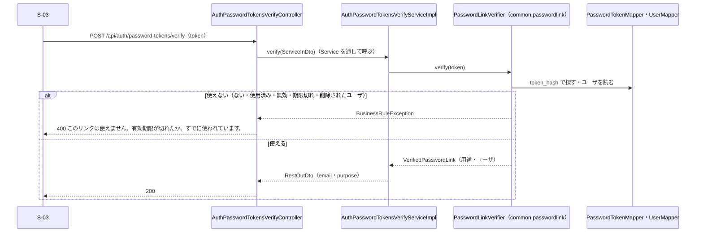

# API詳細設計：A-05 合言葉の確認

| 項目 | 内容 |
|---|---|
| 版 | v1.0 2026-11-15 |
| Jira | ZPOP-59 |
| 状態 | 作成中 |
| まとまり | [auth](auth.md)（api.auth） |
| もとにした設計書 | API設計.md v1.1 の2.3・2.4・3.1・7章、画面設計.md v1.1 の6章（S-03）・9章の注意2、機能一覧.md v1.1 の6章（2・3）、データ設計.md v1.0 の5.1・5.8 |

## 1. API基本情報

写したもと：API設計.md v1.1 の3.1

| 項目 | 内容 |
|---|---|
| ID | A-05 |
| 名前 | 合言葉の確認 |
| 操作 | POST |
| URL | /api/auth/password-tokens/verify |
| 内容 | リンクの合言葉が使えるか確かめる |
| 権限項目 | なし（ログイン前でも呼べる。SecurityConfig の PUBLIC_POST_APIS に、すでに入っている） |
| 使う画面 | S-03（ZPOP-105。開いたとき。まだない） |
| パッケージ | api.auth.passwordtokens.verify（API_パッケージとクラス名_決定版.md のとおり） |
| クラス名の頭（`<頭>`） | AuthPasswordTokensVerify |
| Controller のメソッド | `controller.AuthPasswordTokensVerifyController#verify` |
| Service のメソッド | `service.AuthPasswordTokensVerifyService#verify`（中身は `AuthPasswordTokensVerifyServiceImpl`） |
| Validator のメソッド | なし（確かめは、A-06 と同じ部品 common.passwordlink.PasswordLinkVerifier が行う。4章） |

## 2. リクエスト定義

写したもと：API設計.md v1.1 の3.1（合言葉は、アドレスに入れずに JSON の中で送る）、画面設計.md v1.1 の6章。API設計に A-05 の送る値の例がないため、A-06（4.4）の `token` に合わせて決めた（12章の No.1）。

### 2.1 パスの値

なし

### 2.2 クエリ（URL の ? の後ろ）

なし

### 2.3 本文（JSON）

RestInDto：`controller.AuthPasswordTokensVerifyRestInDto`（形式のチェックはしない。6章）

| 項目名 | 型 | 必須 | 制約 | 説明 |
|---|---|---|---|---|
| token | 文字 | （○） | なし | リンクの合言葉。S-03 が、アドレスの `?token=` から取って送る。ログには出さない。空・ない場合も入力の誤りにせず、「使えない」として返す（6章） |

```json
{ "token": "（リンクの合言葉）" }
```

### 2.4 ファイル（CSV を受け取る API だけ）

なし

### 2.5 Service に渡す値（ServiceInDto）

ServiceInDto：`service.AuthPasswordTokensVerifyServiceInDto`。DB と照らして確かめることは、ServiceImpl から呼ぶ common.passwordlink.PasswordLinkVerifier が行うので、チェック用アノテーションは付けない。

| 項目名 | 型 | もと | 付けるチェック用アノテーション（common.validation） |
|---|---|---|---|
| token | 文字 | RestInDto の token | なし |

## 3. レスポンス定義

写したもと：API設計.md v1.1 の2.4、画面設計.md v1.1 の6章（画面の絵・開いたときの確かめ）。data の形は、画面が要る値（対象のメールアドレス・見出しの違い）から決めた（12章の No.2）。

### 3.1 成功

| status | message |
|---|---|
| 200 | 処理が正常に完了しました。 |

RestOutDto：`model.AuthPasswordTokensVerifyRestOutDto`

| 項目名 | 型 | null になるか | もと（テーブル.列 ／ 計算） | 説明 |
|---|---|---|---|---|
| email | 文字 | ならない | users.email | 対象のメールアドレス。画面に表示するだけ（画面設計 6章） |
| purpose | 文字 | ならない | password_tokens.purpose | リンクの用途。`RESET`（再設定）・`LOCK`（ロック）・`REGISTER`（ユーザ登録）。画面の見出しを、REGISTER のときは「パスワードの設定」、それ以外は「パスワードの再設定」にするために使う（画面設計 6章） |

```json
{
  "status": 200,
  "message": "処理が正常に完了しました。",
  "data": { "email": "yamada@example.com", "purpose": "RESET" },
  "errors": null
}
```

リンクを開いただけでは、使用済みにしない（used_at を書かない。画面設計 9章の注意2）。何も書き換えない。

### 3.2 失敗

9章のとおり。

## 4. 処理フロー

1. AuthPasswordTokensVerifyController が受け取る。形式のチェックはない（6章）。
2. 権限の確認はしない（ログイン前の API）。
3. Controller が `AuthPasswordTokensVerifyServiceInDto` を作り、`AuthPasswordTokensVerifyService#verify` を呼ぶ（中身は AuthPasswordTokensVerifyServiceImpl。`@Transactional` は付けない。読むだけ）。
4. ServiceImpl が common.passwordlink.PasswordLinkVerifier#verify（common.md 3.14）を呼ぶ。PasswordLinkVerifier は次を確かめる（5章の No.1〜4）。
   1. 合言葉が空なら、使えない。
   2. `PasswordLinkTokens#hash` でハッシュを作り、PasswordTokenMapper#selectByExample（andTokenHashEqualTo）で探す。なければ、使えない。
   3. 使用済み（used_at が入っている）、無効（revoked_at が入っている。より新しいリンクが作られたときに入る）、期限切れ（expires_at が今（Clock）以前）のどれかなら、使えない。
   4. UserMapper#selectByPrimaryKey でそのユーザを読む。いない、または削除されている（deleted_at が入っている）なら、使えない。
   5. 使えないときは、BusinessRuleException（「このリンクは使えません。有効期限が切れたか、すでに使われています。」）を投げる。どの理由でも、同じ文（理由を知らせない。画面設計 6章）。理由は、ログに WARN で残す（合言葉は出さない）。
5. ServiceImpl が、読んだユーザのメールアドレスと、リンクの用途で `AuthPasswordTokensVerifyRestOutDto` を作って返す。
6. Controller が `ApiResponse.ok(…)` で返す。



## 5. 条件分岐・業務ルール

| No. | 条件・ルール | 写したもと | 守る場所（クラス.メソッド） | 守れないとき | 同じルールを書いているほかの機能 |
|---|---|---|---|---|---|
| 1 | 正しくない（データベースにない）合言葉は使えない | 画面設計 6章 | common.passwordlink.PasswordLinkVerifier#verify | 9章の No.1 | A-06 |
| 2 | 使用済みのリンクは使えない | 画面設計 6章、機能一覧 6章の3 | 同上 | 9章の No.1 | A-06 |
| 3 | 期限切れのリンクは使えない（期限ちょうどの時刻も使えない） | 画面設計 6章、機能一覧 6章の3 | 同上 | 9章の No.1 | A-06 |
| 4 | より新しいリンクが送られたら、前のリンクは使えない（作るときに revoked_at を入れてある） | 画面設計 5章・6章 | 同上（revoked_at を見る）。入れるのは common.passwordlink.PasswordLinkIssuer#issue | 9章の No.1 | A-06 |
| 5 | 削除されたユーザのリンクは使えない | （設計書にない判断。12章 No.3） | 同上 | 9章の No.1 | A-06 |
| 6 | どの理由でも、同じ返し方・同じ文にする | 画面設計 6章 | 同上 | ― | A-06 |
| 7 | リンクを開いただけでは使用済みにしない。何も書き換えない | 画面設計 9章の注意2 | AuthPasswordTokensVerifyServiceImpl#verify（書き換える Mapper を使わない） | ― | なし（使用済みにするのは A-06） |
| 8 | 合言葉をログに出さない | API設計 7章、CLAUDE.md 5章 | PasswordLinkVerifier・AuthPasswordTokensVerifyRestInDto（toString を伏せる） | ― | A-06 |

## 6. バリデーション仕様

写したもと：画面設計.md v1.1 の6章

形式のチェックはしない。画面設計 6章は、リンクの確かめだけを決めていて、合言葉の入力欄の形式のチェックとメッセージがないため。合言葉が空・ないときは、「リンクが正しくない」と同じに扱い、9章の No.1 を返す（12章の No.4）。

## 7. DB操作仕様

写したもと：データ設計.md v1.0 の5.1・5.8

| No. | Mapper のメソッド | 使う所 | 操作 | テーブル | 条件（Criteria） | 読む・書く列 | 件数 |
|---|---|---|---|---|---|---|---|
| 1 | PasswordTokenMapper#selectByExample | PasswordLinkVerifier#verify | SELECT | password_tokens | `andTokenHashEqualTo(ハッシュ)` | 全列 | 0〜1件（token_hash は UNIQUE） |
| 2 | UserMapper#selectByPrimaryKey | PasswordLinkVerifier#verify | SELECT | users | `id = ?` | 全列（email・deleted_at を使う） | 0〜1件 |

- 手で書く Mapper（dao.mapper.custom）を使うときは、その SQL と、自動で作れない理由：なし。
- 複数のテーブルの突き合わせ方：password_tokens を読み、その user_id で users を読む（JOIN は使わない）。
- まとめて読む所（N+1 を防ぐ）：なし（1件だけ）。
- 削除済みを除く条件：users の deleted_at が入っていれば、使えない（5章の No.5）。
- 書き換えはしない。

## 8. トランザクション・排他制御

| 項目 | 内容 |
|---|---|
| @Transactional | 付けない（読むだけ） |
| 楽観ロック（version） | 使わない |
| 同時に操作されたとき | 読むだけなので問題ない。確かめたあとにリンクが使われても、そのときは A-06 が、使うときにもう一度確かめて断る（A-06 の設計で決める） |
| Slack を送るタイミング | 送らない |

## 9. エラー処理仕様

写したもと：API設計.md v1.1 の2.3・4.4、画面設計.md v1.1 の6章

| No. | 場面 | 投げる例外 | status | message | errors |
|---|---|---|---|---|---|
| 1 | 合言葉が使えない（空・ない・使用済み・無効・期限切れ・削除されたユーザ） | BusinessRuleException | 400 | このリンクは使えません。有効期限が切れたか、すでに使われています。 | null |

ログインの要らない API なので、401・403 は返らない。

## 10. 認証・認可仕様

| 項目 | 内容 |
|---|---|
| ログイン | 要らない（SecurityConfig の PUBLIC_POST_APIS） |
| 権限項目 | なし |
| なりすまし対策の合言葉（CSRF） | 要る（A-01 と同じ） |
| 対象の確かめ（IDOR） | ID を受け取らない（合言葉だけ。合言葉を知っている人だけが、その人のメールアドレスを見られる） |

合言葉は推測されにくい（256ビットの乱数。common.md 3.14）ので、機能一覧 6章の6の「合言葉の試し打ち」を防ぐ回数の制限は入れない（12章の No.5）。

## 11. 外部API連携仕様

なし

## 12. 設計書にない判断

| No. | 判断 | 理由 | 外から見えるか | 人の確認 |
|---|---|---|---|---|
| 1 | 送る値を `{ "token": "…" }` にした | API設計 3.1 に、A-05 の送る値の例がない。A-06（4.4）の `token` と同じ名前にそろえた | はい | まだ |
| 2 | 成功のとき、data に `email` と `purpose`（RESET・LOCK・REGISTER）を返す | 画面設計 6章の画面に、対象のメールアドレスの表示と、「パスワードの再設定」「パスワードの設定」の見出しの違いがあるが、API設計に返す値がないため | はい | まだ |
| 3 | 削除されたユーザのリンクは、使えないことにする | 画面設計 6章は決めていない。削除されたユーザが、パスワードを決めて、ログインできるようにならないようにするため（ログイン自体は A-01 が断る） | はい | まだ |
| 4 | 合言葉が空・ないときは、入力の誤り（400・errors あり）にせず、「このリンクは使えません」（400・errors なし）を返す | 画面設計 6章に、合言葉の入力欄とメッセージがない。リンクのアドレスから取って送る値で、人が入力しないため | はい | まだ |
| 5 | 合言葉の試し打ちを防ぐ回数の制限を入れない | 機能一覧 6章の6は「合言葉の試し打ち」も短い間に何度もできないようにする例を挙げているが、API設計 6章に決まり（回数・間隔の設定）がない。合言葉は256ビットの乱数で、試し打ちでは当たらない | いいえ | まだ |
| 6 | 確かめる部品 PasswordLinkVerifier を common.passwordlink に置いた（A-06 も使う） | API のパッケージどうしは使い合わないため（CLAUDE.md 5章）。common.md 3.14 に足す | いいえ | ― |

## 変更履歴

| 版 | 日付 | 内容 |
|---|---|---|
| v1.0 | 2026-11-15 | 初版（ZPOP-59） |
