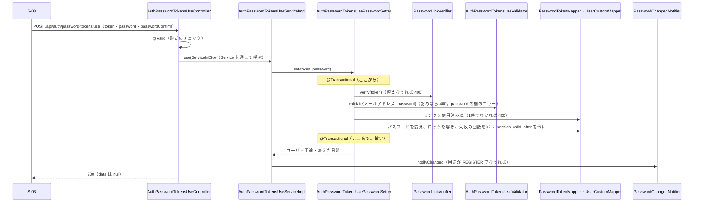

# API詳細設計：A-06 合言葉でパスワードを決める

| 項目 | 内容 |
|---|---|
| 版 | v1.0 2026-11-15 |
| Jira | ZPOP-60 |
| 状態 | 作成中 |
| まとまり | [auth](auth.md)（api.auth） |
| もとにした設計書 | API設計.md v1.1 の2.3・2.4・3.1・4.4・7章、画面設計.md v1.1 の2.1・6章（S-03）・8章（パスワードの決まり）・9章の④、機能一覧.md v1.1 の6章（2・3・7・8・9・11）、データ設計.md v1.0 の5.1・5.8 |

## 1. API基本情報

写したもと：API設計.md v1.1 の3.1

| 項目 | 内容 |
|---|---|
| ID | A-06 |
| 名前 | 合言葉でパスワードを決める |
| 操作 | POST |
| URL | /api/auth/password-tokens/use |
| 内容 | 合言葉を使って新しいパスワードを決める |
| 権限項目 | なし（ログイン前でも呼べる。SecurityConfig の PUBLIC_POST_APIS に、すでに入っている） |
| 使う画面 | S-03（ZPOP-105。「設定する」を押したとき。まだない） |
| パッケージ | api.auth.passwordtokens.use（API_パッケージとクラス名_決定版.md のとおり） |
| クラス名の頭（`<頭>`） | AuthPasswordTokensUse |
| Controller のメソッド | `controller.AuthPasswordTokensUseController#use` |
| Service のメソッド | `service.AuthPasswordTokensUseService#use`（中身は `AuthPasswordTokensUseServiceImpl`） |
| Validator のメソッド | `validator.AuthPasswordTokensUseValidator#validate`（渡す値は `AuthPasswordTokensUseValidatorDto`） |

## 2. リクエスト定義

写したもと：API設計.md v1.1 の4.4、画面設計.md v1.1 の6章・8章

### 2.1 パスの値

なし

### 2.2 クエリ（URL の ? の後ろ）

なし

### 2.3 本文（JSON）

RestInDto：`controller.AuthPasswordTokensUseRestInDto`（形式のチェック。6章）

| 項目名 | 型 | 必須 | 制約 | 説明 |
|---|---|---|---|---|
| token | 文字 | （○） | なし | リンクの合言葉。ログには出さない。空・ないときは、「使えないリンク」として返す（A-05 の6章と同じ） |
| password | 文字 | ○ | 8文字以上64文字以内。半角の英字・数字・記号・スペースだけ | 新しいパスワード。前後の空白も取らない（スペースも使える）。ログには出さない |
| passwordConfirm | 文字 | ○ | password と同じ | 新しいパスワード（確認）。ログには出さない |

```json
{ "token": "（リンクの合言葉）", "password": "（新しいパスワード）", "passwordConfirm": "（同じもの）" }
```

### 2.4 ファイル（CSV を受け取る API だけ）

なし

### 2.5 Service に渡す値（ServiceInDto）

ServiceInDto：`service.AuthPasswordTokensUseServiceInDto`。DB と照らして確かめることは、リンクの確かめ（common.passwordlink.PasswordLinkVerifier）と Validator で行うので、チェック用アノテーションは付けない。

| 項目名 | 型 | もと | 付けるチェック用アノテーション（common.validation） |
|---|---|---|---|
| token | 文字 | RestInDto の token | なし |
| password | 文字 | RestInDto の password | なし |

passwordConfirm は、RestInDto で確かめ終わっているので、Service には渡さない。

## 3. レスポンス定義

写したもと：API設計.md v1.1 の2.4・4.4

### 3.1 成功

| status | message |
|---|---|
| 200 | 処理が正常に完了しました。 |

data は null。RestOutDto は作らない。自動ではログインさせない（機能一覧 6章の8）ので、ログイン状態もクッキーも渡さない。

```json
{
  "status": 200,
  "message": "処理が正常に完了しました。",
  "data": null,
  "errors": null
}
```

完了メッセージ「パスワードを設定しました。新しいパスワードでログインしてください。」は、S-03 が出す（画面設計 6章）。

### 3.2 失敗

9章のとおり。

## 4. 処理フロー

写したもと：画面設計.md v1.1 の6章の「ボタンの動き」の1〜5、2.1 の2

1. AuthPasswordTokensUseController が受け取る。`@Valid` で形式のチェック（6章）。
2. 権限の確認はしない（ログイン前の API）。
3. Controller が `AuthPasswordTokensUseServiceInDto` を作り、`AuthPasswordTokensUseService#use` を呼ぶ（中身は AuthPasswordTokensUseServiceImpl。`@Transactional` は付けない。8章）。
4. ServiceImpl が AuthPasswordTokensUsePasswordSetter#set（`@Transactional`。8章）を呼ぶ。この中で、次を1つのまとまりで行う。
   1. common.passwordlink.PasswordLinkVerifier#verify（common.md 3.14）で、合言葉が使えるかを確かめる。使えなければ BusinessRuleException（400。A-05 と同じ文）。ユーザは削除されていないことも、ここで確かめられる。
   2. AuthPasswordTokensUseValidator#validate を呼ぶ（5章の No.5）。パスワードが、メールアドレス・システム名・よく使われるパスワードと同じなら、FieldErrorException（password に画面設計 8章の文）。
   3. このリンクを使用済みにする：PasswordTokenMapper#updateByExampleSelective で、`id = ? AND used_at IS NULL AND revoked_at IS NULL AND expires_at > 今` の行の used_at に今（Clock）を入れる。1件でなければ、同時にほかで使われたので、BusinessRuleException（400。A-05 と同じ文）。
   4. パスワードを新しいものにする：UserCustomMapper#updatePassword で、password_hash（bcrypt）・failed_login_count（0）・locked_at（NULL。ロックの解除）・session_valid_after（今。秒まで）・updated_at・updated_by を書き換える（7章）。1件でなければ BusinessRuleException（400）。
   5. 変えた日時と、リンクの用途と、ユーザを返す。
5. 4 が確定したあとで（`@Transactional` の外。CLAUDE.md 5章）、リンクの用途が REGISTER でなければ、common.passwordlink.PasswordChangedNotifier が、SlackSender（common.md 3.13）でDM（④）を送る。ユーザ登録後の最初の設定（REGISTER）のときは送らない（画面設計 6章の5）。送れなかったとき（USER_NOT_FOUND・FAILED）は、ログに WARN で残すだけ（画面設計 9章の注意3）。
6. ServiceImpl がログに「パスワードを設定しました（userId、用途）」を INFO で残す（パスワード・合言葉は出さない）。
7. Controller が `ApiResponse.ok(null)` で返す。



## 5. 条件分岐・業務ルール

| No. | 条件・ルール | 写したもと | 守る場所（クラス.メソッド） | 守れないとき | 同じルールを書いているほかの機能 |
|---|---|---|---|---|---|
| 1 | 合言葉が使えないときは、パスワードを変えない（ない・使用済み・無効・期限切れ・削除されたユーザ） | 画面設計 6章、API設計 4.4 | common.passwordlink.PasswordLinkVerifier#verify | 9章の No.2 | A-05 |
| 2 | 新しいパスワードにする（bcrypt でハッシュにして保存する。パスワードそのものは保存しない） | 画面設計 6章の1、機能一覧 6章の11 | AuthPasswordTokensUsePasswordSetter#set（UserCustomMapper#updatePassword） | ― | A-07（変えるとき） |
| 3 | このリンクを使用済みにする（リンクを開いただけでは使用済みにしない。「設定する」を押したときに使用済みにする） | 画面設計 6章の2・9章の注意2 | AuthPasswordTokensUsePasswordSetter#set（used_at を入れる） | 同時にほかで使われたとき：9章の No.2 | なし |
| 4 | アカウントのロックを解除し、ログインの失敗の回数を0に戻す | 画面設計 6章の3・2.1 の2 | AuthPasswordTokensUsePasswordSetter#set（locked_at を NULL、failed_login_count を 0） | ― | なし |
| 5 | パスワードが、メールアドレス・システム名・よく使われるパスワードと同じなら使えない（大文字・小文字は区別しない） | 画面設計 8章 | AuthPasswordTokensUseValidator#validate（照らし合わせは common.security.PasswordBlocklist） | 9章の No.3 | A-07 |
| 6 | すべての端末のログイン（と「ログインしたままにする」）を切る | 画面設計 6章の4、機能一覧 6章の8、2.1 の6 | AuthPasswordTokensUsePasswordSetter#set（session_valid_after に今を入れる）。切るのは common.security.LoginUserRefresherImpl（auth.md R-4） | ― | A-07 |
| 7 | 自動ではログインさせない | 機能一覧 6章の8 | AuthPasswordTokensUseController#use（LoginSession を呼ばない） | ― | なし |
| 8 | パスワードが変わったことをDM（④）で知らせる。ユーザ登録後の最初の設定（REGISTER）のときは送らない。パスワードは書かない | 画面設計 6章の5・9章の④、機能一覧 6章の9 | AuthPasswordTokensUseServiceImpl#use（用途で分ける）、common.passwordlink.PasswordChangedNotifier#notifyChanged | 送れなかったときはログ（パスワードの変更はそのまま） | A-07 |
| 9 | 新しいパスワードを2回入力して確認する | 画面設計 6章、機能一覧 6章の7 | RestInDto の `@PasswordConfirmed`（common.validation） | 9章の No.1 | A-07 |
| 10 | 同時に2回、同じリンクが使われても、パスワードが変わるのは1回だけ（あとの1回は「使えないリンク」） | 機能一覧 6章の3（一度使ったら無効） | AuthPasswordTokensUsePasswordSetter#set（used_at IS NULL の行だけを書き換える） | 9章の No.2 | なし |
| 11 | パスワードや合言葉をログに出さない | API設計 7章、CLAUDE.md 5章 | RestInDto・ServiceInDto の toString を伏せる。PasswordLinkVerifier | ― | A-07 |

## 6. バリデーション仕様

写したもと：画面設計.md v1.1 の6章・8章（メッセージは一字も変えずに写す）

| 項目 | 決まり | メッセージ | 確かめる場所 |
|---|---|---|---|
| password | 空でない（null・長さ0） | 「新しいパスワードを入力してください」 | RestInDto の `@NewPasswordFormat`（common.validation） |
| password | 半角の英字・数字・記号・スペース（0x20〜0x7E）だけ | 「パスワードに使えるのは、半角の英字・数字・記号・スペースです」 | 同上 |
| password | 8文字以上 | 「パスワードは8文字以上で入力してください」 | 同上 |
| password | 64文字以内 | 「パスワードは64文字以内で入力してください」 | 同上 |
| password | メールアドレス・システム名・よく使われるパスワードと同じでない | 「このパスワードはよく使われているため、使えません。別のパスワードにしてください」 | Validator（読んだユーザのメールアドレスが要るため。5章の No.5） |
| passwordConfirm | password と同じ（空のときも、違うものとして扱う） | 「確認用のパスワードが一致しません」 | RestInDto のクラスに付ける `@PasswordConfirmed`（common.validation。誤りは passwordConfirm の欄に付ける） |

- `@NewPasswordFormat` は、1つの欄に1つだけメッセージを出す。上の表の順（空 → 使えない文字 → 短い → 長い）で、最初に当てはまったものだけ（12章の No.2）。
- token は形式のチェックをしない（A-05 の6章と同じ）。

## 7. DB操作仕様

写したもと：データ設計.md v1.0 の5.1・5.8

| No. | Mapper のメソッド | 使う所 | 操作 | テーブル | 条件 | 読む・書く列 | 件数 |
|---|---|---|---|---|---|---|---|
| 1 | PasswordTokenMapper#selectByExample | PasswordLinkVerifier#verify | SELECT | password_tokens | `andTokenHashEqualTo(ハッシュ)` | 全列 | 0〜1件 |
| 2 | UserMapper#selectByPrimaryKey | PasswordLinkVerifier#verify | SELECT | users | `id = ?` | 全列（email・deleted_at を使う） | 0〜1件 |
| 3 | PasswordTokenMapper#updateByExampleSelective | AuthPasswordTokensUsePasswordSetter#set | UPDATE | password_tokens | `andIdEqualTo(id).andUsedAtIsNull().andRevokedAtIsNull().andExpiresAtGreaterThan(今)` | used_at | 1件（0件なら同時に使われた） |
| 4 | UserCustomMapper#updatePassword | AuthPasswordTokensUsePasswordSetter#set | UPDATE | users | `id = ? AND deleted_at IS NULL` | password_hash、failed_login_count（0）、locked_at（NULL）、session_valid_after（今。秒まで）、updated_at（今）、updated_by（本人のID） | 1件 |

- 手で書く Mapper（dao.mapper.custom）を使う SQL と、自動で作れない理由：UserCustomMapper#updatePassword。locked_at を NULL にする書き換えは、Example の `updateByExampleSelective`（null の列は書き換えない）では書けないため。
- 複数のテーブルの突き合わせ方：なし（テーブルごとに読み、書く）。
- 削除済みを除く条件：users は deleted_at IS NULL（No.2 の確かめと、No.4 の条件）。
- 更新した件数の見方（0件のとき）：No.3・No.4 とも、1件でなければ BusinessRuleException（「このリンクは使えません。…」）を投げ、まとまり全体を元に戻す（パスワードは変わらない）。
- version は増やさない。updated_by には、パスワードを決めた本人のIDを入れる（12章の No.4）。

## 8. トランザクション・排他制御

| 項目 | 内容 |
|---|---|
| @Transactional | ServiceImpl には付けない。Slack の送信を、書き込みが確定したあとにするため（CLAUDE.md 5章）。書き換えが2つ（リンクを使用済みにする・パスワードを変える）ある処理を、別のクラス `AuthPasswordTokensUsePasswordSetter#set` に分けて `@Transactional` を付ける（A-01 の LoginFailureRecorder、A-04 の AuthPasswordResetRequestsLinkIssuer と同じ作り）。リンクの確かめと Validator も、この中に入る |
| 楽観ロック（version） | 使わない（users の version は増やさない） |
| 同時に操作されたとき | 同じリンクが同時に2回使われても、リンクの `used_at IS NULL` の行だけを書き換えるので、1つだけが成功し、あとの1つは 400（「このリンクは使えません。…」）になり、そのパスワードは反映されない |
| Slack を送るタイミング | 書き込みが確定してから（11章） |

## 9. エラー処理仕様

写したもと：API設計.md v1.1 の2.3・4.4、画面設計.md v1.1 の6章・8章

| No. | 場面 | 投げる例外 | status | message | errors |
|---|---|---|---|---|---|
| 1 | 入力の誤り（パスワードが空・文字・長さの決まりに合わない、確認が違う） | （Bean Validation） | 400 | 入力内容に誤りがあります。 | 入力欄ごとのメッセージ（6章。password・passwordConfirm） |
| 2 | 合言葉が使えない（空・ない・使用済み・無効・期限切れ・削除されたユーザ。同時にほかで使われたときも） | BusinessRuleException | 400 | このリンクは使えません。有効期限が切れたか、すでに使われています。 | null |
| 3 | パスワードが、メールアドレス・システム名・よく使われるパスワードと同じ | FieldErrorException | 400 | 入力内容に誤りがあります。 | password に「このパスワードはよく使われているため、使えません。別のパスワードにしてください」 |

- 1 と 2 が同時に当てはまるとき（パスワードの形が誤りで、合言葉も使えない）は、1 を返す（形式のチェックが先。12章の No.7）。
- ログインの要らない API なので、401・403 は返らない。

## 10. 認証・認可仕様

| 項目 | 内容 |
|---|---|
| ログイン | 要らない（SecurityConfig の PUBLIC_POST_APIS） |
| 権限項目 | なし |
| なりすまし対策の合言葉（CSRF） | 要る（A-01 と同じ） |
| 対象の確かめ（IDOR） | ID を受け取らない。合言葉を知っている人だけが、その合言葉のユーザのパスワードを決められる（合言葉は256ビットの乱数。common.md 3.14） |

## 11. 外部API連携仕様

パスワードが変わったことを、Slack のDM（画面設計 9章の④）で知らせる。ユーザ登録後の最初の設定（用途 REGISTER）のときは送らない。A-07 も同じDMを送るので、DMを作って送る部分は common.passwordlink.PasswordChangedNotifier に置く（common.md 3.14）。

| 項目 | 内容 |
|---|---|
| 送る相手 | パスワードを決めたユーザ（ユーザに登録したメールアドレスで Slack のユーザーを探す。common.md 3.13） |
| 見出し | 【備品管理】パスワードを変更しました |
| 本文 | パスワードが変わった日時（日本時間）。心当たりがなければ、すぐにパスワードを再設定し、総務に連絡すること。パスワードは書かない（画面設計 9章の④。本文の言葉は、画面設計が「書くこと」だけを決めているので、こちらで作った。12章の No.5） |
| 送るタイミング | 書き込みが確定してから（`@Transactional` の外） |
| 送れなかったとき | ログに WARN で残すだけ。パスワードの変更はそのまま。画面の返し方は変えない（画面設計 9章の注意3） |

本文の例：

```
パスワードを変更しました。
変更した日時：2026年11月15日 21:03

ご自分で変更した覚えがない場合は、すぐにパスワードを再設定し、総務に連絡してください。
```

## 12. 設計書にない判断

| No. | 判断 | 理由 | 外から見えるか | 人の確認 |
|---|---|---|---|---|
| 1 | session_valid_after は、今を**秒までにそろえて**（切り捨て）入れる。ログインした日時（loggedInAt）との比べ（LoginUserRefresherImpl）も、loggedInAt を秒までにそろえて行う（common.md 3.10 の申し送りの答え） | session_valid_after は DATETIME（秒まで）で、MySQL は細かい部分を四捨五入して入れるため、細かいまま入れると、四捨五入で次の秒になり、決めた直後（同じ1秒の中）のログインが、すぐに切られてしまう。切り捨ててそろえれば、パスワードを決めた直後（同じ1秒の中）のログインは有効で、それより前の秒のログインは切れる。同じ1秒の中で、パスワードの変更より前にログインしていたセッションは切れない（1秒の幅） | いいえ | ― |
| 2 | `@NewPasswordFormat` は、1つの欄に1つだけメッセージを出す。順番は 空 → 使えない文字 → 短い → 長い | 画面設計 8章は、メッセージを決めているが、同時に当てはまったときの順番を決めていない。たとえば日本語の短い文字列には、「使えない文字」を先に出す（直す手がかりとして一番役に立つ） | はい | まだ |
| 3 | 確認の欄が空・違うときは、同じ「確認用のパスワードが一致しません」を、passwordConfirm の欄に出す | 画面設計 6章は、確認の欄の「空」のメッセージを決めていない | はい | まだ |
| 4 | users の更新で、updated_by には本人のIDを入れ、version は増やさない | A-01 のロック（12章 No.9）は、システムが変えたので updated_by を空にした。こちらは、本人が決めたので本人のID。version は、ユーザの編集画面（G-04）の楽観ロックに影響させないため、増やさない | いいえ | まだ |
| 5 | DM④の本文の言葉を、画面設計 9章の「本文に書くこと」から作った（11章） | 9章は書く内容だけを決めていて、文そのものは決めていないため | はい（Slack に出る文） | まだ |
| 6 | 「メールアドレスやシステム名と同じ」の範囲：メールアドレスは全体（大文字・小文字は区別しない）。システム名は `equipment`・`equipmentmanagement`・`equipmentmanagementsystem`（大文字・小文字は区別しない）。「備品管理」は、半角でない文字なので、文字の決まりで先に断られる | 画面設計 8章は「メールアドレスやシステム名（「備品管理」「equipment」など）」と、例だけを挙げている | はい | まだ |
| 7 | 形式のチェック（RestInDto）を先にし、そのあとで合言葉の確かめをする | 画面設計 6章・API設計 4.4 に、どちらを先にするかの決まりがない。形式のチェックは、合言葉がなくても確かめられる（CLAUDE.md 5章の順番）。どちらにしても、合言葉を知らない人に、合言葉が正しいかが分かる情報は増えない | いいえ | ― |
| 8 | 合言葉の確かめのあと、リンクを使用済みにする前に、パスワードの確かめ（Validator）をする | 「このパスワードは使えません」で断られたとき、リンクを使用済みにしないで、同じリンクでもう一度決められるようにするため（画面設計 6章は、「正しければ」まとめて行うと書いている） | はい | ― |
| 9 | よく使われるパスワードの一覧は、SecLists の `10k-most-common.txt`（MIT ライセンス。10,000件、73,026バイト）を、Server の `src/main/resources/password/` に置く。取得は 2026-11-15（人の許可を得てダウンロード）。ライセンスの文は、同じ場所の `10k-most-common.LICENSE.txt` に置く | 画面設計 8章が、ファイルとしてシステムに持たせると決めている。MIT ライセンスは、著作権の表示と許諾の文を、ファイルに付けることを求めている | いいえ | 済（2026-11-15） |
| 10 | 一覧は起動時に1回だけ読み込み、メモリに持つ。読み込めなければ、起動を止める | 毎回ファイルを読まないため。一覧がないまま動いて、弱いパスワードを通してしまうのを防ぐため | いいえ | ― |

## 変更履歴

| 版 | 日付 | 内容 |
|---|---|---|
| v1.0 | 2026-11-15 | 初版（ZPOP-60） |
