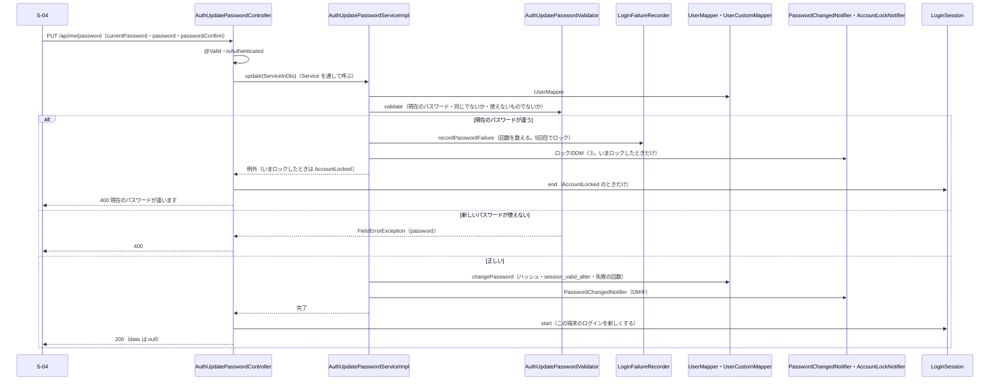

# API詳細設計：A-07 自分のパスワード変更

| 項目 | 内容 |
|---|---|
| 版 | v1.0 2026-11-15 |
| Jira | ZPOP-61 |
| 状態 | 作成中 |
| まとまり | [auth](auth.md)（api.auth） |
| もとにした設計書 | API設計.md v1.1 の2.2・2.3・2.4・3.1・7章、画面設計.md v1.1 の2.1・7章（S-04）・8章・9章の④、機能一覧.md v1.1 の6章（7・8・9・11・12）、データ設計.md v1.0 の5.1 |

## 1. API基本情報

写したもと：API設計.md v1.1 の3.1

| 項目 | 内容 |
|---|---|
| ID | A-07 |
| 名前 | 自分のパスワード変更 |
| 操作 | PUT |
| URL | /api/me/password |
| 内容 | 自分のパスワードを変える |
| 権限項目 | なし（ログインしている人なら、だれでも。`@PreAuthorize("isAuthenticated()")`） |
| 使う画面 | S-04（ZPOP-106。まだない） |
| パッケージ | api.auth.update.password（API_パッケージとクラス名_決定版.md のとおり） |
| クラス名の頭（`<頭>`） | AuthUpdatePassword |
| Controller のメソッド | `controller.AuthUpdatePasswordController#update` |
| Service のメソッド | `service.AuthUpdatePasswordService#update`（中身は `AuthUpdatePasswordServiceImpl`） |
| Validator のメソッド | `validator.AuthUpdatePasswordValidator#validate`（渡す値は `AuthUpdatePasswordValidatorDto`） |

## 2. リクエスト定義

写したもと：画面設計.md v1.1 の7章・8章。API設計に A-07 の送る値の例がないため、画面の項目と A-06（4.4）の名前から決めた（12章の No.1）。

### 2.1 パスの値

なし（変える相手は、ログインしている本人。ID は受け取らない）

### 2.2 クエリ（URL の ? の後ろ）

なし

### 2.3 本文（JSON）

RestInDto：`controller.AuthUpdatePasswordRestInDto`（形式のチェック。6章）

| 項目名 | 型 | 必須 | 制約 | 説明 |
|---|---|---|---|---|
| currentPassword | 文字 | ○ | 空でない | 現在のパスワード。前後の空白も取らない。ログには出さない |
| password | 文字 | ○ | 8文字以上64文字以内。半角の英字・数字・記号・スペースだけ | 新しいパスワード（A-06 と同じ決まり。common.md 3.15）。ログには出さない |
| passwordConfirm | 文字 | ○ | password と同じ | 新しいパスワード（確認）。ログには出さない |

```json
{ "currentPassword": "（現在のパスワード）", "password": "（新しいパスワード）", "passwordConfirm": "（同じもの）" }
```

### 2.4 ファイル（CSV を受け取る API だけ）

なし

### 2.5 Service に渡す値（ServiceInDto）

ServiceInDto：`service.AuthUpdatePasswordServiceInDto`。DB と照らして確かめることは、Validator で行う（現在のパスワードの照らし合わせは、読んだユーザのハッシュが要るため）ので、チェック用アノテーションは付けない。

| 項目名 | 型 | もと | 付けるチェック用アノテーション（common.validation） |
|---|---|---|---|
| userId | 数 | ログインしている人（`@AuthenticationPrincipal LoginUserId`） | なし |
| currentPassword | 文字 | RestInDto の currentPassword | なし |
| password | 文字 | RestInDto の password | なし |

passwordConfirm は、RestInDto で確かめ終わっているので、Service には渡さない。

## 3. レスポンス定義

写したもと：API設計.md v1.1 の2.4、画面設計.md v1.1 の7章

### 3.1 成功

| status | message |
|---|---|
| 200 | 処理が正常に完了しました。 |

data は null。RestOutDto は作らない。

あわせて、**この端末のログインを新しくする**（LoginSession#start。common.md 3.10）。ほかの端末のログインは切れる（4章の No.5）が、この端末はログインしたままにするため。セッションの番号と、なりすまし対策の合言葉（XSRF-TOKEN のクッキー）が新しくなる。画面（S-04）は、このあとのAPIの呼び出しでは、新しい XSRF-TOKEN の値を使う（common/api の部品は、呼ぶたびにクッキーから読むので、特別な対応は要らない）。

```json
{
  "status": 200,
  "message": "処理が正常に完了しました。",
  "data": null,
  "errors": null
}
```

完了メッセージ「パスワードを変更しました」と、この画面を開く前の画面に戻る動きは、S-04（ZPOP-106）が行う。

### 3.2 失敗

9章のとおり。

## 4. 処理フロー

写したもと：画面設計.md v1.1 の7章の「ボタンの動き」「現在のパスワードを間違えたとき」、2.1

1. AuthUpdatePasswordController が受け取る。`@Valid` で形式のチェック（6章）。
2. `@PreAuthorize("isAuthenticated()")` で、ログインしているかを確かめる（10章）。
3. Controller が、RestInDto とログインしている人の ID から `AuthUpdatePasswordServiceInDto` を作り、`AuthUpdatePasswordService#update` を呼ぶ（中身は AuthUpdatePasswordServiceImpl。`@Transactional` は付けない。8章）。
4. ServiceImpl が、UserMapper#selectByPrimaryKey でユーザを読み、AuthUpdatePasswordValidator#validate を呼ぶ。Validator は次を確かめる（5章の No.1〜3）。
   1. 現在のパスワードが、保存しているハッシュと合うか。合わなければ、AuthUpdatePasswordWrongCurrentException（「現在のパスワードが違います」。入力欄 currentPassword のエラー）。
   2. 新しいパスワードが、現在のパスワードと同じでないか。同じなら FieldErrorException（「現在と同じパスワードは使えません」。password のエラー）。
   3. 新しいパスワードが、メールアドレス・システム名・よく使われるパスワードと同じでないか（common.security.PasswordBlocklist。common.md 3.15）。同じなら FieldErrorException（A-06 と同じ文。password のエラー）。
5. **現在のパスワードが違っていたとき**（4 の 1）：ServiceImpl が、common.security.LoginFailureRecorder#recordPasswordFailure で、ログインの失敗と同じく回数を数える（ロック中は数えない。A-01 の 4.1）。いまロックしたときは、本人にロックのDM（③）を送り（common.security.AccountLockNotifier。確定したあと）、AuthUpdatePasswordAccountLockedException（文は同じ「現在のパスワードが違います」。currentPassword のエラー）を投げる。Controller は、これを受け取ったら、**この端末をログアウトさせて**（LoginSession#end）から、同じ 400 を返す（画面設計 7章。ログインしたままのスマートフォンを他人に拾われ、パスワードを試されるのを防ぐため）。
6. 4 を通ったら、ServiceImpl が UserCustomMapper#changePassword で、password_hash（bcrypt）・session_valid_after（今。秒まで）・updated_at・updated_by を書き換える。失敗の回数は、ロックされていなければ0に戻す（ログインに成功したときと同じ）。ロックは解除しない（7章）。書き換えた件数が1件でなければ（読んだあとにパスワードが変わっていたとき）、「現在のパスワードが違います」を返す（12章の No.7）。
7. ServiceImpl が、common.passwordlink.PasswordChangedNotifier（common.md 3.15）で、パスワードが変わったことをDM（④）で知らせる（確定したあと）。送れなかったときは、ログに WARN で残すだけ。
8. ServiceImpl がログに「パスワードを変更しました（userId）」を INFO で残す（パスワードは出さない）。
9. Controller が LoginSession#start で、この端末のログインを新しくし、`ApiResponse.ok(null)` で返す。権限項目は、いまのログイン状態（Authentication）から取る。



## 5. 条件分岐・業務の規則

| No. | 条件・ルール | 写したもと | 守る場所（クラス.メソッド） | 守れないとき | 同じルールを書いているほかの機能 |
|---|---|---|---|---|---|
| 1 | 現在のパスワードが合わなければ、変えられない | 画面設計 7章 | AuthUpdatePasswordValidator#validate | 9章の No.2 | なし |
| 2 | 新しいパスワードは、現在のパスワードと同じにできない | 画面設計 7章 | AuthUpdatePasswordValidator#validate | 9章の No.3 | なし |
| 3 | 新しいパスワードは、メールアドレス・システム名・よく使われるパスワードと同じにできない | 画面設計 8章 | AuthUpdatePasswordValidator#validate（照らし合わせは common.security.PasswordBlocklist） | 9章の No.4 | A-06 |
| 4 | 現在のパスワードを間違えたら、ログインの失敗と同じく回数を数える。5回続けたらロックし、この端末もログアウトさせる。ロックしたらDM（③）を送る | 画面設計 7章・2.1 | AuthUpdatePasswordServiceImpl#update（数えるのは common.security.LoginFailureRecorder、DM は AccountLockNotifier）、AuthUpdatePasswordController#update（ログアウト） | 9章の No.2 | A-01 |
| 5 | この端末以外のログイン（と「ログインしたままにする」）を切る。この端末はログインしたままにする | 画面設計 7章の1、機能一覧 6章の8 | 切るのは UserCustomMapper#changePassword（session_valid_after）と common.security.LoginUserRefresherImpl（auth.md R-4）。この端末は AuthUpdatePasswordController#update（LoginSession#start） | ― | A-06 |
| 6 | パスワードが変わったことを、DM（④）で知らせる。パスワードは書かない | 画面設計 7章の2・9章の④、機能一覧 6章の9 | common.passwordlink.PasswordChangedNotifier（呼ぶのは AuthUpdatePasswordServiceImpl#update） | 送れなかったときはログ（パスワードの変更はそのまま） | A-06 |
| 7 | パスワードは、bcrypt でハッシュにして保存する。パスワードそのものは保存しない | 機能一覧 6章の11 | AuthUpdatePasswordServiceImpl#update（PasswordEncoder） | ― | A-06 |
| 8 | 変えるのは、ログインしている本人のパスワードだけ（ID は受け取らない） | 画面設計 7章、API設計 2.2 | AuthUpdatePasswordController#update（`@AuthenticationPrincipal LoginUserId`） | ― | なし |
| 9 | パスワードをログに出さない | API設計 7章、CLAUDE.md 5章 | RestInDto・ServiceInDto・ValidatorDto の toString を伏せる | ― | A-06 |

## 6. バリデーション仕様

写したもと：画面設計.md v1.1 の7章・8章（メッセージは一字も変えずに写す）

| 項目 | 決まり | メッセージ | 確かめる場所 |
|---|---|---|---|
| currentPassword | 空でない（null・長さ0） | 「現在のパスワードを入力してください」 | RestInDto の `@NotEmpty` |
| currentPassword | 今のパスワードと同じ | 「現在のパスワードが違います」 | Validator（読んだユーザのハッシュが要るため。5章の No.1） |
| password | 空でない | 「新しいパスワードを入力してください」 | RestInDto の `@NewPasswordFormat`（common.validation） |
| password | 半角の英字・数字・記号・スペースだけ | 「パスワードに使えるのは、半角の英字・数字・記号・スペースです」 | 同上 |
| password | 8文字以上 | 「パスワードは8文字以上で入力してください」 | 同上 |
| password | 64文字以内 | 「パスワードは64文字以内で入力してください」 | 同上 |
| password | 現在のパスワードと違う | 「現在と同じパスワードは使えません」 | Validator（5章の No.2） |
| password | メールアドレス・システム名・よく使われるパスワードと同じでない | 「このパスワードはよく使われているため、使えません。別のパスワードにしてください」 | Validator（5章の No.3） |
| passwordConfirm | password と同じ（空のときも、違うものとして扱う） | 「確認用のパスワードが一致しません」 | RestInDto のクラスに付ける `@PasswordConfirmed`（common.validation） |

## 7. DB操作仕様

写したもと：データ設計.md v1.0 の5.1

| No. | Mapper のメソッド | 使う所 | 操作 | テーブル | 条件 | 読む・書く列 | 件数 |
|---|---|---|---|---|---|---|---|
| 1 | UserMapper#selectByPrimaryKey | AuthUpdatePasswordServiceImpl#update | SELECT | users | `id = ?` | 全列（email・password_hash・locked_at を使う） | 1件 |
| 2 | UserCustomMapper#changePassword | AuthUpdatePasswordServiceImpl#update | UPDATE | users | `id = ? AND password_hash = ?（読んだ値）AND deleted_at IS NULL` | password_hash、session_valid_after（今。秒まで）、updated_at（今）、updated_by（本人のID）、failed_login_count（ロックされていなければ 0） | 1件（0件なら、読んだあとに変わった） |
| 3 | UserCustomMapper#incrementFailedLoginCount ほか | common.security.LoginFailureRecorder#recordPasswordFailure | UPDATE・SELECT | users・password_tokens | A-01 の 7章・common.md 3.14 と同じ | A-01 の4.1 と同じ | |

- 手で書く Mapper（dao.mapper.custom）を使う SQL と、自動で作れない理由：UserCustomMapper#changePassword。失敗の回数を「ロックされていなければ 0」にする（`CASE WHEN locked_at IS NULL THEN 0 ELSE failed_login_count END`）書き換えは、Example では書けないため。A-06 の updatePassword と違い、ロック（locked_at）は解除しない（12章の No.4）。
- 複数のテーブルの突き合わせ方：なし。
- 削除済みを除く条件：No.2 の `deleted_at IS NULL`（削除されたユーザは、ログイン状態の読み直し（auth.md R-4）で、すでにログアウトになっている）。
- 更新した件数の見方（0件のとき）：読んだあとに、パスワードがほかで変わった（A-06 など）ので、「現在のパスワードが違います」を返す（12章の No.7）。
- version は増やさない。updated_by には本人のIDを入れる（A-06 の12章 No.4 と同じ）。

## 8. トランザクション・排他制御

| 項目 | 内容 |
|---|---|
| @Transactional | 付けない。users を書き換えるのは1つの UPDATE だけで、まとまりにする必要がないため。Slack の送信は、書き込みが確定したあとにする（CLAUDE.md 5章）。失敗の回数を数える処理は、A-01 と同じく、別のクラス LoginFailureRecorder が、自分のまとまりで行う（401 でなく 400 を返すときも、数えた回数が元に戻らないようにするため） |
| 楽観ロック（version） | 使わない（version は増やさない）。代わりに、UPDATE の条件に、読んだパスワードのハッシュを入れて、同時に変えられていないかを確かめる（12章の No.7） |
| 同時に操作されたとき | 同時に2か所から変えようとすると、あとの1つは「現在のパスワードが違います」になる |
| Slack を送るタイミング | 書き込みが確定してから（11章） |

## 9. エラー処理仕様

写したもと：API設計.md v1.1 の2.3、画面設計.md v1.1 の7章・8章

| No. | 場面 | 投げる例外 | status | message | errors |
|---|---|---|---|---|---|
| 1 | 入力の誤り（現在のパスワードが空、新しいパスワードが空・決まりに合わない、確認が違う） | （Bean Validation） | 400 | 入力内容に誤りがあります。 | 入力欄ごとのメッセージ（6章。currentPassword・password・passwordConfirm） |
| 2 | 現在のパスワードが違う（いまロックしたときも同じ。そのときは、この端末をログアウトさせる） | AuthUpdatePasswordWrongCurrentException ／ AuthUpdatePasswordAccountLockedException（どちらも FieldErrorException） | 400 | 入力内容に誤りがあります。 | currentPassword に「現在のパスワードが違います」 |
| 3 | 新しいパスワードが、現在のパスワードと同じ | FieldErrorException | 400 | 入力内容に誤りがあります。 | password に「現在と同じパスワードは使えません」 |
| 4 | 新しいパスワードが、メールアドレス・システム名・よく使われるパスワードと同じ | FieldErrorException | 400 | 入力内容に誤りがあります。 | password に「このパスワードはよく使われているため、使えません。別のパスワードにしてください」 |
| 5 | ログインしていない | （Spring Security） | 401 | ログインしてください。 | null |

- 1 と 2〜4 が同時に当てはまるとき（形が誤りで、現在のパスワードも違う）は、1 を返す（形式のチェックが先。回数は数えない）。
- 2 と 3・4 が同時に当てはまるとき（現在のパスワードが違い、新しいパスワードも使えない）は、2 だけを返す（現在のパスワードを確かめてから、新しいパスワードを確かめるため。回数を数える）。
- 現在のパスワードの誤りを 401 にしない（12章の No.2）。

## 10. 認証・認可仕様

| 項目 | 内容 |
|---|---|
| ログイン | 要る（`@PreAuthorize("isAuthenticated()")`。API設計 2.2。/api/** は SecurityConfig でも要る） |
| 権限項目 | なし（ログインしている人なら、だれでも） |
| なりすまし対策の合言葉（CSRF） | 要る（PUT） |
| 対象の確かめ（IDOR） | ID を受け取らない。変えるのは、ログインしている本人のパスワードだけ（5章の No.8） |

## 11. 外部API連携仕様

Slack のDMを送る。

| DM | いつ | 送る部分 | 文面 |
|---|---|---|---|
| ④ パスワードを変更しました | 変えたあと（確定したあと） | common.passwordlink.PasswordChangedNotifier | common.md 3.15（A-06 と同じ） |
| ③ アカウントをロックしました | 現在のパスワードを間違えて、いまロックしたとき（確定したあと） | common.security.AccountLockNotifier | A-01 の4.1（ログインでロックしたときと同じ） |

送れなかったときは、どちらも、ログに WARN で残すだけ（画面設計 9章の注意3）。パスワードの変更・ロックはそのまま。画面の返し方も変えない。

## 12. 設計書にない判断

| No. | 判断 | 理由 | 外から見えるか | 人の確認 |
|---|---|---|---|---|
| 1 | 送る値を `{ "currentPassword", "password", "passwordConfirm" }` にした | API設計 3.1 に、A-07 の送る値の例がない。画面の項目と、A-06（4.4）の `password`・`passwordConfirm` の名前にそろえた | はい | まだ |
| 2 | 現在のパスワードが違うときは、401 ではなく、入力欄 currentPassword のエラー（400）にする | 401 にすると、画面（common/api の部品）が「ログインの期限が切れた」と受け取って、ログイン画面に移してしまう。画面設計 7章は、入力欄のメッセージ「現在のパスワードが違います」を決めている | はい | まだ |
| 3 | 5回目の間違いでロックしたとき、返すのは同じ 400（「現在のパスワードが違います」）で、この端末のログアウトは、Controller が LoginSession#end で行う。ロックしたことは、画面には知らせない（DM（③）だけ） | 画面設計 7章は、この端末もログアウトさせると決めているが、返し方は決めていない。ログインのときと同じく、ロックを画面に出さない（2.1 の4）。ログアウトさせるので、画面は、次の操作で 401 を受け取ってログイン画面に移る | はい | まだ |
| 4 | A-07 では、ロックの解除（locked_at）はしない。失敗の回数は、ロックされていなければ0に戻す。ロック中の人が、正しい現在のパスワードで変えることは、できる（ロックはそのまま） | 画面設計 2.1 の2 は、ロックを解除するのは、パスワードの再設定（S-02・S-03）で決めたときと決めている。ロック中でも、すでにログインしている人は使い続けられる（2.1 の6）ので、変えることは止めない | はい | まだ |
| 5 | 新しいパスワードが、現在のパスワードと同じで、かつ、使えないものと同じなとき、「現在と同じパスワードは使えません」を先に出す | 6章の順番。1つの欄に、1つだけ出す | はい | まだ |
| 6 | この端末のログインは、LoginSession#start で作り直す（セッションの番号・ログインした日時・XSRF-TOKEN が新しくなる）。ほかの端末は、session_valid_after で切る | 秒までにそろえた session_valid_after（A-06 の12章 No.1）に、この端末のログインした日時が、同じ秒に入る。同じ1秒の中に変えて作り直すので、この端末は切れない。前にログインしていた端末は、前の秒なら切れる | はい | まだ |
| 7 | UPDATE の条件に、読んだパスワードのハッシュを入れる。0件のときは、「現在のパスワードが違います」を返す | ほかで同時にパスワードが変わっていたとき（A-06 など）、古い現在のパスワードで、新しいパスワードを上書きしないため。version は増やさないので、楽観ロックの代わりにした | いいえ | ― |
| 8 | ログインの失敗を数える処理（AuthLoginFailureRecorder）とロックのDM（AuthLoginLockNotifier）を、common.security に移し、LoginFailureRecorder・AccountLockNotifier に名前を変えた | A-07 も、同じ数え方・同じDMを使う。API のパッケージどうしは使い合わないため（CLAUDE.md 5章）。動きは変えない（A-01 の4.1・common.md 3.16） | いいえ | ― |

## 変更履歴

| 版 | 日付 | 内容 |
|---|---|---|
| v1.0 | 2026-11-15 | 初版（ZPOP-61） |
