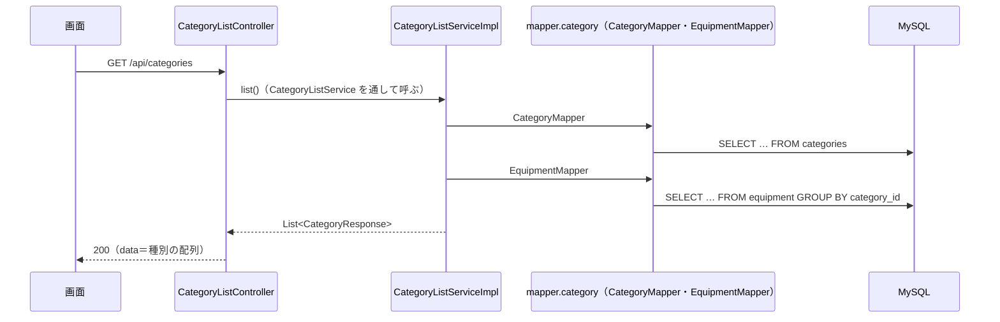

# API詳細設計：K-01 種別一覧

| 項目 | 内容 |
|---|---|
| 版 | v1.1 2026-11-10 |
| Jira | ZPOP-83 |
| 状態 | 作成中 |
| 機能 | [category](category.md) |
| もとにした設計書 | API設計.md v1.2 の2.3・2.4・2.5・2.7・3.6、画面設計.md v1.2 の16章、データ設計.md v1.0 の2章・5.5・5.6、機能一覧.md v1.0 の4章（F-21） |

## 1. API基本情報

写したもと：API設計.md v1.2 の3.6

| 項目 | 内容 |
|---|---|
| ID | K-01 |
| 名前 | 種別一覧 |
| 操作 | GET |
| URL | /api/categories |
| 内容 | 種別の一覧（使っている備品の数つき） |
| 権限項目 | ログイン |
| 使う画面 | S-06・S-07の絞り込み、S-09の選択、S-13 |
| controller のメソッド | CategoryListController#list |
| service のメソッド | CategoryListService#list（中身は CategoryListServiceImpl） |
| validator のメソッド | なし（業務チェックがない） |

## 2. リクエスト定義

受け取る値はない。

### 2.1 パスの値

なし

### 2.2 クエリ（URL の ? の後ろ）

なし（ページ分けをしないので、page も受け取らない。12章の No.2）

### 2.3 本文（JSON）

なし

### 2.4 ファイル（CSV を受け取る API だけ）

なし

## 3. レスポンス定義

写したもと：API設計.md v1.2 の2.4（status・message・data・errors の形）。data の中身は、API設計 4章に例がないため、画面設計.md v1.2 の16章の列と、データ設計.md v1.0 の5.5 の列から決めた（12章の No.1〜3。2026-11-10 に人が確認）。

### 3.1 成功

| status | message |
|---|---|
| 200 | 処理が正常に完了しました。 |

data には、種別の1件（dto：`dto.category.CategoryResponse`）の配列をそのまま入れる。0件なら空の配列（`[]`）。並び順は5章の No.1。

| 項目名 | 型 | null になるか | もと（テーブル.列 ／ 計算） | 説明 |
|---|---|---|---|---|
| id | 数 | ならない | categories.id | 種別のID |
| name | 文字 | ならない | categories.name | 名前 |
| initial | 文字 | なる（頭文字がない種別） | categories.initial | 頭文字（半角の英大文字1文字） |
| equipmentCount | 数 | ならない（使っていなければ 0） | 計算（equipment を数える。5章の No.2） | 使っている備品の数 |
| version | 数 | ならない | categories.version | 種別を変える（K-03）ときに送り返す番号（API設計 2.7 の楽観ロック） |

```json
{
  "status": 200,
  "message": "処理が正常に完了しました。",
  "data": [
    { "id": 1, "name": "PC", "initial": "A", "equipmentCount": 12, "version": 0 },
    { "id": 7, "name": "ケーブル", "initial": null, "equipmentCount": 0, "version": 0 }
  ],
  "errors": null
}
```

### 3.2 失敗

9章のとおり。

## 4. 処理フロー

1. Spring Security が、ログインしているかを確かめる（10章）。していなければ 401。
2. CategoryListController#list が、CategoryListService#list を呼ぶ（中身は CategoryListServiceImpl）。
3. CategoryListServiceImpl が CategoryMapper#selectAll で、削除されていない種別を並び順どおりに読む（7章の No.1）。
4. 種別が0件なら、空の配列を返す（備品は数えない）。
5. CategoryListServiceImpl が EquipmentMapper#countGroupByCategoryId で、削除されていない備品の数を種別ごとに読む（7章の No.2）。
6. CategoryListServiceImpl が、種別のIDで突き合わせて equipmentCount を入れる（数えた結果にない種別は 0）。
7. CategoryListController が `ApiResponse.ok(…)` で返す。



## 5. 条件分岐・業務ルール

| No. | 条件・ルール | 写したもと | 守る場所（クラス.メソッド） | 守れないとき | 同じルールを書いているほかの機能 |
|---|---|---|---|---|---|
| 1 | 頭文字の順に並べ、頭文字がないものは後ろに名前の順で並べる | 画面設計 16章 ／ category.md R-4 | CategoryMapper#selectAll（SQL の ORDER BY） | ― | なし |
| 2 | 使っている備品の数は、削除されていない備品を数える（管理状態は問わない。廃棄・不明の備品も数える） | 画面設計 16章 ／ category.md R-5 | EquipmentMapper#countGroupByCategoryId、CategoryListServiceImpl#list | ― | なし |
| 3 | 削除済みの種別は出さない | データ設計 2章 ／ category.md R-6 | CategoryMapper#selectAll | ― | なし |

## 6. バリデーション仕様

なし（受け取る値がない）

## 7. DB操作仕様

写したもと：データ設計.md v1.0 の2章・5.5・5.6

| No. | mapper のメソッド | 操作 | テーブル | 条件 | 読む・書く列 | 件数 |
|---|---|---|---|---|---|---|
| 1 | CategoryMapper#selectAll | SELECT | categories | deleted_at IS NULL。ORDER BY initial IS NULL, initial, name | id, name, initial, version | 0件以上 |
| 2 | EquipmentMapper#countGroupByCategoryId | SELECT | equipment | deleted_at IS NULL。GROUP BY category_id | category_id, COUNT(*) | 備品のある種別の数だけ |

- 複数のテーブルの突き合わせ方（JOIN とサブクエリは使わない）：categories と equipment を別々に読み、CategoryListServiceImpl で種別のID（category_id）をキーに突き合わせる。
- まとめて読む所（N+1 を防ぐ）：備品の数は、種別ごとに SQL を出さず、No.2 の1回で全部の種別の分を読む（全部の種別が対象なので、`IN` で絞らない。12章の No.5）。
- 削除済みを除く条件：種別も備品も `deleted_at IS NULL`。
- 並び順：`initial IS NULL` は、頭文字がある行が 0、ない行が 1 になるので、頭文字のある種別が先に来る。頭文字は重複しないので、頭文字のある種別の中で順番が決まる。頭文字のない種別は name の順（照合順序 utf8mb4_ja_0900_as_cs_ks の順）。
- 更新した件数の見方：書き換えない。

## 8. トランザクション・排他制御

| 項目 | 内容 |
|---|---|
| @Transactional | 付けない（読むだけ） |
| 楽観ロック（version） | 使わない（version を返すだけ） |
| 同時に操作されたとき | 2つの SELECT の間に種別・備品が変わると、数が1回分ずれることがある。画面を開き直せば直るので、対応しない |
| Slack を送るタイミング | 送らない |

## 9. エラー処理仕様

写したもと：API設計.md v1.2 の2.3・2.4

| No. | 場面 | 投げる例外 | status | message | errors |
|---|---|---|---|---|---|
| 1 | ログインしていない | （Spring Security） | 401 | ログインしてください。 | null |
| 2 | サーバーの不具合（データベースにつながらないなど） | （GlobalExceptionHandler が受ける） | 500 | 問題が発生しました。時間をおいて、もう一度お試しください。続く場合は総務に連絡してください。 | null |

入力の誤り（400）、権限項目がない（403）、見つからない（404）、ぶつかった（409）は起きない。

## 10. 認証・認可仕様

| 項目 | 内容 |
|---|---|
| ログイン | 要る |
| 権限項目 | 要らない（ログインしていればだれでも呼べる）。`@PreAuthorize("isAuthenticated()")` |
| 対象の確かめ（IDOR） | ID を受け取らない |

## 11. 外部API連携仕様

なし

## 12. 設計書にない判断

| No. | 判断 | 理由 | 外から見えるか | 人の確認 |
|---|---|---|---|---|
| 1 | 返す1件の項目を id・name・initial・equipmentCount・version にした | API設計 4章に例がない。画面設計 16章の列（名前・頭文字・使っている備品の数）と、K-03 で送り返す version（API設計 2.7）から決めた | はい | 済（2026-11-10） |
| 2 | ページ分けをせず、全件を返す（API設計 2.5 の例外） | 画面設計 16章に件数の決まりがない。S-06・S-07・S-09 の選択肢にも使うので、全件が要る | はい | 済（2026-11-10） |
| 3 | data に種別の配列をそのまま入れる（2.5 の items・page の形にしない）。返す値の形（status・message・data・errors。API設計 2.4）は変えない | ページ分けをしないため。返す値の形はほかの API とそろえる | はい | 済（2026-11-10） |
| 4 | 並び順（画面設計 16章の S-13 の順）を、API が返す順にする | 画面ごとに並べ直さなくて済むように。S-06・S-07・S-09 の選択肢も同じ順になる | はい | 済（2026-11-10） |
| 5 | 備品の数は、種別を `IN` で絞らずに、全部の種別の分を1回で数える | 全部の種別が対象なので、絞る意味がないため | いいえ | ― |

## 変更履歴

| 版 | 日付 | 内容 |
|---|---|---|
| v1.0 | 2026-11-10 | 初版（ZPOP-83） |
| v1.1 | 2026-11-10 | 画面設計の版を v1.2 にした（16章に K-03 の文が足されたため。K-01 の中身は変わらない） |
