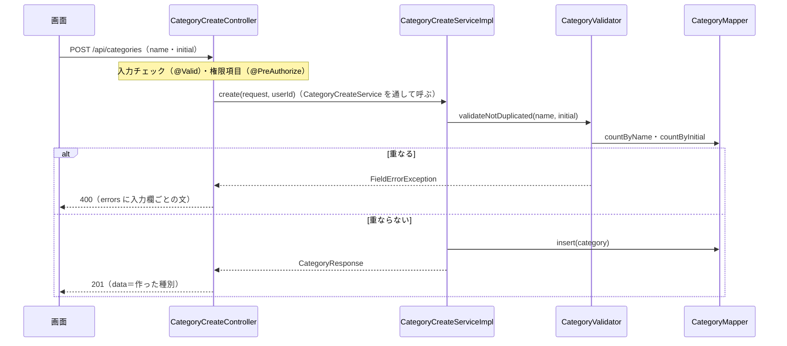

# API詳細設計：K-02 種別を追加する

| 項目 | 内容 |
|---|---|
| 版 | v1.1 2026-11-10 |
| Jira | ZPOP-84 |
| 状態 | 作成中 |
| 機能 | [category](category.md) |
| もとにした設計書 | API設計.md v1.2 の2.3・2.4・3.6・7章、画面設計.md v1.2 の1.2・16章、データ設計.md v1.0 の2章・5.3・5.5、機能一覧.md v1.0 の4章（F-21） |

## 1. API基本情報

写したもと：API設計.md v1.2 の3.6

| 項目 | 内容 |
|---|---|
| ID | K-02 |
| 名前 | 種別を追加する |
| 操作 | POST |
| URL | /api/categories |
| 内容 | 種別を追加する |
| 権限項目 | CATEGORY_MANAGE |
| 使う画面 | S-13 |
| controller のメソッド | CategoryCreateController#create |
| service のメソッド | CategoryCreateService#create（中身は CategoryCreateServiceImpl） |
| validator のメソッド | CategoryValidator#validateNotDuplicated（名前・頭文字がほかの種別と重ならないか。K-03 でも使う。K-02 では excludeId に null を渡す） |

## 2. リクエスト定義

### 2.1 パスの値

なし

### 2.2 クエリ（URL の ? の後ろ）

なし

### 2.3 本文（JSON）

dto：`dto.category.CategoryCreateRequest`。項目は画面設計.md v1.2 の16章「追加・変更のダイアログ」から決めた（API設計 4章に例がないため）。

| 項目名 | 型 | 必須 | 制約 | 説明 |
|---|---|---|---|---|
| name | 文字 | ○ | 前後の空白を取り除いたあとで、空でなく、20文字まで。ほかの種別と重ならない | 名前 |
| initial | 文字 | | 半角の英字1文字（小文字は大文字に直す）。ほかの種別と重ならない。null・空・空白だけなら「頭文字なし」 | 頭文字 |

```json
{ "name": "ケーブル", "initial": "g" }
```

受け取った値は、入力チェックの前に dto で次のように直す（12章の No.3・4）。直し方は K-03 と同じなので、dto.category.CategoryInputs にまとめた。

| 項目 | 直し方 |
|---|---|
| name | 前後の空白（全角の空白も）を取り除く（`String#strip`） |
| initial | 前後の空白を取り除き、空なら null。そうでなければ大文字にする（`toUpperCase(Locale.ROOT)`。半角の a〜z だけが A〜Z になる） |

### 2.4 ファイル（CSV を受け取る API だけ）

なし

## 3. レスポンス定義

写したもと：API設計.md v1.2 の2.3・2.4。data の中身は、API設計 4章に例がないため、同じ登録の API の B-02（4.6「作った貸出履歴（B-01の items の1件と同じ形）」）にそろえ、K-01 の1件と同じ形にした（12章の No.1。2026-11-10 に人が確認）。

### 3.1 成功

| status | message |
|---|---|
| 201 | 処理が正常に完了しました。 |

data：作った種別（dto：`dto.category.CategoryResponse`。K-01 の1件と同じ形）

| 項目名 | 型 | null になるか | もと（テーブル.列 ／ 計算） | 説明 |
|---|---|---|---|---|
| id | 数 | ならない | categories.id（作ったときに決まる） | 種別のID |
| name | 文字 | ならない | categories.name | 名前（前後の空白を取り除いたもの） |
| initial | 文字 | なる（頭文字なし） | categories.initial | 頭文字（大文字に直したもの） |
| equipmentCount | 数 | ならない | いつも 0（作ったばかりで、使っている備品はない） | 使っている備品の数 |
| version | 数 | ならない | categories.version（作ったときは 0） | K-03 で送り返す番号 |

```json
{
  "status": 201,
  "message": "処理が正常に完了しました。",
  "data": { "id": 8, "name": "ケーブル", "initial": "G", "equipmentCount": 0, "version": 0 },
  "errors": null
}
```

### 3.2 失敗

9章のとおり。

## 4. 処理フロー

1. Spring Security が、ログインしているか（していなければ 401）と、CSRF の合言葉があるか（なければ 403）を確かめる。
2. 受け取った JSON から CategoryCreateRequest を作る。このとき name・initial を 2.3 のとおりに直す。
3. `@Valid` で入力チェックをする（6章の No.1〜3）。誤りがあれば 400（入力欄ごとの文）。
4. `@PreAuthorize("hasAuthority('CATEGORY_MANAGE')")` で権限項目を確かめる。なければ 403（10章）。
5. CategoryCreateController#create が、ログインしている人のユーザIDをつけて CategoryCreateService#create を呼ぶ（中身は CategoryCreateServiceImpl）。
6. CategoryCreateServiceImpl（`@Transactional`）が、CategoryValidator#validateNotDuplicated で、名前・頭文字がほかの種別と重ならないかを確かめる（6章の No.4・5）。重なれば FieldErrorException（400。重なった入力欄ごとの文。両方重なれば2つ）。
7. CategoryCreateServiceImpl が CategoryMapper#insert で種別を足す（7章の No.3）。作った日時・変えた日時は Clock の今、作った人・変えた人はログインしている人。
8. 6 と 7 の間に、ほかの人が同じ名前・頭文字の種別を足していた場合は、データベースの重複禁止（UNIQUE）で DuplicateKeyException になる。どの重複禁止に当たったか（制約の名前）で、6 と同じ FieldErrorException に変える（5章の No.4。12章の No.6）。
9. CategoryCreateServiceImpl がログに「種別を追加しました（id・名前・頭文字）」を INFO で残す（API設計 7章）。
10. CategoryCreateController が `ApiResponse.created(…)` で返す（HTTP の status も 201。`@ResponseStatus(HttpStatus.CREATED)`）。



## 5. 条件分岐・業務ルール

| No. | 条件・ルール | 写したもと | 守る場所（クラス.メソッド） | 守れないとき | 同じルールを書いているほかの機能 |
|---|---|---|---|---|---|
| 1 | 名前は必須。20文字まで | 画面設計 16章、データ設計 5.5 ／ category.md R-1 | CategoryCreateRequest（`@NotBlank`・`@Size`） | 400（6章の No.1・2） | なし |
| 2 | 頭文字は任意で、半角の英字1文字。小文字は大文字に直す | 画面設計 16章 ／ category.md R-2 | CategoryCreateRequest（直し方と `@Pattern`） | 400（6章の No.3） | なし |
| 3 | 名前は、ほかの種別（削除されていないもの）と重ならない | 画面設計 16章 | CategoryValidator#validateNotDuplicated | 400（6章の No.4） | なし（K-03 も同じ validator を使う） |
| 4 | 頭文字は、ほかの種別（削除されていないもの）と重ならない | 画面設計 16章 ／ category.md R-2 | CategoryValidator#validateNotDuplicated。同時に足されたときは、データベースの重複禁止（categories の name_active・initial_active）と CategoryCreateServiceImpl#create | 400（6章の No.5） | なし |
| 5 | 削除済みの種別と同じ名前・頭文字は使ってよい | データ設計 2章（削除済みの行は重複に数えない） ／ category.md R-6 | CategoryMapper#countByName・countByInitial（`deleted_at IS NULL`）、データベースの生成列 | ― | なし |

## 6. バリデーション仕様

写したもと：画面設計.md v1.2 の16章「追加・変更のダイアログ」（メッセージは一字も変えずに写す）

| No. | 項目 | 決まり | メッセージ | 確かめる場所 |
|---|---|---|---|---|
| 1 | name | 必須（前後の空白を取り除いて空なら誤り） | 「名前を入力してください」 | dto の `@NotBlank` |
| 2 | name | 20文字まで | 「名前は20文字以内で入力してください」 | dto の `@Size(max = 20)` |
| 3 | initial | 半角の英字1文字（小文字は大文字に直してから確かめる） | 「頭文字は英字1文字で入力してください」 | dto の `@Pattern(regexp = "[A-Z]")`（null は確かめない） |
| 4 | name | ほかの種別と重複しない | 「この名前はすでに使われています」 | CategoryValidator#validateNotDuplicated（業務チェック。データベースを見て確かめる） |
| 5 | initial | ほかの種別と重複しない | 「この頭文字はすでに使われています」 | CategoryValidator#validateNotDuplicated（initial が null なら確かめない） |

- No.1〜3 の誤りがあれば、No.4・5 は確かめない（入力チェックは service より前に終わるため）。
- No.4・5 は、両方重なれば2つとも返す（errors に name・initial の順）。返し方は FieldErrorException（common.md 6章。入力欄の下に出す。2026-11-10 に人が確認）。
- 名前の重なりは、データベースの照合順序（utf8mb4_ja_0900_as_cs_ks。データ設計 2章）で比べる。大文字・小文字、ひらがな・カタカナは別の名前になる（「PC」と「pc」は重ならない）。

## 7. DB操作仕様

写したもと：データ設計.md v1.0 の2章・5.5

| No. | mapper のメソッド | 操作 | テーブル | 条件 | 読む・書く列 | 件数 |
|---|---|---|---|---|---|---|
| 1 | CategoryMapper#countByName | SELECT | categories | name = ? AND deleted_at IS NULL（K-03 では、さらに自分を除く `id <> ?`。K-02 ではつけない） | COUNT(*) | 1件（数） |
| 2 | CategoryMapper#countByInitial | SELECT | categories | initial = ? AND deleted_at IS NULL（K-03 では、さらに `id <> ?`） | COUNT(*) | 1件（数）。initial が null なら呼ばない |
| 3 | CategoryMapper#insert | INSERT | categories | ― | name, initial, created_at, created_by, updated_at, updated_by（id は自動で決まり、model に戻す。version は初期値の 0。name_active・initial_active は生成列） | 1件 |

- 複数のテーブルの突き合わせ方：使わない（categories だけ）。
- まとめて読む所：なし（1件の追加）。
- 削除済みを除く条件：No.1・2 の `deleted_at IS NULL`。
- 更新した件数の見方：INSERT は1件。0件にはならない（重複は例外になる）。

## 8. トランザクション・排他制御

| 項目 | 内容 |
|---|---|
| @Transactional | CategoryCreateServiceImpl#create に付ける（重なりの確かめから追加までを1つのまとまりにする。CLAUDE.md 5章） |
| 楽観ロック（version） | 使わない（追加なので） |
| 同時に操作されたとき | 2人が同じ名前・頭文字を同時に足すと、確かめ（No.1・2）はどちらも通るが、あとの INSERT がデータベースの重複禁止で止まる。その例外を、重複禁止の名前（uk_categories_name_active・uk_categories_initial_active）で入力欄のエラーに変える（4章の 8） |
| Slack を送るタイミング | 送らない |

## 9. エラー処理仕様

写したもと：API設計.md v1.2 の2.3・2.4、画面設計.md v1.2 の16章

| No. | 場面 | 投げる例外 | status | message | errors |
|---|---|---|---|---|---|
| 1 | 入力の誤り（6章の No.1〜3） | （`@Valid`。GlobalExceptionHandler が受ける） | 400 | 入力内容に誤りがあります。 | 入力欄ごとの文（field：name・initial） |
| 2 | 名前・頭文字が重なる（6章の No.4・5） | FieldErrorException | 400 | 入力内容に誤りがあります。 | 「この名前はすでに使われています」（field：name）・「この頭文字はすでに使われています」（field：initial） |
| 3 | 送った JSON の形が壊れている | （GlobalExceptionHandler） | 400 | 入力内容に誤りがあります。 | null |
| 4 | ログインしていない | （Spring Security） | 401 | ログインしてください。 | null |
| 5 | 権限項目 CATEGORY_MANAGE がない、CSRF の合言葉がない | （Spring Security） | 403 | この操作を行う権限がありません。 | null |
| 6 | サーバーの不具合 | （GlobalExceptionHandler） | 500 | 問題が発生しました。時間をおいて、もう一度お試しください。続く場合は総務に連絡してください。 | null |

見つからない（404）、ぶつかった（409）は起きない。

## 10. 認証・認可仕様

写したもと：データ設計.md v1.0 の5.3（CATEGORY_MANAGE：種別を管理する）

| 項目 | 内容 |
|---|---|
| ログイン | 要る |
| 権限項目 | CATEGORY_MANAGE。`@PreAuthorize("hasAuthority('CATEGORY_MANAGE')")` |
| 対象の確かめ（IDOR） | ID を受け取らない |

- 入力チェック（`@Valid`）は、権限項目の確かめ（`@PreAuthorize`）より先に動く（Spring の決まり）。権限項目がない人が誤った値を送ると、403 より先に 400 が返る。データは変わらず、ほかの人のデータも見えないので、このままにする（12章の No.7）。

## 11. 外部API連携仕様

なし

## 12. 設計書にない判断

| No. | 判断 | 理由 | 外から見えるか | 人の確認 |
|---|---|---|---|---|
| 1 | 201 の data に、作った種別を K-01 の1件と同じ形で返す | API設計 4章に例がない。同じ登録の API の B-02（4.6）にそろえた | はい | 済（2026-11-10） |
| 2 | 名前・頭文字の重なりは、400 で入力欄のエラー（errors）として返す（FieldErrorException を common に足した） | 画面設計 16章では、入力欄のチェックの表に書いてあるため。画面設計 1.2「入力の誤り」は入力欄の下に出す | はい | 済（2026-11-10） |
| 3 | 名前の前後の空白を取り除いてから、確かめて保存する | 「 PC 」と「PC」が別の種別にならないように | はい | 済（2026-11-10） |
| 4 | 頭文字の前後の空白を取り除き、空なら頭文字なし（null）にする | 画面の入力欄が空のとき、空の文字が届いても「頭文字なし」にするため | はい | まだ |
| 5 | 受け取った値の直し（空白・大文字）は、dto（CategoryCreateRequest）で、入力チェックの前に行う | 「20文字まで」などを、直したあとの値で確かめるため | いいえ | ― |
| 6 | 同時に足されて重複禁止に当たったときも、入力欄のエラー（400）にする。どの重複禁止かは、例外の文の中の制約の名前で見分ける（K-03 と同じ部品 category.service.CategoryDuplicateKeys） | 確かめ直しをしても、同じまとまり（トランザクション）の中では、ほかの人が足した行が見えないため（MySQL の REPEATABLE READ） | はい（めったに起きない） | まだ |
| 7 | 権限項目がない人が誤った値を送ると、400 が先に返る | Spring で、入力チェックが権限項目の確かめより先に動くため。データは変わらない | はい（めったに起きない） | まだ |
| 8 | 20文字は、Java の文字の数え方（`@Size`）で数える | 絵文字など一部の文字は2文字に数えるが、種別の名前では使わない前提 | いいえ | ― |

## 変更履歴

| 版 | 日付 | 内容 |
|---|---|---|
| v1.0 | 2026-11-10 | 初版（ZPOP-84） |
| v1.1 | 2026-11-10 | K-03 を作るときに、重なりの確かめに自分を除く条件（excludeId）を足し、直し方と重複禁止の変え方を K-03 と同じ部品にまとめた（動きは変えていない）。画面設計の版を v1.2 にした |
