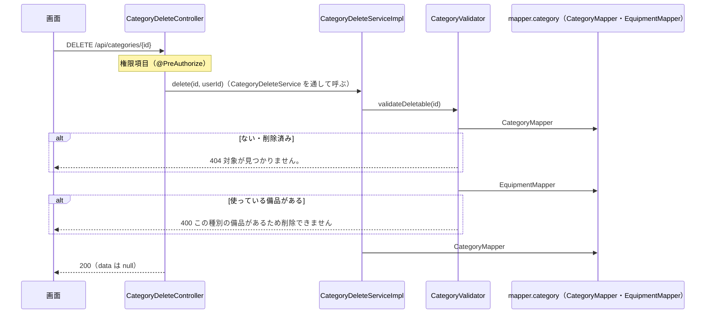

# API詳細設計：K-04 種別を消す

| 項目 | 内容 |
|---|---|
| 版 | v1.0 2026-11-11 |
| Jira | ZPOP-86 |
| 状態 | 作成中 |
| 機能 | [category](category.md) |
| もとにした設計書 | API設計.md v1.2 の2.3・2.4・2.7・3.6・7章、画面設計.md v1.2 の16章、データ設計.md v1.0 の2章・5.3・5.5・5.6、機能一覧.md v1.0 の4章（F-21） |

## 1. API基本情報

写したもと：API設計.md v1.2 の3.6

| 項目 | 内容 |
|---|---|
| ID | K-04 |
| 名前 | 種別を消す |
| 操作 | DELETE |
| URL | /api/categories/{種別のID} |
| 内容 | 種別を消す |
| 権限項目 | CATEGORY_MANAGE |
| 使う画面 | S-13 |
| controller のメソッド | CategoryDeleteController#delete |
| service のメソッド | CategoryDeleteService#delete（中身は CategoryDeleteServiceImpl） |
| validator のメソッド | CategoryValidator#validateDeletable（あるか・使っている備品がないか） |

## 2. リクエスト定義

### 2.1 パスの値

| 項目名 | 型 | 説明 |
|---|---|---|
| id | 数 | 種別のID。数でなければ 400 |

### 2.2 クエリ（URL の ? の後ろ）

なし

### 2.3 本文（JSON）

なし。version も送らない（API設計 2.7 の楽観ロックは、変える API（PUT）の決まり）。

### 2.4 ファイル（CSV を受け取る API だけ）

なし

## 3. レスポンス定義

写したもと：API設計.md v1.2 の2.3（200：消した）・2.4（返すものがない API（削除など）は data が null）

### 3.1 成功

| status | message |
|---|---|
| 200 | 処理が正常に完了しました。 |

```json
{ "status": 200, "message": "処理が正常に完了しました。", "data": null, "errors": null }
```

### 3.2 失敗

9章のとおり。

## 4. 処理フロー

1. Spring Security が、ログインしているか（していなければ 401）と、CSRF の合言葉があるか（なければ 403）を確かめる。
2. `@PreAuthorize("hasAuthority('CATEGORY_MANAGE')")` で権限項目を確かめる。なければ 403。
3. CategoryDeleteController#delete が、パスの id とログインしている人のユーザIDをつけて CategoryDeleteService#delete を呼ぶ（中身は CategoryDeleteServiceImpl）。
4. CategoryDeleteServiceImpl（`@Transactional`）が CategoryValidator#validateDeletable を呼ぶ。
   1. CategoryMapper#selectByIdForUpdate で、削除されていない種別を、ほかの人が同時に使えないように押さえて（行のロック）読む。なければ NotFoundException（404）。
   2. EquipmentMapper#countByCategoryIdForShare で、その種別の削除されていない備品を数える（ほかの人が足したばかりの備品も数える読み方）。1つでもあれば BusinessRuleException（400。画面設計 16章の文）。
5. CategoryMapper#markDeleted で論理削除する（deleted_at・updated_at に Clock の今、updated_by にログインしている人。version を1増やす）。
6. CategoryDeleteServiceImpl がログに「種別を削除しました（id・名前）」を INFO で残す（API設計 7章）。
7. CategoryDeleteController が `ApiResponse.ok(null)` で返す。



## 5. 条件分岐・業務ルール

| No. | 条件・ルール | 写したもと | 守る場所（クラス.メソッド） | 守れないとき | 同じルールを書いているほかの機能 |
|---|---|---|---|---|---|
| 1 | 備品で使われている種別は削除できない。使っている備品は、削除されていない備品（管理状態は問わない。廃棄・不明も数える） | 機能一覧 4章（F-21）、画面設計 16章 ／ category.md R-3・R-5 | CategoryValidator#validateDeletable | 400（9章の No.2） | なし（K-01 の「使っている備品の数」と同じ数え方） |
| 2 | 削除は論理削除（deleted_at に日時を入れる） | データ設計 2章 ／ category.md R-6 | CategoryMapper#markDeleted | ― | なし |
| 3 | ない・削除済みの種別は消せない | API設計 2.3 ／ category.md R-6 | CategoryValidator#validateDeletable | 404（9章の No.4） | なし |
| 4 | 消した種別の名前・頭文字は、ほかの種別でまた使える | データ設計 2章（削除済みの行は重複に数えない） | データベースの生成列（name_active・initial_active が空になる） | ― | なし |

## 6. バリデーション仕様

写したもと：画面設計.md v1.2 の16章「削除」

| No. | 項目 | 決まり | メッセージ | 確かめる場所 |
|---|---|---|---|---|
| 1 | （種別） | 使っている備品が1つでもあれば消せない | 「この種別の備品があるため削除できません」 | CategoryValidator#validateDeletable（業務チェック。データベースを見て確かめる） |

- 画面設計 16章では、画面で「削除」を押せなくし、この文を出す。サーバーでも同じことを確かめる（CLAUDE.md 5章）。サーバーは、入力欄のエラーではなく、決まりに合わない操作（BusinessRuleException。message にこの文）として返す（API設計 2.4 の例「使われている種別の削除」）。

## 7. DB操作仕様

写したもと：データ設計.md v1.0 の2章・5.5・5.6

| No. | mapper のメソッド | 操作 | テーブル | 条件 | 読む・書く列 | 件数 |
|---|---|---|---|---|---|---|
| 1 | CategoryMapper#selectByIdForUpdate | SELECT … FOR UPDATE | categories | id = ? AND deleted_at IS NULL | id, name, initial, version | 0〜1件。読んだ行を、まとまり（トランザクション）が終わるまで押さえる |
| 2 | EquipmentMapper#countByCategoryIdForShare | SELECT … FOR SHARE | equipment | category_id = ? AND deleted_at IS NULL | COUNT(*) | 1件（数） |
| 3 | CategoryMapper#markDeleted | UPDATE | categories | id = ? AND deleted_at IS NULL | deleted_at, updated_at, updated_by, version（＋1） | 1件（No.1 で押さえているので、0件にはならない。0件なら 404） |

- 複数のテーブルの突き合わせ方（JOIN とサブクエリは使わない）：categories と equipment を別々に読む。
- 削除済みを除く条件：No.1〜3 の `deleted_at IS NULL`。
- FOR UPDATE・FOR SHARE（ロックをかける読み方）を使う理由は8章。

## 8. トランザクション・排他制御

| 項目 | 内容 |
|---|---|
| @Transactional | CategoryDeleteServiceImpl#delete に付ける（確かめから消すまでを1つのまとまりにする） |
| 楽観ロック（version） | 使わない（DELETE は version を受け取らない。API設計 2.7）。消すときは version を1増やす（データ設計 2章「保存のたびに1増やす」） |
| 同時に操作されたとき | 「使っている備品がない」と確かめてから消すまでの間に、ほかの人がその種別の備品を足すと、消した種別を使う備品ができてしまう。これを防ぐため、種別の行を FOR UPDATE で押さえ、備品は FOR SHARE（ほかの人が確定させたばかりの行も読む読み方）で数える。備品を足す側（C-02 など）は、種別の行を FOR SHARE で読んでから足す（category.md 3章。12章の No.2） |
| Slack を送るタイミング | 送らない |

## 9. エラー処理仕様

写したもと：API設計.md v1.2 の2.3・2.4、画面設計.md v1.2 の16章

| No. | 場面 | 投げる例外 | status | message | errors |
|---|---|---|---|---|---|
| 1 | パスの ID が数でない | （GlobalExceptionHandler） | 400 | 入力内容に誤りがあります。 | null |
| 2 | 使っている備品がある | BusinessRuleException | 400 | この種別の備品があるため削除できません | null |
| 3 | ログインしていない | （Spring Security） | 401 | ログインしてください。 | null |
| 4 | 種別がない・削除済み | NotFoundException | 404 | 対象が見つかりません。 | null |
| 5 | 権限項目 CATEGORY_MANAGE がない、CSRF の合言葉がない | （Spring Security） | 403 | この操作を行う権限がありません。 | null |
| 6 | サーバーの不具合 | （GlobalExceptionHandler） | 500 | 問題が発生しました。時間をおいて、もう一度お試しください。続く場合は総務に連絡してください。 | null |

ぶつかった（409）は起きない。

## 10. 認証・認可仕様

写したもと：データ設計.md v1.0 の5.3

| 項目 | 内容 |
|---|---|
| ログイン | 要る |
| 権限項目 | CATEGORY_MANAGE。`@PreAuthorize("hasAuthority('CATEGORY_MANAGE')")` |
| 対象の確かめ（IDOR） | 種別は持ち主のいないデータなので、権限項目があれば、どの種別でも消してよい（K-03 と同じ）。ないか削除済みなら 404 |

## 11. 外部API連携仕様

なし

## 12. 設計書にない判断

| No. | 判断 | 理由 | 外から見えるか | 人の確認 |
|---|---|---|---|---|
| 1 | 消すときも version を1増やす | データ設計 2章「保存のたびに1増やす」に合わせた。消したあとで K-03 を呼ばれても、404 になる | いいえ | ― |
| 2 | 確かめから消すまでの間に備品を足されないように、種別の行を FOR UPDATE、備品の数を FOR SHARE で読む。備品を足す機能（equipment・mine・importer）は、種別の行を FOR SHARE で読んでから足す | 確かめと消すの間に足された備品が、消した種別を使ってしまうのを防ぐため。JOIN・サブクエリは使わない | いいえ（同時に操作したときの正しさ） | まだ |
| 3 | 使っている備品があるときは、入力欄のエラーではなく、決まりに合わない操作（400。message に文）で返す | API設計 2.4 の例に「使われている種別の削除」がある。画面設計 16章でも、入力欄ではなく「削除」のボタンの所の文 | はい（API設計どおり） | ― |

## 変更履歴

| 版 | 日付 | 内容 |
|---|---|---|
| v1.0 | 2026-11-11 | 初版（ZPOP-86） |
