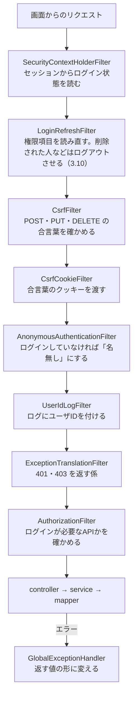
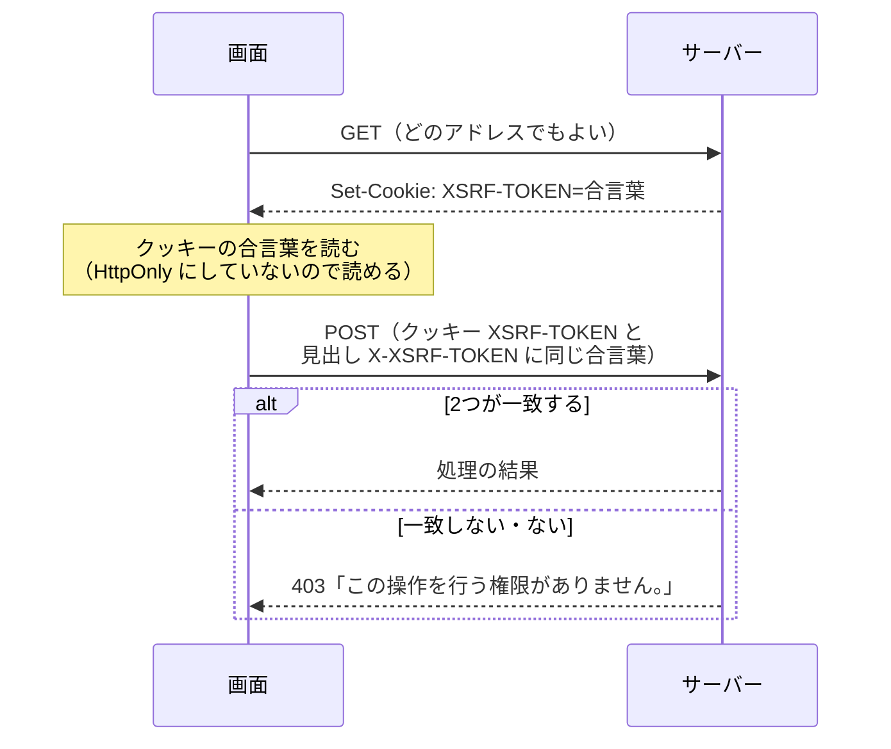

# 詳細設計：共通部品（common）と基盤

| 項目 | 内容 |
|---|---|
| 版 | v1.31 2026-11-23 |
| Jira | ZPOP-21（雛形：サーバー）、ZPOP-22（雛形：画面）、ZPOP-122（テーブルと最初のデータ）、ZPOP-55・56・57・103（ログインの最小限）、ZPOP-121（S-19 エラー）、ZPOP-123（Slack送信の部品）、ZPOP-124（アカウントロック。common.passwordlink） |
| もとにした設計書 | internaldesign/API設計.md v1.1 の2章・6章・7章、externaldesign/基本設計書.md v1.5 の4・5・6・9章、externaldesign/画面設計.md 1章・9章、externaldesign/画面一覧.md 7章、CLAUDE.md 3〜5章 |

## 1. 概要

全部の機能が使う土台。この資料には、ZPOP-21・22・122・55〜57・103 で作った次のものを書く。

| まとまり | 中身 | 状態 |
|---|---|---|
| 起動の入口・組み立ての設定 | EquipmentApplication、build.gradle、settings.gradle | 作成済み（ZPOP-21） |
| common.config | 設定値の読み込み、時計 | 作成済み（ZPOP-21） |
| common.security | Spring Security の設定、CSRF対策、ログへのユーザIDの付与、ログイン状態の持ち方 | 作成済み（ZPOP-21。ログイン状態の持ち方は ZPOP-55〜57。3.10）。ログインそのものは auth |
| common.error | 返す値の形、エラーの返し方 | 作成済み（ZPOP-21） |
| 設定ファイル | application.yml ほか、secret.example.yml | 作成済み（ZPOP-21） |
| ログの設定 | logback-spring.xml | 作成済み（ZPOP-21） |
| テスト用の部品 | TestFlywayConfig、CsrfTestHelper | 作成済み（ZPOP-21） |
| common.slack | Slack送信の部品と、テスト用の偽物・送った内容を読み出すAPI | 作成済み（ZPOP-123。3.13） |
| common.csv | CSVの読み書き | 未作成（使う機能のタスクで章を足す） |
| common.calendar | 祝日・催促日の計算、「今月確認済み」の判定 | 作成済み（「今月確認済み」の判定：2026-11-11。3.11。祝日と催促日の計算：ZPOP-126。3.18） |
| common.passwordlink | パスワード設定用のリンク | 作成済み（ZPOP-124。3.14。リンクを作るところまで。A-04・A-05・A-06 ほかが使う） |
| common.security（パスワードの決まり） | よく使われるパスワードの照らし合わせ（PasswordBlocklist）と、形式のチェック用の印（common.validation の NewPasswordFormat・PasswordConfirmed） | 作成済み（ZPOP-60。3.15。A-06・A-07 が使う） |
| common.security（ログインしたままにする） | 60日間ログインしたままにする仕組み（RememberMeTokenRepository・RememberMeUserDetailsService・LoginRememberMe・RememberMeLoginFilter） | 作成済み（ZPOP-125。3.17。A-01・A-02・A-06・A-07 が使う） |
| common.web | 組み立てた画面（Client）をサーバーから配る | 作成済み（ZPOP-22）。3.9 |
| テーブルと最初のデータ | Flyway の SQL（db/migration） | 作成済み（ZPOP-122）。詳細設計 [テーブル.md](テーブル.md) |
| common.constant | Enum（決まった値だけを持つ型）をまとめる場所 | 作成済み（2026-11-04）。今は HealthState だけ。各機能が足していく（2.3） |
| 画面（Client）の共通部品 | common/api、common/components、common/format、common/theme | 作成済み（ZPOP-22）。11章。common/auth は ZPOP-55〜57・103 で作った（11.9） |

ここに書く名前の意味は次のとおり。

- **Bean**（ビーン）：Spring が作って管理する部品のこと。`@Component`・`@Service` などを付けたクラスや、`@Bean` を付けたメソッドが返すものが Bean になる。
- **フィルター**：すべてのリクエスト（画面からの呼び出し）が controller に届く前に通る、関所のような部品。
- **プロファイル**：開発（dev）・テスト（test）・本番（prod）で設定を切り替える、Spring Boot の仕組み。

## 2. クラス構成

パッケージの頭の `jp.co.highjunk.equipment` は省いて書く。

### 2.1 本体（src/main）

| パッケージ | クラス・ファイル | 役割 |
|---|---|---|
| （いちばん上） | EquipmentApplication | アプリを起動する入口。設定値のクラス（@ConfigurationProperties）を自動で探す。UserDetailsServiceAutoConfiguration は使わない（10章の5） |
| common.config | AppProperties | 設定値（application.yml の `app:` の下）を読み込む入れ物。起動時に値の入力チェックをする |
| common.config | ClockConfig | 日本時間の時計（java.time.Clock）を Bean として1つ用意する |
| common.config | InitialAdminEmailCallback | Flyway が当て始める前に、最初の総務の担当者のメールアドレスの設定があるかを確かめる（ZPOP-122。詳細設計 [テーブル.md](テーブル.md) 5章） |
| common.security | SecurityConfig | Spring Security の設定。ログインなしで呼べるAPI、CSRF対策、401・403の返し方 |
| common.security | CsrfCookieFilter | どのリクエストでも、CSRFの合言葉をクッキー（XSRF-TOKEN）で渡すフィルター |
| common.security | UserIdLogFilter | ログの1行ごとに、操作した人のユーザIDを付けるフィルター |
| common.security | LoginUserId | 「ログインしている人のユーザIDを持つもの」を表す決まり（インターフェース）。LoginUser がこれを持つ |
| common.security | LoginUser・LoginUserRefresher・LoginRefreshFilter・LoginSession | ログイン状態の持ち方（3.10。ZPOP-55・56・57） |
| common.error | UnauthorizedException | 401 と文を返す（6章。ZPOP-55） |
| common.calendar | MonthlyConfirmationRule | 「今月確認済み」の判定（3.11） |
| common.calendar | HolidayCalendar・ReminderCalendar | 祝日・平日の判定、催促日の計算（25日。土日祝日なら前の平日）（ZPOP-126。3.18） |
| common.equipment | EquipmentSummary・EquipmentSummaryAssembler／MyLoanList・MyLoanItem・MyLoanListAssembler | 備品の一覧の1件の形（3.12）／自分が借りている備品の一覧と今月の確認の案内（3.19。ZPOP-63。B-01・B-04） |
| common.constant | PermissionCode・HomePage | 権限項目のコード（データ設計 5.3）、ログイン後の最初の画面（API設計 4.2） |
| common.error | ApiResponse | 返す値の形（status・message・data・errors）。ok・created・accepted・error で作る |
| common.error | ErrorItem | errors の1件（field・row・managementNo・message） |
| common.error | ApiMessages | message に入れる決まった文 |
| common.error | ApiException | 各機能が投げるエラーのもと（番号・文・errors を持つ） |
| common.error | BusinessRuleException | 決まりに合わない操作（400） |
| common.error | NotFoundException | 見つからない（404） |
| common.error | ConflictException | ぶつかった（409） |
| common.error | CsvErrorException | CSVの行のエラー（400） |
| common.error | ServiceUnavailableException | 動いていない（503。A-08） |
| common.error | GlobalExceptionHandler | controller・service で起きたエラーを、返す値の形に変える |
| common.error | ApiResponseWriter | controller の外（Spring Security の中）で、返す値の形を書き出す |
| common.web | SpaWebConfig | 組み立てた画面のファイルを配る。画面のアドレス（/loans など）で開かれたときは index.html を返す（3.9） |
| common.passwordlink | PasswordLinkIssuer・IssuedPasswordLink・PasswordLinkTokens | パスワード設定用のリンクを作る（合言葉を作る・ハッシュで保存する・前のリンクを無効にする・アドレスを作る）（3.14） |
| common.passwordlink | PasswordChangedNotifier | パスワードが変わったことを本人にDM（④）で知らせる（ZPOP-60。A-06・A-07 が使う。3.15） |
| common.passwordlink | PasswordLinkTestSupportController・PasswordLinkTestSupportService・PasswordLinkTestSupportRequest・PasswordLinkTestSupportIssued | テスト用：パスワード設定用のリンクを、用途を指定して作る・全部消す API（`POST`・`DELETE /api/test-support/password-links`）。`app.test-support.enabled` が true のときだけ動く（ZPOP-104。3.14） |
| common.security | PasswordBlocklist | パスワードが、メールアドレス・システム名・よく使われるパスワード（SecLists の10k）と同じかを調べる（3.15） |
| common.security | LoginFailureRecorder・AccountLockNotifier | パスワードを間違えた回数を数える・ロックする・0に戻す／ロックのDM（③）を送る（A-01・A-07 が使う。ZPOP-61。3.16） |
| common.security | RememberMeTokenRepository・RememberMeUserDetailsService・LoginRememberMe・RememberMeLoginFilter | 「ログインしたままにする」（60日間。persistent_logins。3.17。ZPOP-125） |
| common.validation | NewPasswordFormat・NewPasswordFormatCheck、PasswordConfirmed・PasswordConfirmedCheck・PasswordConfirmable | 新しいパスワードの形式のチェック（画面設計 8章）と、確認欄との一致のチェック。RestInDto に付ける（3.15） |
| common.constant | PasswordLinkPurpose | リンクの用途（RESET・REGISTER・LOCK。データ設計 5.8 の purpose の値） |
| common.slack | SlackSender・SlackDirectMessage・SlackSendResult | SlackのDMを送る約束（インターフェース）と、1通のDM、送った結果（3.13） |
| common.slack | SlackApiSender・SlackClientConfig | 本物のSlackに送る中身と、Slackにつなぐ部品（3.13）。`app.test-support.enabled` が false のときだけ動く |
| common.slack | FakeSlackSender・SentSlackMessage・SentSlackMessagesResponse・SlackTestSupportController | テスト用の偽物と、送った内容を読み出すAPI（3.13）。`app.test-support.enabled` が true のときだけ動く |
| common.constant | HealthState | A-08 の state の値（UP）。health の詳細設計に書く。ほかの Enum も、ここに足す |

| ファイル | 役割 |
|---|---|
| build.gradle | 使う部品と版（Slack Java SDK 1.49.0 を ZPOP-123 で足した。10章の14）。ソースの文字コードは UTF-8。テストは test プロファイルで、1つずつ順番に動かす。隣の Client で組み立てた画面（dist）があれば取り込む（3.9） |
| settings.gradle | Gradle のプロジェクト名。フォルダ名と同じ EquipmentManagementSystem_Server にする（10章の11） |
| src/main/resources/application.yml | どの環境でも同じ設定 |
| src/main/resources/application-dev.yml | 開発（各自のPC）の設定 |
| src/main/resources/application-test.yml | 自動テストの設定 |
| src/main/resources/application-prod.yml | 本番（AWS）の設定 |
| src/main/resources/logback-spring.xml | ログの形と出し先 |
| secret.example.yml | 秘密の値の書き方の見本（値は空） |

### 2.2 テスト用の部品（src/test。本番には入らない）

| パッケージ | クラス | 役割 |
|---|---|---|
| （いちばん上） | TestFlywayConfig | テストを始める前に、テスト用のデータベースのテーブルを消して作り直す |
| testsupport | CsrfTestHelper | テストで POST・PUT・DELETE を送るときに、画面と同じやり方で CSRF の合言葉を付ける |
| common.error | ErrorTestController | エラーの返し方を確かめるために、わざとエラーを起こすAPI（/api/test-errors/…） |
| common.security | LogTestController | ログに付くユーザIDを確かめるためのAPI（/api/test-security/log-user-id） |
| common.web | （src/test/resources/static/index.html） | 画面を配る仕組みを確かめるための、テスト用の index.html |

### 2.3 Mapper・返す値・Enum の置き場所

CLAUDE.md 4.1 のとおり（2026-11-15 に変えた）。Mapper とテーブルの形は dao に、受け取る値・返す値は API のパッケージの中に、Enum は common.constant に置く。

| 置くもの | パッケージ | 例 |
|---|---|---|
| Mapper（MyBatis Generator が作る） | dao.mapper | dao.mapper.UserMapper |
| テーブルの形と Example（MyBatis Generator が作る） | dao.entity | dao.entity.User、dao.entity.UserExample |
| 手で書く Mapper と、その結果の形 | dao.mapper.custom、dao.entity.custom | dao.mapper.custom.HealthCustomMapper、dao.entity.custom.EquipmentSearchCondition |
| Mapper の XML | src/main/resources/jp/co/highjunk/equipment/dao/mapper/（手で書くものは custom/） | …/dao/mapper/custom/HealthCustomMapper.xml |
| 受け取る値・返す値 | API のパッケージの controller・service・model | api.health.model.HealthRestOutDto |
| Enum | common.constant | common.constant.HealthState |

- MyBatis は、`@Mapper` を付けたインターフェースを、`jp.co.highjunk.equipment.dao.mapper` の下から探す（common.config.MyBatisConfig の `@MapperScan`。dao.mapper.custom も含む）。
- Spring の部品（bean）の名前は、パッケージ込みの名前（`jp.co.highjunk.equipment.dao.mapper.UserMapper`）にしている（FullyQualifiedAnnotationBeanNameGenerator）。同じ名前の Mapper がパッケージ違いでできても、ぶつからないようにするため。テストは common.config.MyBatisConfigTest（テストだけの dao.mapper.namecheck.first・second の SameNameMapper で確かめる）。2026-11-10 に決め、2026-11-15 に探す場所を dao.mapper にした。
- XML は、Mapper と同じパッケージの場所にあれば自動で読み込まれる（`mybatis.mapper-locations` は設定しない）。XML の namespace は、Mapper のクラスの名前にする。
- Enum を JSON で返すと、Enum の名前（例：UP）がそのまま文字になる。API設計の値（例：管理状態の文字）と Enum の名前をそろえる。
- common.constant は common の一部だが、新しい Enum のファイルを足すだけなら、機能の作業の中で足してよい。すでにある Enum を変えるときは2人で相談する（CLAUDE.md 9章）。

## 3. 処理の流れ

### 3.1 リクエストが通る順番

画面からのリクエストは、Spring Security のフィルターを上から順に通り、controller に届く。



図に書いていないフィルター（DisableEncodeUrlFilter など）は、Spring Security が自動で入れるもので、この作りには関係しない。

### 3.2 ログインなしで呼べるAPI

| 操作 | アドレス | API |
|---|---|---|
| POST | /api/auth/login | A-01 |
| POST | /api/auth/password-reset-requests | A-04 |
| POST | /api/auth/password-tokens/verify | A-05 |
| POST | /api/auth/password-tokens/use | A-06 |
| GET | /api/health | A-08 |

- `/api/test-support/` で始まるアドレス（3.13。テスト用）は、ログインなしで呼べ、CSRFの合言葉も要らない。`app.test-support.enabled` が false のときは、このアドレスを受け持つ controller がないので、404 になる。
- ほかの `/api/` で始まるアドレスは、ログインが必要。必要な権限項目は、各APIのメソッドに `@PreAuthorize` で書く（CLAUDE.md 5章）。
- `/api/` で始まらないアドレス（画面のファイル）は、だれでも受け取れる（ZPOP-22 で配る）。
- Spring Security が用意するログイン画面・Basic認証・ログアウトは使わない（A-01・A-02 で自分で作った。3.10）。
- 「ログイン前に開こうとしたページ」を覚える仕組み（リクエストキャッシュ）も使わない。画面の移り方は React が決めるため。

### 3.3 CSRF対策（なりすまし対策の合言葉）の流れ



- 設定は Spring Security の `csrf.spa()`（画面（React）向けの設定）を使う。
- Spring Security は、合言葉が使われるまでクッキーを作らない。そのため CsrfCookieFilter で一度値を読み、どのリクエストでもクッキーが作られるようにしている。こうすると、ログイン（A-01）の前でも、画面は合言葉を受け取れる。
- GET は合言葉を確かめない（読むだけの操作なので）。

### 3.4 ログにユーザIDを付ける流れ

1. UserIdLogFilter が、ログイン状態（Authentication）の中の「ログインしている人」を見る。
2. それが LoginUserId を持っていれば、ログの付け足し情報（MDC：そのリクエストの間だけ、ログに自動で付ける値の入れ物）に `userId` を入れる。
3. controller に処理を渡す。処理の間に出たログには `userId=12` のように付く。
4. 処理が終わったら（エラーでも）、`userId` を消す。

ログインしていないときは何も入れないので、ログには `userId=-` と出る。

CsrfCookieFilter と UserIdLogFilter は Bean として登録していない。そのため、「このリクエストではもう動いた」という印の名前を、クラスの名前から作るようにしている（10章の8）。

### 3.5 ログインしていない・権限がないとき

止める場所が2つあり、どちらも返す値の形（API設計 2.4）で返す。

| 止める場所 | 場面 | 返し方 |
|---|---|---|
| フィルター（AuthorizationFilter） | ログインが必要なアドレスを、ログインせずに呼んだ | 401。SecurityConfig の authenticationEntryPoint が ApiResponseWriter で書き出す |
| フィルター（CsrfFilter） | 合言葉がない・違う | 403。SecurityConfig の accessDeniedHandler が ApiResponseWriter で書き出す |
| メソッド（@PreAuthorize） | 必要な権限項目を持っていない | GlobalExceptionHandler が AccessDeniedException を受けて返す。ログインしていなければ 401、ログインしていれば 403 |

### 3.6 エラーを返す値の形に変える（GlobalExceptionHandler）

上から順に当てはまるものを使う。

| 起きたこと | 例 | status | message | errors |
|---|---|---|---|---|
| ApiException の仲間を投げた | 各機能の BusinessRuleException など | その例外の番号 | その例外の文 | その例外が持つもの（CSVの行のエラーのときだけ） |
| JSONの入力チェックの誤り（MethodArgumentNotValidException） | `@NotBlank` に引っかかった | 400 | 入力内容に誤りがあります。 | 入力欄ごと（field・message）。入力欄に結び付かない誤りは field が null |
| アドレスの後ろの値の入力チェックの誤り（HandlerMethodValidationException） | `?page=0` が `@Min(1)` に引っかかった | 400 | 入力内容に誤りがあります。 | 入力欄ごと（field は値の名前） |
| JSONが壊れている・必要な値がない・数字の欄に文字（HttpMessageNotReadableException など3つ） | `{壊れたJSON`、`?page=abc` | 400 | 入力内容に誤りがあります。 | null |
| 権限の確認で止められた（AccessDeniedException） | `@PreAuthorize` | 401 か 403（3.5） | ログインしてください。／この操作を行う権限がありません。 | null |
| ログインが必要（AuthenticationException） | | 401 | ログインしてください。 | null |
| Spring が用意したエラーで、番号が400番台（ErrorResponse の仲間） | 存在しないアドレス（404）、使えない操作の種類（405） | Spring が決めた番号 | 404 は「対象が見つかりません。」、400 は「入力内容に誤りがあります。」、ほかは「リクエストの形が正しくありません。」 | null |
| 上のどれでもない | プログラムの不具合 | 500 | 問題が発生しました。時間をおいて、もう一度お試しください。続く場合は総務に連絡してください。 | null |

500 のときだけ、エラーの詳しい中身（スタックトレース：どこで起きたかの記録）を ERROR でログに残す。画面には返さない。

### 3.7 設定値の読み込み

1. `application.yml`（どの環境でも同じ）を読む。
2. 起動するときのプロファイルに合わせて、`application-dev.yml`・`application-test.yml`・`application-prod.yml` のどれかを重ねて読む。何も指定しないと dev になる。自動テスト（gradlew test）は build.gradle で test を指定している。
3. Server のフォルダの `secret.yml` があれば読む（`spring.config.import: optional:file:./secret.yml`。optional なので、なくても起動する）。秘密の値は、このファイルにだけ書く。
4. 環境変数があれば、それがいちばん強い（AWSでは環境変数で渡す。例：`SPRING_DATASOURCE_PASSWORD`、`APP_SLACK_BOT_TOKEN`）。
5. `app:` の下の値は AppProperties に入る。起動時に入力チェック（`@NotNull` など）をし、足りなければ起動しない。

`./secret.yml` は、起動したときのフォルダから見た場所。`gradlew bootRun`・`gradlew test` と Eclipse からの起動は、Server のフォルダで動くので、Server のフォルダの `secret.yml` が読まれる。

### 3.8 時計と日時の形

- ClockConfig が、設定値 `app.time-zone`（Asia/Tokyo）の時計を1つ作る。各機能は、この時計を受け取って `LocalDate.now(clock)` のように使う。テストでは、止めた時計に差し替える。
- JSONで返す日付は "2026-11-02"、日時は "2026-11-25T09:00:00+09:00" の形（`spring.jackson.time-zone: Asia/Tokyo`）。
- データベースとのやり取りも日本時間にそろえる（4章の接続の設定）。

### 3.9 組み立てた画面を配る（common.web.SpaWebConfig）

API設計 2.1 のとおり、画面とAPIを同じアドレスで出す。

**本番（AWS）**
1. 人が Client で `npm run build` を動かす。組み立てた画面が Client の `dist` フォルダにできる。
2. 人が Server で `gradlew bootJar` を動かす。build.gradle が、隣の `../EquipmentManagementSystem_Client/dist` の中身を、Server の `static` フォルダとして jar に入れる。dist がなければ何も入れない（エラーにはしない）。
3. Spring Boot が、`static` の中のファイルを配る。

**アドレスごとの返し方**

| アドレス | 返すもの |
|---|---|
| `/api/` で始まる | API（ほかの章のとおり）。見つからなければ 404 の JSON |
| ファイルが `static` にある（例：`/assets/index-xxxx.js`） | そのファイル |
| 名前に「.」を含むのに、ファイルがない（例：`/assets/なし.js`） | 404（画面のファイルの取り違えに気づけるように） |
| それ以外（例：`/`、`/loans`、`/equipment/12`） | `index.html`。画面の切り替えは React が行うため、どのアドレスで開いても同じ index.html を返す |

**開発中** は、画面を Vite の開発用サーバー（http://localhost:5173）で開く。`/api` の呼び出しは、Vite が Spring Boot（http://localhost:8080）に回す（11.3）。Server の `static` は使わない。

### 3.10 ログインの部品（common.security。ZPOP-55・56・57）

ログインそのもの（メールアドレスとパスワードの確かめ）は A-01（api.auth.login。詳細設計 [auth/auth.md](auth/auth.md)）が行う。common には、どの API も使う「ログイン状態の持ち方」と、2つ以上の API で使う処理・API でない処理を置く（CLAUDE.md 4.1）。

| クラス | 役割 |
|---|---|
| LoginUser | セッションに入れる「ログインしている人」。ユーザID（userId）と、ログインした日時（loggedInAt）だけを持つ。LoginUserId を実装する |
| LoginUserRefresher | APIを呼ぶたびに、ログインしている人の今の権限項目を返す約束（インターフェース）。返せない（削除された、session_valid_after より前のログイン）ときは空を返す。中身は LoginUserRefresherImpl |
| LoginUserRefresherImpl | LoginUserRefresher の中身。dao の UserMapper・RolePermissionMapper で読み直す。API でない処理なので common に置く（2026-11-15 に auth から移した） |
| LoginUserInfoAssembler・LoginUserInfo | ユーザの行（dao.entity.User）から、ログインしている人の情報と権限項目（API設計 4.2 の形。権限項目は sort_order の順）を作る。A-01・A-03 が自分の RestOutDto に写す（2026-11-15 に、A-03 の MeService#toMeResponse から移した） |
| LoginRefreshFilter | `/api/` で始まるリクエストのたびに LoginUserRefresher を呼ぶフィルター。空なら、セッションを捨ててログインしていない扱いにする（→ ログインが要る API は 401）。そうでなければ、今の権限項目でログイン状態を作り直す（そのリクエストの間だけ。権限の変更が次の操作から効く。API設計 2.2）。データベースを読めなかったときは、controller の外なので GlobalExceptionHandler を通らないため、ここで 500 を 2.4 の形で返す（ApiResponseWriter） |
| LoginSession | ログインを始める（start）・終える（end）。start：セッションの番号を変え（すでにあれば）、LoginUser と権限項目のログイン状態をセッションに保存し、XSRF-TOKEN を作り直す。end：ログに「ログアウトしました」を残し、セッションを捨て、XSRF-TOKEN を作り直す |
| SecurityConfig（変更） | PasswordEncoder（bcrypt）・SecurityContextRepository（セッションにログイン状態を入れる部品）・CsrfTokenRepository（XSRF-TOKEN のクッキーを扱う部品）を、ほかの部品から使えるように用意する。LoginRefreshFilter を、セッションからログイン状態を読んだすぐあと（SecurityContextHolderFilter の後ろ）に置く |

**ほかの機能での使い方**

- ログインしている人のユーザIDは、controller の引数に `@AuthenticationPrincipal LoginUserId user` と書いて、`user.getUserId()` で取る。
- パスワードの照らし合わせ・変換は、PasswordEncoder を受け取って使う（bcrypt。基本設計書 5章）。
- テストでログインした状態を作るときは、A-01 を呼んでセッション（MockHttpSession）を受け取るか、`authentication(...)` で LoginUser を入れる（9章）。
- ログインを始める・終える（LoginSession#start・end）は、Web のセッションを扱う仕事なので、A-01・A-02 の Controller から呼ぶ（Service に HttpServletRequest を渡さないため。auth.md 4章の No.6）。CLAUDE.md 5章の「controller は service を呼ぶだけ」の例外として、2026-11-10 に CLAUDE.md 5章に書いた。

**あとのタスクへの申し送り**

- ログインしたままにする（ZPOP-125）：**3.17 で作成済み**。RememberMe で作ったログイン状態を LoginUser に置き換えるフィルター（RememberMeLoginFilter）を、LoginRefreshFilter の前に置いた。
- パスワードの設定・変更（ZPOP-60・61）：session_valid_after は DATETIME（秒まで）、LoginUser の loggedInAt はもっと細かい。**ZPOP-60 で決めた：LoginUserRefresherImpl が、loggedInAt を秒までにそろえて（切り捨て）比べる。session_valid_after には、今を秒までにそろえて入れる**（A-06 の12章 No.1。同じ1秒の中のログインは切らない）。A-07 も同じ。

### 3.11 「今月確認済み」の判定（common.calendar.MonthlyConfirmationRule）

写したもと：機能一覧.md v1.0 の1章（言葉の決まり「今月確認済み」）・4章（F-05）

- 今月確認済み＝最終確認日の月が今月であること。最終確認日が未記入、または先月以前なら「未確認」（今のExcelで最終確認日が黄色になる状態）。
- 使う機能：equipment（C-01 の絞り込みと confirmedThisMonth。C-06）、mine（B-01）、confirmation、reminder（催促の対象）。どの機能もこの部品を使い、書き写さない（CLAUDE.md 5章）。
- 今日の日付は時計（ClockConfig の Clock。日本時間）から取る。

| メソッド | 返すもの | 使い方 |
|---|---|---|
| firstDayOfThisMonth() | 今月の1日（LocalDate） | SQL で「last_confirmed_on >= 今月の1日」なら今月確認済み、「last_confirmed_on IS NULL OR last_confirmed_on < 今月の1日」なら未確認、と比べるときに渡す。最終確認日は今日より後にならない（「確認した」はその日の日付を入れる。機能一覧 F-07）ので、「1日以降」は「今月」と同じ |
| isConfirmedThisMonth(LocalDate lastConfirmedOn) | 今月確認済みなら true（null は false） | 読んだ行ごとに、返す値の confirmedThisMonth などを決めるときに使う |

- 祝日の取り込みと催促日の計算（25日。土日祝日なら前の平日）は、ZPOP-126 でこのパッケージに足した（3.18）。

### 3.12 備品の一覧の1件の形（common.equipment。2026-11-15）

| クラス | 役割 |
|---|---|
| EquipmentSummary | 備品の一覧の1件の形（C-01 の items の1件。id・managementNo・categoryName・maker・model・status・loanStatus・borrowerName・lastConfirmedOn・confirmedThisMonth） |
| EquipmentSummaryAssembler | 備品の行（dao.entity.Equipment）と「備品のID → 借用者のユーザID」から EquipmentSummary を作る。種別の名前と借用者の氏名は、dao の CategoryMapper・UserMapper の selectByExample（andIdIn）でまとめて読む（削除済みも読む）。今月確認済みかは MonthlyConfirmationRule（3.11） |

- C-01・C-06 で使うので common に置く（API どうしは使い合わない。CLAUDE.md 4.1）。各 API は、EquipmentSummary を自分の RestOutDto に写して返す。

### 3.13 Slack送信の部品（common.slack。ZPOP-123）

写したもと：基本設計書.md v1.5 の6章（Slack連携の方式）、画面設計.md v1.1 の9章（SlackのDMの文面）、API設計.md v1.1 の5章・6章（テストでは偽物、ボットトークン、テスト用の切り替え）

- 役目：ユーザに登録したメールアドレスで Slack のユーザーを探し、そのユーザーにアプリからDMを送る。DMの文面（画面設計 9章の①〜⑦）は、送る機能が作って渡す。この部品は文面を持たない。
- 使う機能：パスワード関係（A-04、A-01 のロック、A-06・A-07、G-03・G-06）と、催促（ZPOP-127）。見張り役（monitor）は Server の部品を使わない（CLAUDE.md 4.2）ので、使わない。
- **Slack の呼び出しは `@Transactional` の中で行わない**（CLAUDE.md 5章）。書き込みが確定してから呼ぶ。呼ぶ側の決まり。

| クラス | 役割 |
|---|---|
| SlackSender | DMを送る約束。`SlackSendResult sendDirectMessage(String email, SlackDirectMessage message)`。**例外を投げない**（失敗は結果の値で返す） |
| SlackDirectMessage | 1通のDM。title（見出し）と body（本文）を持つ。Slack に送る文は、見出しを太字にして、空行をはさみ、本文を続けた形（`*見出し*` ＋ 空行 ＋ 本文） |
| SlackSendResult | 送った結果。SENT（送れた）、USER_NOT_FOUND（そのメールアドレスの Slack のユーザーが見つからない）、FAILED（そのほか。トークンが未設定、Slack が断った、通信の失敗） |
| SlackApiSender | 本物。下の「本物の流れ」のとおり |
| SlackClientConfig | Slack にそのトークンでつなぐ部品（Slack Java SDK の MethodsClient）を、Bean として1つ用意する |
| FakeSlackSender | 偽物。Slack には送らず、送った内容を記録（SentSlackMessage）にためる。結果は、いつも SENT。記録を読む（findAll）・空にする（clear）。記録は、送った順で、メモリの中だけに持つ |
| SentSlackMessage | 記録の1件。email（宛先のメールアドレス）、title、body、sentAt（送った日時。時計 ClockConfig の日本時間） |
| SentSlackMessagesResponse | 読み出しAPIが返す data。messages（記録の一覧。古い順） |
| SlackTestSupportController | 送った内容を読み出すAPI（下の表） |

**本物・偽物の切り替え**：`app.test-support.enabled`（API設計 6章「テスト用の切り替え」。テストのプロファイルだけ true）で決める。true のとき FakeSlackSender と SlackTestSupportController だけが Bean になり、false（本番・開発）のとき SlackApiSender と SlackClientConfig だけが Bean になる（`@ConditionalOnProperty`）。

**本物の流れ**（SlackApiSender#sendDirectMessage）

1. ボットトークン（`app.slack.bot-token`）が空なら、Slack を呼ばずに FAILED を返す（記録に「Slackのボットトークンが設定されていません」を warn で残す）。開発のPCで、トークンを入れずに起動したときの動き。
2. メールアドレスで Slack のユーザーを探す（`users.lookupByEmail`）。Slack の答えの error が `users_not_found` なら USER_NOT_FOUND。ほかの error や、通信の失敗（IOException・SlackApiException）は FAILED。
3. 見つかったユーザーのIDを宛先にして、メッセージを送る（`chat.postMessage`）。**リンクのプレビューを出さない**ため、`unfurl_links` と `unfurl_media` を false にする（画面設計 9章の注意1）。Slack が ok でなければ FAILED。
4. 送れたら SENT。

**記録（ログ）**：USER_NOT_FOUND・FAILED のとき、warn で「Slack のDMを送れませんでした」と、結果・Slack の error の名前・宛先のメールアドレスを残す（画面設計 9章の注意3）。**見出し・本文（リンクの合言葉が入るため）・トークンは、記録に出さない**（API設計 7章）。呼ぶ側は、結果を見て、画面設計どおりに分ける（S-02 は同じ文を出す、G-03 は「…送れませんでした」と出す、催促は催促履歴に失敗を残す、など）。

**送った内容を読み出すAPI**（テスト用。`app.test-support.enabled` が true のときだけ動く。API設計の一覧（3章）には載せない）

| 操作 | アドレス | 内容 | 返すもの |
|---|---|---|---|
| GET | /api/test-support/slack-messages | 送った内容の一覧を、古い順に返す | 200。data は `{ "messages": [ { "email": "…", "title": "…", "body": "…", "sentAt": "2026-11-15T09:00:00+09:00" } ] }`。1通もなければ messages は空の配列 |
| DELETE | /api/test-support/slack-messages | 記録を空にする。テストの前に呼ぶ | 200。data は null |

- どちらも、ログインなし・CSRFの合言葉なしで呼べる（SecurityConfig の変更。下の表）。本番・開発では controller がなく 404。本番の設定で動かないことは、テストで確かめる（9章）。
- 画面（Playwright）のテストは、この API で、パスワード設定用のリンクの合言葉入りの DM を読む（テスト方針 5章）。

| クラス | 変更 |
|---|---|
| SecurityConfig（変更） | `/api/test-support/**` を、ログインなしで呼べるアドレス（permitAll）にし、CSRF の確かめの対象から外す（`ignoringRequestMatchers`）。ほかの設定は変えない |

**あとのタスクへの申し送り**

- DMの文面（画面設計 9章の①〜⑦）を、どこで作るか：①〜④ は auth・user が、⑤ は reminder が、それぞれ作って渡す。同じ文面を2つの API が使う（①②③ のリンクの付け方など）ときは、そのタスクで、common に置くかを人と決める。
- 偽物の FakeSlackSender は、いつも SENT を返す。「Slack のユーザーが見つからない」「送れなかった」の場面は、呼ぶ側の単体テストで、SlackSender を Mockito（偽物を作るテストの道具）の偽物（`@MockitoBean`）に差し替えて作る。画面のテストで、その場面が要るときは、そのタスクで偽物に仕掛けを足す。

### 3.14 パスワード設定用のリンクを作る部品（common.passwordlink。ZPOP-124）

写したもと：機能一覧.md v1.1 の6章（3・4・6・10・12）、データ設計.md v1.0 の5.8（password_tokens）、API設計.md v1.1 の6章（リンクの有効期限・アドレス）、画面設計.md v1.1 の2.1・5章・6章・9章

- 役目：パスワード設定用のリンクを作る。合言葉（トークン）を作り、データベースにはハッシュ（元に戻せない形）で保存し、前のリンクを無効にし、リンクのアドレスを返す。**DMは送らない**（DMの文面は、送る機能が作って渡す。3.13）。
- 使う機能：アカウントロック（A-01。ZPOP-124。用途 LOCK）。あとで、A-04（RESET）、G-03・G-06（REGISTER。G-06 は送り直し）が使う。
- 合言葉を確かめる側（A-05・A-06）が使うよう、ハッシュの計算（`PasswordLinkTokens#hash`）も、この部品に置く。

| クラス | 役割 |
|---|---|
| PasswordLinkIssuer | リンクを作る（`IssuedPasswordLink issue(long userId, PasswordLinkPurpose purpose)`）。呼ぶ側の `@Transactional` の中で動く（自分では付けない） |
| IssuedPasswordLink | 作ったリンク。linkUrl（DMに入れるアドレス）、purpose、expiresAt（有効期限の日時） |
| PasswordLinkTokens | 合言葉を作る（`generate()`）・ハッシュにする（`hash(token)`）。static のメソッドだけ |
| common.constant.PasswordLinkPurpose | リンクの用途。RESET（再設定）・REGISTER（ユーザ登録）・LOCK（ロック）。値の文字は、データ設計 5.8 の purpose と同じ |
| PasswordLinkVerifier | リンクの合言葉が使えるかを確かめる（`VerifiedPasswordLink verify(String token)`）。読むだけ。A-05・A-06 が使う（ZPOP-59）。使えないときは BusinessRuleException |
| VerifiedPasswordLink | 確かめた結果。リンクの行（PasswordToken）・ユーザ（User）・用途（PasswordLinkPurpose） |

**リンクを作る流れ**（PasswordLinkIssuer#issue）

1. 合言葉を作る：推測されにくいランダムな文字列（SecureRandom＝予測しにくい乱数で作った32バイトを、URL に使える文字だけの形（Base64URL。= なし）にしたもの。43文字）。
2. ハッシュを作る：合言葉を UTF-8 の文字として SHA-256 に通し、16進数の小文字（64文字）にする（データ設計 5.8 の token_hash）。
3. 前のリンクを無効にする：その人の、まだ使っていない（used_at が空）・まだ無効にしていない（revoked_at が空）リンクの revoked_at に今（Clock）を入れる（PasswordTokenMapper#updateByExampleSelective。`user_id = ? AND used_at IS NULL AND revoked_at IS NULL`）。用途が違っても無効にする（画面設計 5章「同じ人に新しいリンクを送ったとき、それより前のリンク」）。
4. 新しいリンクを保存する：PasswordTokenMapper#insert（user_id・token_hash・purpose・expires_at（今＋その用途の有効期限）・created_at）。
5. リンクのアドレスを作る：`<app.base-url>/password-set?token=<合言葉>`（`app.base-url` の終わりに「/」があれば除く。基本設計書 6章・機能一覧 6章の4のとおり、アクセスしてきた側が送ってくるアドレス情報は使わず、設定の値で作る）。合言葉そのものは、データベースにも記録（ログ）にも残さず、返すアドレスにだけ入れる。

**有効期限**（設定。7.1）：RESET は `app.password-link.reset-validity`（30分）、LOCK は `app.password-link.lock-validity`（30分）、REGISTER は `app.password-link.registration-validity`（3日）。

**合言葉を確かめる流れ**（PasswordLinkVerifier#verify。ZPOP-59）

1. 合言葉が空・ないなら、使えない。
2. `PasswordLinkTokens#hash` でハッシュを作り、PasswordTokenMapper#selectByExample（andTokenHashEqualTo）で探す。なければ、使えない。
3. 使用済み（used_at が入っている）、無効（revoked_at が入っている）、期限切れ（expires_at が今（Clock）以前。期限ちょうども使えない）なら、使えない。
4. UserMapper#selectByPrimaryKey でユーザを読む。いない・削除されている（deleted_at）なら、使えない。
5. 使えないときは、BusinessRuleException（「このリンクは使えません。有効期限が切れたか、すでに使われています。」。定数 `PasswordLinkVerifier.UNUSABLE_MESSAGE`）を投げる。理由は区別せず同じ文（画面設計 6章）。理由は WARN でログに残す（合言葉は出さない）。使えるときは VerifiedPasswordLink を返す。

読むだけで、自分では `@Transactional` を付けない。A-06 は、自分の `@Transactional` の中で呼び、続けて used_at を入れる（そのとき `used_at IS NULL` の行だけを書き換えて、同時に2回使われるのを防ぐ。A-06 の設計で決める）。

**テスト用の API**（ZPOP-104。画面のテスト（Playwright）が使う）：`POST /api/test-support/password-links`（本文 `{ "email", "purpose" }`）が、そのメールアドレスのユーザに、指定した用途（RESET・REGISTER・LOCK）のリンクを作り、`{ token, purpose, expiresAt }` を返す（前のリンクは無効になる。ユーザがいない・削除されていれば 404、用途が知らない値・ないときは 400）。`DELETE /api/test-support/password-links` が、リンクを全部消す。どちらも、5分に1回の決まり（A-04）に当たらず、DM を経由しないので、画面のテストが S-03 を開くための合言葉を、いつでも用意できる。Slack の読み出し API（3.13）と同じく、`app.test-support.enabled` が true のときだけ動き、本番・開発では Bean も controller もなく 404 になる。ログインなし・CSRFの合言葉なしで呼べる（SecurityConfig の `/api/test-support/**`）。

**記録（ログ）**：INFO で「パスワード設定用のリンクを作りました（userId、用途）」だけ。合言葉・アドレス（合言葉を含む）は出さない（API設計 7章）。

**あとのタスクへの申し送り**

- 5分に1回の判定（`app.password-link.request-interval`。A-04）：password_tokens の created_at を使う（データ設計 8章のインデックス）。**A-04 で作成済み（ZPOP-58）**。判定は、用途が RESET のリンクだけを数える（この部品ではなく、A-04 の AuthPasswordResetRequestsLinkIssuer が行う）。
- 合言葉を確かめる（A-05・A-06）：**確かめる部分は PasswordLinkVerifier で作成済み（ZPOP-59）**。「設定する」を押したときに used_at を入れる（画面設計 9章の注意2）。
- リンクのアドレス（`/password-set?token=…`）は、S-03（ZPOP-105）で、同じアドレスの画面を作る。S-03 の画面から別のサイトへ移ったとき、アドレスが伝わらないよう、Referrer-Policy を no-referrer にする（機能一覧 6章の5）のも S-03 で行う。

### 3.15 パスワードの決まりの部品（common.security・common.validation。ZPOP-60）

写したもと：画面設計.md v1.1 の8章（パスワードの決まり）・9章の④、機能一覧.md v1.1 の6章の7・9

A-06（パスワードを決める）と A-07（パスワードを変える）が同じ決まりを使うので、common に置く（API のパッケージどうしは使い合わないため）。

| クラス | 置き場所 | 役割 |
|---|---|---|
| NewPasswordFormat・NewPasswordFormatCheck | common.validation | 新しいパスワードの形式のチェック（RestInDto の password に付ける）。1つの欄に1つだけメッセージを出す。順番は、空（「新しいパスワードを入力してください」）→「パスワードに使えるのは、半角の英字・数字・記号・スペースです」→「パスワードは8文字以上で入力してください」→「パスワードは64文字以内で入力してください」。半角は 0x20〜0x7E。前後の空白は取らない |
| PasswordConfirmed・PasswordConfirmedCheck・PasswordConfirmable | common.validation | 確認欄との一致のチェック（クラスに付ける）。違うとき（空のときも）、passwordConfirm の欄に「確認用のパスワードが一致しません」。RestInDto が PasswordConfirmable（getPassword・getPasswordConfirm）を実装する |
| PasswordBlocklist | common.security | `boolean isBlocked(String password, String email)`。大文字・小文字を区別せず、メールアドレス全体・システム名（equipment・equipmentmanagement・equipmentmanagementsystem）・よく使われるパスワードの一覧と同じなら true。一覧は起動時に1回だけ読み込む。読み込めなければ起動を止める |
| password/10k-most-common.txt | src/main/resources | よく使われるパスワードの一覧。SecLists（MIT）の `Passwords/Common-Credentials/10k-most-common.txt`（10,000件、73,026バイト。2026-11-15 に、人の許可を得てダウンロード）。外部のサービスには問い合わせない |
| password/10k-most-common.LICENSE.txt | src/main/resources | SecLists の MIT ライセンスの文（著作権の表示。ファイルに付けることが条件のため） |

守れないときの返し方：形式のチェックは 400（errors に入力欄ごとの文）。PasswordBlocklist で断られたときは、使う側の Validator が FieldErrorException（password に「このパスワードはよく使われているため、使えません。別のパスワードにしてください」）を投げる。

**パスワードが変わったことのDM（④）**：common.passwordlink.PasswordChangedNotifier（`notifyChanged(String email, long userId, LocalDateTime changedAt)`）。見出しは「【備品管理】パスワードを変更しました」、本文は変わった日時と、「ご自分で変更した覚えがない場合は、すぐにパスワードを再設定し、総務に連絡してください」。パスワードは書かない。書き込みが確定したあとに呼ぶ。送れなかったときは WARN で残すだけ。A-06 では、用途が REGISTER のとき（最初の設定）は呼ばない。

### 3.16 パスワードの失敗を数える・ロックする部品（common.security。ZPOP-61）

写したもと：画面設計.md v1.1 の2.1・7章・9章の③、機能一覧.md v1.1 の6章の12

A-01（ログイン）と A-07（自分のパスワード変更。現在のパスワードを間違えたとき）が、同じ数え方・同じロックのDMを使うので、common.security に置く。もとは api.auth.login.service の AuthLoginFailureRecorder・AuthLoginLockNotifier（ZPOP-124）。名前だけ変えた（動きは変えない）。

| クラス | 役割 |
|---|---|
| LoginFailureRecorder | `Optional<IssuedPasswordLink> recordPasswordFailure(long userId)`（`@Transactional`。失敗の回数を1増やし、しきい値（`app.lock-threshold`）以上でロックして、LOCK のリンクを作る。いまロックしたときだけ、リンクを返す）と、`void resetFailures(long userId)`（`@Transactional`。回数を0に戻す）。詳しい流れは auth/A-01_ログイン.md の4.1 |
| AccountLockNotifier | `void notifyLocked(User user, IssuedPasswordLink link)`。ロックのDM（③）を送る（確定したあとに呼ぶ）。送れなかったときは WARN で残すだけ |

A-01 は、ユーザがいて・パスワードがあり・ロックされていないときだけ数える。A-07 は、現在のパスワードを間違えたときに数える（ロック中は、SQL の条件（`locked_at IS NULL`）で数えない）。

### 3.17 ログインしたままにする（common.security。ZPOP-125）

写したもと：データ設計.md v1.0 の5.9、基本設計書.md v1.1 の5章、API設計.md v1.1 の4.1・6章、画面設計.md v1.1 の2章・2.1 の6・6章・7章、機能一覧.md v1.1 の6章の8

ログイン（A-01）で「ログインしたままにする」にチェックがあれば、60日間（`app.remember-me-validity`）ログインしたままにする。Spring Security の PersistentTokenBasedRememberMeServices（クッキーに「端末ごとの番号（series）」と「合言葉（token）」を持たせ、合言葉と番号をデータベース（persistent_logins）にも持つ仕組み）を使う。セッション（JSESSIONID）が切れても、クッキー `remember-me` があれば、次の操作で自動でログインし直す。

| クラス | 役割 |
|---|---|
| RememberMeTokenRepository | PersistentTokenRepository の中身。persistent_logins を、MyBatis の PersistentLoginMapper で読み書きする（作る・合言葉を更新する・番号で読む・その人の行をすべて消す・番号の行を1つだけ消す） |
| RememberMeUserDetailsService | クッキーのユーザ名（メールアドレス）から、削除されていないユーザを探す。いなければ UsernameNotFoundException（自動ログインしない・クッキーを消す） |
| LoginRememberMe | PersistentTokenBasedRememberMeServices を持ち、業務から使いやすい形にする：`remember(userId, request, response)`（この端末を「ログインしたまま」にする。クッキーを渡し、行を作る）、`forget(request, response)`（この端末の行とクッキーだけを消す）、`removeAllOf(email)`（その人の行をすべて消す。パスワードの変更・再設定のとき）、`isRemembered(request)`（この端末に、クッキーがあるか）、`autoLogin(request, response)`（クッキーで本人と確かめ、ユーザ ID を返す） |
| RememberMeLoginFilter | LoginRefreshFilter の前に置くフィルター。`/api/` のリクエストで、ログイン状態がなく、クッキー `remember-me` があるときだけ、`LoginRememberMe#autoLogin` で自動ログインする。作ったログイン状態は LoginUser（ログインした日時は今）にして、セッションにも保存する（次からは、セッションで続く）。権限項目は、あとの LoginRefreshFilter が読み直す |
| LoginSession | `start(userId, permissions, rememberMe, request, response)`：rememberMe が true なら remember、false なら、この端末の forget（チェックを外してログインし直したとき、前のクッキーを残さない）。`end`：これまでの動きに、この端末の forget を足す |

**動き**

1. **ログインしたとき（A-01）**：rememberMe が true なら、クッキー `remember-me`（HttpOnly。有効期間は60日。本番は Secure）を渡し、persistent_logins に1行（series・token・username＝メールアドレス・last_used）を作る。
2. **セッションが切れたあと、クッキーで入るとき**：RememberMeLoginFilter が、series で行を読み、token が同じで、last_used から60日以内なら、本人とみなす。**入るたびに、token を新しいものに替え**（行の token・last_used を更新し、新しいクッキーを渡す）、新しいセッションを作る。
3. **盗まれたとき**：series はあるが token が違う（古いクッキーをもう一度使った）ときは、盗まれたと見て、その人の行をすべて消し、自動ログインしない（401）。ただし、**合言葉を替えた直後（10秒以内）に、替える前のクッキーで来たとき**は、盗まれたとは見ず、本人として入れる（合言葉は替えず、新しいクッキーも渡さない。判断 No.7）。
4. **60日をすぎたとき**・**ユーザが削除されたとき**：自動ログインしない。クッキーを消す。
5. **ログアウトしたとき（A-02）・5回間違えて、この端末をログアウトさせたとき（A-07）**：この端末の行とクッキーだけを消す（LoginSession#end）。ほかの端末の「ログインしたまま」は残る。
6. **パスワードを変えた・再設定したとき**：その人の行をすべて消す（`removeAllOf`。A-06・A-07。データ設計 5.9）。A-07 では、この端末が「ログインしたまま」だったときは、消したあとに、この端末だけ作り直す（`remember`）。
7. **ロックされているとき**：自動ログインできる（ロックしても、ログインしたままの端末はそのまま使える。画面設計 2.1 の6）。

設定：クッキーの名前は `remember-me`。有効期間は `app.remember-me-validity`（60日）。Secure は、セッションのクッキーと同じ設定（`server.servlet.session.cookie.secure`。本番だけ true）。

**設計書にない判断**

| No. | 判断 | 理由 | 外から見えるか | 人の確認 |
|---|---|---|---|---|
| 1 | ログアウトでは、この端末の「ログインしたまま」だけを解除する（Spring Security の標準は、その人のすべての端末） | 画面設計 2.1 の6・機能一覧 F-01 は、解除の場面を「ログアウト、パスワードの変更・再設定」と書くが、ログアウトがどの範囲かは決めていない。パソコンでログアウトして、スマートフォンまで解除されると困るため | はい | まだ |
| 2 | チェックを付けずにログインしたときは、この端末に前のクッキーが残っていれば、消す（行も消す） | 今回は「ログインしたままにしない」と選んだため | はい | まだ |
| 3 | 自動ログインでは、ログインした日時は「今」にする。パスワードを変えると行は消えるので、session_valid_after との食い違いは起きない | ログインした日時が、クッキーを作った日になると、パスワードを変えたあとのクッキーが、session_valid_after と比べて切られてしまうため | いいえ | ― |
| 4 | 自動ログインは、`/api/` のリクエストだけで行う（画面のファイルのリクエストでは、データベースを読まない） | LoginRefreshFilter と同じ | いいえ | ― |
| 5 | persistent_logins の username は、メールアドレス（データ設計 5.9）。ユーザのメールアドレスを変える（G-04）・ユーザを削除する（G-05）ときの行の扱い（行を消す）は、その機能で決める | メールアドレスを変えると、行の username と合わなくなるため | いいえ | ― |
| 6 | last_used の日時は、Spring Security が、Clock でなく、パソコンの時計から作る（Date）。テストでは、行の last_used を書き換えて、期限切れを確かめる | Spring Security の部品の動きのため | いいえ | ― |
| 7 | 合言葉を替えた直後（10秒以内）に、替える前の合言葉のクッキーで来たときは、盗まれたと見ない。同じ番号の自動ログインは、1つずつ処理する（LoginRememberMe の中の、番号ごとの鍵と、直前の合言葉の記録。サーバーのメモリの中。再起動すれば消える） | Spring Security の標準の作りでは、画面を開いたときに、同じクッキーで、複数のAPIがほぼ同時に来ると、1つ目が合言葉を替え、2つ目が「古い合言葉＝盗まれた」と見られて、その人の行がすべて消え、ログインしたままにならなかった（実際に起きた）。10秒の間に、古いクッキーを盗んだ人が入れてしまう危険は、小さいとして受け入れる | はい（見えるのは、ログインしたままになること） | まだ |

### 3.18 祝日と催促日の計算（common.calendar。ZPOP-126）

写したもと：機能一覧.md v1.1 の7章（1・2・9）、基本設計書.md v1.1 の7章（2・3・4）、データ設計.md v1.0 の5.13、API設計.md v1.1 の4.5（reminderAt）・6章

2つ以上の機能（mine＝B-01、reminder＝催促の定期実行、画面の案内）が使うので、common.calendar に1つだけ置く（CLAUDE.md 5章）。

**祝日のデータ**：Flyway の `V3__insert_holidays.sql`（内閣府の「国民の祝日・休日一覧」CSV を、UTF-8 の SQL にしたもの。1955-01-01〜2027-11-23、1,067件。取得日 2026-11-16。出典・取得日はファイルの先頭に書いた）。API設計 6章の「開発者が年1回、SQLで入れる」の、最初の1回。内閣府は、原則、前年の2月に翌年度分を足すので、毎年、新しい年の分を、新しいファイル（`V4__holidays_2028.sql` など。`INSERT IGNORE` で入れる）に足す。V3 は、一度当てたら、中身を変えない。

| クラス | 役割 |
|---|---|
| HolidayCalendar | `isHoliday(LocalDate)`（holidays にある日か。HolidayMapper#selectByPrimaryKey）、`isBusinessDay(LocalDate)`（土曜・日曜・祝日でない日）、`businessDayOnOrBefore(LocalDate)`（その日が平日ならその日、そうでなければ、さかのぼって最初の平日） |
| ReminderCalendar | `reminderDate(YearMonth)`（その月の催促日。25日。25日が土日祝日なら、前の平日。その日も祝日なら、さらに前の平日）、`reminderAt(YearMonth)`（催促日の催促の時刻。日本時間の ZonedDateTime。B-01 の reminderAt）、`reminderDateOfThisMonth()`・`reminderAtOfThisMonth()`（今月。Clock から）、`isReminderPassed()`（今が今月の催促の日時と同じか、あとか。B-01 の reminderPassed。ZPOP-63）、`isReminderDue(LocalDate today)`（催促を送ってよい日か。今日が平日で、今日が、その月の催促日か、それより後。基本設計書 7章の3の1・2。「その月の催促をまだ送っていない」の確かめは、ZPOP-127 が reminder_runs で行う） |

**催促の時刻**：設定の `app.reminder-cron`（毎朝9:00。`0 0 9 * * *`）の時刻にする（機能一覧 7章の9：テストのために、設定で変えられる）。毎日1回動く形の cron のときだけ、その時刻を使い、そうでない（曜日の指定など）ときは、9:00 にする。起動のとき、cron の書き方が正しいかを確かめる（誤りなら、起動しない）。

**今日の日付・時刻**は、時計（Clock。日本時間）から取る（テストで止められる）。`reminderDate`・`isReminderDue` は、日付を引数で受け取る。

**設計書にない判断**

| No. | 判断 | 理由 | 外から見えるか | 人の確認 |
|---|---|---|---|---|
| 1 | V3 に、CSV の全期間（1955〜2027年）を入れた | 機能一覧 7章の2は「CSV を取り込んで使う」と決めている。全件でも、約1,000行で小さく、過去の日付の判定（貸出の日付など）にも使えるため | いいえ | ― |
| 2 | 催促日は、25日から、1日ずつさかのぼり、最初の平日にする | 機能一覧 7章の1「その日も祝日なら、さらに前の平日」 | はい | ― |
| 3 | 催促の時刻は、`app.reminder-cron` の時刻。毎日1回動く形でないときは 9:00 | 画面設計・API設計は「9:00」と決めていて、機能一覧 7章の9は、設定で変えられるようにすると決めている。時刻を、2か所（cron と、ここ）に書かないため | いいえ | まだ |
| 4 | holidays にない日（収録の最後の日（2027-11-23）より後の祝日）は、平日として扱う。新しい年の分を足し忘れても、エラーにしない | 催促が止まるより、祝日に送ってしまうほうが、害が小さい。足し忘れは、毎年の作業（上）で防ぐ | はい | まだ |

### 3.19 自分が借りている備品の一覧を作る部品（common.equipment。ZPOP-63）

写したもと：API設計.md v1.4 の4.5・4.6・4.7、画面設計.md v1.5 の3章

B-01（一覧）と B-04（確認したあとの最新の一覧。「B-01 と同じ形」）が使う。API のパッケージどうしは使い合わないので、common.equipment に1つだけ置く（CLAUDE.md 5章）。B-02 の「作った貸出履歴」（B-01 の items の1件と同じ形）も MyLoanItem を使う予定。

| クラス | 役割 |
|---|---|
| MyLoanItem | 借りている備品の1件（loanId・equipmentId・managementNo・categoryName・maker・model・lentOn・dueOn・overdue・lastConfirmedOn・confirmedThisMonth） |
| MyLoanList | 一覧と案内（unconfirmedCount・reminderAt（OffsetDateTime）・reminderPassed・items） |
| MyLoanListAssembler | `assemble(userId)`：その人が今借りている貸出履歴（返却日が空・取り消されていない）を読み、管理中で削除されていない備品を IN で読み、EquipmentSummaryAssembler（3.12）で種別の名前と今月確認済みかを付け、期限超過（返却予定日が今日より前）を決め、未確認を上にして貸出日の古い順（同じ日は貸出履歴のID順）に並べ、未確認の数・今月の催促の日時・過ぎたか（ReminderCalendar。3.18）を付ける。読むだけ（`@Transactional` なし） |

詳しい決まりと判断は、詳細設計 equipment/mine/B-01_自分の備品の一覧.md の5章・12章。

### 3.20 貸出履歴のチェックと 403 の返し方（common.validation・common.error。ZPOP-65）

写したもと：機能一覧.md v1.1 の5章、API設計.md v1.4 の4.7、画面設計.md v1.6 の3章。B-03（備品を返す）で足す。**2人で共有するファイル（CLAUDE.md 9章）なので、実装の工程の前に相手に伝え、その変更だけの小さな MR にして、先に main に入れる。**

| 部品 | 場所 | 役割 |
|---|---|---|
| ForbiddenException | common.error | 403 と、決まった文を返す（ConflictException と同じ形。message は、画面設計の文）。errors なし |
| ServiceErrorType.Forbidden | common.validation | チェック用アノテーションの payload の印。ServiceInDtoChecker が ForbiddenException に変える |
| LoanExists（中身は LoanExistsCheck） | common.validation | 取り消されていない貸出履歴があるか（forUpdate で行を押さえる）。First・NotFound |
| LoanBorrowedBySelf（中身は …Check） | common.validation | 貸出履歴の借用者が、ログインしている人か。Second・Forbidden。クラスに付け、Target（貸出履歴のID・ログインしている人のID を返す interface）を ServiceInDto が実装する |
| LoanNotReturned（中身は …Check） | common.validation | 返却日が空か（まだ返却されていないか）。Second・Conflict |
| LoanEquipmentManaged（中身は …Check） | common.validation | その貸出履歴の備品が、管理中か（備品の行も FOR UPDATE で押さえる）。Second・BusinessRule |
| LoanCustomMapper#selectByIdForUpdate | dao.mapper.custom | 貸出履歴を FOR UPDATE で読む（Example では書けない。EquipmentCustomMapper#selectByIdForUpdate と同じ形） |

- 守れないものが2つ以上あるときは、NotFound → Forbidden → Conflict → BusinessRule の順に、先のものを返す（上の ServiceInDtoChecker の決まり）。
- 行を押さえる順は、**貸出履歴 → 備品**（B-02・B-03・C-07・C-08 で、そろえる。デッドロックを防ぐため）。
- B-03 が使う。B-04（自分の備品を確認した。ほかの人の備品が含まれていたら 403）も、ForbiddenException を使う。

## 4. データベース

common には mapper（データベースを読み書きする部品）はない。データベースへのつなぎ方を、設定ファイルで次のように決めている。

| 設定 | 値 | 理由 |
|---|---|---|
| 接続先（dev） | jdbc:mysql://localhost:3306/equipment_dev | 開発用のデータベース |
| 接続先（test） | jdbc:mysql://localhost:3306/equipment_test | テスト専用のデータベース（CLAUDE.md 6章） |
| 開発のPCの MySQL | PC に直接入れる（8.4.13、127.0.0.1 の 3306番）。文字コード utf8mb4・照合順序 utf8mb4_ja_0900_as_cs_ks は、データベースを作るときに指定する。equipment_dev・equipment_test とユーザ `equipment` は、環境構築手順書の SQL で、人が1回作る。パスワードは Server の secret.yml（Git で管理しない） | Docker をやめた（基本設計書 v1.3 の9章。2026-11-14 に決めた）。3306番で待つので、接続先の設定は変えない |
| 接続先（prod） | 環境変数 SPRING_DATASOURCE_URL | RDS。ZPOP-48 で決める |
| 接続のオプション | `connectionTimeZone=+09:00`、`forceConnectionTimeZoneToSession=true`、`characterEncoding=UTF-8` | データベースとのやり取りを日本時間にそろえる。`+` はアドレスの中で `%2B` と書く |
| つながるまで待つ時間 | 5秒（`spring.datasource.hikari.connection-timeout: 5000`） | 見張り役は10秒で失敗とみなすので、それより短くする（health/A-08_動いているかを答える.md） |
| 列名の合わせ方 | `mybatis.configuration.map-underscore-to-camel-case: true` | 列名 last_confirmed_on を、Javaの名前 lastConfirmedOn に自動で合わせる |
| テーブルを作るSQLの置き場所 | `classpath:db/migration`（src/main/resources/db/migration） | ZPOP-122 で作った（V1：テーブル、V2：最初のデータ）。作りは詳細設計 [テーブル.md](テーブル.md) |
| テストのときのテーブル | TestFlywayConfig が、テストを始める前に Flyway で消して（clean）作り直す（migrate） | テスト方針 4章。消すことは test プロファイルだけ許す（`spring.flyway.clean-disabled: false`） |
| 開発用のユーザ（dev・test だけ） | `classpath:db/devdata` の R__dev_users.sql を、dev と test の設定のときだけ Flyway の場所に足す（`spring.flyway.locations`）。prod では入らない | 最初の総務の担当者はパスワードが空で、パスワード再設定ができるまで画面からログインできないため（auth.md 4章の No.1。2026-11-08 に決めた） |

**開発用のユーザ**（R__dev_users.sql。R__ で始まるファイルは、Flyway が版のファイルのあとに当て、中身が変わったら当て直す）

| メールアドレス | 氏名 | 権限 | パスワード |
|---|---|---|---|
| soumu@example.com | 開発 総務 | 総務 | devpass-1234 |
| ippan@example.com | 開発 一般 | 一般社員 | devpass-1234 |

- パスワードは開発とテストのためだけのもの。ファイルには bcrypt で変換した値だけを書く。本番（prod）のデータベースには入らない。
- 同じメールアドレスの行があれば、パスワードと権限を上書きする（何回当てても同じになる）。
- 念のための守り：本番では Flyway の置き場所に db/devdata が入らない（DevDataProfileTest で確かめる）。それに加えて、起動の設定（`SPRING_PROFILES_ACTIVE=prod`）を付け忘れたときのために、SQL の中で、データベースの名前が equipment_dev・equipment_test のときだけ入れる。**本番のデータベースには、この2つの名前を使わない**（ZPOP-48 の手順書にも書く）。

## 5. 入力チェック

確かめることは3つに分ける（CLAUDE.md 5章。2026-11-15 に変えた。お手本は api.equipment.category）。

**1段目：形式のチェック（RestInDto）**
- 画面から受け取る値（`<頭>RestInDto`）の項目に、チェックの印（`@NotBlank`・`@Size` など。Bean Validation と呼ぶ）を付け、Controller の引数に `@Valid` を付ける。
- 印の `message` には、画面設計のメッセージをそのまま書く。例：`@NotBlank(message = "名前を入力してください")`
- 誤りがあれば、GlobalExceptionHandler が 400 と errors（入力欄ごとのメッセージ）に変えて返す（3.6）。
- 形式のチェックの前に値を直すとき（前後の空白を取る、大文字にする など）は、RestInDto の `@JsonCreator` のコンストラクタで、common.text.TextInputs を使って直す。

**2段目：DB との整合性と Enum のチェック（ServiceInDto）**
- Controller が、RestInDto・パスの値・ログインしている人の ID から `<頭>ServiceInDto` を作る。
- ServiceInDto に、common.validation の自作のチェック用アノテーションを付ける（中身は ConstraintValidator を実装した `<アノテーションの名前>Check`。Mapper を読む。読むだけ）。
- ServiceImpl が、`@Transactional` の中で、書き換えの前に ServiceInDtoChecker#check を呼ぶ。ServiceInDtoChecker は、Spring の Bean Validation（jakarta.validation.Validator）で、groups の順（ServiceCheckOrder.First → Second → groups なし）に確かめ、ある段で守れなければ、そこで止める。
- 守れないときの返し方は、payload（ServiceErrorType）で決める。

| payload | 例外 | status | message・errors |
|---|---|---|---|
| ServiceErrorType.NotFound | NotFoundException | 404 | 決まった文。errors なし |
| ServiceErrorType.Conflict | ConflictException | 409 | アノテーションの message（画面設計の文）。errors なし |
| ServiceErrorType.BusinessRule | BusinessRuleException | 400 | アノテーションの message（画面設計の文）。errors なし |
| ServiceErrorType.Forbidden（ZPOP-65 で足す） | ForbiddenException | 403 | アノテーションの message（画面設計の文）。errors なし。「ほかの人の貸出・備品は操作できない」（IDOR）に使う |
| なし | FieldErrorException | 400 | 「入力内容に誤りがあります。」。errors に入力欄ごとの文（ServiceInDto の項目の順） |

- 1つの段で2つ以上の種類が出たら、NotFound → Forbidden → Conflict → BusinessRule → 入力欄のエラーの順に、先のものを返す（Forbidden は ZPOP-65 で足す）。
- クラスに付けるチェック（2つ以上の項目を見るもの）は、アノテーションの中の Target という interface を ServiceInDto が実装して、値を渡す。入力欄のエラーにするときは、CategoryChecks#addFieldViolation のように、誤りを入力欄に付ける。
- 今あるチェック用アノテーション（種別）：CategoryExists（forUpdate で行を押さえる）、CategoryVersionMatches、CategoryNameNotDuplicated、CategoryInitialNotDuplicated、CategoryNotInUse。使い方は equipment/category/ の詳細設計。

**3つ目：業務チェック（Validator）**
- ServiceImpl が読んだ・計算した値が要る業務チェック（例：貸出の期間の重なり、その人が借りている備品か）は、その API の `validator.<頭>Validator`（`@Component`）に書く。common には置かない。
- ServiceImpl が `validator.<頭>ValidatorDto` に値を入れて、`@Transactional` の中で、書き換えの前に呼ぶ。守れなければ、その場で 6章の例外を投げる。読むだけ。

設定値（AppProperties）は、起動時に入力チェックをする。値がなければ起動しない（3.7）。


## 6. エラー

返す message の文（common.error.ApiMessages）。API設計 v1.1 の2.4 と同じ。

| 定数 | status | 文 |
|---|---|---|
| SUCCESS | 200・201・202 | 処理が正常に完了しました。 |
| VALIDATION_ERROR | 400 | 入力内容に誤りがあります。 |
| CSV_ERROR | 400 | エラーがあったため、更新していません。直してからもう一度アップロードしてください。 |
| BAD_REQUEST | 405・415 など | リクエストの形が正しくありません。（設計書にない。10章の1） |
| UNAUTHORIZED | 401 | ログインしてください。 |
| FORBIDDEN | 403 | この操作を行う権限がありません。 |
| NOT_FOUND | 404 | 対象が見つかりません。 |
| INTERNAL_ERROR | 500 | 問題が発生しました。時間をおいて、もう一度お試しください。続く場合は総務に連絡してください。 |
| SERVICE_UNAVAILABLE | 503 | 現在利用できません。 |

各機能が使う例外：

| 例外 | status | 使う場面 | message |
|---|---|---|---|
| BusinessRuleException(文) | 400 | 決まりに合わない操作 | 画面設計の文を渡す |
| NotFoundException() | 404 | 見つからない（削除された備品など） | 決まった文 |
| FieldErrorException(入力欄, 文) ／ FieldErrorException(入力欄のエラーの一覧) | 400 | DB との整合性のチェックの結果を、入力欄の下に出すエラーとして返すとき（新しい形では、ServiceInDtoChecker が payload のないチェックの誤りから作る）。例：種別の名前・頭文字が、ほかの種別ともう重なっている（画面設計 16章） | 決まった文「入力内容に誤りがあります。」。入力欄ごとの文は ErrorItem.ofField(入力欄, 画面設計の文)。受け取った値だけで分かる形式のチェックには使わない（RestInDto の印で行う） |
| ConflictException(文) | 409 | ほかの人が先に保存した、すでに貸し出されている、すでに返却されている | 画面設計の文を渡す |
| CsvErrorException(行のエラーの一覧) | 400 | CSVの行にエラーがある | 決まった文。行ごとの理由は ErrorItem.ofCsvRow(行番号, 管理番号, 理由) |
| ServiceUnavailableException() | 503 | A-08 でデータベースにつながらない | 決まった文 |
| UnauthorizedException(文) | 401 | ログインできなかった（A-01）、ログイン状態が読めなくなった（A-03） | A-01 は画面設計の文「メールアドレスまたはパスワードが違います」、ほかは ApiMessages.UNAUTHORIZED |

## 7. 設定値

### 7.1 このシステムの設定値（AppProperties。application.yml の `app:`）

| application.yml の名前 | 値 | もとにした設計書 |
|---|---|---|
| app.base-url | http://localhost:8080（環境ごとに上書き） | API設計 6章「アプリのアドレス」 |
| app.time-zone | Asia/Tokyo | 「時刻の基準」 |
| app.reminder-cron | "0 0 9 * * *" | 「催促の処理を動かす時刻」 |
| app.remember-me-validity | 60d | 「ログインしたままにする期間」 |
| app.password-link.reset-validity | 30m | 「リンクの有効期限（再設定）」 |
| app.password-link.lock-validity | 30m | 「リンクの有効期限（ロック）」 |
| app.password-link.registration-validity | 3d | 「リンクの有効期限（ユーザ登録）」 |
| app.password-link.request-interval | 5m | 「再設定の依頼の間隔」 |
| app.lock-threshold | 5 | 「ロックまでの回数」 |
| app.csv-max-size | 1MB | 「CSVの大きさの上限」 |
| app.slack.bot-token | （秘密。secret.yml か環境変数） | 「Slackのボットトークン」 |
| app.initial-admin-email | （秘密。secret.yml か環境変数） | 「最初の総務の担当者のメールアドレス」 |
| app.test-support.enabled | false（test プロファイルだけ true） | 「テスト用の切り替え」 |

秘密の値（ボットトークン・メールアドレス）は、AppProperties を文字にしたとき（ログに出たときなど）に「(秘密)」と表示する。

API設計 6章の「データベースの接続先・ユーザ名・パスワード」は、Spring Boot の決まった名前（spring.datasource.*）で渡す。「見張り役の通知先・状態」は monitor の設定なので、ここには入れない。

### 7.2 プロファイルごとの違い

| 設定 | dev | test | prod |
|---|---|---|---|
| データベース | equipment_dev | equipment_test | 環境変数 |
| テーブルを消すこと | 許さない | 許す（テストの前に作り直すため） | 許さない |
| テスト用の切り替え | 無効 | 有効 | 無効 |
| ログインのクッキーの Secure（HTTPSのときだけ送る） | なし（PCはHTTPSでないため） | なし | あり |
| X-Forwarded-*（CloudFront・ALBを通ったことを示す見出し）を読む | 読まない | 読まない | 読む（`server.forward-headers-strategy: framework`） |
| ログの出し先 | 画面とファイル | 画面だけ | 画面だけ |

ログインのクッキーは、どのプロファイルでもプログラムから読めない設定（HttpOnly）にする。

## 8. ログ

| 項目 | 作り |
|---|---|
| 1行の形 | `2026-11-03T19:11:41.456+09:00 INFO  userId=12 [スレッド名] クラス名 - 内容` |
| ユーザID | UserIdLogFilter が入れる。ログインしていなければ `-` |
| 出し先（dev） | 画面（標準出力）と、Server のフォルダの logs/equipment.log。ファイルは1日ごとに分け、30日分残す |
| 出し先（test・prod） | 画面（標準出力）だけ。本番で CloudWatch Logs に送る方法は ZPOP-48 で決める |
| 500 のとき | GlobalExceptionHandler が ERROR で、エラーの詳しい中身を残す |

残さないもの（CLAUDE.md 5章）を守るための作り：

- 送られてきた値（JSONの中身）は、ログに出さない。そのため、パスワードや合言葉がログに入らない。
- AppProperties を文字にしたとき、秘密の値は「(秘密)」と出す。
- Spring Boot が仮のユーザを作り、そのパスワードをログに出す仕組み（UserDetailsServiceAutoConfiguration）は使わない（10章の5）。

## 9. テスト

証跡：Document の evidence/20261103_単体結合API_基盤/

| テストのクラス | 種類 | 確かめること |
|---|---|---|
| common.config.AppPropertiesTest | 単体（アプリを起動） | 設定値が API設計 6章のとおりに読み込まれる／テストの設定では、テスト用の切り替えが有効になる／記録に出ても、秘密の値は見えない／時計は日本時間／日付は 2026-11-02、日時は 2026-11-25T09:00:00+09:00 の形で返す |
| common.error.ApiResponseTest | 単体 | 正常時：status・message・data・errors の4つがあり、errors は null／作った・受け付けた：status は 201・202、返すものがないときは data が null／入力の誤り：data は null、errors に入力欄ごとのメッセージ。行番号・管理番号の項目は出さない／CSVの行のエラー：errors の1件に row と managementNo が入り、field は null |
| common.error.GlobalExceptionHandlerApiTest | 単体（API） | 正常時：200／入力の誤り：400／JSONの形が壊れている：400／数字の欄に文字：400／決まりに合わない操作：400／見つからない：404／存在しないアドレス：404／ぶつかった：409／業務チェックの入力欄のエラー（FieldErrorException）：400／CSVの行のエラー：400／思いがけない不具合：500。詳しい中身は返さない／必要な権限項目がない：403／必要な権限項目がある：200 |
| common.security.SecurityApiTest | 単体（API） | ログインせずに、ログインが必要なAPIを呼ぶと 401／CSRFの合言葉を付けずにPOSTすると 403／合言葉は XSRF-TOKEN クッキーで渡され、X-XSRF-TOKEN 見出しで送り返すと通る／合言葉が違うと 403／Spring Boot の仮のユーザを作らない／ユーザIDがログに付き、合言葉のクッキーも同じ処理で渡される（2つのフィルターが両方動く） |
| common.web.SpaWebConfigTest | 単体（API） | 画面のアドレス（/loans、/equipment/12、/login）では、ログインしていなくても index.html を返す／トップ（/）では index.html に回す（Spring Boot の最初のページの仕組み）／ないファイル（/assets/なし.js）は 404／/api/ で始まる存在しないアドレスは、今までどおり 404 の JSON |
| common.security.UserIdLogFilterTest | 単体 | ユーザIDが処理の間だけログに付き、終わったら消える／ログインしていないときは付けない |
| common.slack.SlackApiSenderTest | 単体（Slack の部品を Mockito の偽物にする） | 送れた：SENT で、見つけたユーザーのIDを宛先に、見出し・本文の入った文を、リンクのプレビューなしで送る／ユーザーが見つからない（users_not_found）：USER_NOT_FOUND で、メッセージは送らない／Slack がほかの error で断った・メッセージの送信が ok でない・通信の失敗：FAILED／トークンが空：FAILED で、Slack を呼ばない／記録（ログ）に、本文・見出し・トークンが出ない |
| common.slack.FakeSlackSenderTest | 単体（時計を止める） | 送ると SENT が返り、記録に宛先・見出し・本文・送った日時（日本時間）が、送った順で入る／clear で空になる／記録を読んだあとに送っても、読んだ一覧は変わらない |
| common.slack.SlackTestSupportApiTest | 単体（API） | テストの設定：GET で送った内容が古い順に出る・1通もなければ空／DELETE で空になる／ログインなし・CSRFの合言葉なしで呼べる。本番の設定（`app.test-support.enabled` を false にして起動）：GET・DELETE とも 404 で、SlackSender は SlackApiSender、読み出しの controller はない |
| common.passwordlink.PasswordLinkTokensTest | 単体 | 合言葉は43文字で、URL に使える文字だけ（英数字・「-」「_」）／毎回違う（1000個で重ならない）／ハッシュは64文字の16進数（小文字）で、同じ合言葉なら同じ値・違えば違う値／既知の値（"abc" の SHA-256）と一致する |
| common.passwordlink.PasswordLinkIssuerApiTest | 単体（API。データベースを使う） | 用途ごとの有効期限（RESET・LOCK は30分、REGISTER は3日）／保存するのはハッシュで、合言葉そのものは保存されない（アドレスの合言葉のハッシュが token_hash と同じ）／アドレスは `<app.base-url>/password-set?token=…`（base-url の終わりの「/」は除く）／前のリンク（未使用・未無効）が無効になり、使用済みのリンクと、ほかの人のリンクは変わらない／ログに合言葉が出ない |
| common.passwordlink.PasswordLinkTestSupportApiTest | 単体（API。データベースを使う） | テスト用のリンクを作る・消す API：テストの設定では、用途ごとに作れる・合言葉で A-05 が通る・5分に1回の決まりに当たらない・ユーザがいなければ 404・用途が誤りなら 400・DELETE で全部消える。本番の設定では Bean がなく、POST・DELETE とも 404 |
| common.calendar.MonthlyConfirmationRuleTest | 単体（時計を止める） | 今月の1日（月の初日・末日・年の変わり目）／今月なら確認済み／未記入・先月・去年の同じ月は未確認／日本時間の月で判定する（UTC ではまだ前の月の時刻） |
| common.calendar.HolidayCalendarApiTest | 単体（データベースを使う） | V3 で入れた祝日（1,067件。最初・最後の日）／祝日・平日の判定（最後の日より後は平日扱い）／「その日かそれより前の平日」（土日・祝日・ゴールデンウィークの続き）／実際の祝日での催促日・催促の日時・催促を送ってよい日（25日が祝日のときは祝日を足して確かめる） |
| common.calendar.ReminderCalendarTest | 単体（時計を止める。祝日は偽物） | 催促日（25日が平日・土曜・日曜・祝日・祝日が続くとき）／催促の日時（日本時間。cron の時刻。毎日1回の形でなければ 9:00。cron の誤りで作れない）／今月の催促の日時を過ぎたか（前日・前の分・ちょうど・あと。土日にずれた月。設定の時刻）／今月（月末・年の変わり目）／催促を送ってよい日か（催促日の前・当日・あと・土日祝日・月の替わり） |
| api.equipment.mine.search.item.EquipmentMineSearchItemApiTest | API（データベースを使う） | B-01：401・403／借りていないとき／1件の形・null／今月確認済み・並び順（未確認が上、貸出日の古い順）／期限超過（昨日・今日・明日・なし）／自分の分だけ（ほかの人・返却済み・取り消し）／管理中でない・削除された備品は出ない／すべて確認済み／催促の日時（+09:00 の形） |

テストを書くときの決まり（CLAUDE.md 6章）：

- POST・PUT・DELETE を送るときは、`CsrfTestHelper.csrfToken(mockMvc)` を使う。Spring Security のテスト用の `csrf()` は使わない（10章の7）。
- ログインした状態は、`@WithMockUser`（権限項目は `authorities` で指定）か、`authentication(...)` で作る。本物のログインを通すときは、A-01 を呼んで受け取ったセッション（MockHttpSession）を次のリクエストに渡す（auth の AuthApiTestBase・LoginApiTest がお手本。3.10）。開発用のユーザ（4章）を使える。

## 10. 設計書にない判断

人に確認してほしい点。

1. **405・415 などのときの文**：API設計 2.4 の表にない誤り（使えない操作の種類など）の message を「リクエストの形が正しくありません。」にした。
2. **401・403・404・503 の文**：API設計 v1.1 の2.4 に書いた文（「ログインしてください。」など）は、この作業の中で決めた。画面設計にはない文。
3. **@PreAuthorize で止められたときの番号**：ログインしていなければ 401、していれば 403 にした。ログインが必要なアドレスは、その前にフィルターで 401 になるので、実際に 401 になるのは「ログインなしで呼べるAPIに @PreAuthorize を付けた」ときだけ。
4. **データベースにつながるまで待つ時間を5秒にした**：見張り役の10秒より短くするため。全部のAPIに効く設定で、5秒たってもつながらなければ、そのAPIはエラーになる。
5. **UserDetailsServiceAutoConfiguration を外した**：外さないと、Spring Boot が仮のユーザを作り、そのパスワードをログに出すため。ログイン（ZPOP-55）は UserDetailsService を使わずに作ったので、外したままでよい。
6. **本番で X-Forwarded-* を読む設定にした**：CloudFront・ALB を通ったときに、HTTPS で来たと正しく分かるようにするため。実際の通り道に合うかは ZPOP-48 で確かめる。
7. **テストで csrf() を使わない決まりを足した**：作る途中で、csrf() がほかのテストと共有している CsrfFilter の中身を書き換え、あとで動くテストで合言葉のクッキーが出なくなる不具合が起きたため。
8. **Bean にしないフィルターの印の名前**：Bean にしないフィルター（OncePerRequestFilter）は名前がなく、「もう動いた」という印の名前が、ほかのフィルターとぶつかるおそれがあった。ぶつかると片方が動かなくなるので、クラスの名前で印を作るようにした。
9. **開発のログファイルを30日分残す**：設計書には、AWSの保管期間（90日）しか書いていない。開発のPCの容量を考えて30日にした。
10. **MyBatis を手で足した**：Spring Initializr（Spring Boot の雛形を作る公式のサービス）が、MyBatis を Spring Boot 4.1.2 と合わないものとして扱ったため。MyBatis 公式の mybatis-spring-boot-starter 4.1.0（Spring Boot 4.1.0 に合わせた版）を使い、テストがすべて通ることを確かめた。

11. **Gradle のプロジェクト名をフォルダ名と同じにした**：Eclipse は、ワークスペースの直下にあるプロジェクトの名前を、フォルダ名と同じにする必要がある。初めは `equipment` にしていたため、Eclipse が読み込みを止めた。そのため `EquipmentManagementSystem_Server` にした。組み立てたファイルの名前も EquipmentManagementSystem_Server-0.0.1-SNAPSHOT.jar になる。

12. **画面のアドレスで index.html を返す作り（3.9）**：API設計 2.1 の「画面とAPIを同じアドレスで出す」を実現するため。名前に「.」を含むアドレスは、ファイルがなければ 404 にした。
13. **組み立てた画面の取り込み方（3.9）**：リポジトリが分かれているため、Server の組み立てのときに隣の Client の dist を取り込む形にした。dist を作る（npm run build）のは人。手順は AWSにアプリを置くタスク（ZPOP-49）の手順書に書く。

14. **Slack Java SDK 1.49.0（com.slack.api:slack-api-client）を build.gradle に足した（ZPOP-123）**：CLAUDE.md 3章で使ってよいと決めてあるライブラリ。版は Maven Central の最新（2026-11-15 時点）。外から見えるか：いいえ。
15. **送った内容を読み出すAPIの形（3.13）**：API設計にアドレスや返す値がなかったので、`GET・DELETE /api/test-support/slack-messages`、返す値は `{ "messages": [ … ] }` にした（2026-11-15 に人が決めた）。外から見えるか：いいえ（テストのときだけ動く）。
16. **送れなかったときは、例外でなく結果の値で返す（3.13）**：画面設計 9章・基本設計書 6章は、「送れなかったときは、呼ぶ側ごとに違う扱い（S-02 は同じ文、G-03 は送れなかったと出す、催促は履歴に失敗）」と決めているため、呼ぶ側が結果で分けられるようにした（2026-11-15 に人が決めた）。外から見えるか：いいえ。
17. **SecurityConfig に `/api/test-support/**` を足した（3.2・3.13）**：読み出しAPIを、ログインなしで、CSRFの合言葉なしで呼べるようにするため。本番・開発では controller がないので、404。外から見えるか：いいえ。
18. **DMの文の見た目（3.13）**：画面設計 9章は「見出し」と「本文」だけを決めていて、見た目の決まりがないので、見出しを太字（`*見出し*`）にし、空行をはさんで本文を続けた。外から見えるか：**はい**（Slack に出る見た目）。
19. **Slack の待ち時間は、SDK のままにした**：接続・読み・書きとも、SDK の初めの設定（10秒）。A-04 などは、Slack が遅いとき、その分だけ返事が遅くなる。短くしたいときは、呼ぶ機能のタスクで決める。外から見えるか：はい（返事の遅さ）。
20. **本物の送り先は、DMの宛先を Slack のユーザーIDにした**：`chat.postMessage` に、メールアドレスで見つけたユーザーのIDを宛先として渡すと、アプリとのDMに届く（基本設計書 6章「DMの送り方」）。外から見えるか：いいえ。

21. **パスワード設定用のリンクの合言葉は、SecureRandom の32バイトを Base64URL にした43文字にした**：機能一覧 6章の3「推測されにくいランダムな文字列」を満たす長さ。外から見えるか：はい（DMのリンクの長さ。長くない）。
22. **リンクのアドレスを `<app.base-url>/password-set?token=<合言葉>` にした（3.14）**：画面設計に S-03 のアドレスがないため。S-02 の `/password-reset` に合わせた。S-03（ZPOP-105）で、同じアドレスの画面を作る。外から見えるか：**はい**（DMのリンク）。
23. **前のリンクを無効にするとき、用途が違っても無効にする（3.14）**：画面設計 5章は「同じ人に新しいリンクを送ったとき、それより前のリンク」と書いていて、用途を分けていないため。たとえば、ユーザ登録のリンクを持つ人が、再設定を依頼すると、登録のリンクは使えなくなる。外から見えるか：はい。

## 11. 画面（Client）の共通部品

画面（Client）の基盤。ZPOP-22 で作った。

### 11.1 使う部品と版

package.json に版を固定して書く（`^` などの幅を付けない）。

| 部品 | 版 | 役割 |
|---|---|---|
| React・React DOM | 19.3.1 | 画面を作る部品 |
| React Router | 8.5.1 | 画面の切り替え |
| MUI（@mui/material） | 9.5.0 | 画面の部品集 |
| Emotion（@emotion/react・@emotion/styled） | 11.14.0・11.14.1 | MUI が見た目を付けるのに使う部品 |
| Vite・@vitejs/plugin-react | 8.3.5・6.2.1 | 開発用のサーバーと、画面の組み立て |
| TypeScript | 7.0.2 | 型の確かめ（`npm run typecheck`） |
| @types/react・@types/react-dom | 19.3.0 | React の型の情報 |
| Playwright（@playwright/test） | 1.63.0 | 画面のテスト |

- Node.js は 22.22 以上が要る（React Router 8 の条件）。
- Playwright のテストで使うブラウザは、最初に1回 `npx playwright install chromium` で入れる。

### 11.2 ファイル構成

```
EquipmentManagementSystem_Client/
├─ package.json・package-lock.json   使う部品と版、コマンド
├─ index.html                          画面の入口のHTML
├─ vite.config.ts                      開発用のサーバー（5173番）と、/api を Spring Boot に回す設定
├─ tsconfig.json                       TypeScript の設定
├─ playwright.config.ts                画面のテストの設定（11.7）
├─ src/
│  ├─ main.tsx                         入口。テーマ、メッセージ、画面の切り替えを組み立てる
│  ├─ routes.tsx                       URLと画面の対応表
│  ├─ vite-env.d.ts                    Vite の型の情報
│  ├─ common/
│  │  ├─ api/client.ts                 APIを呼ぶ部品（11.3）
│  │  ├─ api/useApi.ts                 APIの値を取り込んで持っておく部品（11.3）
│  │  ├─ auth/                         ログイン中の人（AuthProvider・RequireLogin・authApi・permissions・types。11.9）
│  │  ├─ components/AppLayout.tsx      全画面の枠（ヘッダー・メッセージの帯・中身）
│  │  ├─ components/Header.tsx         共通ヘッダー（11.4）
│  │  ├─ components/menuItems.ts       ヘッダーのメニューに出す画面の一覧（11.4）
│  │  ├─ components/MessageProvider.tsx メッセージの帯（11.5）
│  │  ├─ components/ConfirmDialog.tsx  確認ダイアログ（11.6）
│  │  ├─ components/SubmitButton.tsx   押したら処理が終わるまで押せないボタン（11.6）
│  │  ├─ components/TopPlaceholderPage.tsx 仮のトップ画面（ログインが要る。S-05・S-07 ができたら置き換える）
│  │  ├─ components/ErrorPage.tsx      エラー画面 S-19（11.10）
│  │  ├─ format/format.ts              日付・空の値の表示の形（画面設計 1.3）
│  │  └─ theme/theme.ts                MUI のテーマ（11.4）
│  ├─ dev/ComponentSamplePage.tsx      共通部品の見本の画面。開発とテストのときだけ開ける（11.7）
│  └─ dev/CrashSamplePage.tsx          開くと必ず不具合が起きる見本の画面。開発とテストのときだけ開ける（11.10）
└─ tests/common/                       画面のテスト
```

### 11.3 APIの呼び出し（common/api）

**client.ts**：`apiGet`・`apiPost`・`apiPut`・`apiDelete` の4つを各機能の api.ts から使う。

1. 送り先は `/api/…`（同じアドレス）。クッキーも一緒に送る。
2. POST・PUT・DELETE のときは、クッキー `XSRF-TOKEN` の値を、見出し `X-XSRF-TOKEN` に入れて送る（API設計 2.2）。クッキーがまだなければ、先に `GET /api/health` を呼んでクッキーを受け取ってから送る（開発中は、画面を Vite が配るので、最初はクッキーがないため）。
3. 返ってきた値（status・message・data・errors）を読む。
   - 成功（200番台）：`data` を返す。
   - 失敗：`ApiError`（status・message・errors を持つ）を投げる。各画面はこれを受けて、message を赤の帯に出す、errors を入力欄の下に出す、などをする。
   - 401：ログイン画面（`/login?redirect=今のアドレス`）に移してから、`ApiError` を投げる（画面設計 1.4）。ログイン画面は S-01（auth/S-01_ログイン.md）。
   - JSON でない答え（サーバーが止まっている、など）：status はそのまま、message は「問題が発生しました。時間をおいて、もう一度お試しください。続く場合は総務に連絡してください。」の `ApiError` を投げる。
   - つながらない（スマートフォンが圏外、など。fetch そのものが失敗した）：status は 0、message は上と同じ文の `ApiError` を投げる。
4. 呼び出しごとの指定（`apiGet(path, options)`・`apiPost(path, body, options)` の options）：`redirectOnUnauthorized: false` にすると、401 のときにログイン画面へ移さず、ApiError を投げるだけにする。使ってよいのは、ログインしているかを確かめるだけの A-03（common/auth の getMe）と、ログアウトの A-02（ログインが切れていても、redirect を付けずにログイン画面へ移すため）だけ。
5. 401 のときにログイン画面へ移す処理は、common/auth の AuthProvider が `setUnauthorizedHandler` で入れる（11.9）。

**useApi.ts**：画面を開いたときに読み込む値を持っておく部品。`const { data, loading, error, reload } = useApi(() => apiGet(...), [依存する値])` のように使う。

**開発用のサーバー（vite.config.ts）**：http://localhost:5173 で開く。`/api` で始まる呼び出しは、http://localhost:8080（Spring Boot）に回す。こうすると、ブラウザから見て画面とAPIが同じアドレスになり、ログインのクッキーがそのまま使える。

### 11.4 全画面の枠・ヘッダー・テーマ

- **AppLayout**：上から、ヘッダー、メッセージの帯、各画面の中身（React Router の Outlet）の順に並べる。
- **Header**：システム名「備品管理」を出し、押すとトップ（`/`）に戻る（画面設計 1.1）。ログインしているときは、メニューと、右に氏名を出す。氏名を押すと「パスワード変更」（S-04。/password-change に移る。ZPOP-106）と「ログアウト」を出す（11.9）。
- **メニュー**（画面設計 1.1、画面一覧 4章）：
  - 出す画面は `common/components/menuItems.ts` の `MENU_ITEMS` に書く。1行に、名前（画面一覧 2章の画面の名前）、アドレス、開ける権限項目のコード（誰でも開ける画面は null）を書く。画面を作ったら、ここに1行足す（CLAUDE.md 9章）。並びは、画面一覧 4章の「メニューから開く画面」の順。
  - その人が持っている権限項目の画面だけを出す（`hasPermission`。11.9）。表示を隠すだけで、確かめはサーバーが行う。
  - スマートフォン（600px より狭い）：システム名の左に「≡」ボタンを出し、押すと縦に並んだメニューを開く。画面を選ぶと閉じる。
  - PC：システム名の右に横に並べる。入りきらなければ、次の行に折り返す。
  - 出す画面が1つもなければ、「≡」ボタンも出さない。
- **theme**：
  - スマートフォンとPCの境目は 600px（MUI の `sm`）。これより狭ければスマートフォンの並べ方にする。
  - ボタンは高さ 44px 以上（指で押しやすい大きさ。画面一覧 7章）。
  - 文字は、日本語が読みやすい字体（Hiragino Sans・Noto Sans JP・Meiryo など、PCにあるもの）。

### 11.5 メッセージの帯（MessageProvider）

画面設計 1.2 のとおり。各画面からは `const message = useMessage()` で使う。

| 呼び方 | 出し方 |
|---|---|
| `message.success("借りました（A001）")` | ヘッダーのすぐ下に緑の帯で出し、5秒で消える |
| `message.error("この備品はすでに貸し出されています")` | ヘッダーのすぐ下に赤の帯で出し、×を押すまで残る |
| `message.clear()` | 帯を消す |

- 帯は1つだけ出す。新しいメッセージを出すと、前の帯は消える。
- 入力の誤り（入力欄のすぐ下に赤字）は、帯ではなく MUI の入力欄の `error`・`helperText` で出す。

### 11.6 確認ダイアログ・押せないボタン

- **ConfirmDialog**：タイトル・文・実行ボタンの名前を渡して開く。「キャンセル」を押すか、窓の外を押すと閉じる（画面設計 1.3）。実行ボタンは SubmitButton なので、処理が終わるまで押せない。
- **SubmitButton**：`onClick` に処理（Promise を返すもの）を渡す。押すと、処理が終わるまで押せなくなる（二重押しの防止。画面設計 1.3、CLAUDE.md 5章）。

### 11.7 画面のテスト（Playwright）

- テストは `tests/` に、機能と同じ名前のフォルダに分けて置く（共通部品は `tests/common/`）。
- 2つの大きさで動かす：スマートフォン（Pixel 7 の大きさ）とPC（Desktop Chrome の大きさ）。スマートフォン優先でない画面のテストは、各機能でPCだけにしてよい（テスト方針 5章）。
- `npx playwright test` を動かすと、Vite の開発用サーバーと、Server（test の設定。データベースは equipment_test）を自動で起動する。すでに動いていれば、それを使う。
- 各テストの最後の画面のスクリーンショットを残す。失敗したテストは、操作の記録（トレース）も残す（テスト方針 5章）。結果は `playwright-report/`（レポート）と `test-results/`（スクリーンショット）にでき、Document の evidence に写す。
- **共通部品の見本の画面（/_dev/components）**：メッセージの帯やダイアログを使う画面がまだないため、テストで確かめるための見本の画面を置く。開発用のサーバー（`npm run dev`）のときだけ開け、`npm run build` で組み立てた画面には入らない。

| テスト | 確かめること |
|---|---|
| tests/common/shell.spec.ts | ヘッダーに「備品管理」が出て、押すとトップに戻る／スマートフォンでも横にスクロールしない |
| tests/common/error-page.spec.ts | S-19（11.10）：ないアドレス（ログインの前後とも）、開くときの API が 500・つながらない・403・404 のときの文と「最初の画面へ」、401 はログイン画面に移る、画面の不具合（/_dev/crash）。アドレスは変わらず、ヘッダーは残り、詳しい中身は出さない |
| tests/common/api.spec.ts | 画面からAPIを呼べる（/api/health の data を読める）／POST に CSRF の合言葉が付く（クッキーがないところからでも、403 にならない）／ログインが必要なAPIで 401 が返ると、/login?redirect=… に移る |
| tests/common/components.spec.ts | 完了の帯は緑で出て5秒で消える／操作できなかったときの帯は赤で出て、×を押すまで残る／確認ダイアログは「キャンセル」と窓の外で閉じ、実行すると処理が1回だけ動く／押したボタンは処理が終わるまで押せない／日付は 2026/11/02 と 2026/11/02（月）、空の値は「―」 |

### 11.9 ログイン中の人（common/auth。ZPOP-55・56・57・103）

| ファイル | 役割 |
|---|---|
| common/auth/types.ts | Me（A-03 の data の形） |
| common/auth/authApi.ts | getMe（A-03）、logout（A-02） |
| common/auth/AuthProvider.tsx | 画面を開いたときに A-03 を1回呼び、ログイン中の人を持つ。各画面からは `const { me } = useAuth();` で使う。ログインしたら setMe、ログアウトしたら clear |
| common/auth/RequireLogin.tsx | ログインが要る画面のまとまり（routes.tsx）。ログイン中の人を確かめている間は何も出さない。ログインしていなければ /login?redirect=今のアドレス に移す（画面設計 1.4） |
| common/auth/permissions.ts | `hasPermission(me, 'EQUIPMENT_VIEW')` のように、権限項目を持っているかを調べる（ボタンの出し分けに使う。表示を隠すだけで、確かめはサーバーで行う） |

- ログアウト：ヘッダーの氏名を押して「ログアウト」を押すと、A-02 → ログイン中の人を消す → /login に移る。
- 画面の 401（ログインが切れた）は、今までどおり common/api が /login?redirect=… に移す（11.3）。

### 11.10 エラー画面 S-19（common/components/ErrorPage.tsx。ZPOP-121）

写したもと：画面設計.md v1.3 の22章、画面一覧.md v1.0 の2章・7章、API設計.md v1.2 の2.3・2.4

| 場合 | 表示（画面設計 22章の文のまま） |
|---|---|
| 権限がない（forbidden） | 「このページを見る権限がありません。」 |
| ページが見つからない（notFound） | 「ページが見つかりません。」 |
| システムの不具合（systemError） | 「問題が発生しました。時間をおいて、もう一度お試しください。続く場合は総務に連絡してください。」 |

- どの場合も「最初の画面へ」のボタンを出す。押すと `/`（ログイン後の最初の画面）に移る。スマートフォン優先の画面なので、スマートフォンではボタンを横いっぱいにする。
- **アドレスは変えない**：開こうとした画面のアドレスのまま、中身だけを S-19 にする（2026-11-11 に人が決めた）。ブラウザの再読み込みで、もう一度試せる。ヘッダーは残る。
- **S-19 を出すときと、赤の帯を出すとき**（2026-11-11 に人が決めた。API設計 2.3 の「画面は S-19 を出す」と、2.4 の「どの画面で起きたかで決める」の当てはめ方）：

| 場面 | 出し方 |
|---|---|
| 画面を開いて読み込む API（useApi）が 403・404・500・つながらない | S-19（403 は権限がない、404 は見つからない、ほかはシステムの不具合）。各画面で `if (error) return <ApiErrorPage error={error} />;` |
| ボタンを押した操作の API が失敗した | 各画面が赤の帯（画面設計 1.2）。入力したものを失わないため |
| 権限項目がない人が、その画面を開いた | 各画面が `<ErrorPage kind="forbidden" />` を出し、API を呼ばない |
| どの画面にも当たらないアドレス | routes.tsx の `*` で `<ErrorPage kind="notFound" />`（ログインしていなくても出す） |
| 画面を描く途中で不具合が起きた | routes.tsx の ErrorBoundary（React Router の、不具合を受け止める仕組み）で `RouteErrorPage`（システムの不具合） |
| 401（ログインが切れた） | S-19 ではなく S-01 に移る（common/api。画面設計 1.4）。ApiErrorPage は何も出さない |

- 不具合の詳しい中身（サーバーの message、画面の例外の中身）は画面に出さない（画面設計 22章）。画面の例外の中身は、React Router がブラウザの記録（console）に残す。
- **/_dev/crash**：開くと必ず例外を投げる見本の画面。画面の不具合のときに S-19 が出ることをテストで確かめるために置く（/_dev/components と同じく、開発とテストのときだけ開ける）。

### 11.8 設計書にない判断（画面）

1. **見本の画面（/_dev/components）を置いた**（11.7）。開発とテストのときだけ開ける。
2. **仮のトップ画面を置いた**（11.2）。ログイン（ZPOP-103）でログインの要る画面にした。S-05・S-07 ができたら、ログイン後の最初の画面に置き換える。（見つからないときの仮の画面は、ZPOP-121 で S-19 に置き換えた）
3. **POST の前に合言葉のクッキーがなければ、先に /api/health を呼ぶ**（11.3）。開発中は、画面を Vite が配るため。
4. **メッセージの帯は1つだけ出す**（11.5）。画面設計 1.2 に、帯が重なったときの決まりがないため。
5. **common/format フォルダを足した**（11.2）。日付と空の値の表示の形（画面設計 1.3）を、どの機能でも同じにするため。CLAUDE.md 4.3 にも足す。
6. **Playwright は 1.63.0 にした**（11.1）。最新は 1.64.1 だが、Claude の作業場所に入っているブラウザが 1.63 用で、1.64 のブラウザを取ってこられないため。1つ前の版で、使い方は変わらない。
7. **メニューの形**（11.4）：画面設計 1.1 に、スマートフォンの「≡」の位置とPCで入りきらないときの決まりがないため、「≡」はシステム名の左、PCは折り返す形にした。「≡」は絵の部品（@mui/icons-material）を足さずに、文字の「≡」で出す（ライブラリを足さないため。CLAUDE.md 3章）。メニューの名前は、画面一覧 2章の画面の名前をそのまま使う。
8. **メニューのテスト**：この作業では、メニューに出す画面がまだないため、テストは最初の画面（S-13 種別管理。ZPOP-115）で書く。
9. **S-19 の出し方**（11.10）：アドレスを変えないこと、S-19 と赤の帯の使い分けは、2026-11-11 に人が決めた。画面の不具合を受け止めるため、routes.tsx の画面のまとまりを ErrorBoundary で包んだ（routes.tsx の「1行足すだけ」の決まりの例外。CLAUDE.md 9章）。テスト用に /_dev/crash を足した。

## 変更履歴

| 版 | 日付 | 内容 |
|---|---|---|
| v1.0 | 2026-11-03 | 初版（ZPOP-21 で作ったもの） |
| v1.1 | 2026-11-03 | リポジトリを3つに分けた形に合わせて、場所の書き方を直した。Gradle のプロジェクト名を変えた（10章の11） |
| v1.2 | 2026-11-03 | ZPOP-22：組み立てた画面を配る仕組み（3.9）と、画面（Client）の共通部品（11章）を足した |
| v1.3 | 2026-11-04 | パッケージ構成の変更：common.constant（Enum の置き場所）を足し、mapper・dto・Enum の置き場所（2.3）を書いた |
| v1.4 | 2026-11-08 | 詳細設計の形の変更（README v2.0）に合わせて、health の詳細設計の場所を health/A-08_動いているかを答える.md に直した。common.md そのものの形は変えていない |
| v1.5 | 2026-11-08 | ディレクトリ構成の変更（service を interface と Impl に分け、業務チェックを validator に置く）に合わせて、5章の業務チェックの書き場所を validator に直した |
| v1.6 | 2026-11-08 | ZPOP-122：テーブルと最初のデータを作ったので、1章・2.1・4章に、テーブル.md への案内と InitialAdminEmailCallback を足した |
| v1.7 | 2026-11-08 | ZPOP-55・56・57・103（ログインの最小限）：ログインの部品（3.10）、開発用のユーザ（4章）、UnauthorizedException（6章）、PermissionCode・HomePage、画面の common/auth（11.9）とヘッダーの氏名・ログアウト（11.4）を足した |
| v1.8 | 2026-11-09 | 開発のPCの MySQL を Docker で動かす形にしたので、4章に compose.yaml の行を足した（接続先の設定は変えない） |
| v1.9 | 2026-11-10 | mapper の部品の名前をパッケージ込みにする MyBatisConfig を足した（2.3）。controller から LoginSession を呼ぶ例外を CLAUDE.md 5章に書いたことを 3.10 に足した |
| v1.10 | 2026-11-10 | controller と service を API 1本に1つずつにした決まりに合わせて、auth のクラスの名前を直した（3.10・9章） |
| v1.11 | 2026-11-10 | 6章に FieldErrorException（業務チェックの結果を入力欄のエラーとして返す 400）を足した（ZPOP-84 K-02 で使う。2026-11-10 に人が決めた） |
| v1.12 | 2026-11-11 | 共通ヘッダーのメニュー（11.4）と menuItems.ts（11.2）、設計書にない判断の7・8（11.8）を足した。S-13（ZPOP-115）の前に、共通の小さな作業として作った（2026-11-11 に人が決めた） |
| v1.13 | 2026-11-11 | ZPOP-121：エラー画面 S-19（11.10）を足し、見つからないときの仮の画面を置き換えた（11.2・11.7・11.8 の2・9） |
| v1.14 | 2026-11-11 | common.calendar の「今月確認済み」の判定（MonthlyConfirmationRule。3.11）を足した。C-01（ZPOP-68）の前に、共通の小さな作業として作った（2026-11-11 に人が決めた）。祝日・催促日は ZPOP-126 で足す |
| v1.15 | 2026-11-14 | 開発のPCの MySQL を、Docker で動かす形から、PC に直接入れる形に戻したので、4章の「開発のPCの MySQL」の行を直した（接続先の設定は変えない） |
| v1.16 | 2026-11-15 | パッケージ構成の変更で、お手本の種別（api.equipment.category）を作り直したときに、common.validation（ServiceInDtoChecker・ServiceCheckOrder・ServiceErrorType と種別のチェック用アノテーション）と common.text（TextInputs）を足した。5章を、RestInDto・ServiceInDto の2段のチェックと、返し方の決まりに書き直した |
| v1.17 | 2026-11-15 | A-01〜A-03・A-08・C-01・C-03・C-06 を新しい形に作り直したので、2.3（置き場所）を dao と API のパッケージの形に書き直した。3.10 に LoginUserRefresherImpl・LoginUserInfoAssembler（auth から移した）を足し、3.12 に common.equipment を足した |
| v1.18 | 2026-11-15 | テストの表の種類を「結合（API）」から「単体（API）」に、「結合（アプリを起動）」から「単体（アプリを起動）」にした（テスト方針 v1.5。2026-11-15 に人が決めた。機能をまたいだ結合はシナリオテストで確かめるため）。テストの中身は変えていない。証跡のフォルダ名は作ったときのまま |
| v1.19 | 2026-11-15 | ZPOP-123：Slack送信の部品（common.slack。3.13）を足した。送った結果を値で返す（SlackSender）、本物（SlackApiSender。Slack Java SDK）、偽物（FakeSlackSender）、送った内容を読み出すAPI（GET・DELETE /api/test-support/slack-messages）。SecurityConfig に test-support のアドレスを足した（3.2）。基本設計書 v1.5 のスコープ（users:read を足した）に合わせた。10章に 14〜20 を足した |
| v1.20 | 2026-11-15 | ZPOP-124：パスワード設定用のリンクを作る部品（common.passwordlink。3.14）と、Enum の PasswordLinkPurpose を足した（1章・2.1・9章・10章の21〜23）。A-01 のアカウントロック（auth/A-01_ログイン.md 4.1）から使う |
| v1.21 | 2026-11-15 | ZPOP-58：3.14 の申し送り「5分に1回の判定」を、A-04 で作成済みに直した（判定は用途 RESET のリンクだけを数える）。 |
| v1.22 | 2026-11-15 | ZPOP-59：3.14 に、合言葉を確かめる部品（PasswordLinkVerifier・VerifiedPasswordLink）を足した。A-05・A-06 が使う。 |
| v1.23 | 2026-11-15 | ZPOP-60：3.15「パスワードの決まりの部品」を足した（NewPasswordFormat・PasswordConfirmed・PasswordBlocklist・よく使われるパスワードの一覧・PasswordChangedNotifier）。3.10 の申し送り（session_valid_after と loggedInAt を秒にそろえて比べる）を、決めた形に直した。 |
| v1.24 | 2026-11-15 | ZPOP-61：3.16「パスワードの失敗を数える・ロックする部品」を足した。AuthLoginFailureRecorder・AuthLoginLockNotifier を common.security に移し、LoginFailureRecorder・AccountLockNotifier に名前を変えた。 |
| v1.25 | 2026-11-15 | ZPOP-104：3.14 に、テスト用のリンクを作る・消す API（PasswordLinkTestSupportController ほか）を足した（画面のテストが使う）。 |
| v1.26 | 2026-11-16 | ZPOP-106：11.4 の Header に、氏名を押したときの「パスワード変更」（S-04）を足した。 |
| v1.27 | 2026-11-16 | ZPOP-125：3.17「ログインしたままにする」を足した（RememberMeTokenRepository・RememberMeUserDetailsService・LoginRememberMe・RememberMeLoginFilter、LoginSession の変更）。3.10 の申し送りを、作成済みに直した。 |
| v1.28 | 2026-11-16 | ZPOP-125：3.17 に、合言葉を替えた直後（10秒以内）の古いクッキーを、盗まれたと見ない猶予を足した（判断 No.7）。 |
| v1.29 | 2026-11-16 | ZPOP-126：3.18「祝日と催促日の計算」を足した（HolidayCalendar・ReminderCalendar。Flyway の V3 で祝日を入れる）。3.11 の申し送りを、作成済みに直した。 |
| v1.30 | 2026-11-16 | ZPOP-63：3.19「自分が借りている備品の一覧を作る部品」（common.equipment の MyLoanList・MyLoanItem・MyLoanListAssembler）を足し、3.18 に ReminderCalendar#isReminderPassed を足した |
| v1.31 | 2026-11-23 | ZPOP-65：3.20「貸出履歴のチェックと 403 の返し方」を足した（ForbiddenException・ServiceErrorType.Forbidden・貸出履歴のチェック用アノテーション・LoanCustomMapper）。ServiceErrorType の表と、守れないものが2つ以上あるときの順に、Forbidden を足した |
