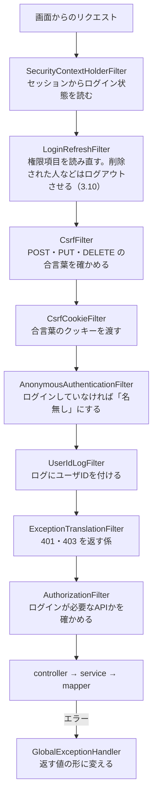
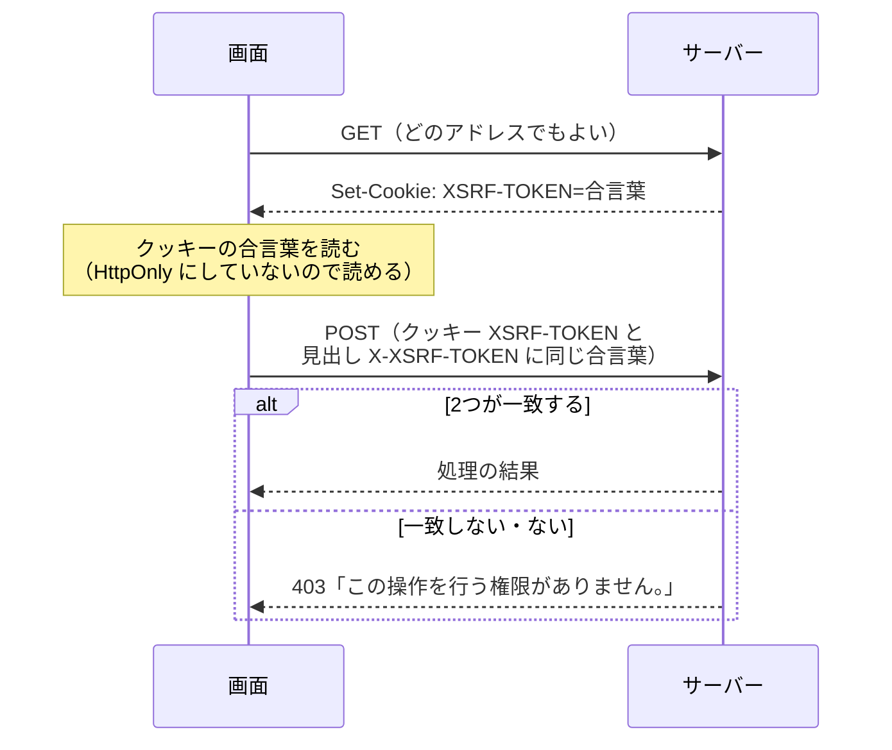

# 詳細設計：共通部品（common）と基盤

| 項目 | 内容 |
|---|---|
| 版 | v1.10 2026-11-10 |
| Jira | ZPOP-21（雛形：サーバー）、ZPOP-22（雛形：画面）、ZPOP-122（テーブルと最初のデータ）、ZPOP-55・56・57・103（ログインの最小限） |
| もとにした設計書 | internaldesign/API設計.md v1.1 の2章・6章・7章、externaldesign/基本設計書.md v1.2 の4・5・9章、externaldesign/画面設計.md 1章、externaldesign/画面一覧.md 7章、CLAUDE.md 3〜5章 |

## 1. 概要

全部の機能が使う土台。この資料には、ZPOP-21・22・122・55〜57・103 で作った次のものを書く。

| まとまり | 中身 | 状態 |
|---|---|---|
| 起動の入口・組み立ての設定 | EquipmentApplication、build.gradle、settings.gradle | 作成済み（ZPOP-21） |
| common.config | 設定値の読み込み、時計 | 作成済み（ZPOP-21） |
| common.security | Spring Security の設定、CSRF対策、ログへのユーザIDの付与、ログイン状態の持ち方 | 作成済み（ZPOP-21。ログイン状態の持ち方は ZPOP-55〜57。3.10）。ログインそのものは auth |
| common.error | 返す値の形、エラーの返し方 | 作成済み（ZPOP-21） |
| 設定ファイル | application.yml ほか、secret.example.yml | 作成済み（ZPOP-21） |
| ログの設定 | logback-spring.xml | 作成済み（ZPOP-21） |
| テスト用の部品 | TestFlywayConfig、CsrfTestHelper | 作成済み（ZPOP-21） |
| common.slack | Slack送信の部品 | 未作成（ZPOP-123 で、この資料に章を足す） |
| common.csv | CSVの読み書き | 未作成（使う機能のタスクで章を足す） |
| common.calendar | 祝日・催促日の計算、「今月確認済み」の判定 | 未作成（ZPOP-126 で章を足す） |
| common.passwordlink | パスワード設定用のリンク | 未作成（A-04 の ZPOP-58 で章を足す） |
| common.web | 組み立てた画面（Client）をサーバーから配る | 作成済み（ZPOP-22）。3.9 |
| テーブルと最初のデータ | Flyway の SQL（db/migration） | 作成済み（ZPOP-122）。詳細設計 [テーブル.md](テーブル.md) |
| common.constant | Enum（決まった値だけを持つ型）をまとめる場所 | 作成済み（2026-11-04）。今は HealthState だけ。各機能が足していく（2.3） |
| 画面（Client）の共通部品 | common/api、common/components、common/format、common/theme | 作成済み（ZPOP-22）。11章。common/auth は ZPOP-55〜57・103 で作った（11.9） |

ここに書く名前の意味は次のとおり。

- **Bean**（ビーン）：Spring が作って管理する部品のこと。`@Component`・`@Service` などを付けたクラスや、`@Bean` を付けたメソッドが返すものが Bean になる。
- **フィルター**：すべてのリクエスト（画面からの呼び出し）が controller に届く前に通る、関所のような部品。
- **プロファイル**：開発（dev）・テスト（test）・本番（prod）で設定を切り替える、Spring Boot の仕組み。

## 2. クラス構成

パッケージの頭の `jp.co.highjunk.equipment` は省いて書く。

### 2.1 本体（src/main）

| パッケージ | クラス・ファイル | 役割 |
|---|---|---|
| （いちばん上） | EquipmentApplication | アプリを起動する入口。設定値のクラス（@ConfigurationProperties）を自動で探す。UserDetailsServiceAutoConfiguration は使わない（10章の5） |
| common.config | AppProperties | 設定値（application.yml の `app:` の下）を読み込む入れ物。起動時に値の入力チェックをする |
| common.config | ClockConfig | 日本時間の時計（java.time.Clock）を Bean として1つ用意する |
| common.config | InitialAdminEmailCallback | Flyway が当て始める前に、最初の総務の担当者のメールアドレスの設定があるかを確かめる（ZPOP-122。詳細設計 [テーブル.md](テーブル.md) 5章） |
| common.security | SecurityConfig | Spring Security の設定。ログインなしで呼べるAPI、CSRF対策、401・403の返し方 |
| common.security | CsrfCookieFilter | どのリクエストでも、CSRFの合言葉をクッキー（XSRF-TOKEN）で渡すフィルター |
| common.security | UserIdLogFilter | ログの1行ごとに、操作した人のユーザIDを付けるフィルター |
| common.security | LoginUserId | 「ログインしている人のユーザIDを持つもの」を表す決まり（インターフェース）。LoginUser がこれを持つ |
| common.security | LoginUser・LoginUserRefresher・LoginRefreshFilter・LoginSession | ログイン状態の持ち方（3.10。ZPOP-55・56・57） |
| common.error | UnauthorizedException | 401 と文を返す（6章。ZPOP-55） |
| common.constant | PermissionCode・HomePage | 権限項目のコード（データ設計 5.3）、ログイン後の最初の画面（API設計 4.2） |
| common.error | ApiResponse | 返す値の形（status・message・data・errors）。ok・created・accepted・error で作る |
| common.error | ErrorItem | errors の1件（field・row・managementNo・message） |
| common.error | ApiMessages | message に入れる決まった文 |
| common.error | ApiException | 各機能が投げるエラーのもと（番号・文・errors を持つ） |
| common.error | BusinessRuleException | 決まりに合わない操作（400） |
| common.error | NotFoundException | 見つからない（404） |
| common.error | ConflictException | ぶつかった（409） |
| common.error | CsvErrorException | CSVの行のエラー（400） |
| common.error | ServiceUnavailableException | 動いていない（503。A-08） |
| common.error | GlobalExceptionHandler | controller・service で起きたエラーを、返す値の形に変える |
| common.error | ApiResponseWriter | controller の外（Spring Security の中）で、返す値の形を書き出す |
| common.web | SpaWebConfig | 組み立てた画面のファイルを配る。画面のアドレス（/loans など）で開かれたときは index.html を返す（3.9） |
| common.constant | HealthState | A-08 の state の値（UP）。health の詳細設計に書く。ほかの Enum も、ここに足す |

| ファイル | 役割 |
|---|---|
| build.gradle | 使う部品と版。ソースの文字コードは UTF-8。テストは test プロファイルで、1つずつ順番に動かす。隣の Client で組み立てた画面（dist）があれば取り込む（3.9） |
| settings.gradle | Gradle のプロジェクト名。フォルダ名と同じ EquipmentManagementSystem_Server にする（10章の11） |
| src/main/resources/application.yml | どの環境でも同じ設定 |
| src/main/resources/application-dev.yml | 開発（各自のPC）の設定 |
| src/main/resources/application-test.yml | 自動テストの設定 |
| src/main/resources/application-prod.yml | 本番（AWS）の設定 |
| src/main/resources/logback-spring.xml | ログの形と出し先 |
| secret.example.yml | 秘密の値の書き方の見本（値は空） |

### 2.2 テスト用の部品（src/test。本番には入らない）

| パッケージ | クラス | 役割 |
|---|---|---|
| （いちばん上） | TestFlywayConfig | テストを始める前に、テスト用のデータベースのテーブルを消して作り直す |
| testsupport | CsrfTestHelper | テストで POST・PUT・DELETE を送るときに、画面と同じやり方で CSRF の合言葉を付ける |
| common.error | ErrorTestController | エラーの返し方を確かめるために、わざとエラーを起こすAPI（/api/test-errors/…） |
| common.security | LogTestController | ログに付くユーザIDを確かめるためのAPI（/api/test-security/log-user-id） |
| common.web | （src/test/resources/static/index.html） | 画面を配る仕組みを確かめるための、テスト用の index.html |

### 2.3 mapper・dto・Enum の置き場所

CLAUDE.md 4.1 のとおり、mapper と dto は機能のパッケージの外にまとめ、その下に機能と同じ名前のパッケージを作る。Enum は common.constant に置く。

| 置くもの | パッケージ | 例 |
|---|---|---|
| mapper（インターフェース） | mapper.<機能名> | mapper.health.HealthMapper |
| mapper の XML | src/main/resources の、mapper と同じ場所 | src/main/resources/jp/co/highjunk/equipment/mapper/health/HealthMapper.xml |
| dto | dto.<機能名> | dto.health.HealthResponse |
| Enum | common.constant | common.constant.HealthState |

- MyBatis は、`@Mapper` を付けたインターフェースを、`jp.co.highjunk.equipment.mapper` の下から探す（common.config.MyBatisConfig の `@MapperScan`）。mapper のパッケージを足しても、設定を足す必要はない。
- mapper の名前は `<テーブルの名前>Mapper`（CLAUDE.md 5章）なので、同じ名前の mapper がパッケージ違いでできる（例：mapper.auth.UserMapper と mapper.user.UserMapper）。Spring の部品（bean）の名前は、ふつうはクラスの名前（userMapper）でぶつかるため、MyBatisConfig で、パッケージ込みの名前（`jp.co.highjunk.equipment.mapper.auth.UserMapper`）にしている（FullyQualifiedAnnotationBeanNameGenerator）。テストは common.config.MyBatisConfigTest（テストだけの mapper.namecheck.first・second の SameNameMapper で確かめる）。2026-11-10 に決めた。
- XML は、mapper と同じパッケージの場所にあれば自動で読み込まれる（`mybatis.mapper-locations` は設定しない）。XML の namespace は、mapper のクラスの名前（例：`jp.co.highjunk.equipment.mapper.health.HealthMapper`）にする。
- Enum を JSON で返すと、Enum の名前（例：UP）がそのまま文字になる。API設計の値（例：管理状態の文字）と Enum の名前をそろえる。
- common.constant は common の一部だが、新しい Enum のファイルを足すだけなら、機能の作業の中で足してよい。すでにある Enum を変えるときは2人で相談する（CLAUDE.md 9章）。

## 3. 処理の流れ

### 3.1 リクエストが通る順番

画面からのリクエストは、Spring Security のフィルターを上から順に通り、controller に届く。



図に書いていないフィルター（DisableEncodeUrlFilter など）は、Spring Security が自動で入れるもので、この作りには関係しない。

### 3.2 ログインなしで呼べるAPI

| 操作 | アドレス | API |
|---|---|---|
| POST | /api/auth/login | A-01 |
| POST | /api/auth/password-reset-requests | A-04 |
| POST | /api/auth/password-tokens/verify | A-05 |
| POST | /api/auth/password-tokens/use | A-06 |
| GET | /api/health | A-08 |

- ほかの `/api/` で始まるアドレスは、ログインが必要。必要な権限項目は、各APIのメソッドに `@PreAuthorize` で書く（CLAUDE.md 5章）。
- `/api/` で始まらないアドレス（画面のファイル）は、だれでも受け取れる（ZPOP-22 で配る）。
- Spring Security が用意するログイン画面・Basic認証・ログアウトは使わない（A-01・A-02 で自分で作った。3.10）。
- 「ログイン前に開こうとしたページ」を覚える仕組み（リクエストキャッシュ）も使わない。画面の移り方は React が決めるため。

### 3.3 CSRF対策（なりすまし対策の合言葉）の流れ



- 設定は Spring Security の `csrf.spa()`（画面（React）向けの設定）を使う。
- Spring Security は、合言葉が使われるまでクッキーを作らない。そのため CsrfCookieFilter で一度値を読み、どのリクエストでもクッキーが作られるようにしている。こうすると、ログイン（A-01）の前でも、画面は合言葉を受け取れる。
- GET は合言葉を確かめない（読むだけの操作なので）。

### 3.4 ログにユーザIDを付ける流れ

1. UserIdLogFilter が、ログイン状態（Authentication）の中の「ログインしている人」を見る。
2. それが LoginUserId を持っていれば、ログの付け足し情報（MDC：そのリクエストの間だけ、ログに自動で付ける値の入れ物）に `userId` を入れる。
3. controller に処理を渡す。処理の間に出たログには `userId=12` のように付く。
4. 処理が終わったら（エラーでも）、`userId` を消す。

ログインしていないときは何も入れないので、ログには `userId=-` と出る。

CsrfCookieFilter と UserIdLogFilter は Bean として登録していない。そのため、「このリクエストではもう動いた」という印の名前を、クラスの名前から作るようにしている（10章の8）。

### 3.5 ログインしていない・権限がないとき

止める場所が2つあり、どちらも返す値の形（API設計 2.4）で返す。

| 止める場所 | 場面 | 返し方 |
|---|---|---|
| フィルター（AuthorizationFilter） | ログインが必要なアドレスを、ログインせずに呼んだ | 401。SecurityConfig の authenticationEntryPoint が ApiResponseWriter で書き出す |
| フィルター（CsrfFilter） | 合言葉がない・違う | 403。SecurityConfig の accessDeniedHandler が ApiResponseWriter で書き出す |
| メソッド（@PreAuthorize） | 必要な権限項目を持っていない | GlobalExceptionHandler が AccessDeniedException を受けて返す。ログインしていなければ 401、ログインしていれば 403 |

### 3.6 エラーを返す値の形に変える（GlobalExceptionHandler）

上から順に当てはまるものを使う。

| 起きたこと | 例 | status | message | errors |
|---|---|---|---|---|
| ApiException の仲間を投げた | 各機能の BusinessRuleException など | その例外の番号 | その例外の文 | その例外が持つもの（CSVの行のエラーのときだけ） |
| JSONの入力チェックの誤り（MethodArgumentNotValidException） | `@NotBlank` に引っかかった | 400 | 入力内容に誤りがあります。 | 入力欄ごと（field・message）。入力欄に結び付かない誤りは field が null |
| アドレスの後ろの値の入力チェックの誤り（HandlerMethodValidationException） | `?page=0` が `@Min(1)` に引っかかった | 400 | 入力内容に誤りがあります。 | 入力欄ごと（field は値の名前） |
| JSONが壊れている・必要な値がない・数字の欄に文字（HttpMessageNotReadableException など3つ） | `{壊れたJSON`、`?page=abc` | 400 | 入力内容に誤りがあります。 | null |
| 権限の確認で止められた（AccessDeniedException） | `@PreAuthorize` | 401 か 403（3.5） | ログインしてください。／この操作を行う権限がありません。 | null |
| ログインが必要（AuthenticationException） | | 401 | ログインしてください。 | null |
| Spring が用意したエラーで、番号が400番台（ErrorResponse の仲間） | 存在しないアドレス（404）、使えない操作の種類（405） | Spring が決めた番号 | 404 は「対象が見つかりません。」、400 は「入力内容に誤りがあります。」、ほかは「リクエストの形が正しくありません。」 | null |
| 上のどれでもない | プログラムの不具合 | 500 | 問題が発生しました。時間をおいて、もう一度お試しください。続く場合は総務に連絡してください。 | null |

500 のときだけ、エラーの詳しい中身（スタックトレース：どこで起きたかの記録）を ERROR でログに残す。画面には返さない。

### 3.7 設定値の読み込み

1. `application.yml`（どの環境でも同じ）を読む。
2. 起動するときのプロファイルに合わせて、`application-dev.yml`・`application-test.yml`・`application-prod.yml` のどれかを重ねて読む。何も指定しないと dev になる。自動テスト（gradlew test）は build.gradle で test を指定している。
3. Server のフォルダの `secret.yml` があれば読む（`spring.config.import: optional:file:./secret.yml`。optional なので、なくても起動する）。秘密の値は、このファイルにだけ書く。
4. 環境変数があれば、それがいちばん強い（AWSでは環境変数で渡す。例：`SPRING_DATASOURCE_PASSWORD`、`APP_SLACK_BOT_TOKEN`）。
5. `app:` の下の値は AppProperties に入る。起動時に入力チェック（`@NotNull` など）をし、足りなければ起動しない。

`./secret.yml` は、起動したときのフォルダから見た場所。`gradlew bootRun`・`gradlew test` と Eclipse からの起動は、Server のフォルダで動くので、Server のフォルダの `secret.yml` が読まれる。

### 3.8 時計と日時の形

- ClockConfig が、設定値 `app.time-zone`（Asia/Tokyo）の時計を1つ作る。各機能は、この時計を受け取って `LocalDate.now(clock)` のように使う。テストでは、止めた時計に差し替える。
- JSONで返す日付は "2026-11-02"、日時は "2026-11-25T09:00:00+09:00" の形（`spring.jackson.time-zone: Asia/Tokyo`）。
- データベースとのやり取りも日本時間にそろえる（4章の接続の設定）。

### 3.9 組み立てた画面を配る（common.web.SpaWebConfig）

API設計 2.1 のとおり、画面とAPIを同じアドレスで出す。

**本番（AWS）**
1. 人が Client で `npm run build` を動かす。組み立てた画面が Client の `dist` フォルダにできる。
2. 人が Server で `gradlew bootJar` を動かす。build.gradle が、隣の `../EquipmentManagementSystem_Client/dist` の中身を、Server の `static` フォルダとして jar に入れる。dist がなければ何も入れない（エラーにはしない）。
3. Spring Boot が、`static` の中のファイルを配る。

**アドレスごとの返し方**

| アドレス | 返すもの |
|---|---|
| `/api/` で始まる | API（ほかの章のとおり）。見つからなければ 404 の JSON |
| ファイルが `static` にある（例：`/assets/index-xxxx.js`） | そのファイル |
| 名前に「.」を含むのに、ファイルがない（例：`/assets/なし.js`） | 404（画面のファイルの取り違えに気づけるように） |
| それ以外（例：`/`、`/loans`、`/equipment/12`） | `index.html`。画面の切り替えは React が行うため、どのアドレスで開いても同じ index.html を返す |

**開発中** は、画面を Vite の開発用サーバー（http://localhost:5173）で開く。`/api` の呼び出しは、Vite が Spring Boot（http://localhost:8080）に回す（11.3）。Server の `static` は使わない。

### 3.10 ログインの部品（common.security。ZPOP-55・56・57）

ログインそのもの（メールアドレスとパスワードの確かめ）は auth 機能（詳細設計 [auth/auth.md](auth/auth.md)）が行う。common には、どの機能も使う「ログイン状態の持ち方」を置く。

| クラス | 役割 |
|---|---|
| LoginUser | セッションに入れる「ログインしている人」。ユーザID（userId）と、ログインした日時（loggedInAt）だけを持つ。LoginUserId を実装する |
| LoginUserRefresher | APIを呼ぶたびに、ログインしている人の今の権限項目を返す約束（インターフェース）。返せない（削除された、session_valid_after より前のログイン）ときは空を返す。中身は auth の LoginUserRefresherImpl が持つ（common から機能を使わないため、約束だけを common に置く） |
| LoginRefreshFilter | `/api/` で始まるリクエストのたびに LoginUserRefresher を呼ぶフィルター。空なら、セッションを捨ててログインしていない扱いにする（→ ログインが要る API は 401）。そうでなければ、今の権限項目でログイン状態を作り直す（そのリクエストの間だけ。権限の変更が次の操作から効く。API設計 2.2）。データベースを読めなかったときは、controller の外なので GlobalExceptionHandler を通らないため、ここで 500 を 2.4 の形で返す（ApiResponseWriter） |
| LoginSession | ログインを始める（start）・終える（end）。start：セッションの番号を変え（すでにあれば）、LoginUser と権限項目のログイン状態をセッションに保存し、XSRF-TOKEN を作り直す。end：ログに「ログアウトしました」を残し、セッションを捨て、XSRF-TOKEN を作り直す |
| SecurityConfig（変更） | PasswordEncoder（bcrypt）・SecurityContextRepository（セッションにログイン状態を入れる部品）・CsrfTokenRepository（XSRF-TOKEN のクッキーを扱う部品）を、ほかの部品から使えるように用意する。LoginRefreshFilter を、セッションからログイン状態を読んだすぐあと（SecurityContextHolderFilter の後ろ）に置く |

**ほかの機能での使い方**

- ログインしている人のユーザIDは、controller の引数に `@AuthenticationPrincipal LoginUserId user` と書いて、`user.getUserId()` で取る。
- パスワードの照らし合わせ・変換は、PasswordEncoder を受け取って使う（bcrypt。基本設計書 5章）。
- テストでログインした状態を作るときは、A-01 を呼んでセッション（MockHttpSession）を受け取るか、`authentication(...)` で LoginUser を入れる（9章）。
- ログインを始める・終える（LoginSession#start・end）は、Web のセッションを扱う仕事なので、auth の controller から呼ぶ（service に HttpServletRequest を渡さないため。auth.md 4章の No.6）。CLAUDE.md 5章の「controller は service を呼ぶだけ」の例外として、2026-11-10 に CLAUDE.md 5章に書いた。

**あとのタスクへの申し送り**

- ログインしたままにする（ZPOP-125）：Spring Security の RememberMe（ログインしたままにする仕組み）は、LoginRefreshFilter より後ろでログイン状態を作り、持ち主も LoginUser にならない。そのままでは権限項目の読み直しが効かないので、ZPOP-125 で、RememberMe で作ったログイン状態を LoginUser に置き換え、読み直しの前に来るようにする。
- パスワードの設定・変更（ZPOP-60・61）：session_valid_after は DATETIME（秒まで）、LoginUser の loggedInAt はもっと細かい。同じ1秒の中でログインとパスワードの変更が起きたときの扱い（秒にそろえて比べるか）を、そのタスクで決める。

## 4. データベース

common には mapper（データベースを読み書きする部品）はない。データベースへのつなぎ方を、設定ファイルで次のように決めている。

| 設定 | 値 | 理由 |
|---|---|---|
| 接続先（dev） | jdbc:mysql://localhost:3306/equipment_dev | 開発用のデータベース |
| 接続先（test） | jdbc:mysql://localhost:3306/equipment_test | テスト専用のデータベース（CLAUDE.md 6章） |
| 開発のPCの MySQL | Docker で動かす（Server の compose.yaml。`mysql:8.4.13`、127.0.0.1 の 3306番、文字コード utf8mb4・照合順序 utf8mb4_ja_0900_as_cs_ks）。equipment_dev とユーザ `equipment` は compose.yaml の環境変数で、equipment_test は docker/mysql/init/01_create_test_database.sql で、最初の起動のときに作る。パスワードは Server の .env（Git で管理しない） | PC に直接入れると重くなったため（基本設計書 v1.2 の9章。2026-11-09 に決めた）。3306番で待つので、接続先の設定は変えない |
| 接続先（prod） | 環境変数 SPRING_DATASOURCE_URL | RDS。ZPOP-48 で決める |
| 接続のオプション | `connectionTimeZone=+09:00`、`forceConnectionTimeZoneToSession=true`、`characterEncoding=UTF-8` | データベースとのやり取りを日本時間にそろえる。`+` はアドレスの中で `%2B` と書く |
| つながるまで待つ時間 | 5秒（`spring.datasource.hikari.connection-timeout: 5000`） | 見張り役は10秒で失敗とみなすので、それより短くする（health/A-08_動いているかを答える.md） |
| 列名の合わせ方 | `mybatis.configuration.map-underscore-to-camel-case: true` | 列名 last_confirmed_on を、Javaの名前 lastConfirmedOn に自動で合わせる |
| テーブルを作るSQLの置き場所 | `classpath:db/migration`（src/main/resources/db/migration） | ZPOP-122 で作った（V1：テーブル、V2：最初のデータ）。作りは詳細設計 [テーブル.md](テーブル.md) |
| テストのときのテーブル | TestFlywayConfig が、テストを始める前に Flyway で消して（clean）作り直す（migrate） | テスト方針 4章。消すことは test プロファイルだけ許す（`spring.flyway.clean-disabled: false`） |
| 開発用のユーザ（dev・test だけ） | `classpath:db/devdata` の R__dev_users.sql を、dev と test の設定のときだけ Flyway の場所に足す（`spring.flyway.locations`）。prod では入らない | 最初の総務の担当者はパスワードが空で、パスワード再設定ができるまで画面からログインできないため（auth.md 4章の No.1。2026-11-08 に決めた） |

**開発用のユーザ**（R__dev_users.sql。R__ で始まるファイルは、Flyway が版のファイルのあとに当て、中身が変わったら当て直す）

| メールアドレス | 氏名 | 権限 | パスワード |
|---|---|---|---|
| soumu@example.com | 開発 総務 | 総務 | devpass-1234 |
| ippan@example.com | 開発 一般 | 一般社員 | devpass-1234 |

- パスワードは開発とテストのためだけのもの。ファイルには bcrypt で変換した値だけを書く。本番（prod）のデータベースには入らない。
- 同じメールアドレスの行があれば、パスワードと権限を上書きする（何回当てても同じになる）。
- 念のための守り：本番では Flyway の置き場所に db/devdata が入らない（DevDataProfileTest で確かめる）。それに加えて、起動の設定（`SPRING_PROFILES_ACTIVE=prod`）を付け忘れたときのために、SQL の中で、データベースの名前が equipment_dev・equipment_test のときだけ入れる。**本番のデータベースには、この2つの名前を使わない**（ZPOP-48 の手順書にも書く）。

## 5. 入力チェック

common には、入力チェックそのものはない。各機能で入力チェックを作るときの決まりは次のとおり。

- 受け取る値の形（dto）の項目に、入力チェックの印（`@NotBlank`・`@Size` など。Bean Validation と呼ぶ）を付け、controller の引数に `@Valid` を付ける。
- 印の `message` には、画面設計のメッセージをそのまま書く。例：`@NotBlank(message = "ユーザー名は必須です。")`
- 誤りがあれば、GlobalExceptionHandler が 400 と errors（入力欄ごとのメッセージ）に変えて返す（3.6）。
- 印だけでは確かめられない決まり（「同じ管理番号がすでにある」など。業務チェックと呼ぶ）は、各機能の validator（`<機能名>/validator/<名前>Validator`）で確かめ、BusinessRuleException か、errors 付きの例外を投げる。Validator は ServiceImpl から呼ぶ（CLAUDE.md 5章）。

設定値（AppProperties）は、起動時に入力チェックをする。値がなければ起動しない（3.7）。

## 6. エラー

返す message の文（common.error.ApiMessages）。API設計 v1.1 の2.4 と同じ。

| 定数 | status | 文 |
|---|---|---|
| SUCCESS | 200・201・202 | 処理が正常に完了しました。 |
| VALIDATION_ERROR | 400 | 入力内容に誤りがあります。 |
| CSV_ERROR | 400 | エラーがあったため、更新していません。直してからもう一度アップロードしてください。 |
| BAD_REQUEST | 405・415 など | リクエストの形が正しくありません。（設計書にない。10章の1） |
| UNAUTHORIZED | 401 | ログインしてください。 |
| FORBIDDEN | 403 | この操作を行う権限がありません。 |
| NOT_FOUND | 404 | 対象が見つかりません。 |
| INTERNAL_ERROR | 500 | 問題が発生しました。時間をおいて、もう一度お試しください。続く場合は総務に連絡してください。 |
| SERVICE_UNAVAILABLE | 503 | 現在利用できません。 |

各機能が使う例外：

| 例外 | status | 使う場面 | message |
|---|---|---|---|
| BusinessRuleException(文) | 400 | 決まりに合わない操作 | 画面設計の文を渡す |
| NotFoundException() | 404 | 見つからない（削除された備品など） | 決まった文 |
| ConflictException(文) | 409 | ほかの人が先に保存した、すでに貸し出されている、すでに返却されている | 画面設計の文を渡す |
| CsvErrorException(行のエラーの一覧) | 400 | CSVの行にエラーがある | 決まった文。行ごとの理由は ErrorItem.ofCsvRow(行番号, 管理番号, 理由) |
| ServiceUnavailableException() | 503 | A-08 でデータベースにつながらない | 決まった文 |
| UnauthorizedException(文) | 401 | ログインできなかった（A-01）、ログイン状態が読めなくなった（A-03） | A-01 は画面設計の文「メールアドレスまたはパスワードが違います」、ほかは ApiMessages.UNAUTHORIZED |

## 7. 設定値

### 7.1 このシステムの設定値（AppProperties。application.yml の `app:`）

| application.yml の名前 | 値 | もとにした設計書 |
|---|---|---|
| app.base-url | http://localhost:8080（環境ごとに上書き） | API設計 6章「アプリのアドレス」 |
| app.time-zone | Asia/Tokyo | 「時刻の基準」 |
| app.reminder-cron | "0 0 9 * * *" | 「催促の処理を動かす時刻」 |
| app.remember-me-validity | 60d | 「ログインしたままにする期間」 |
| app.password-link.reset-validity | 30m | 「リンクの有効期限（再設定）」 |
| app.password-link.lock-validity | 30m | 「リンクの有効期限（ロック）」 |
| app.password-link.registration-validity | 3d | 「リンクの有効期限（ユーザ登録）」 |
| app.password-link.request-interval | 5m | 「再設定の依頼の間隔」 |
| app.lock-threshold | 5 | 「ロックまでの回数」 |
| app.csv-max-size | 1MB | 「CSVの大きさの上限」 |
| app.slack.bot-token | （秘密。secret.yml か環境変数） | 「Slackのボットトークン」 |
| app.initial-admin-email | （秘密。secret.yml か環境変数） | 「最初の総務の担当者のメールアドレス」 |
| app.test-support.enabled | false（test プロファイルだけ true） | 「テスト用の切り替え」 |

秘密の値（ボットトークン・メールアドレス）は、AppProperties を文字にしたとき（ログに出たときなど）に「(秘密)」と表示する。

API設計 6章の「データベースの接続先・ユーザ名・パスワード」は、Spring Boot の決まった名前（spring.datasource.*）で渡す。「見張り役の通知先・状態」は monitor の設定なので、ここには入れない。

### 7.2 プロファイルごとの違い

| 設定 | dev | test | prod |
|---|---|---|---|
| データベース | equipment_dev | equipment_test | 環境変数 |
| テーブルを消すこと | 許さない | 許す（テストの前に作り直すため） | 許さない |
| テスト用の切り替え | 無効 | 有効 | 無効 |
| ログインのクッキーの Secure（HTTPSのときだけ送る） | なし（PCはHTTPSでないため） | なし | あり |
| X-Forwarded-*（CloudFront・ALBを通ったことを示す見出し）を読む | 読まない | 読まない | 読む（`server.forward-headers-strategy: framework`） |
| ログの出し先 | 画面とファイル | 画面だけ | 画面だけ |

ログインのクッキーは、どのプロファイルでもプログラムから読めない設定（HttpOnly）にする。

## 8. ログ

| 項目 | 作り |
|---|---|
| 1行の形 | `2026-11-03T19:11:41.456+09:00 INFO  userId=12 [スレッド名] クラス名 - 内容` |
| ユーザID | UserIdLogFilter が入れる。ログインしていなければ `-` |
| 出し先（dev） | 画面（標準出力）と、Server のフォルダの logs/equipment.log。ファイルは1日ごとに分け、30日分残す |
| 出し先（test・prod） | 画面（標準出力）だけ。本番で CloudWatch Logs に送る方法は ZPOP-48 で決める |
| 500 のとき | GlobalExceptionHandler が ERROR で、エラーの詳しい中身を残す |

残さないもの（CLAUDE.md 5章）を守るための作り：

- 送られてきた値（JSONの中身）は、ログに出さない。そのため、パスワードや合言葉がログに入らない。
- AppProperties を文字にしたとき、秘密の値は「(秘密)」と出す。
- Spring Boot が仮のユーザを作り、そのパスワードをログに出す仕組み（UserDetailsServiceAutoConfiguration）は使わない（10章の5）。

## 9. テスト

証跡：Document の evidence/20261103_単体結合API_基盤/

| テストのクラス | 種類 | 確かめること |
|---|---|---|
| common.config.AppPropertiesTest | 結合（アプリを起動） | 設定値が API設計 6章のとおりに読み込まれる／テストの設定では、テスト用の切り替えが有効になる／記録に出ても、秘密の値は見えない／時計は日本時間／日付は 2026-11-02、日時は 2026-11-25T09:00:00+09:00 の形で返す |
| common.error.ApiResponseTest | 単体 | 正常時：status・message・data・errors の4つがあり、errors は null／作った・受け付けた：status は 201・202、返すものがないときは data が null／入力の誤り：data は null、errors に入力欄ごとのメッセージ。行番号・管理番号の項目は出さない／CSVの行のエラー：errors の1件に row と managementNo が入り、field は null |
| common.error.GlobalExceptionHandlerApiTest | 結合（API） | 正常時：200／入力の誤り：400／JSONの形が壊れている：400／数字の欄に文字：400／決まりに合わない操作：400／見つからない：404／存在しないアドレス：404／ぶつかった：409／CSVの行のエラー：400／思いがけない不具合：500。詳しい中身は返さない／必要な権限項目がない：403／必要な権限項目がある：200 |
| common.security.SecurityApiTest | 結合（API） | ログインせずに、ログインが必要なAPIを呼ぶと 401／CSRFの合言葉を付けずにPOSTすると 403／合言葉は XSRF-TOKEN クッキーで渡され、X-XSRF-TOKEN 見出しで送り返すと通る／合言葉が違うと 403／Spring Boot の仮のユーザを作らない／ユーザIDがログに付き、合言葉のクッキーも同じ処理で渡される（2つのフィルターが両方動く） |
| common.web.SpaWebConfigTest | 結合（API） | 画面のアドレス（/loans、/equipment/12、/login）では、ログインしていなくても index.html を返す／トップ（/）では index.html に回す（Spring Boot の最初のページの仕組み）／ないファイル（/assets/なし.js）は 404／/api/ で始まる存在しないアドレスは、今までどおり 404 の JSON |
| common.security.UserIdLogFilterTest | 単体 | ユーザIDが処理の間だけログに付き、終わったら消える／ログインしていないときは付けない |

テストを書くときの決まり（CLAUDE.md 6章）：

- POST・PUT・DELETE を送るときは、`CsrfTestHelper.csrfToken(mockMvc)` を使う。Spring Security のテスト用の `csrf()` は使わない（10章の7）。
- ログインした状態は、`@WithMockUser`（権限項目は `authorities` で指定）か、`authentication(...)` で作る。本物のログインを通すときは、A-01 を呼んで受け取ったセッション（MockHttpSession）を次のリクエストに渡す（auth の AuthApiTestBase・LoginApiTest がお手本。3.10）。開発用のユーザ（4章）を使える。

## 10. 設計書にない判断

人に確認してほしい点。

1. **405・415 などのときの文**：API設計 2.4 の表にない誤り（使えない操作の種類など）の message を「リクエストの形が正しくありません。」にした。
2. **401・403・404・503 の文**：API設計 v1.1 の2.4 に書いた文（「ログインしてください。」など）は、この作業の中で決めた。画面設計にはない文。
3. **@PreAuthorize で止められたときの番号**：ログインしていなければ 401、していれば 403 にした。ログインが必要なアドレスは、その前にフィルターで 401 になるので、実際に 401 になるのは「ログインなしで呼べるAPIに @PreAuthorize を付けた」ときだけ。
4. **データベースにつながるまで待つ時間を5秒にした**：見張り役の10秒より短くするため。全部のAPIに効く設定で、5秒たってもつながらなければ、そのAPIはエラーになる。
5. **UserDetailsServiceAutoConfiguration を外した**：外さないと、Spring Boot が仮のユーザを作り、そのパスワードをログに出すため。ログイン（ZPOP-55）は UserDetailsService を使わずに作ったので、外したままでよい。
6. **本番で X-Forwarded-* を読む設定にした**：CloudFront・ALB を通ったときに、HTTPS で来たと正しく分かるようにするため。実際の通り道に合うかは ZPOP-48 で確かめる。
7. **テストで csrf() を使わない決まりを足した**：作る途中で、csrf() がほかのテストと共有している CsrfFilter の中身を書き換え、あとで動くテストで合言葉のクッキーが出なくなる不具合が起きたため。
8. **Bean にしないフィルターの印の名前**：Bean にしないフィルター（OncePerRequestFilter）は名前がなく、「もう動いた」という印の名前が、ほかのフィルターとぶつかるおそれがあった。ぶつかると片方が動かなくなるので、クラスの名前で印を作るようにした。
9. **開発のログファイルを30日分残す**：設計書には、AWSの保管期間（90日）しか書いていない。開発のPCの容量を考えて30日にした。
10. **MyBatis を手で足した**：Spring Initializr（Spring Boot の雛形を作る公式のサービス）が、MyBatis を Spring Boot 4.1.2 と合わないものとして扱ったため。MyBatis 公式の mybatis-spring-boot-starter 4.1.0（Spring Boot 4.1.0 に合わせた版）を使い、テストがすべて通ることを確かめた。

11. **Gradle のプロジェクト名をフォルダ名と同じにした**：Eclipse は、ワークスペースの直下にあるプロジェクトの名前を、フォルダ名と同じにする必要がある。初めは `equipment` にしていたため、Eclipse が読み込みを止めた。そのため `EquipmentManagementSystem_Server` にした。組み立てたファイルの名前も EquipmentManagementSystem_Server-0.0.1-SNAPSHOT.jar になる。

12. **画面のアドレスで index.html を返す作り（3.9）**：API設計 2.1 の「画面とAPIを同じアドレスで出す」を実現するため。名前に「.」を含むアドレスは、ファイルがなければ 404 にした。
13. **組み立てた画面の取り込み方（3.9）**：リポジトリが分かれているため、Server の組み立てのときに隣の Client の dist を取り込む形にした。dist を作る（npm run build）のは人。手順は AWSにアプリを置くタスク（ZPOP-49）の手順書に書く。

## 11. 画面（Client）の共通部品

画面（Client）の基盤。ZPOP-22 で作った。

### 11.1 使う部品と版

package.json に版を固定して書く（`^` などの幅を付けない）。

| 部品 | 版 | 役割 |
|---|---|---|
| React・React DOM | 19.3.1 | 画面を作る部品 |
| React Router | 8.5.1 | 画面の切り替え |
| MUI（@mui/material） | 9.5.0 | 画面の部品集 |
| Emotion（@emotion/react・@emotion/styled） | 11.14.0・11.14.1 | MUI が見た目を付けるのに使う部品 |
| Vite・@vitejs/plugin-react | 8.3.5・6.2.1 | 開発用のサーバーと、画面の組み立て |
| TypeScript | 7.0.2 | 型の確かめ（`npm run typecheck`） |
| @types/react・@types/react-dom | 19.3.0 | React の型の情報 |
| Playwright（@playwright/test） | 1.63.0 | 画面のテスト |

- Node.js は 22.22 以上が要る（React Router 8 の条件）。
- Playwright のテストで使うブラウザは、最初に1回 `npx playwright install chromium` で入れる。

### 11.2 ファイル構成

```
EquipmentManagementSystem_Client/
├─ package.json・package-lock.json   使う部品と版、コマンド
├─ index.html                          画面の入口のHTML
├─ vite.config.ts                      開発用のサーバー（5173番）と、/api を Spring Boot に回す設定
├─ tsconfig.json                       TypeScript の設定
├─ playwright.config.ts                画面のテストの設定（11.7）
├─ src/
│  ├─ main.tsx                         入口。テーマ、メッセージ、画面の切り替えを組み立てる
│  ├─ routes.tsx                       URLと画面の対応表
│  ├─ vite-env.d.ts                    Vite の型の情報
│  ├─ common/
│  │  ├─ api/client.ts                 APIを呼ぶ部品（11.3）
│  │  ├─ api/useApi.ts                 APIの値を取り込んで持っておく部品（11.3）
│  │  ├─ auth/                         ログイン中の人（AuthProvider・RequireLogin・authApi・permissions・types。11.9）
│  │  ├─ components/AppLayout.tsx      全画面の枠（ヘッダー・メッセージの帯・中身）
│  │  ├─ components/Header.tsx         共通ヘッダー（11.4）
│  │  ├─ components/MessageProvider.tsx メッセージの帯（11.5）
│  │  ├─ components/ConfirmDialog.tsx  確認ダイアログ（11.6）
│  │  ├─ components/SubmitButton.tsx   押したら処理が終わるまで押せないボタン（11.6）
│  │  ├─ components/TopPlaceholderPage.tsx 仮のトップ画面（ログインが要る。S-05・S-07 ができたら置き換える）
│  │  ├─ components/NotFoundPage.tsx   見つからないときの仮の画面（エラー画面（ZPOP-121）で置き換える）
│  │  ├─ format/format.ts              日付・空の値の表示の形（画面設計 1.3）
│  │  └─ theme/theme.ts                MUI のテーマ（11.4）
│  └─ dev/ComponentSamplePage.tsx      共通部品の見本の画面。開発とテストのときだけ開ける（11.7）
└─ tests/common/                       画面のテスト
```

### 11.3 APIの呼び出し（common/api）

**client.ts**：`apiGet`・`apiPost`・`apiPut`・`apiDelete` の4つを各機能の api.ts から使う。

1. 送り先は `/api/…`（同じアドレス）。クッキーも一緒に送る。
2. POST・PUT・DELETE のときは、クッキー `XSRF-TOKEN` の値を、見出し `X-XSRF-TOKEN` に入れて送る（API設計 2.2）。クッキーがまだなければ、先に `GET /api/health` を呼んでクッキーを受け取ってから送る（開発中は、画面を Vite が配るので、最初はクッキーがないため）。
3. 返ってきた値（status・message・data・errors）を読む。
   - 成功（200番台）：`data` を返す。
   - 失敗：`ApiError`（status・message・errors を持つ）を投げる。各画面はこれを受けて、message を赤の帯に出す、errors を入力欄の下に出す、などをする。
   - 401：ログイン画面（`/login?redirect=今のアドレス`）に移してから、`ApiError` を投げる（画面設計 1.4）。ログイン画面は S-01（auth/S-01_ログイン.md）。
   - JSON でない答え（サーバーが止まっている、など）：status はそのまま、message は「問題が発生しました。時間をおいて、もう一度お試しください。続く場合は総務に連絡してください。」の `ApiError` を投げる。
   - つながらない（スマートフォンが圏外、など。fetch そのものが失敗した）：status は 0、message は上と同じ文の `ApiError` を投げる。
4. 呼び出しごとの指定（`apiGet(path, options)`・`apiPost(path, body, options)` の options）：`redirectOnUnauthorized: false` にすると、401 のときにログイン画面へ移さず、ApiError を投げるだけにする。使ってよいのは、ログインしているかを確かめるだけの A-03（common/auth の getMe）と、ログアウトの A-02（ログインが切れていても、redirect を付けずにログイン画面へ移すため）だけ。
5. 401 のときにログイン画面へ移す処理は、common/auth の AuthProvider が `setUnauthorizedHandler` で入れる（11.9）。

**useApi.ts**：画面を開いたときに読み込む値を持っておく部品。`const { data, loading, error, reload } = useApi(() => apiGet(...), [依存する値])` のように使う。

**開発用のサーバー（vite.config.ts）**：http://localhost:5173 で開く。`/api` で始まる呼び出しは、http://localhost:8080（Spring Boot）に回す。こうすると、ブラウザから見て画面とAPIが同じアドレスになり、ログインのクッキーがそのまま使える。

### 11.4 全画面の枠・ヘッダー・テーマ

- **AppLayout**：上から、ヘッダー、メッセージの帯、各画面の中身（React Router の Outlet）の順に並べる。
- **Header**：システム名「備品管理」を出し、押すとトップ（`/`）に戻る（画面設計 1.1）。ログインしているときは、右に氏名を出し、押すと「ログアウト」を出す（11.9）。「パスワード変更」は S-04（ZPOP-106）、メニューは各画面を作るときに足す。
- **theme**：
  - スマートフォンとPCの境目は 600px（MUI の `sm`）。これより狭ければスマートフォンの並べ方にする。
  - ボタンは高さ 44px 以上（指で押しやすい大きさ。画面一覧 7章）。
  - 文字は、日本語が読みやすい字体（Hiragino Sans・Noto Sans JP・Meiryo など、PCにあるもの）。

### 11.5 メッセージの帯（MessageProvider）

画面設計 1.2 のとおり。各画面からは `const message = useMessage()` で使う。

| 呼び方 | 出し方 |
|---|---|
| `message.success("借りました（A001）")` | ヘッダーのすぐ下に緑の帯で出し、5秒で消える |
| `message.error("この備品はすでに貸し出されています")` | ヘッダーのすぐ下に赤の帯で出し、×を押すまで残る |
| `message.clear()` | 帯を消す |

- 帯は1つだけ出す。新しいメッセージを出すと、前の帯は消える。
- 入力の誤り（入力欄のすぐ下に赤字）は、帯ではなく MUI の入力欄の `error`・`helperText` で出す。

### 11.6 確認ダイアログ・押せないボタン

- **ConfirmDialog**：タイトル・文・実行ボタンの名前を渡して開く。「キャンセル」を押すか、窓の外を押すと閉じる（画面設計 1.3）。実行ボタンは SubmitButton なので、処理が終わるまで押せない。
- **SubmitButton**：`onClick` に処理（Promise を返すもの）を渡す。押すと、処理が終わるまで押せなくなる（二重押しの防止。画面設計 1.3、CLAUDE.md 5章）。

### 11.7 画面のテスト（Playwright）

- テストは `tests/` に、機能と同じ名前のフォルダに分けて置く（共通部品は `tests/common/`）。
- 2つの大きさで動かす：スマートフォン（Pixel 7 の大きさ）とPC（Desktop Chrome の大きさ）。スマートフォン優先でない画面のテストは、各機能でPCだけにしてよい（テスト方針 5章）。
- `npx playwright test` を動かすと、Vite の開発用サーバーと、Server（test の設定。データベースは equipment_test）を自動で起動する。すでに動いていれば、それを使う。
- 各テストの最後の画面のスクリーンショットを残す。失敗したテストは、操作の記録（トレース）も残す（テスト方針 5章）。結果は `playwright-report/`（レポート）と `test-results/`（スクリーンショット）にでき、Document の evidence に写す。
- **共通部品の見本の画面（/_dev/components）**：メッセージの帯やダイアログを使う画面がまだないため、テストで確かめるための見本の画面を置く。開発用のサーバー（`npm run dev`）のときだけ開け、`npm run build` で組み立てた画面には入らない。

| テスト | 確かめること |
|---|---|
| tests/common/shell.spec.ts | ヘッダーに「備品管理」が出て、押すとトップに戻る／スマートフォンでも横にスクロールしない／ないアドレスでは「ページが見つかりません。」 |
| tests/common/api.spec.ts | 画面からAPIを呼べる（/api/health の data を読める）／POST に CSRF の合言葉が付く（クッキーがないところからでも、403 にならない）／ログインが必要なAPIで 401 が返ると、/login?redirect=… に移る |
| tests/common/components.spec.ts | 完了の帯は緑で出て5秒で消える／操作できなかったときの帯は赤で出て、×を押すまで残る／確認ダイアログは「キャンセル」と窓の外で閉じ、実行すると処理が1回だけ動く／押したボタンは処理が終わるまで押せない／日付は 2026/11/02 と 2026/11/02（月）、空の値は「―」 |

### 11.9 ログイン中の人（common/auth。ZPOP-55・56・57・103）

| ファイル | 役割 |
|---|---|
| common/auth/types.ts | Me（A-03 の data の形） |
| common/auth/authApi.ts | getMe（A-03）、logout（A-02） |
| common/auth/AuthProvider.tsx | 画面を開いたときに A-03 を1回呼び、ログイン中の人を持つ。各画面からは `const { me } = useAuth();` で使う。ログインしたら setMe、ログアウトしたら clear |
| common/auth/RequireLogin.tsx | ログインが要る画面のまとまり（routes.tsx）。ログイン中の人を確かめている間は何も出さない。ログインしていなければ /login?redirect=今のアドレス に移す（画面設計 1.4） |
| common/auth/permissions.ts | `hasPermission(me, 'EQUIPMENT_VIEW')` のように、権限項目を持っているかを調べる（ボタンの出し分けに使う。表示を隠すだけで、確かめはサーバーで行う） |

- ログアウト：ヘッダーの氏名を押して「ログアウト」を押すと、A-02 → ログイン中の人を消す → /login に移る。
- 画面の 401（ログインが切れた）は、今までどおり common/api が /login?redirect=… に移す（11.3）。

### 11.8 設計書にない判断（画面）

1. **見本の画面（/_dev/components）を置いた**（11.7）。開発とテストのときだけ開ける。
2. **仮のトップ画面と、見つからないときの仮の画面を置いた**（11.2）。仮のトップ画面は、ログイン（ZPOP-103）でログインの要る画面にした。S-05・S-07 ができたら、ログイン後の最初の画面に置き換える。見つからないときの仮の画面は、エラー画面（ZPOP-121）で置き換える。仮の画面の文は、見つからないときだけ画面設計 S-19 の「ページが見つかりません。」を使った。
3. **POST の前に合言葉のクッキーがなければ、先に /api/health を呼ぶ**（11.3）。開発中は、画面を Vite が配るため。
4. **メッセージの帯は1つだけ出す**（11.5）。画面設計 1.2 に、帯が重なったときの決まりがないため。
5. **common/format フォルダを足した**（11.2）。日付と空の値の表示の形（画面設計 1.3）を、どの機能でも同じにするため。CLAUDE.md 4.3 にも足す。
6. **Playwright は 1.63.0 にした**（11.1）。最新は 1.64.1 だが、Claude の作業場所に入っているブラウザが 1.63 用で、1.64 のブラウザを取ってこられないため。1つ前の版で、使い方は変わらない。

## 変更履歴

| 版 | 日付 | 内容 |
|---|---|---|
| v1.0 | 2026-11-03 | 初版（ZPOP-21 で作ったもの） |
| v1.1 | 2026-11-03 | リポジトリを3つに分けた形に合わせて、場所の書き方を直した。Gradle のプロジェクト名を変えた（10章の11） |
| v1.2 | 2026-11-03 | ZPOP-22：組み立てた画面を配る仕組み（3.9）と、画面（Client）の共通部品（11章）を足した |
| v1.3 | 2026-11-04 | パッケージ構成の変更：common.constant（Enum の置き場所）を足し、mapper・dto・Enum の置き場所（2.3）を書いた |
| v1.4 | 2026-11-08 | 詳細設計の形の変更（README v2.0）に合わせて、health の詳細設計の場所を health/A-08_動いているかを答える.md に直した。common.md そのものの形は変えていない |
| v1.5 | 2026-11-08 | ディレクトリ構成の変更（service を interface と Impl に分け、業務チェックを validator に置く）に合わせて、5章の業務チェックの書き場所を validator に直した |
| v1.6 | 2026-11-08 | ZPOP-122：テーブルと最初のデータを作ったので、1章・2.1・4章に、テーブル.md への案内と InitialAdminEmailCallback を足した |
| v1.7 | 2026-11-08 | ZPOP-55・56・57・103（ログインの最小限）：ログインの部品（3.10）、開発用のユーザ（4章）、UnauthorizedException（6章）、PermissionCode・HomePage、画面の common/auth（11.9）とヘッダーの氏名・ログアウト（11.4）を足した |
| v1.8 | 2026-11-09 | 開発のPCの MySQL を Docker で動かす形にしたので、4章に compose.yaml の行を足した（接続先の設定は変えない） |
| v1.9 | 2026-11-10 | mapper の部品の名前をパッケージ込みにする MyBatisConfig を足した（2.3）。controller から LoginSession を呼ぶ例外を CLAUDE.md 5章に書いたことを 3.10 に足した |
| v1.10 | 2026-11-10 | controller と service を API 1本に1つずつにした決まりに合わせて、auth のクラスの名前を直した（3.10・9章） |
