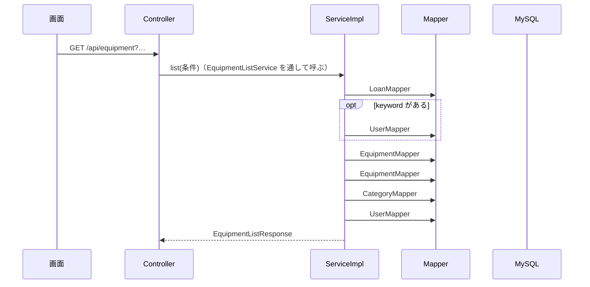

# API詳細設計：C-01 備品を探す

| 項目 | 内容 |
|---|---|
| 版 | v1.0 2026-11-11 |
| Jira | ZPOP-68 |
| 状態 | 作成中 |
| 機能 | [equipment](equipment.md) |
| もとにした設計書 | API設計.md v1.2 の2.3・2.4・2.5・3.3・4.8、画面設計.md v1.3 の10章、データ設計.md v1.0 の2章・5.3・5.5・5.6・5.7・5.1・6章、機能一覧.md v1.0 の1章・4章（F-05） |

## 1. API基本情報

写したもと：API設計.md v1.2 の3.3

| 項目 | 内容 |
|---|---|
| ID | C-01 |
| 名前 | 備品を探す |
| 操作 | GET |
| URL | /api/equipment |
| 内容 | 備品を探す（絞り込み・並び替え・ページ分け） |
| 権限項目 | EQUIPMENT_VIEW（備品一覧を見る） |
| 使う画面 | S-07（まだ。ZPOP-109） |
| controller のメソッド | EquipmentListController#list |
| service のメソッド | EquipmentListService#list（中身は EquipmentListServiceImpl） |
| validator のメソッド | なし（業務チェックがない。条件の形の確かめは dto で行う） |

## 2. リクエスト定義

写したもと：API設計.md v1.2 の4.8・2.5。最初の値と、決まった値以外のときの扱いは、API設計にないため決めた（12章の No.3。2026-11-11 に人が確認）

### 2.1 パスの値

なし

### 2.2 クエリ（URL の ? の後ろ）

dto：`dto.equipment.EquipmentListRequest`（受け取った値を確かめて、探す条件にする）

| 名前 | 型 | 必須 | 最初の値 | 説明 |
|---|---|---|---|---|
| keyword | 文字 | | なし | 管理番号・メーカー・モデル・シリアルNo・借用者の氏名のどれかに含まれていれば出す。大文字・小文字を区別しない（データ設計 2章）。前後の空白を取り除き、空なら条件にしない |
| categoryId | 数 | | なし（すべて） | 種別のID |
| status | MANAGED／DISPOSED／MISSING | | なし（すべての管理状態） | 管理状態。複数指定できる（status=MANAGED&status=MISSING） |
| loanStatus | ALL／IN_STOCK／LENT | | ALL | 貸出状態。IN_STOCK＝保管中（貸出中でない）、LENT＝貸出中 |
| confirm | ALL／CONFIRMED／UNCONFIRMED | | ALL | 今月確認済みか。**管理中の備品にだけ効かせる**（廃棄・不明の備品は、この条件で落とさない。5章の No.5） |
| sort | managementNo／lastConfirmedOn（後ろに ,desc を付けると逆順） | | managementNo | 並び順 |
| page | 数 | | 1 | 何ページ目か（1から数える。API設計 2.5） |

例：`GET /api/equipment?keyword=lenovo&status=MANAGED&status=MISSING&confirm=UNCONFIRMED&sort=lastConfirmedOn,desc&page=2`

### 2.3 本文（JSON）

なし

### 2.4 ファイル（CSV を受け取る API だけ）

なし

## 3. レスポンス定義

写したもと：API設計.md v1.2 の2.4・2.5・4.8、画面設計.md v1.3 の10章（項目名は API設計にないため決めた。12章の No.1。2026-11-11 に人が確認）

### 3.1 成功

| status | message |
|---|---|
| 200 | 処理が正常に完了しました。 |

data（dto：`dto.equipment.EquipmentListResponse`。API設計 2.5 の形）

| 項目名 | 型 | null になるか | もと | 説明 |
|---|---|---|---|---|
| items | 配列 | ならない | ― | このページの備品（下の表）。0件なら空の配列 |
| page | 数 | ならない | 受け取った page | 何ページ目か |
| size | 数 | ならない | 50（画面設計 10章） | 1ページの件数 |
| totalCount | 数 | ならない | 条件に合う備品の数 | |
| totalPages | 数 | ならない | totalCount を 50 で割って切り上げ。0件なら 0 | |

items の1件（dto：`dto.equipment.EquipmentListItem`）

| 項目名 | 型 | null になるか | もと（テーブル.列 ／ 計算） | 説明 |
|---|---|---|---|---|
| id | 数 | ならない | equipment.id | S-08 に移るときに使う |
| managementNo | 文字 | ならない | equipment.management_no | 管理番号 |
| categoryName | 文字 | ならない | categories.name（equipment.category_id で突き合わせ） | 種別 |
| maker | 文字 | なる | equipment.maker | メーカー |
| model | 文字 | なる | equipment.model | モデル |
| status | MANAGED／DISPOSED／MISSING | ならない | equipment.status | 管理状態 |
| loanStatus | IN_STOCK／LENT | ならない | 貸出中の貸出履歴（loans の returned_on が空で、取り消されていない行）があれば LENT | 貸出状態。管理状態が不明のときなどの出し方（「―」）は画面で決める |
| borrowerName | 文字 | なる（貸出中でないとき） | users.name（貸出中の貸出履歴の user_id で突き合わせ） | 借用者 |
| lastConfirmedOn | 日付 | なる（未記入） | equipment.last_confirmed_on | 最終確認日 |
| confirmedThisMonth | 真偽 | ならない | MonthlyConfirmationRule#isConfirmedThisMonth（common.md 3.11） | 今月確認済みか（色分けと「確認した」ボタンに使う） |

```json
{
  "status": 200,
  "message": "処理が正常に完了しました。",
  "data": {
    "items": [
      {
        "id": 15,
        "managementNo": "A001",
        "categoryName": "PC",
        "maker": "Lenovo",
        "model": "ThinkPad X1",
        "status": "MANAGED",
        "loanStatus": "LENT",
        "borrowerName": "山田太郎",
        "lastConfirmedOn": "2026-10-20",
        "confirmedThisMonth": false
      }
    ],
    "page": 1,
    "size": 50,
    "totalCount": 128,
    "totalPages": 3
  },
  "errors": null
}
```

### 3.2 失敗

9章のとおり。

## 4. 処理フロー

1. controller が受け取る。管理状態・貸出状態・確認の値は Enum として受け取り、決まった値でなければ 400（Spring が型を直せない。9章の No.1）。
2. `@PreAuthorize("hasAuthority('EQUIPMENT_VIEW')")` で権限項目を確かめる（10章）。
3. controller が `EquipmentListRequest.of(…)` で、sort と page を確かめて探す条件にする（決まった値でなければ 400）。EquipmentListService#list を呼ぶ。
4. ServiceImpl が、貸出中の貸出履歴をすべて読む（備品のID → 借用者のユーザID）。
5. keyword があれば、氏名に keyword を含むユーザのIDを読み、そのユーザが借りている備品のIDを集める（借用者の氏名で探すため）。
6. 4・5 の備品のIDと、今月の1日（MonthlyConfirmationRule#firstDayOfThisMonth）を条件に入れて、備品の数（count）と、このページの備品（50件まで）を読む。
7. このページの備品の種別の名前と、借用者の氏名を、それぞれ IN でまとめて読む。
8. 突き合わせて items を作り、`ApiResponse.ok(…)` で返す。



## 5. 条件分岐・業務ルール

| No. | 条件・ルール | 写したもと | 守る場所（クラス.メソッド） | 守れないとき | 同じルールを書いているほかの機能 |
|---|---|---|---|---|---|
| 1 | 削除された備品は出さない | データ設計 2章 | EquipmentMapper.xml（deleted_at IS NULL） | ― | なし |
| 2 | 貸出中＝返却日が空で、取り消されていない貸出履歴がある | データ設計 5.7 | LoanMapper.xml#selectActive | ― | mine（B-01）、importer・equipment の貸出 |
| 3 | 今月確認済み＝最終確認日の月が今月 | 機能一覧 1章 | MonthlyConfirmationRule（common.calendar。common.md 3.11） | ― | mine・confirmation・reminder（同じ部品を使う） |
| 4 | キーワードは大文字・小文字を区別しない（両方を小文字にそろえて比べる） | データ設計 2章「画面での検索」 | EquipmentListRequest（小文字にする）、EquipmentMapper.xml・UserMapper.xml（LOWER） | ― | なし |
| 5 | 確認の条件（confirm）は管理中の備品にだけ効かせる。廃棄・不明の備品は、確認の条件にかかわらず出す（管理状態の条件では絞る） | 画面設計 10章「棚卸対象」（管理中で今月確認済みでないもの＋不明のもの）。2026-11-11 に人が決めた | EquipmentMapper.xml | ― | なし |
| 6 | 最初は管理番号の順。最終確認日でも並べられる。逆順もできる | 画面設計 10章「並び順」 | EquipmentMapper.xml（ORDER BY） | ― | なし |
| 7 | 50件ずつ | 画面設計 10章「件数」、API設計 2.5 | EquipmentListServiceImpl（PAGE_SIZE） | ― | なし |

## 6. バリデーション仕様

写したもと：なし（画面設計 10章の探す条件は選ぶ形で、入力の誤りの文がない）。2026-11-11 に人が決めた（12章の No.3）

| 項目 | 決まり | メッセージ | 確かめる場所 |
|---|---|---|---|
| status・loanStatus・confirm | 決まった値（大文字） | 400「入力内容に誤りがあります。」（errors は null） | Spring の型の変換（MethodArgumentTypeMismatchException。GlobalExceptionHandler） |
| categoryId・page | 数 | 同上 | 同上 |
| sort | managementNo・managementNo,desc・lastConfirmedOn・lastConfirmedOn,desc のどれか | 同上 | EquipmentListRequest#of（BusinessRuleException） |
| page | 1以上 | 同上 | EquipmentListRequest#of（BusinessRuleException） |

- 最後のページより後ろの page は誤りにせず、items を空にして返す。
- categoryId に、ない種別・削除された種別を入れても誤りにしない（0件になる）。

## 7. DB操作仕様

写したもと：データ設計.md v1.0 の5.1・5.5・5.6・5.7・6章

mapper は equipment 機能の `mapper.equipment` のもの（CLAUDE.md 5章）。

| No. | mapper のメソッド | 操作 | テーブル | 条件 | 読む・書く列 | 件数 |
|---|---|---|---|---|---|---|
| 1 | LoanMapper#selectActive | SELECT | loans | returned_on IS NULL AND deleted_at IS NULL | equipment_id, user_id | 貸出中の数 |
| 2 | UserMapper#selectIdsByNameContaining | SELECT | users | LOWER(name) LIKE キーワード（削除されたユーザも含める。貸出中の借用者だけを使うため） | id | 0件〜 |
| 3 | EquipmentMapper#countBySearch | SELECT COUNT(*) | equipment | 下の「探す条件」 | ― | 1件 |
| 4 | EquipmentMapper#selectBySearch | SELECT | equipment | 下の「探す条件」＋ ORDER BY ＋ LIMIT 50 OFFSET (page-1)×50 | id, management_no, category_id, maker, model, status, last_confirmed_on | 0〜50件 |
| 5 | CategoryMapper#selectByIds | SELECT | categories | id IN (…)（削除済みも読む。備品が指していれば名前を出す） | id, name | ページの種別の数 |
| 6 | UserMapper#selectByIds | SELECT | users | id IN (…)（削除済みも読む） | id, name | ページの借用者の数 |

**探す条件**（No.3・4 で同じ。`<sql>` にまとめる）

| 条件 | SQL |
|---|---|
| 削除されていない | deleted_at IS NULL |
| 種別 | category_id = #{categoryId} |
| 管理状態 | status IN (…) |
| 貸出中だけ（LENT） | id IN (貸出中の備品のID)。貸出中が0件なら、SQL を出さずに0件とする |
| 保管中だけ（IN_STOCK） | id NOT IN (貸出中の備品のID)。貸出中が0件なら条件を付けない |
| 今月確認済み（CONFIRMED） | (status &lt;&gt; 'MANAGED' OR last_confirmed_on &gt;= 今月の1日) |
| 未確認（UNCONFIRMED） | (status &lt;&gt; 'MANAGED' OR last_confirmed_on IS NULL OR last_confirmed_on &lt; 今月の1日) |
| キーワード | (LOWER(management_no) LIKE ? OR LOWER(maker) LIKE ? OR LOWER(model) LIKE ? OR LOWER(serial_no) LIKE ? OR id IN (キーワードを氏名に含む借用者の備品のID))。LIKE の % _ ! は ! を付けて文字として扱う（ESCAPE '!'） |

**並び順**

| sort | ORDER BY |
|---|---|
| managementNo | management_no ASC, id ASC |
| managementNo,desc | management_no DESC, id DESC |
| lastConfirmedOn | last_confirmed_on ASC, management_no ASC, id ASC（MySQL は ASC で未記入（NULL）を先頭にする＝古い扱い） |
| lastConfirmedOn,desc | last_confirmed_on DESC, management_no ASC, id ASC（DESC では未記入が末尾） |

並び順の列は `<choose>` で選び、受け取った文字を SQL につなげない（`${}` を使わない）。

- 複数のテーブルの突き合わせ方（JOIN とサブクエリは使わない）：貸出中の貸出履歴（No.1）と、氏名で探したユーザ（No.2）を先に読み、備品のIDの一覧にして、備品の SQL の IN に渡す。種別の名前と借用者の氏名は、ページの備品を読んだあとで IN でまとめて読み、Java で突き合わせる。
- まとめて読む所（N+1 を防ぐ）：No.5・6（ページの中の種別のID・ユーザIDを集めて1回で読む）。
- 削除済みを除く条件：備品は deleted_at IS NULL。貸出履歴は deleted_at IS NULL（取り消し）。
- 更新した件数の見方：なし（読むだけ）。

## 8. トランザクション・排他制御

| 項目 | 内容 |
|---|---|
| @Transactional | 付けない（読むだけ） |
| 楽観ロック（version） | 使わない |
| 同時に操作されたとき | 読む途中で貸出・返却があると、件数と中身がずれることがある（読むだけなので、次に開いたときに正しくなる） |
| Slack を送るタイミング | 送らない |

## 9. エラー処理仕様

写したもと：API設計.md v1.2 の2.3・2.4

| No. | 場面 | 投げる例外 | status | message | errors |
|---|---|---|---|---|---|
| 1 | 決まった値でない（status・loanStatus・confirm）、数でない（categoryId・page） | （MethodArgumentTypeMismatchException） | 400 | 入力内容に誤りがあります。 | null |
| 2 | sort が決まった値でない、page が 1 より小さい | BusinessRuleException | 400 | 入力内容に誤りがあります。 | null |
| 3 | ログインしていない | （Spring Security） | 401 | ログインしてください。 | null |
| 4 | 権限項目 EQUIPMENT_VIEW がない | （Spring Security） | 403 | この操作を行う権限がありません。 | null |
| 5 | サーバーの不具合 | （GlobalExceptionHandler） | 500 | 問題が発生しました。時間をおいて、もう一度お試しください。続く場合は総務に連絡してください。 | null |

## 10. 認証・認可仕様

| 項目 | 内容 |
|---|---|
| ログイン | 要る |
| 権限項目 | `@PreAuthorize("hasAuthority('EQUIPMENT_VIEW')")` |
| 対象の確かめ（IDOR） | ID を受け取らない（categoryId は絞り込みの条件。EQUIPMENT_VIEW を持つ人は、すべての備品を見てよい） |

## 11. 外部API連携仕様

なし

## 12. 設計書にない判断

| No. | 判断 | 理由 | 外から見えるか | 人の確認 |
|---|---|---|---|---|
| 1 | items の1件の項目名（3.1） | API設計 4.8 に「画面設計10章の列＋confirmedThisMonth・id」とだけあるため | はい | 済（2026-11-11） |
| 2 | 確認の条件（confirm）は管理中の備品にだけ効かせる（5章の No.5） | 「棚卸対象」（管理中で未確認＋不明のもの全部）を、条件の組み合わせで出せるようにするため | はい | 済（2026-11-11） |
| 3 | 条件の最初の値と、決まった値以外のときの扱い（2.2・6章）。status がなければすべての管理状態（画面の最初の値「管理中・不明」は画面が送る）。最後のページより後ろは空 | API設計に書いていないため | はい | 済（2026-11-11） |
| 4 | 最終確認日で並べるとき、未記入は「古い」扱い（昇順で先頭、降順で末尾）。同じ値の中は管理番号の順 | 画面設計 10章に書いていないため。MySQL の NULL の並び方と同じ | はい | 済（2026-11-11） |
| 5 | 0件のときの totalPages は 0 | API設計 2.5 に書いていないため。「ページがない」ことをそのまま表す | はい | まだ |
| 6 | キーワードで探すとき、LIKE の特別な文字（% と _）も、ふつうの文字として探す | 「50%」のような文字で、すべての備品が出ないようにするため | はい | まだ |
| 7 | 貸出中の貸出履歴は、探すたびにすべて読む | JOIN とサブクエリを使わずに、貸出状態と借用者の氏名で絞るため（CLAUDE.md 5章）。貸出中の数は備品の数より多くならないので、読む量は小さい | いいえ | ― |

## 変更履歴

| 版 | 日付 | 内容 |
|---|---|---|
| v1.0 | 2026-11-11 | 初版（ZPOP-68） |
