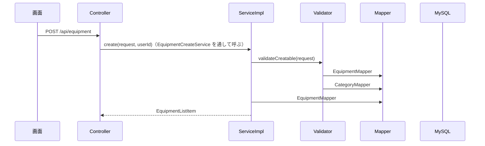

# API詳細設計：C-03 備品を登録する

| 項目 | 内容 |
|---|---|
| 版 | v1.0 2026-11-11 |
| Jira | ZPOP-70 |
| 状態 | 作成中 |
| 機能 | [equipment](equipment.md) |
| もとにした設計書 | API設計.md v1.2 の2.3・2.4・3.3・7章、画面設計.md v1.3 の12章、データ設計.md v1.0 の2章・5.5・5.6、機能一覧.md v1.0 の4章（F-06）・13章 |

## 1. API基本情報

写したもと：API設計.md v1.2 の3.3

| 項目 | 内容 |
|---|---|
| ID | C-03 |
| 名前 | 備品を登録する |
| 操作 | POST |
| URL | /api/equipment |
| 内容 | 備品を登録する |
| 権限項目 | EQUIPMENT_CREATE（備品を登録する） |
| 使う画面 | S-09（登録。まだ。ZPOP-111） |
| controller のメソッド | EquipmentCreateController#create |
| service のメソッド | EquipmentCreateService#create（中身は EquipmentCreateServiceImpl） |
| validator のメソッド | EquipmentValidator#validateCreatable |

## 2. リクエスト定義

写したもと：画面設計.md v1.3 の12章「入力項目」（API設計 4章に例がないため、項目から決めた。12章の No.1）

### 2.1 パスの値

なし

### 2.2 クエリ（URL の ? の後ろ）

なし

### 2.3 本文（JSON）

dto：`dto.equipment.EquipmentCreateRequest`

| 項目名 | 型 | 必須 | 制約 | 説明 |
|---|---|---|---|---|
| managementNo | 文字 | ○ | 30文字まで。ほかの備品と重ならない（削除済みの備品の番号は使い直せる） | 管理番号。形は自由 |
| categoryId | 数 | ○ | 削除されていない種別 | 種別 |
| maker | 文字 | | 50文字まで | メーカー |
| model | 文字 | | 100文字まで | モデル |
| serialNo | 文字 | | 100文字まで | シリアルNo |
| size | 文字 | | 20文字まで | サイズ（例：24インチ） |
| resolution | 文字 | | 20文字まで | 解像度（例：1920×1080） |
| heightAdjustable | 真偽 | | true＝あり、false＝なし、null・なし＝未設定 | 昇降 |
| pivot | 真偽 | | 同上 | ピボット |
| purchasedOn | 日付（2026-11-02 の形） | | 今日以前 | 購入日 |
| warrantyUntil | 日付 | | 購入日以降（購入日がなければ確かめない） | 保証期日 |
| note | 文字 | | 500文字まで | 備考 |

```json
{ "managementNo": "E015", "categoryId": 5, "maker": "EIZO", "model": "EV2485", "size": "24インチ",
  "heightAdjustable": true, "pivot": false, "purchasedOn": "2024-04-01", "warrantyUntil": "2027-03-31" }
```

- 文字の項目は、入力チェックの前に、前後の空白（全角の空白も）を取り除き、空なら null（入力なし）にする（dto.equipment.EquipmentInputs。12章の No.2）。
- 管理状態（status）・最終確認日（lastConfirmedOn）・廃棄日は受け取らない。送られても使わない（5章の No.2・3）。
- 知らない項目は無視する。

### 2.4 ファイル（CSV を受け取る API だけ）

なし

## 3. レスポンス定義

写したもと：API設計.md v1.2 の2.4。data の形は API設計にないため、K-02（K-01 の1件と同じ形）・B-02（B-01 の1件と同じ形）にそろえ、C-01 の1件と同じ形にした（12章の No.1。2026-11-11 に人が確認）

### 3.1 成功

| status | message |
|---|---|
| 201 | 処理が正常に完了しました。 |

data：作った備品（dto：`dto.equipment.EquipmentListItem`。C-01 の3章の1件と同じ10項目）。作ったばかりなので、status は MANAGED、loanStatus は IN_STOCK、borrowerName は null、lastConfirmedOn は今日、confirmedThisMonth は true。

```json
{
  "status": 201,
  "message": "処理が正常に完了しました。",
  "data": { "id": 42, "managementNo": "E015", "categoryName": "モニター", "maker": "EIZO", "model": "EV2485",
            "status": "MANAGED", "loanStatus": "IN_STOCK", "borrowerName": null,
            "lastConfirmedOn": "2026-11-11", "confirmedThisMonth": true },
  "errors": null
}
```

### 3.2 失敗

9章のとおり。

## 4. 処理フロー

1. controller が受け取る。dto で文字の項目を直してから、`@Valid` で入力チェック（6章の No.1〜9）。
2. `@PreAuthorize("hasAuthority('EQUIPMENT_CREATE')")` で権限項目を確かめる（10章）。
3. controller が EquipmentCreateService#create を呼ぶ（ここから `@Transactional`）。
4. ServiceImpl が EquipmentValidator#validateCreatable を呼ぶ。管理番号の重なり、種別（FOR SHARE で読む）、購入日、保証期日を確かめ、誤りがあればまとめて FieldErrorException（6章の No.10〜13）。
5. ServiceImpl が、管理状態を管理中、最終確認日を今日にして、備品を足す（7章の No.3）。重複禁止に当たったら、管理番号の欄のエラーにする（8章）。
6. ログに「備品を登録しました（id・管理番号・種別のID）」を残す（API設計 7章）。
7. `ApiResponse.created(…)` で返す。



## 5. 条件分岐・業務ルール

| No. | 条件・ルール | 写したもと | 守る場所（クラス.メソッド） | 守れないとき | 同じルールを書いているほかの機能 |
|---|---|---|---|---|---|
| 1 | 管理番号はほかの備品と重ならない。削除済みの備品の番号は使い直せる | 画面設計 12章、データ設計 2章 | EquipmentValidator#validateCreatable、データベースの重複禁止（uk_equipment_management_no_active） | 400（9章の No.2） | importer（I-01〜I-03） |
| 2 | 管理状態は管理中にする | 画面設計 12章（登録のときは「表示のみ（管理中）」）、機能一覧 9章 | EquipmentCreateServiceImpl#create | ― | importer |
| 3 | 最終確認日は登録した日にする | 機能一覧 F-06、画面設計 12章 | EquipmentCreateServiceImpl#create | ― | importer |
| 4 | 種別は、削除されていない種別から選ぶ | 画面設計 12章「登録されている種別から選ぶ」 | EquipmentValidator#validateCreatable | 400（9章の No.2） | importer |
| 5 | 種別の行を FOR SHARE で読んでから足す（K-04 で同時に種別を消されないように） | category/category.md 3章の No.2、K-04 の8章 | CategoryMapper#selectByIdForShare（EquipmentValidator から） | 消されていたら 400（No.4） | importer、C-04（種別を変えるとき） |
| 6 | 購入日は今日以前、保証期日は購入日以降 | 画面設計 12章 | EquipmentValidator#validateCreatable | 400（9章の No.2） | C-04 |

## 6. バリデーション仕様

写したもと：画面設計.md v1.3 の12章「入力項目」（メッセージは一字も変えずに写す。「（同じ形）」と書かれた所は、メーカーの文の項目名と文字数を入れ替えた）

| No. | 項目 | 決まり | メッセージ | 確かめる場所 |
|---|---|---|---|---|
| 1 | managementNo | 必須 | 「管理番号を入力してください」 | dto の `@NotBlank` |
| 2 | managementNo | 30文字まで | 「管理番号は30文字以内で入力してください」 | dto の `@Size(max = 30)` |
| 3 | categoryId | 必須 | 「種別を選んでください」 | dto の `@NotNull` |
| 4 | maker | 50文字まで | 「メーカーは50文字以内で入力してください」 | dto の `@Size` |
| 5 | model | 100文字まで | 「モデルは100文字以内で入力してください」 | dto の `@Size` |
| 6 | serialNo | 100文字まで | 「シリアルNoは100文字以内で入力してください」 | dto の `@Size` |
| 7 | size | 20文字まで | 「サイズは20文字以内で入力してください」 | dto の `@Size` |
| 8 | resolution | 20文字まで | 「解像度は20文字以内で入力してください」 | dto の `@Size` |
| 9 | note | 500文字まで | 「備考は500文字以内で入力してください」 | dto の `@Size` |
| 10 | managementNo | ほかの備品と重ならない | 「この管理番号はすでに使われています」 | EquipmentValidator#validateCreatable（業務チェック） |
| 11 | categoryId | 削除されていない種別 | 「種別を選んでください」 | EquipmentValidator#validateCreatable（12章の No.3） |
| 12 | purchasedOn | 今日以前 | 「購入日は今日以前の日付を入力してください」 | EquipmentValidator#validateCreatable（今日の日付が要るため） |
| 13 | warrantyUntil | 購入日以降 | 「保証期日は購入日以降の日付を入力してください」 | EquipmentValidator#validateCreatable |

- No.1〜9 の誤りがあれば、No.10〜13 は確かめない（入力チェックは service より前に終わるため）。
- No.10〜13 は、重なればすべて返す（errors に managementNo・categoryId・purchasedOn・warrantyUntil の順）。返し方は FieldErrorException（common.md 6章）。
- 日付の形でない値（2026/11/01 など）・真偽でない値は、JSON が読めないので 400（errors は null。9章の No.1）。
- 管理番号の重なりは、データベースの照合順序で比べる（大文字・小文字は別の番号。データ設計 2章）。

## 7. DB操作仕様

写したもと：データ設計.md v1.0 の2章・5.5・5.6

| No. | mapper のメソッド | 操作 | テーブル | 条件 | 読む・書く列 | 件数 |
|---|---|---|---|---|---|---|
| 1 | CategoryMapper#selectByIdForShare | SELECT … FOR SHARE | categories | id = ? AND deleted_at IS NULL | id, name | 0〜1件 |
| 2 | EquipmentMapper#countByManagementNo | SELECT COUNT(*) | equipment | management_no = ? AND deleted_at IS NULL | ― | 1件 |
| 3 | EquipmentMapper#insert | INSERT | equipment | ― | management_no, category_id, maker, model, serial_no, size, resolution, height_adjustable, pivot, purchased_on, warranty_until, status（MANAGED）, last_confirmed_on（今日）, note, created_at・updated_at（今）, created_by・updated_by（ログインしている人）。version は最初の値の 0。足した ID を受け取る（useGeneratedKeys） | 1件 |

- 複数のテーブルの突き合わせ方：返す値の種別の名前は、No.1 で読んだ種別のものを使う。
- 削除済みを除く条件：種別・管理番号の重なりとも deleted_at IS NULL。

## 8. トランザクション・排他制御

| 項目 | 内容 |
|---|---|
| @Transactional | 付ける：EquipmentCreateServiceImpl#create（Validator の呼び出しも、この中に入る） |
| 楽観ロック（version） | 使わない（足すだけ） |
| 同時に操作されたとき | ①種別を消される：種別の行を FOR SHARE で読むので、K-04（FOR UPDATE）が先に押さえていれば待ち、消されたのを見て 400（種別を選んでください）。C-03 が先なら、K-04 が待ち、足した備品を数えて 400 になる（K-04 の8章）。EquipmentCreateLockTest で確かめた。②同じ管理番号を同時に足される：確かめのあとで重複禁止（uk_equipment_management_no_active）に当たったら、管理番号の欄のエラー（400「この管理番号はすでに使われています」）にする |
| Slack を送るタイミング | 送らない |

## 9. エラー処理仕様

写したもと：API設計.md v1.2 の2.3・2.4、画面設計.md v1.3 の12章

| No. | 場面 | 投げる例外 | status | message | errors |
|---|---|---|---|---|---|
| 1 | 入力の誤り（6章の No.1〜9） | （`@Valid`） | 400 | 入力内容に誤りがあります。 | 入力欄ごとの文 |
| 2 | 業務チェックの誤り（6章の No.10〜13）、確かめのあとの管理番号の重なり | FieldErrorException | 400 | 入力内容に誤りがあります。 | 入力欄ごとの文 |
| 3 | JSON の形が壊れている、日付の形でない | （GlobalExceptionHandler） | 400 | 入力内容に誤りがあります。 | null |
| 4 | ログインしていない | （Spring Security） | 401 | ログインしてください。 | null |
| 5 | 権限項目 EQUIPMENT_CREATE がない、CSRF の合言葉がない | （Spring Security） | 403 | この操作を行う権限がありません。 | null |
| 6 | サーバーの不具合 | （GlobalExceptionHandler） | 500 | 問題が発生しました。時間をおいて、もう一度お試しください。続く場合は総務に連絡してください。 | null |

## 10. 認証・認可仕様

| 項目 | 内容 |
|---|---|
| ログイン | 要る |
| 権限項目 | `@PreAuthorize("hasAuthority('EQUIPMENT_CREATE')")` |
| 対象の確かめ（IDOR） | 操作する対象の ID を受け取らない（categoryId は選ぶ値で、削除されていない種別かを No.11 で確かめる） |

## 11. 外部API連携仕様

なし

## 12. 設計書にない判断

| No. | 判断 | 理由 | 外から見えるか | 人の確認 |
|---|---|---|---|---|
| 1 | 受け取る項目名（2.3）と、返す data を C-01 の1件と同じ形にする（3.1） | API設計 4章に例がないため。K-02・B-02 と同じ考え方 | はい | 済（2026-11-11） |
| 2 | 文字の項目はどれも前後の空白を取り除き、空なら null にする | 画面設計 12章は管理番号だけ「前後の空白は取り除く」と書いているが、空白だけのメーカーなどが残らないようにするため | はい | 済（2026-11-11） |
| 3 | ない種別・削除された種別は、種別の欄に「種別を選んでください」（400） | 画面設計 12章に、選べない種別を送られたときの文がないため | はい | 済（2026-11-11） |
| 4 | 管理状態・最終確認日は送られても使わない | 画面設計 12章で、登録のときは表示のみのため | はい | 済（2026-11-11） |
| 5 | 業務チェックの誤りは、重なればすべて返す（管理番号・種別・購入日・保証期日の順） | 画面で、一度に直せるようにするため。K-02 と同じ考え方 | はい | まだ |

## 変更履歴

| 版 | 日付 | 内容 |
|---|---|---|
| v1.0 | 2026-11-11 | 初版（ZPOP-70） |
