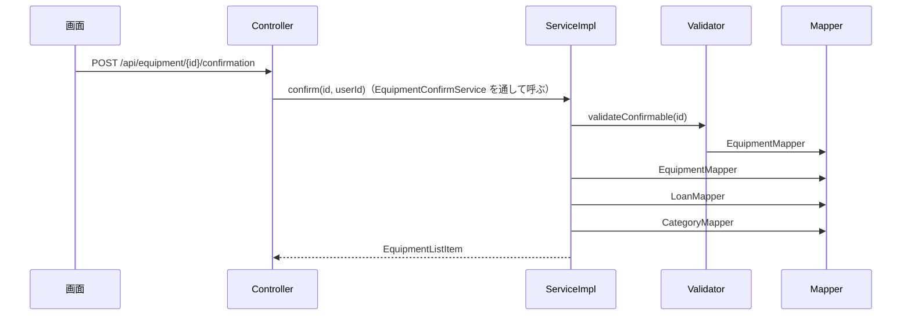

# API詳細設計：C-06 確認した（総務）

| 項目 | 内容 |
|---|---|
| 版 | v1.0 2026-11-11 |
| Jira | ZPOP-73 |
| 状態 | 作成中 |
| 機能 | [equipment](equipment.md) |
| もとにした設計書 | API設計.md v1.2 の2.3・2.4・3.3・7章、画面設計.md v1.4 の10章・11章、データ設計.md v1.0 の2章・5.6・5.7、機能一覧.md v1.0 の1章・4章（F-07） |

## 1. API基本情報

写したもと：API設計.md v1.2 の3.3

| 項目 | 内容 |
|---|---|
| ID | C-06 |
| 名前 | 確認した（総務） |
| 操作 | POST |
| URL | /api/equipment/{備品のID}/confirmation |
| 内容 | 備品を「確認した」にする |
| 権限項目 | CONFIRM_ALL（最終確認日を更新する（すべて）） |
| 使う画面 | S-07・S-08（まだ。ZPOP-109・110） |
| controller のメソッド | EquipmentConfirmController#confirm |
| service のメソッド | EquipmentConfirmService#confirm（中身は EquipmentConfirmServiceImpl） |
| validator のメソッド | EquipmentValidator#validateConfirmable |

## 2. リクエスト定義

### 2.1 パスの値

| 名前 | 型 | 説明 |
|---|---|---|
| id | 数 | 備品のID |

### 2.2 クエリ（URL の ? の後ろ）

なし

### 2.3 本文（JSON）

なし（日付は選べない。サーバーが今日の日付を入れる。機能一覧 F-07）

### 2.4 ファイル（CSV を受け取る API だけ）

なし

## 3. レスポンス定義

写したもと：API設計.md v1.2 の2.4。data の形は API設計にないため、C-01 の1件と同じ形にした（12章の No.2。2026-11-11 に人が確認）

### 3.1 成功

| status | message |
|---|---|
| 200 | 処理が正常に完了しました。 |

data：変えたあとの備品（dto：`dto.equipment.EquipmentListItem`。C-01 の3章の1件と同じ10項目）。lastConfirmedOn は今日、confirmedThisMonth は true。S-07 では、この値で一覧の行を差し替えられる。

```json
{
  "status": 200,
  "message": "処理が正常に完了しました。",
  "data": { "id": 15, "managementNo": "A001", "categoryName": "PC", "maker": "Lenovo", "model": "ThinkPad X1",
            "status": "MANAGED", "loanStatus": "LENT", "borrowerName": "山田太郎",
            "lastConfirmedOn": "2026-11-11", "confirmedThisMonth": true },
  "errors": null
}
```

### 3.2 失敗

9章のとおり。

## 4. 処理フロー

1. controller が受け取る。パスの ID が数でなければ 400（9章の No.1）。
2. `@PreAuthorize("hasAuthority('CONFIRM_ALL')")` で権限項目を確かめる（10章）。
3. controller が EquipmentConfirmService#confirm を呼ぶ（ここから `@Transactional`）。
4. ServiceImpl が EquipmentValidator#validateConfirmable を呼ぶ。備品の行を FOR UPDATE で読み、ない・削除済みなら 404、管理中でなければ 400。
5. ServiceImpl が、最終確認日を今日にし、version を1増やす（7章の No.2）。
6. ログに「備品を確認しました（id・管理番号）」を残す（API設計 7章）。
7. その備品の貸出中の貸出履歴を読み、EquipmentItemAssembler で C-01 の1件の形にする（種別の名前・借用者の氏名を読む）。
8. `ApiResponse.ok(…)` で返す。



## 5. 条件分岐・業務ルール

| No. | 条件・ルール | 写したもと | 守る場所（クラス.メソッド） | 守れないとき | 同じルールを書いているほかの機能 |
|---|---|---|---|---|---|
| 1 | 最終確認日を、その日の日付にする（日付は選べない） | 機能一覧 F-07、画面設計 10章 | EquipmentConfirmServiceImpl#confirm | ― | mine（B-04）、confirmation（E-02 は CSV の日付） |
| 2 | 確認できるのは管理中の備品だけ（保管中・貸出中は問わない） | 画面設計 10章・11章（「管理中で今月確認済みでないとき」にボタンを出す）。管理中でないときの文は 2026-11-11 に人が決め、画面設計 v1.4 の10章に足した | EquipmentValidator#validateConfirmable | 400（9章の No.4） | なし |
| 3 | 今月すでに確認済みの備品でも誤りにせず、今日にする | 画面設計にない（ボタンを出さないだけ）。12章の No.3 | EquipmentConfirmServiceImpl#confirm | ― | mine（B-04） |
| 4 | 保存のたびに version を1増やす（最終確認日だけを変えるときも） | データ設計 2章。2026-11-11 に人が決めた | EquipmentMapper.xml#updateLastConfirmedOn | ― | mine（B-04）、貸出・返却（B-02・B-03・C-07・C-08。最終確認日を変えるとき） |
| 5 | 削除された備品は確認できない | データ設計 2章 | EquipmentValidator#validateConfirmable | 404（9章の No.5） | なし |

## 6. バリデーション仕様

なし（本文がない。パスの ID の型だけを Spring が確かめる）

## 7. DB操作仕様

写したもと：データ設計.md v1.0 の2章・5.6・5.7

| No. | mapper のメソッド | 操作 | テーブル | 条件 | 読む・書く列 | 件数 |
|---|---|---|---|---|---|---|
| 1 | EquipmentMapper#selectByIdForUpdate | SELECT … FOR UPDATE | equipment | id = ? AND deleted_at IS NULL | id, management_no, category_id, maker, model, status, last_confirmed_on, version | 0〜1件 |
| 2 | EquipmentMapper#updateLastConfirmedOn | UPDATE | equipment | id = ? AND deleted_at IS NULL | last_confirmed_on（今日）、version（+1）、updated_at（今）、updated_by（ログインしている人） | 1件 |
| 3 | LoanMapper#selectActiveByEquipmentId | SELECT | loans | equipment_id = ? AND returned_on IS NULL AND deleted_at IS NULL | equipment_id, user_id | 0〜1件 |
| 4 | CategoryMapper#selectByIds・UserMapper#selectByIds | SELECT | categories・users | id IN (…) | id, name | 1件ずつ |

- 複数のテーブルの突き合わせ方：No.3・4 をテーブルごとに読み、EquipmentItemAssembler で突き合わせる（C-01 と同じ部品）。
- 更新した件数の見方：No.1 で行を押さえているので、No.2 はいつも1件。

## 8. トランザクション・排他制御

| 項目 | 内容 |
|---|---|
| @Transactional | 付ける：EquipmentConfirmServiceImpl#confirm（Validator の呼び出しも、この中に入る） |
| 楽観ロック（version） | 確かめには使わない（本文で version を受け取らない）。保存のたびに1増やす（5章の No.4）ので、同じ備品を S-09 で編集中の人は、保存のときに 409 になる |
| 同時に操作されたとき | 備品の行を FOR UPDATE で押さえてから管理状態を確かめるので、確かめてから書き換えるまでの間に、ほかの人に廃棄・不明・削除にされない。ほかの人が先に変えていれば、それを見て 400・404 になる |
| Slack を送るタイミング | 送らない |

## 9. エラー処理仕様

写したもと：API設計.md v1.2 の2.3・2.4、画面設計.md v1.4 の10章

| No. | 場面 | 投げる例外 | status | message | errors |
|---|---|---|---|---|---|
| 1 | パスの ID が数でない | （GlobalExceptionHandler） | 400 | 入力内容に誤りがあります。 | null |
| 2 | ログインしていない | （Spring Security） | 401 | ログインしてください。 | null |
| 3 | 権限項目 CONFIRM_ALL がない、CSRF の合言葉がない | （Spring Security） | 403 | この操作を行う権限がありません。 | null |
| 4 | 管理中でない（廃棄・不明） | BusinessRuleException | 400 | 管理中の備品だけ確認できます | null |
| 5 | 備品がない・削除済み | NotFoundException | 404 | 対象が見つかりません。 | null |
| 6 | サーバーの不具合 | （GlobalExceptionHandler） | 500 | 問題が発生しました。時間をおいて、もう一度お試しください。続く場合は総務に連絡してください。 | null |

## 10. 認証・認可仕様

| 項目 | 内容 |
|---|---|
| ログイン | 要る |
| 権限項目 | `@PreAuthorize("hasAuthority('CONFIRM_ALL')")` |
| 対象の確かめ（IDOR） | CONFIRM_ALL は「すべての備品」の最終確認日を更新できる権限項目（データ設計 5.3）なので、だれが借りている備品でも確認できる。削除されていないことは No.5 で確かめる |

## 11. 外部API連携仕様

なし

## 12. 設計書にない判断

| No. | 判断 | 理由 | 外から見えるか | 人の確認 |
|---|---|---|---|---|
| 1 | 管理中でない備品は 400「管理中の備品だけ確認できます」で止める | 画面ではボタンを出さないが、押すまでの間に管理状態を変えられたときなどのため（画面設計に書かれた決まりは、サーバーでも確かめる。CLAUDE.md 5章）。文を画面設計 v1.4 の10章に足した | はい | 済（2026-11-11） |
| 2 | data を C-01 の1件と同じ形にする | API設計に書いていないため。一覧の行をそのまま差し替えられるように | はい | 済（2026-11-11） |
| 3 | 今月すでに確認済みでも誤りにせず、今日にする | 画面ではボタンを出さないが、2人がほぼ同時に押しても、両方とも成功にするため | はい | 済（2026-11-11。C-06 の質問の前提として伝えた） |
| 4 | 最終確認日だけを変えるときも version を1増やす | データ設計 2章のとおり。B-04・貸出・返却も同じにする | はい（S-09 で編集中の人が 409 になる） | 済（2026-11-11） |
| 5 | C-01 の1件の形を作る処理を EquipmentItemAssembler にまとめ、C-01 と C-06 で使う | 同じ突き合わせを2か所に書かないため（同じ機能の中の部品） | いいえ | ― |

## 変更履歴

| 版 | 日付 | 内容 |
|---|---|---|
| v1.0 | 2026-11-11 | 初版（ZPOP-73） |
