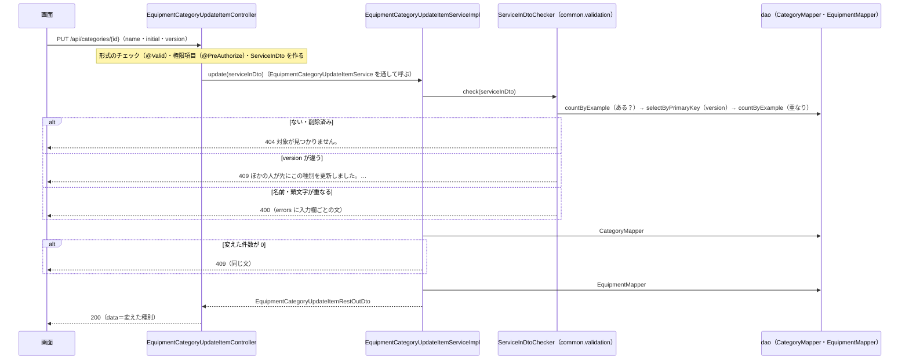

# API詳細設計：K-03 種別を変える

| 項目 | 内容 |
|---|---|
| 版 | v2.0 2026-11-15 |
| Jira | ZPOP-85 |
| 状態 | 作成中 |
| まとまり | [category](category.md)（api.equipment.category） |
| もとにした設計書 | API設計.md v1.2 の2.3・2.4・2.7・3.6・7章、画面設計.md v1.2 の1.2・16章、データ設計.md v1.0 の2章・5.3・5.5・5.6、機能一覧.md v1.0 の4章（F-21） |

## 1. API基本情報

写したもと：API設計.md v1.2 の3.6

| 項目 | 内容 |
|---|---|
| ID | K-03 |
| 名前 | 種別を変える |
| 操作 | PUT |
| URL | /api/categories/{種別のID} |
| 内容 | 種別を変える |
| 権限項目 | CATEGORY_MANAGE |
| 使う画面 | S-13 |
| パッケージ | api.equipment.category.update.item |
| クラス名の頭（`<頭>`） | EquipmentCategoryUpdateItem |
| Controller のメソッド | EquipmentCategoryUpdateItemController#update |
| Service のメソッド | EquipmentCategoryUpdateItemService#update（中身は EquipmentCategoryUpdateItemServiceImpl） |

## 2. リクエスト定義

### 2.1 パスの値

| 項目名 | 型 | 説明 |
|---|---|---|
| id | 数 | 種別のID。数でなければ 400（9章の No.3） |

### 2.2 クエリ（URL の ? の後ろ）

なし

### 2.3 本文（JSON）

RestInDto：`EquipmentCategoryUpdateItemRestInDto`（形式のチェック。6章）。name・initial は K-02 と同じ（画面設計.md v1.2 の16章「追加・変更のダイアログ」）。version は API設計.md v1.2 の2.7（画面を開いたときに受け取った version を送る）。

| 項目名 | 型 | 必須 | 制約 | 説明 |
|---|---|---|---|---|
| name | 文字 | ○ | K-02 と同じ（前後の空白を取り除いたあとで、空でなく、20文字まで。ほかの種別と重ならない） | 名前 |
| initial | 文字 | | K-02 と同じ（半角の英字1文字。小文字は大文字に直す。ほかの種別と重ならない。null・空・空白だけなら頭文字なし） | 頭文字 |
| version | 数 | ○ | K-01 で受け取った値 | 楽観ロックの番号。ないときは 400（12章の No.4） |

```json
{ "name": "ノートPC", "initial": "A", "version": 3 }
```

name・initial の直し方は K-02 と同じ（[K-02_種別を追加する.md](K-02_種別を追加する.md) の2.3。common.text.TextInputs を使う）。version がない（null）ときは、RestInDto のコンストラクタで例外を投げ、JSON の形の誤りと同じ 400 にする（12章の No.4）。

### 2.4 ファイル（CSV を受け取る API だけ）

なし

### 2.5 Service に渡す値（ServiceInDto）

ServiceInDto：`EquipmentCategoryUpdateItemServiceInDto`（DB との整合性のチェック。6章）。Controller が作る。

| 項目名 | 型 | もと | 付けるチェック用アノテーション（common.validation） |
|---|---|---|---|
| id | 数 | パスの id | `@CategoryExists`（groups：ServiceCheckOrder.First、payload：NotFound。6章の No.6） |
| name | 文字 | RestInDto の name | クラスに `@CategoryNameNotDuplicated`（6章の No.4） |
| initial | 文字 | RestInDto の initial | クラスに `@CategoryInitialNotDuplicated`（6章の No.5） |
| version | 数 | RestInDto の version | クラスに `@CategoryVersionMatches`（groups：ServiceCheckOrder.Second、payload：Conflict。6章の No.7） |
| loginUserId | 数 | ログインしている人のユーザID（変えた人に入れる） | なし |

- 確かめる順番（ServiceInDtoChecker）：種別がある（First）→ version が同じ（Second）→ 名前・頭文字が重ならない（Default）。前の段で守れなければ、後ろは確かめない。

## 3. レスポンス定義

写したもと：API設計.md v1.2 の2.3・2.4。data の中身は、K-02 にそろえ、K-01 の1件と同じ形にした（12章の No.1。2026-11-10 に人が確認）。

### 3.1 成功

| status | message |
|---|---|
| 200 | 処理が正常に完了しました。 |

data：変えた種別（RestOutDto：`EquipmentCategoryUpdateItemRestOutDto`。K-01 の1件と同じ形）

| 項目名 | 型 | null になるか | もと（テーブル.列 ／ 計算） | 説明 |
|---|---|---|---|---|
| id | 数 | ならない | categories.id | 種別のID |
| name | 文字 | ならない | categories.name | 名前（変えたあと） |
| initial | 文字 | なる（頭文字なし） | categories.initial | 頭文字（変えたあと） |
| equipmentCount | 数 | ならない | 計算（equipment を数える。K-01 と同じ数え方） | 使っている備品の数 |
| version | 数 | ならない | categories.version（送った値＋1） | 次に変えるときに送る番号 |

```json
{
  "status": 200,
  "message": "処理が正常に完了しました。",
  "data": { "id": 1, "name": "ノートPC", "initial": "A", "equipmentCount": 12, "version": 4 },
  "errors": null
}
```

### 3.2 失敗

9章のとおり。

## 4. 処理フロー

1. Spring Security が、ログインしているか（していなければ 401）と、CSRF の合言葉があるか（なければ 403）を確かめる。
2. 受け取った JSON から EquipmentCategoryUpdateItemRestInDto を作る。name・initial を K-02 と同じように直す。version がなければ 400。
3. `@Valid` で形式のチェックをする（6章の No.1〜3）。誤りがあれば 400（入力欄ごとの文）。
4. `@PreAuthorize("hasAuthority('CATEGORY_MANAGE')")` で権限項目を確かめる。なければ 403。
5. EquipmentCategoryUpdateItemController#update が、パスの id・RestInDto・ログインしている人のユーザIDから ServiceInDto を作り、EquipmentCategoryUpdateItemService#update を呼ぶ（中身は EquipmentCategoryUpdateItemServiceImpl）。
6. ServiceImpl（`@Transactional`）が、ServiceInDtoChecker#check で ServiceInDto を確かめる（2.5 の順番）。
   1. `@CategoryExists`：削除されていない種別がなければ NotFoundException（404）。
   2. `@CategoryVersionMatches`：送られた version と、今の version が違えば ConflictException（409。画面設計 16章の文）。
   3. `@CategoryNameNotDuplicated`・`@CategoryInitialNotDuplicated`：名前・頭文字が、自分以外の種別と重なれば FieldErrorException（400）。
7. ServiceImpl が CategoryMapper#selectByPrimaryKey で今の行を読み（7章の No.4）、名前・頭文字・version（＋1）・変えた日時（Clock の今）・変えた人（ログインしている人）を入れて、CategoryMapper#updateByExample で変える（7章の No.5。条件に id・version・削除されていない）。作った日時・作った人は、読んだ値のまま。
   - 変えた件数が 0 なら、6 と 7 の間にほかの人が変えた・消した。ConflictException（409。6.2 と同じ文）。7 で読んだ行がないときも同じ。
   - 6〜7 の間にほかの人が同じ名前・頭文字にしていて、データベースの重複禁止に当たったら、K-02 と同じく入力欄のエラー（400）に変える（CategoryChecks#duplicateKeyToFieldError）。
8. EquipmentMapper#countByExample で、使っている備品の数を読む（7章の No.6）。
9. ServiceImpl がログに「種別を変えました（id・名前・頭文字）」を INFO で残す（API設計 7章）。
10. Controller が `ApiResponse.ok(…)` で返す。



## 5. 条件分岐・業務ルール

| No. | 条件・ルール | 写したもと | 守る場所（クラス.メソッド） | 守れないとき | 同じルールを書いているほかの機能 |
|---|---|---|---|---|---|
| 1 | 名前は必須。20文字まで。頭文字は任意で、半角の英字1文字（小文字は大文字に直す） | 画面設計 16章 ／ category.md R-1・R-2 | RestInDto（`@NotBlank`・`@Size`・`@Pattern`）、common.text.TextInputs | 400（6章の No.1〜3） | なし（K-02 と同じ決まり） |
| 2 | 名前・頭文字は、自分以外の種別（削除されていないもの）と重ならない | 画面設計 16章 ／ category.md R-2 | ServiceInDto の `@CategoryNameNotDuplicated`・`@CategoryInitialNotDuplicated`（getId に自分の ID）。同時に変えられたときは、データベースの重複禁止 | 400（6章の No.4・5） | なし |
| 3 | 削除済みの種別は変えられない | データ設計 2章 ／ category.md R-6 | ServiceInDto の `@CategoryExists`、ServiceImpl#update の updateByExample（`andDeletedAtIsNull`） | 404（6.1）・409（7 で0件） | なし |
| 4 | 画面を開いたときの version と、今の version が違えば、上書きしない | API設計 2.7、データ設計 2章、画面設計 16章 | ServiceInDto の `@CategoryVersionMatches`、ServiceImpl#update の updateByExample（`andVersionEqualTo`） | 409（9章の No.7） | なし |
| 5 | 名前・頭文字を変えなくても、保存すれば version は1増える | データ設計 2章（保存のたびに1増やす） | ServiceImpl#update（version に送られた値＋1 を入れる） | ― | なし |

## 6. バリデーション仕様

写したもと：画面設計.md v1.2 の16章「追加・変更のダイアログ」（メッセージは一字も変えずに写す）。K-02 と同じ。

| No. | 項目 | 決まり | メッセージ | 確かめる場所 |
|---|---|---|---|---|
| 1 | name | 必須（前後の空白を取り除いて空なら誤り） | 「名前を入力してください」 | RestInDto の `@NotBlank` |
| 2 | name | 20文字まで | 「名前は20文字以内で入力してください」 | RestInDto の `@Size(max = 20)` |
| 3 | initial | 半角の英字1文字（小文字は大文字に直してから確かめる） | 「頭文字は英字1文字で入力してください」 | RestInDto の `@Pattern(regexp = "[A-Z]")` |
| 4 | name | 自分以外の種別と重複しない | 「この名前はすでに使われています」 | ServiceInDto の `@CategoryNameNotDuplicated`（payload なし＝入力欄のエラー） |
| 5 | initial | 自分以外の種別と重複しない | 「この頭文字はすでに使われています」 | ServiceInDto の `@CategoryInitialNotDuplicated`（payload なし＝入力欄のエラー） |
| 6 | id | 削除されていない種別がある | （404。対象が見つかりません。） | ServiceInDto の `@CategoryExists`（payload：NotFound） |
| 7 | version | 今の version と同じ | （409。ほかの人が先にこの種別を更新しました。…） | ServiceInDto の `@CategoryVersionMatches`（payload：Conflict） |

- 自分と同じ名前・頭文字のまま保存するのは、重なりにならない。

## 7. DB操作仕様

写したもと：データ設計.md v1.0 の2章・5.5・5.6

| No. | Mapper のメソッド | 使う所 | 操作 | テーブル | 条件（Criteria） | 読む・書く列 | 件数 |
|---|---|---|---|---|---|---|---|
| 1 | CategoryMapper#countByExample | `@CategoryExists` の中 | SELECT | categories | `andIdEqualTo(id).andDeletedAtIsNull()` | COUNT(*) | 1件（数） |
| 1-2 | CategoryMapper#selectByPrimaryKey | `@CategoryVersionMatches` の中 | SELECT | categories | id = ?（削除済みなら確かめない） | 全部の列 | 0〜1件 |
| 2 | CategoryMapper#countByExample | `@CategoryNameNotDuplicated` の中 | SELECT | categories | `andNameEqualTo(name).andDeletedAtIsNull().andIdNotEqualTo(id)`（自分を除く） | COUNT(*) | 1件（数） |
| 3 | CategoryMapper#countByExample | `@CategoryInitialNotDuplicated` の中 | SELECT | categories | `andInitialEqualTo(initial).andDeletedAtIsNull().andIdNotEqualTo(id)`（自分を除く） | COUNT(*) | 1件（数）。initial が null なら呼ばない |
| 4 | CategoryMapper#selectByPrimaryKey | ServiceImpl#update | SELECT | categories | id = ? | 全部の列 | 0〜1件。なければ 409 |
| 5 | CategoryMapper#updateByExample | ServiceImpl#update | UPDATE | categories | `andIdEqualTo(id).andVersionEqualTo(送られた値).andDeletedAtIsNull()` | 生成列（name_active・initial_active）以外の全部の列。変えるのは name, initial, version（＋1）, updated_at, updated_by。ほかは No.4 で読んだ値のまま | 0〜1件。0件なら 409 |
| 6 | EquipmentMapper#countByExample | ServiceImpl#update | SELECT | equipment | `andCategoryIdEqualTo(id).andDeletedAtIsNull()` | COUNT(*) | 1件（数） |

- 手で書く Mapper：使わない。
- No.5 で updateByExampleSelective（null の列を変えない）を使わないのは、頭文字をなくす（null にする）変更ができなくなるため。

- 複数のテーブルの突き合わせ方（JOIN とサブクエリは使わない）：categories と equipment を別々に読む。
- まとめて読む所：なし（1件）。
- No.2・3 は K-02 と同じチェック用アノテーション。K-02 では自分を除く条件（`andIdNotEqualTo`）をつけない（ServiceInDto の getId が null）。
- 削除済みを除く条件：No.1〜3・5・6 の `andDeletedAtIsNull`。
- 更新した件数の見方：No.5 が 0件なら、ほかの人が先に変えた・消した（409）。

## 8. トランザクション・排他制御

| 項目 | 内容 |
|---|---|
| @Transactional | EquipmentCategoryUpdateItemServiceImpl#update に付ける（ServiceInDto のチェックから変えるまでを1つのまとまりにする） |
| 楽観ロック（version） | 使う。`@CategoryVersionMatches` で送られた version と今の version を比べ（409）、UPDATE の条件にも version を入れる（確かめと UPDATE の間に変えられたときのため。0件なら 409） |
| 同時に操作されたとき | version が同じ2人が同時に保存すると、先の人の UPDATE が version を1増やすので、あとの人の UPDATE は0件になり 409 になる。同じ名前・頭文字に同時に変えたときは、K-02 と同じく重複禁止に当たり 400（入力欄のエラー） |
| Slack を送るタイミング | 送らない |

## 9. エラー処理仕様

写したもと：API設計.md v1.2 の2.3・2.4、画面設計.md v1.2 の16章

| No. | 場面 | 投げる例外 | status | message | errors |
|---|---|---|---|---|---|
| 1 | 入力の誤り（6章の No.1〜3） | （`@Valid`） | 400 | 入力内容に誤りがあります。 | 入力欄ごとの文 |
| 2 | 名前・頭文字が重なる（6章の No.4・5） | FieldErrorException（ServiceInDtoChecker が変える） | 400 | 入力内容に誤りがあります。 | 「この名前はすでに使われています」（name）・「この頭文字はすでに使われています」（initial） |
| 3 | JSON の形が壊れている、version がない、パスの ID が数でない | （GlobalExceptionHandler） | 400 | 入力内容に誤りがあります。 | null |
| 4 | ログインしていない | （Spring Security） | 401 | ログインしてください。 | null |
| 5 | 権限項目 CATEGORY_MANAGE がない、CSRF の合言葉がない | （Spring Security） | 403 | この操作を行う権限がありません。 | null |
| 6 | 種別がない・削除済み | NotFoundException（ServiceInDtoChecker が、payload：NotFound の誤りを変える） | 404 | 対象が見つかりません。 | null |
| 7 | ほかの人が先に保存していた（version が違う、UPDATE が0件） | ConflictException（version が違うときは ServiceInDtoChecker が、payload：Conflict の誤りを変える。UPDATE が0件のときは ServiceImpl が投げる） | 409 | ほかの人が先にこの種別を更新しました。画面を開き直して、最新の内容を確かめてください。 | null |
| 8 | サーバーの不具合 | （GlobalExceptionHandler） | 500 | 問題が発生しました。時間をおいて、もう一度お試しください。続く場合は総務に連絡してください。 | null |

## 10. 認証・認可仕様

写したもと：データ設計.md v1.0 の5.3

| 項目 | 内容 |
|---|---|
| ログイン | 要る |
| 権限項目 | CATEGORY_MANAGE。`@PreAuthorize("hasAuthority('CATEGORY_MANAGE')")` |
| 対象の確かめ（IDOR） | 種別は持ち主のいないデータ（総務みんなで管理する）ので、権限項目があれば、どの種別でも変えてよい。ないか削除済みなら 404 |

- K-02 と同じく、入力チェックは権限項目の確かめより先に動く（権限項目がない人が誤った値を送ると 400 が先に返る）。

## 11. 外部API連携仕様

なし

## 12. 設計書にない判断

| No. | 判断 | 理由 | 外から見えるか | 人の確認 |
|---|---|---|---|---|
| 1 | 200 の data に、変えた種別を K-01 の1件と同じ形で返す（version は1増えた値、equipmentCount は今の数） | API設計 4章に例がない。K-02 にそろえた | はい | 済（2026-11-10） |
| 2 | ほかの人が先に保存していたときの文を「ほかの人が先にこの種別を更新しました。画面を開き直して、最新の内容を確かめてください。」にし、画面設計 16章に書き足した（v1.2） | 画面設計 16章になかった。S-09 の文の「備品」を「種別」にした | はい | 済（2026-11-10） |
| 3 | ない・削除済みの種別は 404、確かめと UPDATE の間に消された・変えられたときは 409 | ない種別は API設計 2.3 の「見つからない」。間に起きたことは、どちらか見分けずに「ほかの人が先に変えた」とする | はい | まだ |
| 4 | version がないときは、JSON の形の誤りと同じ 400（errors は null）にする | 画面は必ず送るので、入力欄の文は要らない。0 とみなして 409 にすると、原因が分かりにくいため | はい（画面からは起きない） | まだ |
| 5 | 名前・頭文字の直し方（空白・大文字）を、K-02 と K-03 で同じ部品（common.text.TextInputs）にまとめた | 同じ決まりを2か所に書かないため。API どうしは使い合わないので common に置いた（2026-11-15 に決めた） | いいえ | ― |
| 6 | 重複禁止に当たった例外を入力欄のエラーに変える処理を、K-02 と K-03 で同じ部品（common.validation.CategoryChecks）にまとめた | 同じ処理を2か所に書かないため | いいえ | ― |

## 変更履歴

| 版 | 日付 | 内容 |
|---|---|---|
| v1.0 | 2026-11-10 | 初版（ZPOP-85） |
| v2.0 | 2026-11-15 | パッケージ構成の変更で、api.equipment.category.update.item に作り直した。置き場所を equipment/category/ にし、1・2.3・2.5・3.1・4〜9・12章を新しいクラス（RestInDto・ServiceInDto・RestOutDto、common.validation のチェック用アノテーション、dao の Mapper と Example）に合わせた。外から見た動きは変わらない |
