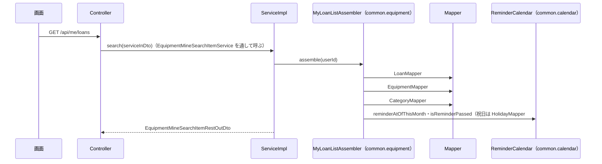

# API詳細設計：B-01 自分の備品の一覧

| 項目 | 内容 |
|---|---|
| 版 | v1.0 2026-11-16 |
| Jira | ZPOP-63 |
| 状態 | 作成中 |
| まとまり | [mine](mine.md) |
| もとにした設計書 | API設計.md v1.4 の2.3・2.4・3.2・4.5・7章、画面設計.md v1.5 の3章、機能一覧.md v1.1 の1章・5章・7章、データ設計.md v1.0 の2章・5.6・5.7 |

## 1. API基本情報

写したもと：API設計.md v1.4 の3.2

| 項目 | 内容 |
|---|---|
| ID | B-01 |
| 名前 | 自分の備品の一覧 |
| 操作 | GET |
| URL | /api/me/loans |
| 内容 | 自分が借りている備品の一覧と、今月の確認の案内（未確認の件数・催促日）を返す |
| 権限項目 | LOAN_SELF（備品を借りる・返す（自分）） |
| 使う画面 | S-05（まだ。ZPOP-107） |
| controller のメソッド | EquipmentMineSearchItemController#search |
| service のメソッド | EquipmentMineSearchItemService#search（中身は EquipmentMineSearchItemServiceImpl） |
| validator のメソッド | なし（受け取る値がない） |

## 2. リクエスト定義

### 2.1 パスの値

なし

### 2.2 クエリ（URL の ? の後ろ）

なし。借用者は受け取らず、ログインしている人の分だけを返す（10章）

### 2.3 本文（JSON）

なし

### 2.4 ファイル（CSV を受け取る API だけ）

なし

## 3. レスポンス定義

写したもと：API設計.md v1.4 の2.4・4.5。reminderPassed の意味は 12章の No.1

### 3.1 成功

| status | message |
|---|---|
| 200 | 処理が正常に完了しました。 |

data（RestOutDto：`EquipmentMineSearchItemRestOutDto`。common.equipment.MyLoanListAssembler が作った MyLoanList を写す。ページ分けはしない。借りている数は多くないため。12章の No.4）

| 項目名 | 型 | null になるか | もと | 説明 |
|---|---|---|---|---|
| unconfirmedCount | 数 | ならない | items のうち confirmedThisMonth が false の数 | 今月まだ確認していない備品の数。0 なら「今月の確認はすべて済んでいます。」 |
| reminderAt | 日時 | ならない | ReminderCalendar#reminderAtOfThisMonth（common.md 3.18） | 今月の催促の日時。日本時間（例：2026-11-25T09:00:00+09:00）。25日が土日祝日なら前の平日の9:00 |
| reminderPassed | 真偽 | ならない | ReminderCalendar#isReminderPassed | 今が今月の催促の日時と同じか、あとなら true（画面設計 3章「今月の催促日を過ぎても未確認がある」の案内の出し分けに使う） |
| items | 配列 | ならない | ― | 借りている備品（下の表）。0件なら空の配列。未確認を上にし、その中は貸出日の古い順（同じ日なら貸出履歴のID順） |

items の1件（RestOutDto：`EquipmentMineSearchItemRestOutDto.Item`。common.equipment.MyLoanItem を写す。B-02 の「作った貸出履歴」・B-04 の items も同じ形）

| 項目名 | 型 | null になるか | もと（テーブル.列 ／ 計算） | 説明 |
|---|---|---|---|---|
| loanId | 数 | ならない | loans.id | 返す（B-03）で使う |
| equipmentId | 数 | ならない | loans.equipment_id | 確認した（B-04）で使う |
| managementNo | 文字 | ならない | equipment.management_no | 管理番号 |
| categoryName | 文字 | ならない | categories.name（equipment.category_id で突き合わせ） | 種別 |
| maker | 文字 | なる | equipment.maker | メーカー |
| model | 文字 | なる | equipment.model | モデル |
| lentOn | 日付 | ならない | loans.lent_on | 貸出日 |
| dueOn | 日付 | なる | loans.due_on | 返却予定日 |
| overdue | 真偽 | ならない | dueOn がある、かつ dueOn が今日より前 | 返却予定日を過ぎたか（画面で、返却予定日を赤字にする）。今日が返却予定日なら false |
| lastConfirmedOn | 日付 | なる（未記入） | equipment.last_confirmed_on | 最終確認日 |
| confirmedThisMonth | 真偽 | ならない | MonthlyConfirmationRule#isConfirmedThisMonth（common.md 3.11） | 今月確認済みか（「確認済み」（緑）・「未確認」（黄）の出し分けと「確認した」ボタン） |

```json
{
  "status": 200,
  "message": "処理が正常に完了しました。",
  "data": {
    "unconfirmedCount": 1,
    "reminderAt": "2026-11-25T09:00:00+09:00",
    "reminderPassed": false,
    "items": [
      { "loanId": 301, "equipmentId": 15, "managementNo": "A001", "categoryName": "PC", "maker": "Lenovo",
        "model": "ThinkPad X1", "lentOn": "2026-10-01", "dueOn": null, "overdue": false,
        "lastConfirmedOn": "2026-10-20", "confirmedThisMonth": false }
    ]
  },
  "errors": null
}
```

### 3.2 失敗

9章のとおり。

## 4. 処理フロー

1. `@PreAuthorize("hasAuthority('LOAN_SELF')")` で権限項目を確かめる（10章）。
2. controller が、ログインしている人のユーザIDから ServiceInDto を作り、EquipmentMineSearchItemService#search を呼ぶ（`@Transactional` は付けない。読むだけ）。
3. ServiceImpl が common.equipment.MyLoanListAssembler#assemble を呼ぶ。
4. MyLoanListAssembler が、今借りている貸出履歴（user_id が自分・返却日が空・取り消されていない）を読む。0件なら、items が空の一覧にする。
5. 4 の備品のID で、管理中で削除されていない備品を読む（IN）。
6. 5 の備品を、common.equipment.EquipmentSummaryAssembler（3.12）で、種別の名前と今月確認済みかを付けた形にする（種別・借用者の氏名を IN でまとめて読む）。
7. 貸出履歴と備品を突き合わせて MyLoanItem にする。期限超過は、今日（時計）と返却予定日で決める。並び替える（5章の No.2）。
8. 未確認の数、催促の日時、過ぎたか（common.calendar.ReminderCalendar）を付けて MyLoanList にする。
9. controller が `ApiResponse.ok(…)` で返す。



## 5. 条件分岐・業務ルール

| No. | 条件・ルール | 写したもと | 守る場所（クラス.メソッド） | 守れないとき | 同じルールを書いているほかの機能 |
|---|---|---|---|---|---|
| 1 | 出すのは、ログインしている人が今借りている備品だけ（返却日が空で、取り消されていない貸出履歴） | 機能一覧 F-07・F-19、API設計 4.5 | MyLoanListAssembler#items（LoanExample） | ― | B-04（同じ一覧を返す）、C-01（貸出状態）、E-03 の催促の対象 |
| 2 | 並び順は、未確認を上にし、その中は貸出日の古い順。同じ日なら貸出履歴のID順 | 画面設計 3章、API設計 4.5（ID順は決めた。12章の No.3） | MyLoanListAssembler#items | ― | B-04 |
| 3 | 今月確認済みか＝最終確認日の月が今月 | 機能一覧 1章 | EquipmentSummaryAssembler（MonthlyConfirmationRule） | ― | C-01・C-06・B-04 |
| 4 | 期限超過＝返却予定日がある、かつ今日より前 | 画面設計 3章（「返却予定日を過ぎていたら」） | MyLoanListAssembler#items | ― | なし |
| 5 | 未確認の数＝出した備品のうち、今月確認済みでないもの | 画面設計 3章 | MyLoanListAssembler#assemble | ― | B-04 |
| 6 | 催促の日時・過ぎたか | 機能一覧 7章、API設計 4.5 | ReminderCalendar#reminderAtOfThisMonth・#isReminderPassed | ― | ZPOP-127（催促の定期実行） |
| 7 | 出す備品は、管理中で削除されていないものだけ | 機能一覧 7章の3（催促の対象は管理中・貸出中）、C-06 の5章の No.2（確認できるのは管理中の備品だけ）。12章の No.2 | MyLoanListAssembler#items（EquipmentExample） | ― | B-04 |

## 6. バリデーション仕様

なし（受け取る値がない）

## 7. DB操作仕様

写したもと：データ設計.md v1.0 の2章・5.6・5.7

| No. | mapper のメソッド | 操作 | テーブル | 条件 | 読む・書く列 | 件数 |
|---|---|---|---|---|---|---|
| 1 | LoanMapper#selectByExample（andUserIdEqualTo・andReturnedOnIsNull・andDeletedAtIsNull） | SELECT | loans | user_id = ? AND returned_on IS NULL AND deleted_at IS NULL | id, equipment_id, lent_on, due_on | 0件以上（借りている数） |
| 2 | EquipmentMapper#selectByExample（andIdIn・andStatusEqualTo・andDeletedAtIsNull） | SELECT | equipment | id IN (…) AND status = 'MANAGED' AND deleted_at IS NULL | id, management_no, category_id, maker, model, last_confirmed_on | No.1 の件数以下 |
| 3 | CategoryMapper#selectByExample（andIdIn）・UserMapper#selectByExample（andIdIn） | SELECT | categories・users | id IN (…) | id, name | 1件ずつ（EquipmentSummaryAssembler。ユーザは自分の1行） |
| 4 | HolidayMapper#selectByPrimaryKey | SELECT | holidays | holiday_on = ? | holiday_on | 催促日を探すあいだ、1日ごとに1回（最大で数回） |

- 複数のテーブルの突き合わせ方：No.1〜3 をテーブルごとに読み、Java で突き合わせる（JOIN を使わない。N+1 にしない。CLAUDE.md 5章）。
- No.4 は、25日が土日祝日のときだけ前の日を探すので、最大でも数回（ReminderCalendar#reminderAtOfThisMonth と #isReminderPassed がそれぞれ計算するので、2回分）。

## 8. トランザクション・排他制御

| 項目 | 内容 |
|---|---|
| @Transactional | 付けない（読むだけ） |
| 楽観ロック（version） | 使わない（読むだけ） |
| 同時に操作されたとき | 読んでいる途中でほかの人が返却・確認しても、読んだ時点の値を返す（次に開き直したときに最新になる）。B-03・B-04 は、操作のときに、もう一度確かめる |
| Slack を送るタイミング | 送らない |

## 9. エラー処理仕様

写したもと：API設計.md v1.4 の2.3・2.4

| No. | 場面 | 投げる例外 | status | message | errors |
|---|---|---|---|---|---|
| 1 | ログインしていない | （Spring Security） | 401 | ログインしてください。 | null |
| 2 | 権限項目 LOAN_SELF がない | （Spring Security） | 403 | この操作を行う権限がありません。 | null |
| 3 | サーバーの不具合 | （GlobalExceptionHandler） | 500 | 問題が発生しました。時間をおいて、もう一度お試しください。続く場合は総務に連絡してください。 | null |

## 10. 認証・認可仕様

| 項目 | 内容 |
|---|---|
| ログイン | 要る |
| 権限項目 | `@PreAuthorize("hasAuthority('LOAN_SELF')")` |
| 対象の確かめ（IDOR） | 借用者の ID を受け取らない。ログインしている人のユーザIDで貸出履歴を読むので、ほかの人の分は出ない（5章の No.1） |

## 11. 外部API連携仕様

なし

## 12. 設計書にない判断

| No. | 判断 | 理由 | 外から見えるか | 人の確認 |
|---|---|---|---|---|
| 1 | reminderPassed は、今が今月の催促の日時（reminderAt）と同じか、あと、で true にする | API設計 4.5 に reminderPassed の意味が書いていない。画面設計 3章は「今月の催促日を過ぎても未確認がある」と書くが、「過ぎる」の境目を決めていない。催促の時刻（9:00）にDMが送られたあと、とみなすと、案内の「9:00 までに」と食い違わない（25日の8:59 までは「9:00 までに」、9:00 から「確認してください」） | はい | まだ |
| 2 | 出す備品は、管理中で削除されていないものだけ（不明の備品に貸出中の履歴が残っていても出さない） | 画面設計 3章は管理状態に触れていない。催促の対象（機能一覧 7章の3）と、確認できる備品（C-06。管理中だけ）にそろえないと、「確認した」を押しても 400 になる備品が未確認の数に入ってしまうため。不明にした備品は総務が扱う（機能一覧 7章の8） | はい | まだ |
| 3 | 同じ貸出日のときは、貸出履歴のID順にする | 画面設計 3章は貸出日の古い順だけを決めている。並びを毎回同じにするため | はい（細かい並び） | まだ |
| 4 | ページ分けをしない | API設計 4.5 の形に page・size などがないため。借りている備品の数は多くない | はい | 済（API設計 4.5 のとおり） |
| 5 | 一覧を作る処理を common.equipment.MyLoanListAssembler にまとめ、B-01 と B-04 で使う | API設計 4.7：B-04 は「B-01 と同じ形の最新の一覧」を返す。同じ作り方を2か所に書かないため。API のパッケージどうしは使い合わないので common に置く（CLAUDE.md 5章） | いいえ | ― |

## 変更履歴

| 版 | 日付 | 内容 |
|---|---|---|
| v1.0 | 2026-11-16 | 初版（ZPOP-63） |
