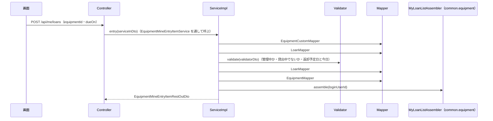

# API詳細設計：B-02 備品を借りる

| 項目 | 内容 |
|---|---|
| 版 | v1.1 2026-11-26 |
| Jira | ZPOP-64（サブタスク：ZPOP-165 詳細設計・ZPOP-166 実装・ZPOP-167 単体テスト） |
| 状態 | 作成中 |
| まとまり | [mine](mine.md) |
| もとにした設計書 | API設計.md v1.5 の2.3〜2.5・2.7・3.2・4.6・7章、画面設計.md v1.10 の4章（S-06）、機能一覧.md v1.2 の4章（F-18）・5章、データ設計.md v1.0 の2章・5.6・5.7、詳細設計 B-03（行を押さえる順・同じ作り方）・B-04（B-02 への約束）・C-03（足すときの作り方） |

## 1. API基本情報

写したもと：API設計.md v1.5 の3.2

| 項目 | 内容 |
|---|---|
| ID | B-02 |
| 名前 | 備品を借りる |
| 操作 | POST |
| URL | /api/me/loans |
| 内容 | 備品を借りる（借用者はログインしている人、貸出日は登録した日になる。返却予定日は任意） |
| 権限項目 | LOAN_SELF（備品を借りる・返す（自分）） |
| 使う画面 | S-06（まだ。ZPOP-108） |
| パッケージ | api.equipment.mine.entry.item（mine.md の1.1 のとおり） |
| クラス名の頭（`<頭>`） | EquipmentMineEntryItem |
| controller のメソッド | EquipmentMineEntryItemController#entry |
| service のメソッド | EquipmentMineEntryItemService#entry（中身は EquipmentMineEntryItemServiceImpl） |
| validator のメソッド | EquipmentMineEntryItemValidator#validate（渡す値は EquipmentMineEntryItemValidatorDto）。管理中か・貸出中でないか・返却予定日が今日以降か（今日の日付と、行を押さえて読んだ備品・貸出履歴が要るので Validator） |

## 2. リクエスト定義

写したもと：API設計.md v1.5 の4.6（送る値）、画面設計.md v1.10 の4章（「借りる」を押したときのダイアログ）

### 2.1 パスの値

なし

### 2.2 クエリ（URL の ? の後ろ）

なし

### 2.3 本文（JSON）

RestInDto：`EquipmentMineEntryItemRestInDto`（形式のチェック。6章）

| 項目名 | 型 | 必須 | 制約 | 説明 |
|---|---|---|---|---|
| equipmentId | 数 | ○ | 数であること | 借りる備品のID（B-05 の items の equipmentId） |
| dueOn | 日付（"2026-11-30"） | | 日付の形 | 返却予定日。なくてもよい（null も同じ）。今日以降（6章） |

```json
{ "equipmentId": 21, "dueOn": "2026-11-30" }
```

- 貸出日・借用者は、受け取らない。送られても使わない（貸出日はサーバーが今日の日付を入れる。API設計 4.6。借用者は、ログインしている人）。
- 日付の形が違う・equipmentId がない（または数でない）ときは、JSON の形の誤りと同じ 400（errors は null。9章の No.1。12章の No.6）。

### 2.4 ファイル（CSV を受け取る API だけ）

なし

### 2.5 ServiceInDto（`EquipmentMineEntryItemServiceInDto`）

Controller が、RestInDto（equipmentId・dueOn）と、ログインしている人のユーザID（loginUserId）から作る。DB と照らす確かめ（管理中か・貸出中でないか）は、チェック用アノテーション（ServiceInDtoChecker）にせず、ServiceImpl が備品の行を押さえたあとで読み、Validator で確かめる。ServiceInDtoChecker は、行を押さえる前に動き、その中で読むと、備品を押さえる前に最初の普通の SELECT が起きてしまうため（4章・8章・12章の No.12）。

| 項目名 | 型 | もと | 付けるチェック用アノテーション（common.validation） |
|---|---|---|---|
| equipmentId | 数 | RestInDto | なし |
| dueOn | 日付 | RestInDto | なし（今日以降かは Validator） |
| loginUserId | 数 | ログインしている人 | なし |

## 3. レスポンス定義

写したもと：API設計.md v1.5 の2.3・2.4・4.6

### 3.1 成功

| status | message |
|---|---|
| 201 | 処理が正常に完了しました。 |

data（RestOutDto：`EquipmentMineEntryItemRestOutDto`）：**作った貸出履歴**。B-01 の items の1件と同じ形（common.equipment.MyLoanItem を写す。B-01 の3章）。

| 項目名 | 型 | null になるか | もと（テーブル.列 ／ 計算） | 説明 |
|---|---|---|---|---|
| loanId | 数 | ならない | loans.id | 返す（B-03）で使う |
| equipmentId | 数 | ならない | loans.equipment_id | |
| managementNo | 文字 | ならない | equipment.management_no | 管理番号（完了メッセージ「借りました（A003）」に使う） |
| categoryName | 文字 | ならない | categories.name | 種別 |
| maker | 文字 | なる | equipment.maker | メーカー |
| model | 文字 | なる | equipment.model | モデル |
| lentOn | 日付 | ならない | loans.lent_on | 貸出日（今日） |
| dueOn | 日付 | なる | loans.due_on | 返却予定日 |
| overdue | 真偽 | ならない | dueOn がある、かつ dueOn が今日より前 | 作ったばかりなので、いつも false（今日以降しか入らない） |
| lastConfirmedOn | 日付 | ならない | equipment.last_confirmed_on | 最終確認日（今日になる） |
| confirmedThisMonth | 真偽 | ならない | MonthlyConfirmationRule#isConfirmedThisMonth | 作ったばかりなので、いつも true（借りた備品は「確認済み」で出る。画面設計 4章） |

```json
{
  "status": 201,
  "message": "処理が正常に完了しました。",
  "data": {
    "loanId": 305, "equipmentId": 21, "managementNo": "A003", "categoryName": "PC", "maker": "Lenovo",
    "model": "ThinkPad X1", "lentOn": "2026-11-26", "dueOn": "2026-11-30", "overdue": false,
    "lastConfirmedOn": "2026-11-26", "confirmedThisMonth": true
  },
  "errors": null
}
```

### 3.2 失敗

9章のとおり。

## 4. 処理フロー

1. controller が受け取る。`@Valid` で RestInDto を確かめ、JSON の形・日付の形・equipmentId の有無の誤りは 400（9章の No.1）。
2. `@PreAuthorize("hasAuthority('LOAN_SELF')")` で権限項目を確かめる（10章）。
3. controller が、ServiceInDto を作り、EquipmentMineEntryItemService#entry を呼ぶ（ここから `@Transactional`）。
4. ServiceImpl が、今日（Clock）を求める。
5. ServiceImpl が、備品を FOR UPDATE で読む（`EquipmentCustomMapper#selectByIdForUpdate`。削除済み・ない備品は、見つからない）。**このまとまりの、最初の読みであり、行を押さえる読み**（8章）。
6. ServiceImpl が、その備品の「今借りている貸出履歴」（返却日が空で、取り消されていない）を、**普通の SELECT で**読む（`LoanMapper#selectByExample`）。備品を押さえたあとの、最初の普通の SELECT なので、その時点で確定している貸出履歴を見る（B-04 と同じ読み方。8章）。貸出履歴を FOR UPDATE で読むことは、しない。
7. ServiceImpl が、読んだ備品・今借りている貸出履歴の有無・返却予定日・今日を `EquipmentMineEntryItemValidatorDto` に入れて、`EquipmentMineEntryItemValidator#validate` を呼ぶ。次の順に、先のものを返す：備品が見つからない・管理中でない → 400（管理中の備品だけ借りられる。9章の No.4）、今借りている貸出履歴がある → 409（9章の No.5）、返却予定日が今日より前 → 400（入力欄 dueOn。9章の No.3）。
8. ServiceImpl が、貸出履歴を足す（`LoanMapper#insertSelective`）：備品・借用者（ログインしている人）・貸出日（今日）・返却予定日・記録用の列（7章）。重複禁止（`uk_loans_active_equipment_id`）に当たったら 409 にする（9章の No.5。7 で確かめたあとなので、起きないはずだが、最後の守りとして。K-02 の重複禁止と同じ作り方）。
9. ServiceImpl が、その備品の最終確認日を今日にし、version を1増やす（機能一覧 5章の6。B-03・C-06 と同じ。7章の No.4）。
10. ログに「備品を借りました（loanId・managementNo）」を残す（API設計 7章）。
11. ServiceImpl が、common.equipment.MyLoanListAssembler#assemble（ログインしている人）で最新の一覧を作り、足した貸出履歴の loanId（7章の No.3 で受け取った ID）の1件を取り出す（12章の No.9）。見つからないことは起きない（同じまとまりで足したため）。見つからなければ、500 にする。
12. controller が `ApiResponse.created(…)` で返す（C-03 と同じ 201 の返し方）。



## 5. 条件分岐・業務ルール

| No. | 条件・ルール | 写したもと | 守る場所（クラス.メソッド） | 守れないとき | 同じルールを書いているほかの機能 |
|---|---|---|---|---|---|
| 1 | 借りられるのは、管理中で、保管中（貸出中でない）の備品だけ | 機能一覧 5章の1、画面設計 4章「表示する備品」 | 管理中・貸出中でないこと：Validator#validate（4章の7。最後の守りは DB の重複禁止） | 管理中でない：400、貸出中：409 | B-05（探すときの条件）、C-07（総務が借りる） |
| 2 | 借用者は、ログインしている人。貸出日は、登録した日（選べない） | 機能一覧 5章の3、画面設計 4章（貸出日は表示のみ） | ServiceImpl#entry（loginUserId・Clock） | ― | C-07（総務は借用者・日付を指定できる） |
| 3 | 貸出を登録した日は、その備品の最終確認日も更新する | 機能一覧 5章の6、画面設計 4章 | ServiceImpl#entry | ― | B-03・C-07・C-08 |
| 4 | 返却予定日は、任意。入れるなら今日以降 | 画面設計 4章 | Validator#validate | 400（入力欄 dueOn） | C-07（貸出日以降） |
| 5 | 1つの備品に、貸出中の行は1つだけ（二重貸出の防止） | データ設計 5.7 | DB の `uk_loans_active_equipment_id`（4章の7が先に確かめる。最後の守り） | 409 | C-07・I-03 |
| 6 | 総務も、この API では、自分の分だけ借りる | 機能一覧 5章の3・4 | ServiceImpl#entry（借用者はいつもログインしている人） | ― | C-07（ほかの人の分） |
| 7 | 貸出履歴を足す処理は、確定する前に、その備品の行を FOR UPDATE で押さえる | B-04 の8章「B-04 が頼っている約束」、mine.md の3章 No.5 | ServiceImpl#entry（4章の5） | ― | B-03・B-04・C-06・C-07・C-08 |

## 6. バリデーション仕様

写したもと：画面設計.md v1.10 の4章（「借りる」を押したときのダイアログ。メッセージは一字も変えずに写す）

| 項目 | 必須 | チェック | メッセージ | 場所 |
|---|---|---|---|---|
| dueOn | 任意 | 日付の形。今日以降 | 「返却予定日は今日以降の日付を入力してください」 | 日付の形：RestInDto（JSON の読み取り。形の誤りは errors なしの 400）。今日以降：Validator（FieldErrorException。errors の field は dueOn） |
| equipmentId | 必須 | 数 | （文はない。errors なしの 400） | RestInDto（`@NotNull`。JSON の読み取り） |

- 画面は、日付を選ぶ入力欄で送るので、形の誤りは、ふつうは起きない（12章の No.6）。
- DB と照らす確かめ（管理中か・貸出中か）は、4章の5〜7（ServiceImpl が備品を押さえて貸出履歴を読み、Validator が確かめる）。

## 7. DB操作仕様

写したもと：データ設計.md v1.0 の2章・5.6・5.7

| No. | mapper のメソッド | 使う所 | 操作 | テーブル | 条件 | 読む・書く列 | 件数 |
|---|---|---|---|---|---|---|---|
| 1 | EquipmentCustomMapper#selectByIdForUpdate | ServiceImpl#entry（4章の5） | SELECT … FOR UPDATE | equipment | id = ? AND deleted_at IS NULL | 全列（既存のもの。B-03・C-06 と同じ） | 0〜1件。なければ、管理中でないとして 400 |
| 2 | LoanMapper#selectByExample（andEquipmentIdEqualTo・andReturnedOnIsNull・andDeletedAtIsNull） | ServiceImpl#entry（4章の6） | SELECT（普通） | loans | equipment_id = ? AND returned_on IS NULL AND deleted_at IS NULL | id | 0〜1件 |
| 3 | LoanMapper#insertSelective | ServiceImpl#entry（4章の8） | INSERT | loans | ― | equipment_id, user_id（ログインしている人）, lent_on（今日）, due_on, created_at・updated_at（今）, created_by・updated_by（ログインしている人）。version は入れず、テーブルの初期値（0）にする。returned_on・memo・deleted_at は入れない。**active_equipment_id は、生成列なので、入れない**（入れるとエラーになる）。足した行の ID（loans.id）を受け取る（insertSelective は useGeneratedKeys 付き。C-03 と同じ） | 1件 |
| 3-2 | 重複禁止（uk_loans_active_equipment_id）に当たったとき | 同上 | ― | loans | ― | DuplicateKeyException を、409 に直す（制約の名前で見分ける。K-02 と同じ）。データ設計 5.7 に「プログラムはそのエラーを受けて『この備品はすでに貸し出されています』と出す」とある | ― |
| 4 | EquipmentMapper#updateByExampleSelective | ServiceImpl#entry（4章の9） | UPDATE | equipment | id = ? AND deleted_at IS NULL | last_confirmed_on（今日）、version（No.1 で読んだ値 + 1）、updated_at（今）、updated_by（ログインしている人） | 1件 |
| 5 | MyLoanListAssembler が読むもの（common.md 3.19。B-01 の7章の No.1〜4 と同じ） | ServiceImpl#entry（4章の11） | SELECT | loans・equipment・categories・users・holidays | ― | ― | ― |

- 手で書く Mapper を、新しくは足さない（EquipmentCustomMapper#selectByIdForUpdate は、B-03・C-06 で足したもの。LoanMapper の insertSelective・selectByExample は MyBatis Generator が作ったもの）。2人で共有する dao の変更は、B-02 では要らない。
- 複数のテーブルの突き合わせ方（JOIN とサブクエリは使わない）：テーブルごとに読む（No.1・2・5）。
- 更新した件数の見方：No.1 で行を押さえているので、No.4 は、いつも1件。
- 削除済みを除く条件：備品は deleted_at IS NULL。貸出履歴は deleted_at IS NULL（取り消し）。

## 8. トランザクション・排他制御

| 項目 | 内容 |
|---|---|
| @Transactional | 付ける：EquipmentMineEntryItemServiceImpl#entry（貸出中の確かめ → 備品を押さえる → 確かめる → 足す → 更新 → 一覧を作る、までを1つのまとまりにする） |
| 楽観ロック（version） | 確かめには使わない（本文で version を受け取らない）。保存のたびに、備品の version を1増やす（B-02 は PUT ではない。API設計 2.7 の対象外。B-03・C-06 の判断と同じ）。そのため、S-09（備品の編集）を開いたままの総務は、保存のときに 409 になる |
| 押さえる行 | **備品の行だけ**（FOR UPDATE）。貸出履歴は、足す新しい行なので、押さえる行がない |
| 押さえる順 | 4章の5（備品を押さえる）→ 6（貸出履歴を普通の SELECT で読む。何も待たず、何も押さえない）→ 8（貸出履歴を足す）。**貸出履歴の行を、待たない**ので、B-03（貸出履歴 → 備品）と、行き違って待ち続ける（デッドロック）輪ができない。B-04 と同じ読み方（備品を押さえてから、普通の SELECT）。common.md 3.20 の「貸出履歴 → 備品」とは違う（B-02 は、貸出履歴を押さえない。12章の No.4・mine.md の3章 No.12） |
| 同時に操作されたとき | ①**同じ備品を、2人がほぼ同時に借りる**：先に備品を押さえたほうが成功する。あとの人は、備品の行が空くのを待ち、押さえたあとで貸出履歴を普通の SELECT で読むと、先の人の貸出（確定済み）が見え、409（「この備品はすでに貸し出されています」）。重複禁止は、最後の守りで、ふつうは当たらない。②**借りる（B-02）と返す（B-03）が同時**：B-03 が貸出履歴を押さえ、備品を待っているとき、B-02 は備品を押さえて、貸出履歴を普通の SELECT で読む（待たない）。返却が確定する前なら、貸出中が見えて 409。確定したあとなら、借りられる。B-02 は、貸出履歴の行を待たないので、B-03 と輪ができない。③**借りる（B-02）と確認した（B-04）・C-06 が同時**：どちらも備品の行を押さえるので、順番に動く。B-04 は、備品を押さえたあとで貸出履歴を読むので、B-02 が確定した貸出履歴を見る（借りた人と同じ人の B-04 なら成功、違う人なら 403）。④**借りる（B-02）と備品の編集（S-09）・管理状態の変更が同時**：備品の行を押さえているので、順番に動く。先に管理中でなくなれば、B-02 は 400 |
| B-04 が頼っている約束 | 貸出履歴の「今借りている」を変える処理（貸出）は、確定する前に、その備品の行を FOR UPDATE で押さえる。B-02 は、貸出履歴を足す前（4章の5）に押さえる。外部キー（loans.equipment_id → equipment.id）のための親の備品の行の共有ロックは、すでに自分が排他ロックで押さえているので、待たない |
| 実機で確かめること | 上の同時の動きは、実装の単体テスト（EquipmentMineEntryItemLockTest）で、実際のデータベースで確かめる（B-03 の EquipmentMineUpdateReturnItemLockTest・B-04 の EquipmentMineUpdateItemLockTest と同じ作り方）。**同じ備品**：B-02 と B-02 を同時に（片方が 201、もう片方が 409）、B-02 と B-03 を同時に（どちらの結果でも、二重貸出・500・デッドロックにならない）、B-02 と B-04 を同時に。**別々の備品**：備品の ID が隣り合う 3 つを、B-02・B-03・B-02 で、同時に何十回も動かし、500・デッドロックの例外（DeadlockLoserDataAccessException など）が出ないこと（貸出履歴の一意索引への INSERT が、近い値のあいだに共有のロックを残して、別々の備品の同時操作を待たせないかを見るため。推測のため、実機で確かめる）。想定と違ったら、この設計を直す（12章の No.4） |
| Slack を送るタイミング | 送らない |

## 9. エラー処理仕様

写したもと：API設計.md v1.5 の2.3・2.4・4.6、画面設計.md v1.10 の4章

| No. | 場面 | 投げる例外 | status | message | errors |
|---|---|---|---|---|---|
| 1 | JSON が壊れている・equipmentId がない・数でない・日付の形が違う | （GlobalExceptionHandler。HttpMessageNotReadableException など） | 400 | 入力内容に誤りがあります。 | null |
| 2 | ログインしていない | （Spring Security） | 401 | ログインしてください。 | null |
| 3 | 返却予定日が今日より前 | FieldErrorException（Validator） | 400 | 入力内容に誤りがあります。 | `[{ "field": "dueOn", "message": "返却予定日は今日以降の日付を入力してください" }]` |
| 4 | 備品が管理中でない（廃棄・不明）・削除された・ない | BusinessRuleException（Validator） | 400 | **この備品は借りられません。総務へお問い合わせください。**（案。12章の No.1） | null |
| 5 | すでに貸し出されている（4章の7で見つけた。最後の守りの重複禁止に当たった場合も） | ConflictException（Validator。重複禁止は ServiceImpl） | 409 | この備品はすでに貸し出されています | null |
| 6 | 権限項目 LOAN_SELF がない、CSRF の合言葉がない | （Spring Security） | 403 | この操作を行う権限がありません。 | null |
| 7 | サーバーの不具合 | （GlobalExceptionHandler） | 500 | 問題が発生しました。時間をおいて、もう一度お試しください。続く場合は総務に連絡してください。 | null |

- 守れないものが2つ以上あるとき（例：貸出中で、返却予定日も今日より前）は、4章の7の順（管理中でない → 貸出中 → 返却予定日）に、先のものを返す。
- No.5 の文は、画面設計 4章の「操作できなかったとき」と同じ（画面は、この文を赤の帯に出し、一覧を最新にする）。

## 10. 認証・認可仕様

| 項目 | 内容 |
|---|---|
| ログイン | 要る |
| 権限項目 | `@PreAuthorize("hasAuthority('LOAN_SELF')")` |
| 対象の確かめ（IDOR） | 備品のID を画面から受け取るが、借りられる備品は、だれが開いても同じ（B-05）。借用者は受け取らず、ログインしている人にする。総務でも、この API では、自分の分だけ借りる（ほかの人の分は C-07） |

## 11. 外部API連携仕様

なし

## 12. 設計書にない判断

| No. | 判断 | 理由 | 外から見えるか | 人の確認 |
|---|---|---|---|---|
| 1 | 備品が管理中でない・削除された・ないときは、400 で、文は「この備品は借りられません。総務へお問い合わせください。」 | API設計 4.6 は「管理中でない、削除された備品 → 400、message は画面設計のもの」と書くが、画面設計 4章に、その文がない。B-03 の「この備品は返却できません。総務へお問い合わせください。」（人が言葉を決めた）と同じ形にした。**新しい文なので、人に確かめる**（CLAUDE.md 2章「確定・推測・未確定を分ける」） | はい | まだ |
| 2 | 存在しない備品の ID も、削除された備品と同じ 400 にする（404 にしない） | API設計 4.6 は、削除された備品を 400 としている。存在するかどうかを、外から分からなくするため（備品の ID は連番）。B-03 の「備品が見つからないときも、管理中でないとして 400」と同じ | はい | まだ |
| 3 | 成功したとき、data は、作った貸出履歴の1件（B-01 の items と同じ形）。status は 201 | API設計 4.6 のとおり（設計書にある決まりの写し） | はい | 済（API設計 4.6 のとおり） |
| 4 | 備品を FOR UPDATE で押さえたあとで、貸出履歴を普通の SELECT で読む（B-04 と同じ）。貸出履歴は、FOR UPDATE で読まず、押さえない。最後の守りは、DB の重複禁止（当たったら 409） | B-03 は、貸出履歴 → 備品の順に押さえる。B-02 が、備品を押さえたあとで、貸出履歴の行を FOR UPDATE や重複禁止の索引で待つと、行き違って、お互いを待ち続ける（デッドロック）ので、貸出履歴を待つ読み方は、しない。普通の SELECT は何も待たないので、備品を押さえたあとなら、安全で、その時点で確定している貸出履歴が見える。備品を押さえる前に普通の SELECT を挟まない（古い見え方になり、重複禁止に頼ることになるため）。mine.md の3章 No.3（貸出履歴を押さえる一般の決まり。未確定）に頼らずに済む。common.md 3.20・B-03 の 8章の「貸出履歴 → 備品の順にそろえる」とは違う（mine.md の3章 No.12）。**実機で確かめる**（8章） | はい（同時に操作されたときの結果） | まだ |
| 5 | 重複禁止（uk_loans_active_equipment_id）に当たった DuplicateKeyException（最後の守り）を、409（「この備品はすでに貸し出されています」）に直す | データ設計 5.7（プログラムはそのエラーを受けて「この備品はすでに貸し出されています」と出す）。K-02 の重複禁止の直し方と同じ | はい | 済（データ設計 5.7 のとおり） |
| 6 | equipmentId がない・数でない、日付の形が違うときは、errors なしの 400（「入力内容に誤りがあります。」）。新しい文は作らない | 画面は、日付を選ぶ入力欄で送り、備品は一覧から選ぶので、ふつうは起きない。B-04 の equipmentIds の形の誤りと同じ扱い | はい（新しい文はない） | まだ |
| 7 | 管理中でないこと（400）を、貸出中（409）より先に返す。不明にした備品に貸出中の履歴が残っていても、400 | 備品を押さえてから貸出履歴を読むので、管理中かを先に確かめられる。管理中でない備品は、「総務へお問い合わせください」が合う。B-05 は、管理中の備品だけを出すので、画面からは、ふつう起きない | はい（細かい） | まだ |
| 8 | 備品の最終確認日を今日にし、version を1増やす | 機能一覧 5章の6。データ設計 2章（保存のたびに version を増やす）。C-06 の12章の No.4（済 2026-11-11。「B-02・B-03・C-07・C-08 も同じにする」）。S-09 を開いたままの総務は、保存のときに 409 になる | はい | 済（C-06 の判断に含まれる。2026-11-11） |
| 9 | 作った貸出履歴の1件は、MyLoanListAssembler#assemble で一覧を作り、loanId で取り出す | 同じ作り方を、2か所に書かないため（B-01・B-03・B-04 と共通の部品を使う）。借りている数は多くないので、一覧を作るコストは小さい | いいえ | ― |
| 10 | 貸出のメモ欄は、受け取らない（loans.memo は入れない） | 画面設計 4章のダイアログに、メモがない（メモは返却のときの特記事項。データ設計 5.7） | いいえ | ― |
| 11 | 行を押さえるのは、備品だけ。dao（手で書く Mapper）は足さない | 4章・7章のとおり。既存の EquipmentCustomMapper#selectByIdForUpdate を使う | いいえ | ― |
| 12 | 管理中か・貸出中でないかの確かめを、ServiceInDto のチェック用アノテーションにせず、ServiceImpl が読んで Validator で確かめる（java.md 5章は「すでに貸し出されている」をアノテーションの例に挙げている） | ServiceInDtoChecker は、行を押さえる前に動く。その中で貸出履歴を読むと、備品を押さえる前に最初の普通の SELECT が起き、古い見え方になる（4章の5・6、8章） | いいえ | ― |

## 変更履歴

| 版 | 日付 | 内容 |
|---|---|---|
| v1.0 | 2026-11-26 | 初版（ZPOP-165。B-02） |
| v1.1 | 2026-11-26 | 独立レビューの指摘を直した：備品を先に押さえてから貸出履歴を普通の SELECT で読む順に直した（4章・7章・8章・9章、12章の No.4・7）。貸出履歴の ID の受け取りと生成列を入れない（7章）。実機で確かめる項目に、別々の備品の同時操作を足した（8章）。12章に No.12。mine.md の3章に No.12 |
