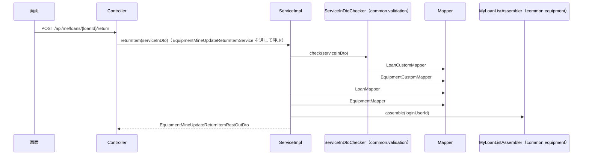

# API詳細設計：B-03 備品を返す

| 項目 | 内容 |
|---|---|
| 版 | v1.0 2026-11-23 |
| Jira | ZPOP-65（サブタスク：ZPOP-169 詳細設計・ZPOP-170 実装・ZPOP-171 単体テスト） |
| 状態 | 作成中 |
| まとまり | [mine](mine.md) |
| もとにした設計書 | API設計.md v1.4 の2.3・2.4・3.2・4.5・4.7・7章、画面設計.md v1.6 の3章（S-05）、機能一覧.md v1.1 の4章（F-19）・5章、データ設計.md v1.0 の2章・5.6・5.7 |

## 1. API基本情報

写したもと：API設計.md v1.4 の3.2

| 項目 | 内容 |
|---|---|
| ID | B-03 |
| 名前 | 備品を返す |
| 操作 | POST |
| URL | /api/me/loans/{貸出履歴のID}/return |
| 内容 | 自分が借りている備品を返す（返却日は、登録した日になる。メモは任意） |
| 権限項目 | LOAN_SELF（備品を借りる・返す（自分）） |
| 使う画面 | S-05（まだ。ZPOP-107。「返す」ダイアログ） |
| controller のメソッド | EquipmentMineUpdateReturnItemController#returnItem |
| service のメソッド | EquipmentMineUpdateReturnItemService#returnItem（中身は EquipmentMineUpdateReturnItemServiceImpl） |
| validator のメソッド | ServiceInDto のチェック（@LoanExists・@LoanBorrowedBySelf・@LoanNotReturned・@LoanEquipmentManaged）。Validator は作らない（受け取った貸出履歴のID だけで確かめられる） |

## 2. リクエスト定義

### 2.1 パスの値

| 名前 | 型 | 説明 |
|---|---|---|
| loanId | 数 | 貸出履歴のID（B-01 の items の loanId） |

### 2.2 クエリ（URL の ? の後ろ）

なし

### 2.3 本文（JSON）

写したもと：画面設計.md v1.6 の3章（「返す」ダイアログ）、データ設計.md 5.7（memo は200文字まで）

| 項目名 | 型 | 必須 | チェック（RestInDto） | メッセージ |
|---|---|---|---|---|
| memo | 文字 | 任意 | 200文字まで（画面設計 3章） | 「メモは200文字以内で入力してください」 |

- 本文は、なくてもよい（`{}` も、本文なしも、メモなしの返却）。返却日は、送られても使わない（サーバーが今日の日付を入れる。機能一覧 5章の3）。
- 設計書にない決めごと（12章の No.4）：メモは、前後の空白を取ったあとの長さで確かめる。空（空白だけ）なら、記録しない（null にする）。

### 2.4 ファイル（CSV を受け取る API だけ）

なし

### 2.5 ServiceInDto（`EquipmentMineUpdateReturnItemServiceInDto`）

Controller が、RestInDto（memo）・パスの値（loanId）・ログインしている人のユーザID（loginUserId）から作る。

| 項目名 | 型 | もと | チェック（common.validation） |
|---|---|---|---|
| loanId | 数 | パスの値 | `@LoanExists(forUpdate = true)`（First。NotFound。取り消されていない貸出履歴があるか。行を FOR UPDATE で押さえる） |
| （クラス） | ― | loanId・loginUserId | `@LoanBorrowedBySelf`（Second。Forbidden。借りたのが、ログインしている人か）、`@LoanNotReturned`（Second。Conflict。まだ返却されていないか）、`@LoanEquipmentManaged`（Second。BusinessRule。その備品が管理中か。備品の行も FOR UPDATE で押さえる） |
| memo | 文字 | RestInDto（前後の空白を取り、空なら null） | （形式のチェックは RestInDto） |
| loginUserId | 数 | ログインしている人 | ― |

## 3. レスポンス定義

写したもと：API設計.md v1.4 の2.4・4.5・4.7。data の形は、API設計に書いていないため決めた（12章の No.1）

### 3.1 成功

| status | message |
|---|---|
| 200 | 処理が正常に完了しました。 |

data（RestOutDto：`EquipmentMineUpdateReturnItemRestOutDto`）：**返したあとの、最新の「自分の備品」一覧**。B-01 の data（unconfirmedCount・reminderAt・reminderPassed・items）と同じ形（common.equipment.MyLoanListAssembler が作った MyLoanList を写す。common.md 3.19）。返した備品は、items に出ない。

```json
{
  "status": 200,
  "message": "処理が正常に完了しました。",
  "data": {
    "unconfirmedCount": 0,
    "reminderAt": "2026-11-25T09:00:00+09:00",
    "reminderPassed": false,
    "items": []
  },
  "errors": null
}
```

### 3.2 失敗

9章のとおり。

## 4. 処理フロー

1. controller が受け取る。パスの loanId が数でなければ 400（9章の No.1）。本文の形式のチェック（メモ200文字）を `@Valid` で確かめる（9章の No.2）。
2. `@PreAuthorize("hasAuthority('LOAN_SELF')")` で権限項目を確かめる（10章）。
3. controller が、ServiceInDto を作り、EquipmentMineUpdateReturnItemService#returnItem を呼ぶ（ここから `@Transactional`）。
4. ServiceImpl が ServiceInDtoChecker#check を呼ぶ（ServiceInDtoChecker は、段ごとに確かめ、ある段で守れないものがあれば、そこで止める。common.md 5章）。
   - 1段目（First）：貸出履歴を FOR UPDATE で読む。ない・取り消されている → 404。
   - 2段目（Second）：次の3つを、まとめて確かめ、守れないものがあれば、404 → 403 → 409 → 400 の順（common.md 3.20）に、先のもの1つを返す。
     - 借りたのが自分でない → 403（「ほかの人が借りているため、返却はできません。」）。
     - すでに返却されている → 409（「この備品はすでに返却されています」）。
     - その備品が管理中でない → 400（「この備品は返却できません。総務へお問い合わせください。」）。備品を FOR UPDATE で読む（貸出履歴 → 備品の順は保たれる）。備品が見つからない（削除済み）ときも、管理中でないとして、この 400 にする（7章の No.2）。
5. ServiceImpl が、貸出履歴を更新する：返却日（今日）・メモ・version（+1）・更新日時・更新者（7章の No.2）。
6. ServiceImpl が、その備品の最終確認日を今日にし、version を1増やす（機能一覧 5章の6。C-06 と同じ。7章の No.3）。
7. ログに「備品を返却しました（loanId・managementNo）」を残す（API設計 7章。メモの中身は出さない）。
8. common.equipment.MyLoanListAssembler#assemble（ログインしている人）で、最新の一覧を作る（common.md 3.19）。
9. `ApiResponse.ok(…)` で返す。



## 5. 条件分岐・業務ルール

| No. | 条件・ルール | 写したもと | 守る場所（クラス.メソッド） | 守れないとき | 同じルールを書いているほかの機能 |
|---|---|---|---|---|---|
| 1 | 返せるのは、自分が借りている（貸出履歴の user_id が自分の）備品だけ | 機能一覧 5章の3、CLAUDE.md 5章（IDOR）、2026-11-23 に人が決めた文 | ServiceInDto のチェック（@LoanBorrowedBySelf） | 403 | B-04（自分の備品だけ。API設計 4.7 は 403） |
| 2 | 返却日は、登録した日（選べない） | 機能一覧 5章の3、画面設計 3章（返却日は表示のみ） | EquipmentMineUpdateReturnItemServiceImpl#returnItem（Clock） | ― | C-08（総務は日付を指定できる） |
| 3 | 返却を登録した日は、その備品の最終確認日も更新する | 機能一覧 5章の6 | EquipmentMineUpdateReturnItemServiceImpl#returnItem | ― | B-02（借りたとき）・C-07・C-08 |
| 4 | すでに返却されている貸出履歴は、返せない | 画面設計 3章（操作できなかったとき） | ServiceInDto のチェック（@LoanNotReturned） | 409 | C-08 |
| 5 | 管理中でない備品は、返せない（総務へ問い合わせる）。管理状態を変えない | 2026-11-23 に人が決めた（12章の No.2） | ServiceInDto のチェック（@LoanEquipmentManaged） | 400 | C-08（総務が返す。扱いは、C-08 の詳細設計で決める） |
| 6 | 取り消された（削除された）貸出履歴は、ないものとして扱う | データ設計 2章（論理削除） | ServiceInDto のチェック（@LoanExists） | 404 | ― |
| 7 | メモは200文字まで。前後の空白を取り、空なら記録しない | 画面設計 3章、データ設計 5.7 | RestInDto（`@Size`）・common.text.TextInputs | 400（入力欄 memo） | C-08 |
| 8 | 返却日が貸出日より前にならない（今日 ≥ 貸出日） | 機能一覧 5章の5 | （確かめない。貸出日は、いつも今日以前なので、起きない。12章の No.5） | ― | C-08 |
| 9 | 貸出・返却をまたぐ書き換えは、貸出履歴 → 備品の順に行を押さえる | 2026-11-23 に決めた（8章） | ServiceInDto のチェックの段（1段目で貸出履歴、2段目の @LoanEquipmentManaged で備品） | ― | C-07・C-08（同じ順にする） |

## 6. バリデーション仕様

写したもと：画面設計.md v1.6 の3章（「返す」ダイアログ）

| 項目 | 必須 | チェック | メッセージ | 場所 |
|---|---|---|---|---|
| memo | 任意 | 200文字まで（前後の空白を取ったあと） | 「メモは200文字以内で入力してください」 | RestInDto（`@Size(max = 200)`。TextInputs で、前後の空白を取る） |

- loanId の型（数）は、Spring が確かめる（9章の No.1）。
- DB と照らす確かめ（あるか・自分の貸出か・返却済みか・管理中か）は、ServiceInDto のチェック（2.5）。

## 7. DB操作仕様

写したもと：データ設計.md v1.0 の2章・5.6・5.7

| No. | mapper のメソッド | 操作 | テーブル | 条件 | 読む・書く列 | 件数 | 使う所 |
|---|---|---|---|---|---|---|---|
| 1 | LoanCustomMapper#selectByIdForUpdate（新規。common.md 3.20） | SELECT … FOR UPDATE | loans | id = ? AND deleted_at IS NULL | id, equipment_id, user_id, lent_on, returned_on, version | 0〜1件 | @LoanExists（1段目。行を押さえる） |
| 2 | EquipmentCustomMapper#selectByIdForUpdate | SELECT … FOR UPDATE | equipment | id = ? AND deleted_at IS NULL | id, management_no, status, version | 0〜1件。なければ、管理中でないとして 400 | @LoanEquipmentManaged（2段目。行を押さえる） |
| 3 | LoanMapper#selectByPrimaryKey | SELECT | loans | id = ? | user_id, returned_on, equipment_id | 1件（No.1 で押さえたあとの読み直し。同じ transaction） | @LoanBorrowedBySelf・@LoanNotReturned・@LoanEquipmentManaged |
| 4 | LoanMapper#selectByPrimaryKey・EquipmentMapper#selectByPrimaryKey | SELECT | loans・equipment | id = ? | loans：equipment_id, version／equipment：management_no, version | 1件ずつ | ServiceImpl（更新の前。version を +1 するため、ログの managementNo のため） |
| 5 | LoanMapper#updateByExampleSelective | UPDATE | loans | id = ? AND deleted_at IS NULL | returned_on（今日）、memo、version（+1）、updated_at（今）、updated_by（ログインしている人） | 1件 | ServiceImpl |
| 6 | EquipmentMapper#updateByExampleSelective | UPDATE | equipment | id = ? AND deleted_at IS NULL | last_confirmed_on（今日）、version（+1）、updated_at（今）、updated_by（ログインしている人） | 1件 | ServiceImpl |
| 7 | MyLoanListAssembler が読むもの（common.md 3.19。B-01 の7章の No.1〜4 と同じ） | SELECT | loans・equipment・categories・users・holidays | ― | ― | ― | ServiceImpl（最後に、最新の一覧を作る） |

- 更新した件数の見方：No.1・2 で行を押さえているので、No.5・6 は、いつも1件。
- `loans.active_equipment_id`（返却日が空の行だけに備品の ID が入る列）は、返却日を入れると、自動で空になる。これで、その備品を、また借りられる。

## 8. トランザクション・排他制御

| 項目 | 内容 |
|---|---|
| @Transactional | 付ける：EquipmentMineUpdateReturnItemServiceImpl#returnItem（ServiceInDto のチェックも、この中に入る） |
| 楽観ロック（version） | 確かめには使わない（本文で version を受け取らない）。保存のたびに、貸出履歴と備品の version を1増やす（B-03 は PUT ではない。API設計 2.7 の対象外。C-06 の判断と同じ） |
| 同時に操作されたとき | 貸出履歴の行を FOR UPDATE で押さえてから確かめるので、本人が2つの端末でほぼ同時に返しても、先の1つだけが成功し、あとのものは、返却済み（409）になる。総務が C-08 で同時に返却を登録した場合も同じ |
| 行を押さえる順 | **貸出履歴 → 備品**。貸出・返却のほかの API（B-02・C-07・C-08）も、この順にそろえる（行き違いで、お互いに待ち続ける「デッドロック」を防ぐため） |
| Slack を送るタイミング | 送らない |

## 9. エラー処理仕様

写したもと：API設計.md v1.4 の2.3・2.4、画面設計.md v1.6 の3章

| No. | 場面 | 投げる例外 | status | message | errors |
|---|---|---|---|---|---|
| 1 | loanId が数でない | （GlobalExceptionHandler） | 400 | 入力内容に誤りがあります。 | null |
| 2 | メモが200文字を超える | FieldErrorException（RestInDto の `@Valid`） | 400 | 入力内容に誤りがあります。 | `[{ "field": "memo", "message": "メモは200文字以内で入力してください" }]` |
| 3 | ログインしていない | （Spring Security） | 401 | ログインしてください。 | null |
| 4 | 権限項目 LOAN_SELF がない、CSRF の合言葉がない | （Spring Security） | 403 | この操作を行う権限がありません。 | null |
| 5 | 貸出履歴がない・取り消されている | NotFoundException | 404 | 対象が見つかりません。 | null |
| 6 | 借りたのが自分でない | ForbiddenException（新規。common.md 3.20） | 403 | ほかの人が借りているため、返却はできません。 | null |
| 7 | すでに返却されている | ConflictException | 409 | この備品はすでに返却されています | null |
| 8 | その備品が管理中でない | BusinessRuleException | 400 | この備品は返却できません。総務へお問い合わせください。 | null |
| 9 | サーバーの不具合 | （GlobalExceptionHandler） | 500 | 問題が発生しました。時間をおいて、もう一度お試しください。続く場合は総務に連絡してください。 | null |

- No.6 の 403 は、No.4 と、同じ番号で、文が違う（画面は、message をそのまま出す。画面設計 v1.6 の3章に足した）。
- 守れないものが2つ以上あるとき（例：他人の貸出で、返却済み）は、404 → 403 → 409 → 400 の順に、先のものを返す（common.md 3.20）。

## 10. 認証・認可仕様

| 項目 | 内容 |
|---|---|
| ログイン | 要る |
| 権限項目 | `@PreAuthorize("hasAuthority('LOAN_SELF')")` |
| 対象の確かめ（IDOR） | 貸出履歴の ID を画面から受け取るので、借りたのがログインしている人かを、ServiceInDto のチェック（@LoanBorrowedBySelf）で確かめる（5章の No.1）。総務でも、この API では、自分の分だけを返せる（ほかの人の分は、C-08） |

## 11. 外部API連携仕様

なし

## 12. 設計書にない判断

| No. | 判断 | 理由 | 外から見えるか | 人の確認 |
|---|---|---|---|---|
| 1 | 成功したとき、data は、返したあとの最新の「自分の備品」一覧（B-01 と同じ形）にする | API設計に、B-03 の data の決まりがない。B-04 は B-01 と同じ形の一覧を返す（API設計 4.7）ので、そろえた。画面は、そのまま案内の件数・文を更新できる | はい | まだ（質問されたので、違いを説明した。変えるなら、3章を直す） |
| 2 | 管理中でない備品は返せない（400。文は「この備品は返却できません。総務へお問い合わせください。」）。管理状態は変えない | 2026-11-23 に人が「一旦返せないようにして、「総務へお問い合わせください。」のようなメッセージにする」と決めた。文は、その言葉をもとに、私が決めた（画面設計 v1.6 の3章に足した） | はい | 済（2026-11-23。文の細かい言い方は、まだ） |
| 3 | 他人の貸出履歴は、403（文は「ほかの人が借りているため、返却はできません。」） | 人が、文を決めた（2026-11-23）。status は、B-04（API設計 4.7）と同じ 403 にした。新しい共通部品（ForbiddenException ほか）が要るので、2人で相談する（common.md 3.20）。なお、存在しない ID は 404 なので、ID が存在するかは、外から分かる（貸出履歴の ID は連番）。分からなくしたいなら、他人の貸出も 404 にする（その場合、共通部品の追加は要らなくなる） | はい | 済（2026-11-23。status は、まだ） |
| 4 | 返却日は、送られても使わず、今日にする。メモは、前後の空白を取り、空なら null | 機能一覧 5章の3。メモの直し方は、ほかの入力（種別の名前など）と同じ（TextInputs） | はい（データの中身） | まだ |
| 5 | 返却日が貸出日より前になる場合（機能一覧 5章の5）は、この API では確かめない | 貸出日は、B-02（今日）・C-07（今日以前）で入るので、今日より後にならない。DB の CHECK 制約（返却日は貸出日以降）が、最後の守りになる | いいえ | まだ |
| 6 | 総務も、この API では自分の分だけ返せる | 機能一覧 5章の3・4。ほかの人の分は C-08 | はい | まだ |
| 7 | 行を押さえる順を、貸出履歴 → 備品にそろえる | 同時に貸出・返却の API が動いても、デッドロックしないため | いいえ | ― |
| 8 | 一覧を作る処理は、common.equipment.MyLoanListAssembler をそのまま使う（B-01・B-04 と共通） | 同じ作り方を書き写さないため | いいえ | ― |
| 9 | 返却で、貸出履歴と備品の version を1増やす | データ設計 2章のとおり（保存のたびに増やす）。C-06 の12章の No.4（済 2026-11-11。「B-02・B-03・C-07・C-08 も同じにする」）。そのため、S-09（備品の編集）・D-02（貸出履歴を直す）の画面を開いたままの総務は、保存のときに 409（「ほかの人が先に保存しました」など）になる | はい | 済（C-06 の判断に含まれる。2026-11-11） |

## 変更履歴

| 版 | 日付 | 内容 |
|---|---|---|
| v1.0 | 2026-11-23 | 初版（ZPOP-169。B-03） |
