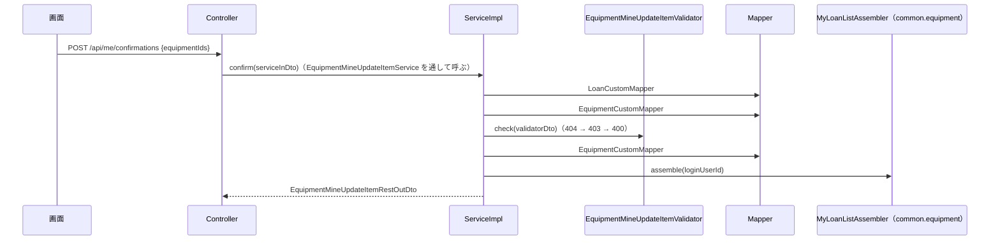

# API詳細設計：B-04 自分が借りている備品を「確認した」にする

| 項目 | 内容 |
|---|---|
| 版 | v1.0 2026-11-23 |
| Jira | ZPOP-66（サブタスク：ZPOP-173 詳細設計・ZPOP-174 実装・ZPOP-175 単体テスト） |
| 状態 | 作成中 |
| まとまり | [mine](mine.md) |
| もとにした設計書 | API設計.md v1.4 の2.3・2.4・3.2・4.5・4.7・7章、画面設計.md v1.7 の3章（S-05）・10章、機能一覧.md v1.1 の4章（F-07）・5章、データ設計.md v1.0 の2章・5.3 |

## 1. API基本情報

写したもと：API設計.md v1.4 の3.2

| 項目 | 内容 |
|---|---|
| ID | B-04 |
| 名前 | 確認した（自分） |
| 操作 | POST |
| URL | /api/me/confirmations |
| 内容 | 自分が借りている備品を「確認した」にする（1件でも、まとめてでも）。最終確認日は、登録した日（日付は選べない） |
| 権限項目 | CONFIRM_SELF（最終確認日を更新する（自分）） |
| 使う画面 | S-05（まだ。ZPOP-107。「確認した」・「まとめて確認した」） |
| controller のメソッド | EquipmentMineUpdateItemController#confirm |
| service のメソッド | EquipmentMineUpdateItemService#confirm（中身は EquipmentMineUpdateItemServiceImpl） |
| validator のメソッド | EquipmentMineUpdateItemValidator#check（ServiceImpl が読んだ貸出履歴・備品の行を見て確かめる。2.5・6章） |

## 2. リクエスト定義

### 2.1 パスの値

なし

### 2.2 クエリ（URL の ? の後ろ）

なし

### 2.3 本文（JSON）

写したもと：API設計.md v1.4 の4.7（送る値）、画面設計.md v1.7 の3章（「まとめて確認した」）。メッセージ「確認する備品を選んでください」は、設計書にない。人が決めた文（2026-11-23。12章の No.5）

| 項目名 | 型 | 必須 | チェック（RestInDto） | メッセージ |
|---|---|---|---|---|
| equipmentIds | 数の配列 | 必須 | 1つ以上（1件のときも配列で送る。空の配列・ないときは誤り） | 「確認する備品を選んでください」 |

- 送る ID は、貸出履歴ではなく、**備品のID**（B-01 の items の equipmentId）。「確認した」は1件、「まとめて確認した」は未確認の備品すべてを送る（画面設計 3章）。
- 同じ ID が重なっていても誤りにしない。ServiceImpl が、1つにまとめて確かめる・更新する（12章の No.5）。
- 配列の中身が、null のとき、数に変えられないときは、JSON の形の誤りと同じ 400（errors は null。9章の No.1。12章の No.11）。小数や文字（`1.5`・`"15"`）を、数に変えて受け取るかは、既存の API（K-03 の version など）と同じにする（実装の工程で、既存の API の動きを確かめる）。
- 日付は受け取らない（最終確認日は、サーバーの今日。機能一覧 F-07）。送られても使わない。

### 2.4 ファイル（CSV を受け取る API だけ）

なし

### 2.5 ServiceInDto（`EquipmentMineUpdateItemServiceInDto`）

Controller が、RestInDto（equipmentIds）・ログインしている人のユーザID（loginUserId）から作る。

| 項目名 | 型 | もと | チェック（common.validation） |
|---|---|---|---|
| equipmentIds | 数の一覧 | RestInDto（送られたまま。重なりは、ServiceImpl が1つにまとめる） | なし |
| loginUserId | 数 | ログインしている人 | なし |

- DB と照らす確かめ（あるか・自分が借りているか・管理中か）は、ServiceImpl が読んだ貸出履歴・備品の行を見る必要があるので、`EquipmentMineUpdateItemValidator`（6章）で行う。common.validation の部品は、足さない（12章の No.6）。

## 3. レスポンス定義

写したもと：API設計.md v1.4 の2.4・4.5・4.7

### 3.1 成功

| status | message |
|---|---|
| 200 | 処理が正常に完了しました。 |

data（RestOutDto：`EquipmentMineUpdateItemRestOutDto`）：**確認したあとの、最新の「自分の備品」一覧**。B-01 の data（unconfirmedCount・reminderAt・reminderPassed・items）と同じ形（common.equipment.MyLoanListAssembler が作った MyLoanList を写す。common.md 3.19）。API設計 4.7「成功したら 200 で、data に B-01と同じ形の最新の一覧を入れて返す（画面を更新しやすくするため）」のとおり。

```json
{
  "status": 200,
  "message": "処理が正常に完了しました。",
  "data": {
    "unconfirmedCount": 0,
    "reminderAt": "2026-11-25T09:00:00+09:00",
    "reminderPassed": false,
    "items": [ { "loanId": 31, "equipmentId": 15, "managementNo": "A001", "categoryName": "PC", "…": "…", "confirmedThisMonth": true } ]
  },
  "errors": null
}
```

### 3.2 失敗

9章のとおり。

## 4. 処理フロー

1. controller が受け取る。本文の形（JSON、equipmentIds が数の配列）が誤りなら 400（9章の No.1）。equipmentIds が空・ないなら 400（9章の No.2。`@Valid`）。
2. `@PreAuthorize("hasAuthority('CONFIRM_SELF')")` で権限項目を確かめる（10章）。
3. controller が、ServiceInDto を作り、EquipmentMineUpdateItemService#confirm を呼ぶ（ここから `@Transactional`）。
4. ServiceImpl が、送られた備品の ID の重なりを、1つにまとめる。そのあと、**貸出履歴 → 備品の順に**、行を押さえて読む（8章。7章の No.1・2）。
   - 送られた備品の ID を持つ、今借りている（返却日が空・取り消されていない）貸出履歴を、FOR UPDATE で読む。
   - 送られた ID の、削除されていない備品を、FOR UPDATE で読む。
5. ServiceImpl が、`EquipmentMineUpdateItemValidator#check` を呼ぶ。守れないものがあれば、**何も書き換えずに**、次の順に先のもの1つを返す（common.md 3.20）。
   1. 備品が見つからない（送られた ID の数より、読めた備品が少ない）→ 404。
   2. 自分が借りていない備品が、1つでも含まれる（今借りている貸出履歴がない、または借りたのが自分でない）→ 403（API設計 4.7。9章の No.6）。
   3. 管理中でない備品（廃棄・不明）が、1つでも含まれる → 400（C-06 と同じ文。9章の No.7）。
6. ServiceImpl が、備品をまとめて更新する：最終確認日（今日）、version（+1）、更新日時、更新者（7章の No.3）。今月すでに確認済みの備品も、今日にする（12章の No.4）。貸出履歴は、変えない。
7. ログに「備品を確認しました（備品の管理番号の一覧）」を残す（API設計 7章。7章の No.1 で読んだ行から取る）。
8. common.equipment.MyLoanListAssembler#assemble（ログインしている人）で、最新の一覧を作る（common.md 3.19）。更新のあとに呼ぶ（前に移さない。8章の「読み方」）。
9. `ApiResponse.ok(…)` で返す。



## 5. 条件分岐・業務ルール

| No. | 条件・ルール | 写したもと | 守る場所（クラス.メソッド） | 守れないとき | 同じルールを書いているほかの機能 |
|---|---|---|---|---|---|
| 1 | 確認できるのは、自分が今借りている備品だけ。1つでも違えば、どれも更新しない | API設計 4.7、機能一覧 F-07、CLAUDE.md 5章（IDOR） | EquipmentMineUpdateItemValidator#check | 403 | C-06（総務は、すべての備品。B-04 の対象外） |
| 2 | 最終確認日は、登録した日（日付は選べない） | 機能一覧 F-07 | EquipmentMineUpdateItemServiceImpl#confirm（Clock） | ― | C-06・B-03（B-03 は返却の日） |
| 3 | 確認できるのは、管理中の備品だけ | 画面設計 10章（管理中でないときの文）、C-06 の5章 No.2 | EquipmentMineUpdateItemValidator#check | 400 | C-06 |
| 4 | 今月すでに確認済みの備品でも、誤りにせず、今日にする | C-06 の5章 No.3（B-04 も同じにする） | EquipmentMineUpdateItemServiceImpl#confirm | ― | C-06 |
| 5 | 保存のたびに version を1増やす（最終確認日だけを変えるときも） | データ設計 2章、C-06 の5章 No.4 | EquipmentCustomMapper#updateLastConfirmedOnByIds | ― | C-06・B-02・B-03・C-07・C-08 |
| 6 | 削除された備品は、確認できない | データ設計 2章 | EquipmentMineUpdateItemValidator#check（7章の No.2 は、削除されていない備品だけを読む） | 404 | C-06 |
| 7 | 1件でも守れなければ、どれも更新しない（全部成功するか、全部止める） | API設計 4.7 | EquipmentMineUpdateItemServiceImpl#confirm（`@Transactional`。確かめてから書き換える） | 403・404・400 | ― |
| 8 | 確認しても、貸出履歴は変えない（返却日・メモ・version）。借りたままである | 機能一覧 F-07（最終確認日だけを更新する） | EquipmentMineUpdateItemServiceImpl#confirm（備品の最終確認日だけを書き換える） | ― | ― |

## 6. バリデーション仕様

写したもと：API設計.md v1.4 の4.7、画面設計.md v1.7 の3章・10章

| 項目 | 必須 | チェック | メッセージ | 場所 |
|---|---|---|---|---|
| equipmentIds | 必須 | 1つ以上 | 「確認する備品を選んでください」 | RestInDto（`@NotEmpty`） |
| equipmentIds の中身 | 必須 | 数（null でない） | （JSON の形の誤り。errors は null） | RestInDto（コンストラクタ。K-03 の version と同じ扱い） |
| 備品がある（削除されていない） | ― | 送られた ID すべてについて、削除されていない備品がある | 「対象が見つかりません。」（404） | EquipmentMineUpdateItemValidator |
| 自分が借りている | ― | 送られた ID すべてについて、今借りている貸出履歴があり、借りたのがログインしている人 | 「借りていない備品が含まれているため、確認できません。」（403） | EquipmentMineUpdateItemValidator |
| 管理中 | ― | 送られた ID すべての管理状態が MANAGED | 「管理中の備品だけ確認できます」（400） | EquipmentMineUpdateItemValidator |

- ValidatorDto（`EquipmentMineUpdateItemValidatorDto`）に入れるもの：ログインしている人のユーザID、送られた備品のID の一覧（ServiceInDto の値）、ServiceImpl が読んだ貸出履歴の一覧、ServiceImpl が読んだ備品の一覧。Validator は、Mapper を使わず、渡された値だけで確かめる（読むだけ。書き換えない）。
- 守れないものが2つ以上あるときは、404 → 403 → 400 の順に、先のもの1つを返す（common.md 3.20）。

## 7. DB操作仕様

写したもと：データ設計.md v1.0 の2章・5.6

| No. | mapper のメソッド | 操作 | テーブル | 条件 | 読む・書く列 | 件数 | 使う所 |
|---|---|---|---|---|---|---|---|
| 1 | LoanCustomMapper#selectCurrentByEquipmentIdsForUpdate（新規） | SELECT … FOR UPDATE（`<foreach>` で IN） | loans | active_equipment_id IN (?)（返却日が空で、取り消されていない行だけに、備品の ID が入る列。一意。データ設計 5.7）。ORDER BY active_equipment_id（結果を並べるだけ） | 全列 | 0〜送られた ID の数（1つの備品に、今借りている貸出履歴は、多くて1件） | ServiceImpl（先に押さえる。8章）→ Validator |
| 2 | EquipmentCustomMapper#selectByIdsForUpdate（新規） | SELECT … FOR UPDATE（`<foreach>` で IN） | equipment | id IN (?) AND deleted_at IS NULL。ORDER BY id（結果を並べるだけ） | 全列 | 0〜送られた ID の数 | ServiceImpl（No.1 のあとに押さえる）→ Validator。ログに残す管理番号にも使う |
| 3 | EquipmentCustomMapper#updateLastConfirmedOnByIds（新規） | UPDATE（`<foreach>` で IN。1つの SQL） | equipment | id IN (?) AND deleted_at IS NULL | last_confirmed_on（今日）、version（`version + 1`）、updated_at（今）、updated_by（ログインしている人） | 送られた ID の数と同じ（No.2 で押さえているので、いつも全部） | ServiceImpl |
| 4 | MyLoanListAssembler が読むもの（common.md 3.19。B-01 の7章の No.1〜4 と同じ） | SELECT | loans・equipment・categories・users・holidays | ― | ― | ― | ServiceImpl（最後に、最新の一覧を作る） |

- 新しい手で書く Mapper のメソッドは3つ（No.1〜3）。Example では、FOR UPDATE を書けない。No.3 は、複数の備品を1つの SQL で更新し、行ごとに version が違うため、`version = version + 1`（列の値を使った式）で書く（B-03・C-06 は、1件だけなので、読んだ version に 1 を足した値を Example で書いている。同じ決まり（5章の No.5）の書き方が分かれるが、結果は同じ）。どれも、JOIN・サブクエリを使わない。dao の共有ファイルなので、2人で相談する（mine.md の3章 No.6）。
- 備品を1件ずつ読む・更新する形（ループの中で Mapper を呼ぶ形）にしない（N+1 を防ぐ。CLAUDE.md 5章）。
- 更新した件数が、送られた ID の数と違うことはない（No.1・2 で行を押さえているので、確かめたあとに、ほかの人に変えられない）。
- 貸出履歴は、押さえる（FOR UPDATE）だけで、書き換えない。押さえる理由は、8章。

## 8. トランザクション・排他制御

| 項目 | 内容 |
|---|---|
| @Transactional | 付ける：EquipmentMineUpdateItemServiceImpl#confirm（行を押さえて読む → 確かめる → 書き換える → 一覧を作る、までを1つのまとまりにする） |
| 楽観ロック（version） | 確かめには使わない（本文で version を受け取らない）。保存のたびに、備品の version を1増やす（B-04 は PUT ではない。API設計 2.7 の対象外。C-06・B-03 の判断と同じ）。そのため、S-09（備品の編集）を開いたままの総務は、保存のときに 409 になる |
| 同時に操作されたとき | 先に貸出履歴の行、次に備品の行を、FOR UPDATE で押さえてから確かめる。たとえば、確認と返却（B-03）がほぼ同時に来ても、先の1つが終わってから、あとのものが動く。返却が先なら、あとの B-04 は、借りていない備品が含まれる（403）になる |
| 行を押さえる順 | **貸出履歴 → 備品**。それぞれ、備品の ID の小さい順に押さえる（貸出履歴は active_equipment_id の索引の順、備品は主キーの順。どちらも、備品の ID の昇順になる。ORDER BY は、結果を並べるだけで、押さえる順は決めない）。複数の行を押さえる B-04 どうしが、行き違いで待ち続ける「デッドロック」にならないため。B-03 は、貸出履歴1件 → その備品の順なので、同じ向き（common.md 3.20）。B-02（借りる）は、貸出履歴を先に足し、そのあとで備品を押さえる（mine.md の3章 No.5。B-02 の詳細設計で決める） |
| 押さえる範囲 | 今借りている貸出履歴の行と、借りられていない備品の ID の隙間（active_equipment_id の一意の索引。REPEATABLE READ の隙間ロック）。返却済みの行は押さえない。存在しない備品の ID が含まれると、備品の主キーの末尾の隙間も押さえる。どちらも、確かめ終われば、すぐ放す（404・403・400 なら、その場で終わる。成功でも、一覧を作ったら終わる）。ID を全部読む前に、待たされる処理を足さない |
| 読み方 | 貸出履歴・備品の読みは、すべて FOR UPDATE（そのときの最新の値を読む）。普通の SELECT を先に挟まない（B-03 の7章 No.3 と同じ理由。MySQL の REPEATABLE READ では、普通の SELECT は、最初に読んだ時点の記録を見る）。最後の MyLoanListAssembler（普通の SELECT）は、更新のあとに呼ぶ。そのとき初めての普通の SELECT なので、自分の更新も、ほかの人が確定した値も見える |
| Slack を送るタイミング | 送らない |

## 9. エラー処理仕様

写したもと：API設計.md v1.4 の2.3・2.4・4.7、画面設計.md v1.7 の3章・10章

| No. | 場面 | 投げる例外 | status | message | errors |
|---|---|---|---|---|---|
| 1 | 本文がない・JSON の形の誤り・equipmentIds が数の配列でない・中身が null | （GlobalExceptionHandler） | 400 | 入力内容に誤りがあります。 | null |
| 2 | equipmentIds が空の配列・ない | FieldErrorException（RestInDto の `@Valid`） | 400 | 入力内容に誤りがあります。 | `[{ "field": "equipmentIds", "message": "確認する備品を選んでください" }]` |
| 3 | ログインしていない | （Spring Security） | 401 | ログインしてください。 | null |
| 4 | 権限項目 CONFIRM_SELF がない、CSRF の合言葉がない | （Spring Security） | 403 | この操作を行う権限がありません。 | null |
| 5 | 備品がない・削除済み（送られた ID の1つでも） | NotFoundException | 404 | 対象が見つかりません。 | null |
| 6 | 自分が借りていない備品が含まれる（ほかの人が借りている・保管中・返却済み） | ForbiddenException（common.md 3.20） | 403 | 借りていない備品が含まれているため、確認できません。 | null |
| 7 | 管理中でない備品が含まれる（廃棄・不明） | BusinessRuleException | 400 | 管理中の備品だけ確認できます | null |
| 8 | サーバーの不具合 | （GlobalExceptionHandler） | 500 | 問題が発生しました。時間をおいて、もう一度お試しください。続く場合は総務に連絡してください。 | null |

- No.6 の 403 は、No.4 と、同じ番号で、文が違う（画面は、message をそのまま出す。画面設計 v1.7 の3章に足した）。
- どの失敗でも、1件も更新しない（5章の No.7）。403（No.6）と 400（No.7）のときは、画面は、一覧を最新にする（画面設計 v1.7 の3章）。404（No.5）のときの S-05 の動き（S-19 に移るか）は、画面の詳細設計（ZPOP-107）で決める（mine.md の4章 No.2）。equipmentIds が空の 400（No.2）は、画面からは普通は来ない。
- 守れないものが2つ以上あるときは、404 → 403 → 400 の順に、先のものを返す（common.md 3.20）。

## 10. 認証・認可仕様

| 項目 | 内容 |
|---|---|
| ログイン | 要る |
| 権限項目 | `@PreAuthorize("hasAuthority('CONFIRM_SELF')")`（一般社員・総務とも持つ。データ設計 5.3） |
| 対象の確かめ（IDOR） | 備品の ID を画面から受け取るので、すべての備品について、今借りているのがログインしている人かを、Validator で確かめる（5章の No.1）。総務でも、この API では、自分が借りている分だけ（ほかの備品は、C-06） |

## 11. 外部API連携仕様

なし

## 12. 設計書にない判断

| No. | 判断 | 理由 | 外から見えるか | 人の確認 |
|---|---|---|---|---|
| 1 | 自分が借りていない備品が含まれたときの文は「借りていない備品が含まれているため、確認できません。」。他人が借りている・保管中・返却済み（別の端末で返した）を、同じ文・同じ 403 にする | API設計 4.7 は 403 とだけ書く。文は、画面設計に書いていないため、人に決めてもらった。画面設計 v1.7 の3章に足した | はい | 済（2026-11-23） |
| 2 | 備品がない・削除済みは 404（対象が見つかりません。1つでもあれば、全部止める）。403・400 より先に返す | C-06・B-03 と同じ扱い（common.md 3.20 の順）。なお、存在しない ID は 404、他人の備品は 403 なので、ID が存在するかは、外から分かる | はい | 済（2026-11-23） |
| 3 | 管理中でない備品が含まれたら、400「管理中の備品だけ確認できます」で、全部止める（一部だけ確認しない） | C-06 と同じ文・同じ扱い。API設計 4.7 の「1つでも含まれたら、どれも更新しない」と同じ考え方 | はい | 済（2026-11-23） |
| 4 | 今月すでに確認済みの備品でも、誤りにせず、今日にする（「まとめて確認した」に、別の端末で先に確認した備品が混ざっても、成功にする） | C-06 の12章の No.3 と同じ（画面ではボタンを出さないが、ほぼ同時に押しても、成功にするため） | はい | まだ（C-06 では、2026-11-11 に済。B-04 に当てはめることは、まだ） |
| 5 | equipmentIds が空の配列・ないときは 400（equipmentIds 欄のエラー。文は「確認する備品を選んでください」）。同じ ID が重なっていたら、1つにまとめて確認する（ServiceImpl が重なりを除く） | 画面は、「まとめて確認した」を、未確認があるときだけ出すので、空は普通は送られない。重なりは、誤りにせず、1回だけ更新する。この文は、画面にエラーとして出さないので、画面設計には足さない（足すかは、人が決める） | はい | 済（2026-11-23。画面設計に足すかは、まだ） |
| 6 | DB と照らす確かめは、common.validation のチェック用アノテーションではなく、`EquipmentMineUpdateItemValidator` で行う | 複数の ID の貸出履歴・備品を、1回の SQL で FOR UPDATE で読んで、その行を、確かめにも、更新にも、ログにも使うため（二重に読まない）。CLAUDE.md 5章の「ServiceImpl が読んだ値が要るもの＝Validator」に当たる | いいえ | ― |
| 7 | 新しい手で書く Mapper のメソッドを3つ足す（LoanCustomMapper#selectCurrentByEquipmentIdsForUpdate、EquipmentCustomMapper#selectByIdsForUpdate・#updateLastConfirmedOnByIds） | 複数の ID を、1件ずつではなく、まとめて読む・更新する（N+1 を防ぐ）。Example では、FOR UPDATE と `version + 1` を書けない | いいえ | ―（dao の共有ファイルの変更なので、2人で相談する。mine.md の3章 No.6） |
| 8 | 貸出履歴 → 備品の順に、それぞれ備品の ID の小さい順に押さえる | 複数の行を押さえる API どうしが、行き違いで待ち続ける（デッドロック）のを防ぐため。順は、索引の順（8章）で決まるので、並べ替えの処理は書かない | いいえ | ― |
| 9 | 送る備品の数に、上限を決めない | 1人が借りている備品は多くない。上限を決めると、画面（まとめて確認）の件数と、食い違いうる。上限を付けるなら、数と、超えたときの 400 の文を決める | はい（上限があれば、超えたときの 400 が見える） | まだ |
| 10 | 確認したあとの貸出履歴は、変えない（返却日・メモ・version を、そのまま） | 機能一覧 F-07 は、最終確認日だけを更新する。借りたままである | いいえ | ― |
| 11 | equipmentIds の中身が、null・数に変えられないときは、文のない 400（errors は null。JSON の形の誤りと同じ） | K-03 の version と同じ扱い。画面からは来ない | はい | まだ |
| 12 | 守れないものが混ざったときは、404 → 403 → 400 の順に、先のもの1つを返す（例：他人の備品と、管理中でない備品が混ざったら 403） | common.md 3.20 の順。B-03 と同じ | はい | 済（B-03 の判断に含まれる。順そのものは、common.md 3.20）。B-04 の組み合わせは、まだ |
| 13 | 総務も、この API では、自分が借りている備品だけ確認できる（ほかの備品は C-06） | 機能一覧 5章の3・4、API設計 4.7、B-03 の12章 No.6 | はい | まだ |

## 変更履歴

| 版 | 日付 | 内容 |
|---|---|---|
| v1.0 | 2026-11-23 | 初版（ZPOP-173。B-04） |
