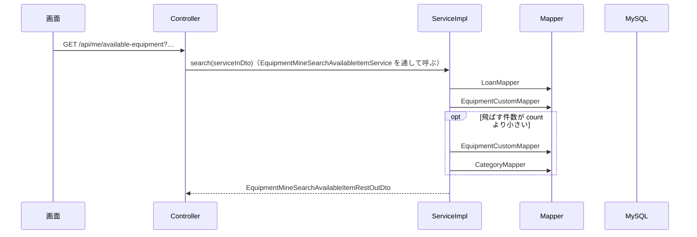

# API詳細設計：B-05 借りられる備品を探す

| 項目 | 内容 |
|---|---|
| 版 | v1.2 2026-11-26 |
| Jira | ZPOP-67（サブタスク：ZPOP-177 詳細設計・ZPOP-178 実装・ZPOP-179 単体テスト） |
| 状態 | 人の確認済み（2026-11-26。12章の外から見える判断） |
| まとまり | [mine](mine.md) |
| もとにした設計書 | API設計.md v1.5 の2.3〜2.5・3.2・4.6（B-02。借りるときの確かめ）、画面設計.md v1.10 の4章（S-06）、機能一覧.md v1.2 の5章、データ設計.md v1.0 の2章・5.5・5.6・5.7、詳細設計 equipment/management/C-01_備品を探す.md v2.0（同じ作り方の手本） |

## 1. API基本情報

写したもと：API設計.md v1.5 の3.2

| 項目 | 内容 |
|---|---|
| ID | B-05 |
| 名前 | 借りられる備品を探す |
| 操作 | GET |
| URL | /api/me/available-equipment |
| 内容 | 借りられる備品（管理中・保管中）を探す |
| 権限項目 | LOAN_SELF（備品を借りる・返す（自分）） |
| 使う画面 | S-06（まだ。ZPOP-108） |
| controller のメソッド | EquipmentMineSearchAvailableItemController#search |
| service のメソッド | EquipmentMineSearchAvailableItemService#search（中身は EquipmentMineSearchAvailableItemServiceImpl） |
| validator のメソッド | なし（業務チェックがない。条件の形の確かめは RestInDto で行う） |

## 2. リクエスト定義

写したもと：画面設計.md v1.10 の4章「探す条件」「表示する備品」。API設計に B-05 の4章（送る値・返す値の例）がないため、項目名・形は画面設計の項目から決めた（12章の No.1）。作り方は C-01 と同じ形にそろえた

### 2.1 パスの値

なし

### 2.2 クエリ（URL の ? の後ろ）

RestInDto：`EquipmentMineSearchAvailableItemRestInDto`（受け取った値を確かめて、探す条件にする。形式のチェックは 6章）

| 名前 | 型 | 必須 | 最初の値 | 説明 |
|---|---|---|---|---|
| keyword | 文字 | | なし | 管理番号・メーカー・モデルのどれかに含まれていれば出す（画面設計 4章）。大文字・小文字を区別しない（データ設計 2章）。前後の空白を取り除き、空なら条件にしない |
| categoryId | 数 | | なし（すべて） | 種別のID |
| page | 数 | | 1 | 何ページ目か（1から数える。API設計 2.5）。1ページは20件（画面設計 4章） |

例：`GET /api/me/available-equipment?keyword=thinkpad&categoryId=1&page=2`

### 2.3 本文（JSON）

なし

### 2.4 ファイル（CSV を受け取る API だけ）

なし

### 2.5 Service に渡す値（ServiceInDto）

ServiceInDto：`EquipmentMineSearchAvailableItemServiceInDto`（Controller が、RestInDto から作る。DB との整合性のチェックはない）

| 項目名 | 型 | もと | 付けるチェック用アノテーション（common.validation） |
|---|---|---|---|
| categoryId | 数 | クエリの categoryId | なし（ない種別・削除された種別でも誤りにしない。6章） |
| keywordPattern | 文字 | クエリの keyword（前後の空白を取り除き、小文字にして、% _ ! に ! を付け、前後に % を付けたもの。空なら null） | なし |
| page | 数 | クエリの page | なし |

ログインしている人の ID は使わない（借りられる備品は、だれが開いても同じ。10章）。

## 3. レスポンス定義

写したもと：API設計.md v1.5 の2.4・2.5、画面設計.md v1.10 の4章「表示する項目」（項目名は API設計にないため決めた。12章の No.1）

### 3.1 成功

| status | message |
|---|---|
| 200 | 処理が正常に完了しました。 |

data（RestOutDto：`EquipmentMineSearchAvailableItemRestOutDto`。API設計 2.5 の形）

| 項目名 | 型 | null になるか | もと | 説明 |
|---|---|---|---|---|
| items | 配列 | ならない | ― | このページの備品（下の表）。0件なら空の配列 |
| page | 数 | ならない | 受け取った page | 何ページ目か |
| size | 数 | ならない | 20（画面設計 4章） | 1ページの件数 |
| totalCount | 数 | ならない | 条件に合う、借りられる備品の数 | 「N件」の表示と、「さらに表示」を出すかに使う |
| totalPages | 数 | ならない | totalCount を 20 で割って切り上げ。0件なら 0 | |

items の1件（RestOutDto：`EquipmentMineSearchAvailableItemRestOutDto.Item`）

| 項目名 | 型 | null になるか | もと（テーブル.列 ／ 計算） | 説明 |
|---|---|---|---|---|
| equipmentId | 数 | ならない | equipment.id | 借りる（B-02）で送る備品のID |
| managementNo | 文字 | ならない | equipment.management_no | 管理番号 |
| categoryName | 文字 | ならない | categories.name（equipment.category_id で突き合わせ） | 種別 |
| maker | 文字 | なる | equipment.maker | メーカー |
| model | 文字 | なる | equipment.model | モデル |
| size | 文字 | なる | equipment.size | サイズ（例：24.1インチ）。「仕様」の表示に使う |
| resolution | 文字 | なる | equipment.resolution | 解像度（例：1920×1200）。同上 |
| heightAdjustable | 真偽 | なる（未設定） | equipment.height_adjustable | 昇降。true＝あり、false＝なし、null＝未設定。同上 |
| pivot | 真偽 | なる（未設定） | equipment.pivot | ピボット。同上 |

```json
{
  "status": 200,
  "message": "処理が正常に完了しました。",
  "data": {
    "items": [
      { "equipmentId": 21, "managementNo": "A003", "categoryName": "PC", "maker": "Lenovo", "model": "ThinkPad X1",
        "size": null, "resolution": null, "heightAdjustable": null, "pivot": null },
      { "equipmentId": 35, "managementNo": "E015", "categoryName": "モニター", "maker": "EIZO", "model": "FlexScan EV2485",
        "size": "24.1インチ", "resolution": "1920×1200", "heightAdjustable": true, "pivot": true }
    ],
    "page": 1,
    "size": 20,
    "totalCount": 12,
    "totalPages": 1
  },
  "errors": null
}
```

### 3.2 失敗

9章のとおり。

## 4. 処理フロー

1. controller が受け取る。数でない categoryId・page は、Spring が型を直せずに 400（9章の No.1）。
2. `@PreAuthorize("hasAuthority('LOAN_SELF')")` で権限項目を確かめる（10章）。
3. controller が `EquipmentMineSearchAvailableItemRestInDto#of` で page を確かめ（1より小さければ 400。9章の No.2）、keyword から LIKE の形を作って、`EquipmentMineSearchAvailableItemServiceInDto` にする。EquipmentMineSearchAvailableItemService#search を呼ぶ（`@Transactional` は付けない。読むだけ）。
4. ServiceImpl が、今貸出中の貸出履歴（返却日が空で、取り消されていない）を読み、貸出中の備品のIDの一覧にする。
5. ServiceImpl が、借りられる備品（管理中で、削除されておらず、貸出中のIDを除き、種別・キーワードで絞ったもの）の数（count）を読む。次に、このページの備品（20件まで）を読む。ただし、飛ばす件数 `(page - 1) × 20`（long で計算する。page が非常に大きくても溢れない）が count 以上なら、備品は読まず、空の items にする（12章の No.5）。
6. このページの備品が1件以上あるときだけ、備品の種別の名前を、IN でまとめて読み、Java で突き合わせて items にする。0件のときは、種別を読まない（`IN ()` にならないようにする）。
7. controller が `ApiResponse.ok(…)` で返す。



## 5. 条件分岐・業務ルール

| No. | 条件・ルール | 写したもと | 守る場所（クラス.メソッド） | 守れないとき | 同じルールを書いているほかの機能 |
|---|---|---|---|---|---|
| 1 | 出すのは、管理状態が「管理中」で、貸出状態が「保管中」の備品だけ | 画面設計 4章「表示する備品」、機能一覧 5章の1 | EquipmentCustomMapper.xml（status = 'MANAGED'、貸出中のIDを除く） | ― | B-02（借りるときも同じ確かめ）、C-01（貸出状態） |
| 2 | 削除された備品は出さない | データ設計 2章 | EquipmentCustomMapper.xml（deleted_at IS NULL） | ― | C-01 |
| 3 | 貸出中＝返却日が空で、取り消されていない貸出履歴がある | データ設計 5.7 | EquipmentMineSearchAvailableItemServiceImpl#search（LoanExample） | ― | B-01・C-01 |
| 4 | キーワードは、管理番号・メーカー・モデルのどれかに含まれていれば出す。大文字・小文字を区別しない（両方を小文字にそろえて比べる） | 画面設計 4章「探す条件」、データ設計 2章「画面での検索」 | RestInDto#of（小文字にする）、EquipmentCustomMapper.xml（LOWER） | ― | C-01（C-01 はシリアルNo・借用者の氏名も探す。ここは探さない。12章の No.3） |
| 5 | 種別で絞れる。「すべて」は条件なし | 画面設計 4章「探す条件」 | EquipmentCustomMapper.xml（category_id） | ― | C-01 |
| 6 | 管理番号の順に並べる。同じ管理番号なら備品のID順 | 画面設計 4章「表示する備品」（ID順は決めた。12章の No.6） | EquipmentCustomMapper.xml（ORDER BY） | ― | C-01 |
| 7 | 20件ずつ | 画面設計 4章、API設計 2.5 | EquipmentMineSearchAvailableItemServiceImpl（PAGE_SIZE） | ― | なし（C-01 は50件） |

## 6. バリデーション仕様

写したもと：なし（画面設計 4章の探す条件は、入力の誤りの文がない）。C-01 の6章と同じ形にした（12章の No.5）

| 項目 | 決まり | メッセージ | 確かめる場所 |
|---|---|---|---|
| categoryId・page | 数 | 400「入力内容に誤りがあります。」（errors は null） | Spring の型の変換（MethodArgumentTypeMismatchException。GlobalExceptionHandler） |
| page | 1以上 | 同上 | EquipmentMineSearchAvailableItemRestInDto#of（BusinessRuleException） |
| keyword | 文字数の上限を決めない（C-01 と同じ。12章の No.10）。前後の空白を取り除き、空なら条件にしない。小文字にするときは Locale.ROOT を使う（C-01 の実装と同じ）。前後の空白の取り除き方は、実装のときに、common.text.TextInputs を使うか C-01 と同じにするかを決める | ― | RestInDto#of |

- 最後のページより後ろの page は、誤りにせず、items を空にして返す。page が非常に大きくても（飛ばす件数が int を超えても）、飛ばす件数を long で計算して、count 以上なら備品を読まずに空にする（500 にしない。12章の No.5）。
- categoryId に、ない種別・削除された種別を入れても誤りにしない（0件になる）。
- keyword の中の % と _ は、ふつうの文字として探す（! を付けて ESCAPE '!'。C-01 と同じ）。

## 7. DB操作仕様

写したもと：データ設計.md v1.0 の2章・5.5・5.6・5.7、C-01 の7章

mapper は equipment 機能の `dao.mapper` と、手で書く `dao.mapper.custom` のもの（CLAUDE.md 5章）。

| No. | mapper のメソッド | 使う所 | 操作 | テーブル | 条件 | 読む・書く列 | 件数 |
|---|---|---|---|---|---|---|---|
| 1 | LoanMapper#selectByExample（andReturnedOnIsNull・andDeletedAtIsNull） | ServiceImpl#search | SELECT | loans | returned_on IS NULL AND deleted_at IS NULL | equipment_id | 貸出中の数 |
| 2 | EquipmentCustomMapper#countAvailableBySearch（新規） | ServiceImpl#search | SELECT COUNT(*) | equipment | 下の「探す条件」 | ― | 1件 |
| 3 | EquipmentCustomMapper#selectAvailableBySearch（新規） | ServiceImpl#search | SELECT | equipment | 下の「探す条件」＋ ORDER BY ＋ LIMIT 20 OFFSET (page-1)×20（long で計算。count 以上なら読まない。4章の5） | id, management_no, category_id, maker, model, size, resolution, height_adjustable, pivot | 0〜20件 |
| 4 | CategoryMapper#selectByExample（andIdIn） | ServiceImpl#search | SELECT | categories | id IN (…)（削除済みも読む。備品が指していれば名前を出す）。ページの備品が0件なら読まない | id, name | ページの種別の数 |

**探す条件**（No.2・3 で同じ。`<sql>` にまとめる。条件を渡す入れ物は、新規の `dao.entity.custom.AvailableEquipmentSearchCondition`）

| 条件 | SQL |
|---|---|
| 削除されていない | deleted_at IS NULL |
| 管理中 | status = 'MANAGED' |
| 貸出中を除く | id NOT IN (貸出中の備品のID)。貸出中が0件なら条件を付けない |
| 種別 | category_id = #{categoryId}（null なら付けない） |
| キーワード | (LOWER(management_no) LIKE ? OR LOWER(maker) LIKE ? OR LOWER(model) LIKE ?)。LIKE の % _ ! は ! を付けて文字として扱う（ESCAPE '!'）。null なら付けない |

**並び順**：management_no ASC, id ASC（固定）

- 手で書く Mapper（dao.mapper.custom）を使う理由：LOWER と LIKE の OR、NOT IN の組み合わせは、Example では書けない。C-01 の `EquipmentCustomMapper#countBySearch・selectBySearch` は、キーワードがシリアルNo・借用者の氏名も探し、返す列も違うので、そのまま使えない（12章の No.3・No.9）。
- 複数のテーブルの突き合わせ方（JOIN とサブクエリは使わない）：貸出中の貸出履歴（No.1）を先に読み、備品のIDの一覧にして、備品の SQL の NOT IN に渡す。種別の名前は、ページの備品を読んだあとで IN でまとめて読み、Java で突き合わせる。
- まとめて読む所（N+1 を防ぐ）：No.4（ページの中の種別のIDを集めて1回で読む）。
- 削除済みを除く条件：備品は deleted_at IS NULL。貸出履歴は deleted_at IS NULL（取り消し）。
- 更新した件数の見方：なし（読むだけ）。
- 並び順は固定で、受け取った文字を SQL につなげない（`${}` を使わない）。

## 8. トランザクション・排他制御

| 項目 | 内容 |
|---|---|
| @Transactional | 付けない（読むだけ） |
| 楽観ロック（version） | 使わない（読むだけ） |
| 同時に操作されたとき | 読む途中で、ほかの人が借りる・返す・管理状態を変えると、件数と中身がずれることがある（次に開いたときに正しくなる）。借りるときは、B-02 が、もう一度確かめる（すでに借りられていれば 409） |
| Slack を送るタイミング | 送らない |

## 9. エラー処理仕様

写したもと：API設計.md v1.5 の2.3・2.4

| No. | 場面 | 投げる例外 | status | message | errors |
|---|---|---|---|---|---|
| 1 | 数でない（categoryId・page） | （MethodArgumentTypeMismatchException） | 400 | 入力内容に誤りがあります。 | null |
| 2 | page が 1 より小さい | BusinessRuleException | 400 | 入力内容に誤りがあります。 | null |
| 3 | ログインしていない | （Spring Security） | 401 | ログインしてください。 | null |
| 4 | 権限項目 LOAN_SELF がない | （Spring Security） | 403 | この操作を行う権限がありません。 | null |
| 5 | サーバーの不具合 | （GlobalExceptionHandler） | 500 | 問題が発生しました。時間をおいて、もう一度お試しください。続く場合は総務に連絡してください。 | null |

## 10. 認証・認可仕様

| 項目 | 内容 |
|---|---|
| ログイン | 要る |
| 権限項目 | `@PreAuthorize("hasAuthority('LOAN_SELF')")` |
| 対象の確かめ（IDOR） | 借りる人の ID を受け取らない。返すのは、借りられる備品の、管理番号・種別・メーカー・モデル・仕様だけで、借用者の氏名・シリアルNo・購入日などは返さない（借りる画面で選ぶのに要る項目だけ） |

## 11. 外部API連携仕様

なし

## 12. 設計書にない判断

| No. | 判断 | 理由 | 外から見えるか | 人の確認 |
|---|---|---|---|---|
| 1 | クエリの名前（keyword・categoryId・page）と、items の1件の項目名（equipmentId・managementNo・categoryName・maker・model・size・resolution・heightAdjustable・pivot）。ページ分けの形は API設計 2.5 のとおり | API設計 2.5・3.2 に、B-05 の送る値・返す値の例（4章）がないため。名前は C-01・B-01 にそろえた。借りる（B-02）が送る備品のIDと同じ名前にするため、備品のIDは equipmentId（C-01 は id） | はい | 済（2026-11-26） |
| 2 | 1ページは20件、size は 20。画面の「さらに表示」は、次の page を読んで、続きに足す（画面の詳細設計で決める） | 画面設計 4章「20件ずつ表示し、『さらに表示』で続きを出す」のとおり | はい | 済（画面設計 4章のとおり） |
| 3 | キーワードで探すのは、管理番号・メーカー・モデルだけ。シリアルNo・借用者の氏名は探さない | 画面設計 4章「探す条件」の「キーワード」に、そう書いてある（C-01 の S-07 は、シリアルNo・借用者の氏名も探す） | はい | 済（画面設計 4章のとおり） |
| 4 | 返す項目に、サイズ・解像度・昇降・ピボットを入れる。昇降・ピボットは、true／false／null（未設定）で返し、「あり」「なし」の言葉への直しは画面が行う。false（なし）を「昇降なし」と出すかは、画面設計 4章の「値が入っている項目だけ」から読み取れないので、S-06 の詳細設計（ZPOP-108）で決める | 画面設計 4章「表示する項目」の「仕様」に要るため。画面が文字を決めるので、API は、データ設計 5.6 の値のまま返す（どちらの出し方でも作れる） | はい | 済（2026-11-26） |
| 5 | 条件の最初の値と、決まった値以外のときの扱い：page が 1 より小さければ 400、最後のページより後ろ（page が非常に大きい値を含む）は空、ない種別は0件。0件のときの totalPages は 0。飛ばす件数は long で計算し、count 以上なら備品を読まない（C-01 の実装は `(page - 1) × 件数` を int で計算しており、page が非常に大きいと溢れるおそれがある。C-01 にも同じ直しが要る。7章・mine.md の3章 No.11） | API設計に書いていないため。C-01 の12章の No.3・5 と同じ。totalPages の 0 は、C-01 の No.5 が「まだ」のままなので、そろえて、まだ | はい | 済（2026-11-26） |
| 6 | 同じ管理番号の中は、備品のID順 | 画面設計 4章は「管理番号の順」だけ。管理番号は重ならない（データ設計 5.6）ので、実際には起きない。並びを毎回同じにするため | いいえ | ― |
| 7 | 貸出中の貸出履歴は、探すたびにすべて読み、NOT IN に渡す | JOIN とサブクエリを使わずに、貸出状態で絞るため（CLAUDE.md 5章）。C-01 の No.7 と同じ。貸出中の数は備品の数より多くならないので、読む量は小さい | いいえ | ― |
| 8 | 管理中でない備品（廃棄・不明）に、貸出中の履歴が残っていても、出さない（管理中だけを出す） | 画面設計 4章「管理状態が『管理中』で、貸出状態が『保管中』」 | はい（細かい） | 済（画面設計 4章のとおり） |
| 9 | 探す SQL を、新しい手で書く Mapper のメソッド（EquipmentCustomMapper#countAvailableBySearch・selectAvailableBySearch）として足し、C-01 のものは使い回さない | C-01 の SQL は、キーワードの対象と返す列が違うため。C-01 の SQL に条件を足すと、C-01 の動きを変えてしまう。足すのは、2人で共有するファイル（dao.mapper.custom。mine.md の3章 No.10） | いいえ | 進め方は済（2026-11-26。dao の小さな MR を先に入れる）。もう1人への連絡は、実装の前 |
| 10 | キーワードの長さの上限を決めない | C-01 と同じ。使う人は社内だけで、LIKE が重くなる長さは起きにくい | いいえ | ― |

## 変更履歴

| 版 | 日付 | 内容 |
|---|---|---|
| v1.0 | 2026-11-26 | 初版（ZPOP-177。B-05） |
| v1.1 | 2026-11-26 | 独立レビューの指摘を直した：ページの備品が0件のとき種別を読まない（4章・7章）、page が非常に大きいときの飛ばす件数を long で計算する（4章・6章・7章）、キーワードの長さの上限・TextInputs・Locale.ROOT（6章）、昇降・ピボットの false の出し方（12章 No.4）、12章に No.10、もとにした設計書の欄を直した |
| v1.2 | 2026-11-26 | 人の確認：12章の No.1・4・5 を「済」にした（クエリ・項目の名前、昇降・ピボットの返し方、page の扱い）。No.9（dao の足し）の進め方も、人が決めた |
