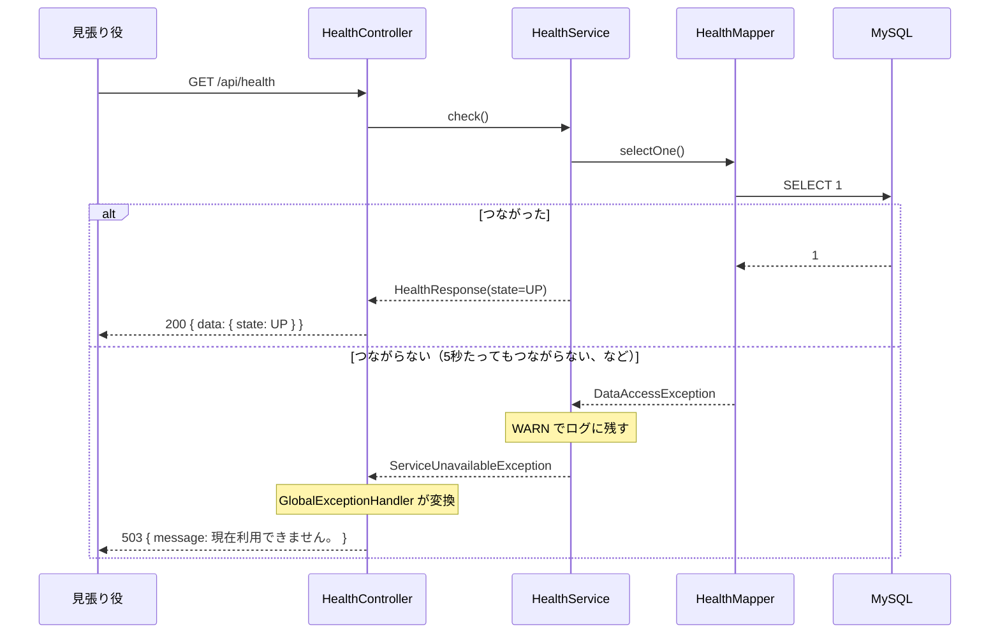

# 詳細設計：動いているかを答える（health）

| 項目 | 内容 |
|---|---|
| 版 | v1.2 2026-11-04 |
| Jira | ZPOP-21（雛形：サーバー）。パッケージ構成の変更（2026-11-04） |
| もとにした設計書 | internaldesign/API設計.md v1.1 の3.1（A-08）・3.10（見張り役）、externaldesign/基本設計書.md 8章 |

## 1. 概要

アプリとデータベースが動いているかを答える。見張り役（AWSのLambda。ZPOP-46）が5分ごとに呼び、答えがおかしければ開発者にDMを送る。

| API | 操作 | アドレス | 権限 |
|---|---|---|---|
| A-08 | GET | /api/health | なし（ログインしていなくても呼べる） |

画面・定期実行：なし。

この機能は、controller → service → mapper の形を持つ最初の機能でもある。category（ZPOP-33）ができるまでは、ほかの機能はこの書き方に合わせる（CLAUDE.md 9章）。

## 2. クラス構成

パッケージの頭の `jp.co.highjunk.equipment` は省いて書く。

| パッケージ | クラス・ファイル | 役割 |
|---|---|---|
| health.controller | HealthController | A-08 の入口。HealthService を呼び、結果を ApiResponse.ok で包んで返す |
| health.service | HealthService | データベースにつながるかを確かめる。つながらなければ ServiceUnavailableException を投げる |
| health.model | なし | テーブルの1行を表すものがないため、作らない |
| mapper.health | HealthMapper（インターフェース） | データベースを読み書きする部品。`@Mapper` を付けると、MyBatis が中身を自動で作る |
| mapper.health | HealthMapper.xml（src/main/resources/jp/co/highjunk/equipment/mapper/health/） | SQL を書く |
| dto.health | HealthResponse | 返す data の形（state だけ）。state の型は HealthState |
| common.constant | HealthState（Enum） | 動いている状態の値。今は UP だけ。JSON では文字の "UP" になる |

mapper と dto は機能のパッケージの外（mapper.health・dto.health）に、Enum は common.constant に置く（CLAUDE.md 4.1）。

## 3. 処理の流れ



1. 受け取る値：なし。
2. 入力チェック：なし。
3. 権限の確認：なし（SecurityConfig で、ログインしていなくても呼べるようにしている。common.md 3.2）。
4. HealthService が HealthMapper.selectOne() を呼ぶ。
5. 成功したら、HealthResponse（state=HealthState.UP）を返す。controller が ApiResponse.ok で包み、200 で返す。
6. データベースのエラー（DataAccessException：Spring がデータベースのエラーをまとめて表す例外）が起きたら、WARN でログに残し、ServiceUnavailableException を投げる。GlobalExceptionHandler が 503 に変える。

返す値（正常時）

```json
{ "status": 200, "message": "処理が正常に完了しました。", "data": { "state": "UP" }, "errors": null }
```

返す値（データベースにつながらないとき）

```json
{ "status": 503, "message": "現在利用できません。", "data": null, "errors": null }
```

版や設定などの詳しい情報は返さない（API設計 3.1）。

## 4. データベース

| mapper のメソッド | SQL | 読み書きするテーブル |
|---|---|---|
| selectOne() | `SELECT 1` | なし（つながるかだけを確かめる） |

答えるまでの時間：データベースにつながるまで最大5秒待つ（common.md 4章の `connection-timeout`）。見張り役は10秒で失敗とみなすので、データベースが止まっていても、その前に 503 を返せる。

## 5. 入力チェック

なし。

## 6. エラー

| 場面 | status | message |
|---|---|---|
| データベースにつながらない | 503 | 現在利用できません。 |
| アプリそのものが止まっている | 答えがない | （見張り役が「失敗」と判断する） |

## 7. 設定値

この機能だけで使う設定値はない。データベースにつながるまで待つ時間（`spring.datasource.hikari.connection-timeout: 5000`）は、全部の機能で共通（common.md 4章）。

## 8. ログ

| 場面 | 重要度 | 内容 |
|---|---|---|
| データベースにつながらない | WARN | 「データベースにつながりません」と、エラーの詳しい中身 |

成功したときは、ログに残さない（5分ごとに呼ばれるので、残すとログが増えすぎるため）。

## 9. テスト

証跡：Document の evidence/20261103_単体結合API_基盤/（作ったとき）、evidence/20261104_単体結合API_パッケージ構成の変更/（パッケージを移したとき）

| テストのクラス | 種類 | 確かめること |
|---|---|---|
| health.HealthApiTest（データベースにつながるとき） | 結合（API）。テスト専用のデータベース equipment_test を使う | ログインしていなくても呼べて、200 と state=UP を返す／版や設定などの詳しい情報は返さない（data は state だけ） |
| health.HealthApiTest（データベースにつながらないとき） | 結合（API）。HealthMapper を偽物（`@MockitoBean`）にして、つながらない状態を作る | 503 を返す。詳しい理由は返さない |

手で確かめたこと（自動テストの外）：

- 組み立てたアプリを起動し、MySQL を止めると、約5秒で 503 を返すこと。MySQL を戻すと 200 に戻ること。

## 10. 設計書にない判断

1. **返す値の data を `{ "state": "UP" }` にした**：API設計 v1.1 の3.1 に書いたとおり。503 のときは、返す値の形の決まり（エラー時は data が null）に合わせて、DOWN を data に入れずに null にした。
2. **成功したときはログに残さない**：5分ごとに呼ばれるため（8章）。
3. **データベースにつながるまで待つ時間を5秒にした**：common.md 10章の4。
4. **state を Enum（HealthState）にした**：API設計では state は文字の "UP"。Enum の名前がそのまま JSON の文字になるので、返す値は変わらない。決まった値は Enum にして common.constant に置く決まり（CLAUDE.md 4.1）に合わせた。

## 変更履歴

| 版 | 日付 | 内容 |
|---|---|---|
| v1.0 | 2026-11-03 | 初版（ZPOP-21 で作ったもの） |
| v1.1 | 2026-11-03 | リポジトリを3つに分けた形に合わせて、場所の書き方を直した |
| v1.2 | 2026-11-04 | パッケージ構成の変更：HealthMapper を mapper.health に、HealthResponse を dto.health に移した。state を Enum（common.constant.HealthState）にした。証跡の場所を足した |
