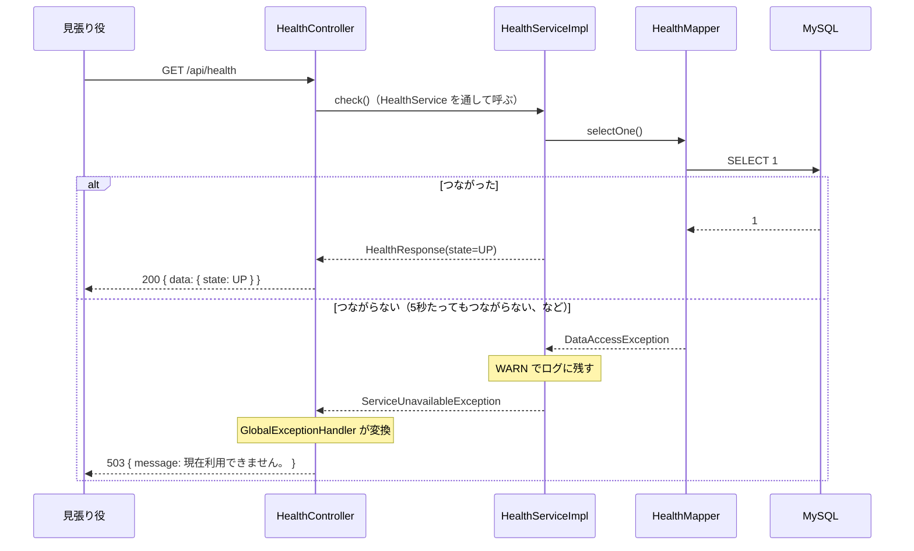

# API詳細設計：A-08 動いているかを答える

| 項目 | 内容 |
|---|---|
| 版 | v2.1 2026-11-08 |
| Jira | ZPOP-21（雛形：サーバー） |
| 状態 | 作成中（v2.1 の service の分け方は、人の確認がまだ。v2.0 までは人の確認済み 2026-11-04） |
| 機能 | [health](health.md) |
| もとにした設計書 | API設計.md v1.1 の2.3・2.4・3.1・3.10、基本設計書.md 8章 |

## 1. API基本情報

写したもと：API設計.md v1.1 の3.1

| 項目 | 内容 |
|---|---|
| ID | A-08 |
| 名前 | 動いているかを答える |
| 操作 | GET |
| URL | /api/health |
| 内容 | アプリとデータベースが動いているかを答える。動いていれば 200 で data は `{ "state": "UP" }`、データベースにつながらなければ 503（data は null）。版や設定などの詳しい情報は出さない |
| 権限項目 | なし（ログインしていなくても呼べる） |
| 使う画面 | 画面なし（見張り役のLambdaが5分ごとに呼ぶ。基本設計書8章） |
| controller のメソッド | HealthController#health |
| service のメソッド | HealthService#check（中身は HealthServiceImpl） |
| validator のメソッド | なし（業務チェックがない） |

## 2. リクエスト定義

### 2.1 パスの値

なし

### 2.2 クエリ（URL の ? の後ろ）

なし

### 2.3 本文（JSON）

なし（GET のため）

### 2.4 ファイル（CSV を受け取る API だけ）

なし

## 3. レスポンス定義

写したもと：API設計.md v1.1 の2.4・3.1

### 3.1 成功

| status | message |
|---|---|
| 200 | 処理が正常に完了しました。 |

dto：`dto.health.HealthResponse`

| 項目名 | 型 | null になるか | もと（テーブル.列 ／ 計算） | 説明 |
|---|---|---|---|---|
| state | 文字（Enum `common.constant.HealthState`） | ならない | 計算（データベースにつながったら UP） | 今は UP だけ |

```json
{ "status": 200, "message": "処理が正常に完了しました。", "data": { "state": "UP" }, "errors": null }
```

版や設定などの詳しい情報は返さない（API設計 3.1）。

### 3.2 失敗

9章のとおり。

## 4. 処理フロー

1. HealthController が受け取る。受け取る値はない。
2. 権限の確認はしない（SecurityConfig で、ログインしていなくても呼べるようにしている。common.md 3.2）。
3. HealthController が HealthService#check を呼ぶ（中身は HealthServiceImpl）。業務チェックはない。HealthServiceImpl が HealthMapper#selectOne を呼ぶ。
4. 成功したら、HealthResponse（state = HealthState.UP）を返す。controller が `ApiResponse.ok` で包み、200 で返す。
5. データベースのエラー（DataAccessException：Spring がデータベースのエラーをまとめて表す例外）が起きたら、WARN で「データベースにつながりません」とエラーの中身をログに残し、ServiceUnavailableException を投げる。GlobalExceptionHandler が 503 に変える。
6. 成功したときは、ログに残さない（5分ごとに呼ばれるため。12章の No.2）。



## 5. 条件分岐・業務ルール

| No. | 条件・ルール | 写したもと | 守る場所（クラス.メソッド） | 守れないとき | 同じルールを書いているほかの機能 |
|---|---|---|---|---|---|
| 1 | データベースにつながらなければ 503（data は null） | API設計 3.1 | HealthServiceImpl#check | 9章の No.1 | なし |
| 2 | 版や設定などの詳しい情報は出さない | API設計 3.1 | HealthResponse（state だけを持つ） | ― | なし |

## 6. バリデーション仕様

なし（受け取る値がない）

## 7. DB操作仕様

| No. | mapper のメソッド | 操作 | テーブル | 条件 | 読む・書く列 | 件数 |
|---|---|---|---|---|---|---|
| 1 | HealthMapper#selectOne | SELECT（`SELECT 1`） | なし（つながるかだけを確かめる） | なし | なし | 1件 |

- データベースにつながるまで最大5秒待つ（`spring.datasource.hikari.connection-timeout: 5000`。common.md 4章）。見張り役は10秒で失敗とみなすので、データベースが止まっていても、その前に 503 を返せる。

## 8. トランザクション・排他制御

| 項目 | 内容 |
|---|---|
| @Transactional | 付けない（読むだけ） |
| 楽観ロック（version） | 使わない |
| 同時に操作されたとき | 読むだけなので、影響はない |
| Slack を送るタイミング | 送らない（DM は見張り役が送る） |

## 9. エラー処理仕様

写したもと：API設計.md v1.1 の2.3・2.4

| No. | 場面 | 投げる例外 | status | message | errors |
|---|---|---|---|---|---|
| 1 | データベースにつながらない | ServiceUnavailableException | 503 | 現在利用できません。 | null |
| 2 | アプリそのものが止まっている | ― | 答えがない | ― | ―（見張り役が「失敗」と判断する） |

```json
{ "status": 503, "message": "現在利用できません。", "data": null, "errors": null }
```

## 10. 認証・認可仕様

| 項目 | 内容 |
|---|---|
| ログイン | 要らない（SecurityConfig で許可。common.md 3.2） |
| 権限項目 | なし（`@PreAuthorize` を付けない） |
| 対象の確かめ（IDOR） | ID を受け取らない |

## 11. 外部API連携仕様

なし

## 12. 設計書にない判断

| No. | 判断 | 理由 | 外から見えるか | 人の確認 |
|---|---|---|---|---|
| 1 | 503 のときは、DOWN を data に入れずに null にした | 返す値の形の決まり（エラー時は data が null。API設計 2.4）に合わせた。API設計 v1.1 の3.1 にも同じことを書いた | はい | 済（2026-11-03） |
| 2 | 成功したときはログに残さない | 5分ごとに呼ばれるので、残すとログが増えすぎるため | いいえ | 済（2026-11-03） |
| 3 | state を Enum（HealthState）にした | 決まった値は Enum にして common.constant に置く決まり（CLAUDE.md 4.1）。Enum の名前がそのまま JSON の文字になるので、返す値は変わらない | いいえ | 済（2026-11-04） |

## 変更履歴

| 版 | 日付 | 内容 |
|---|---|---|
| v1.0〜v1.2 | 2026-11-03〜04 | health.md の中に書いていた（health.md の変更履歴を見る） |
| v2.0 | 2026-11-08 | 新しいテンプレートに合わせて、health.md から分けた。設計書の中身を写した。中身（作り）は変えていない |
| v2.1 | 2026-11-08 | ディレクトリ構成の変更：HealthService をインターフェースにし、中身を HealthServiceImpl に移した。動きは変えていない |
