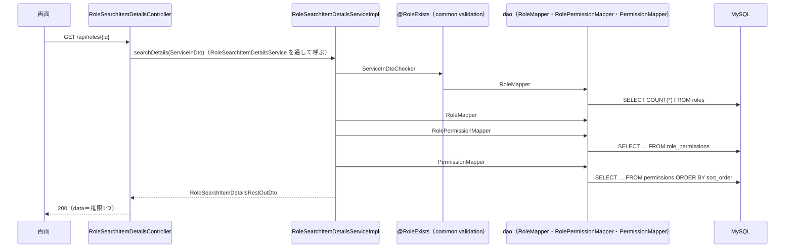

# API詳細設計：H-02 権限1つを返す

| 項目 | 内容 |
|---|---|
| 版 | v1.0 2026-11-28 |
| Jira | ZPOP-95（サブタスク：[詳細設計] ZPOP-289） |
| 状態 | 作成中（12章の No.1・2・5・6 は、人の確認済み 2026-11-28） |
| まとまり | [role](role.md)（api.role） |
| もとにした設計書 | API設計.md v1.5 の2.3・2.4・2.7・3.8・7章、画面設計.md v1.10 の20章、データ設計.md v1.0 の2章・5.2〜5.4、機能一覧.md v1.2 の8章、権限の対応表.md v1.1 の6章 |

## 1. API基本情報

写したもと：API設計.md v1.5 の3.8

| 項目 | 内容 |
|---|---|
| ID | H-02 |
| 名前 | 権限1つを返す |
| 操作 | GET |
| URL | /api/roles/{権限のID} |
| 内容 | 権限1つを返す |
| 権限項目 | PERMISSION_VIEW、PERMISSION_MANAGE のどちらか |
| 使う画面 | S-17（編集） |
| パッケージ | api.role.search.itemdetails |
| クラス名の頭（`<頭>`） | RoleSearchItemDetails |
| Controller のメソッド | RoleSearchItemDetailsController#searchDetails |
| Service のメソッド | RoleSearchItemDetailsService#searchDetails（中身は RoleSearchItemDetailsServiceImpl） |

## 2. リクエスト定義

### 2.1 パスの値

| 項目名 | 型 | 説明 |
|---|---|---|
| id | 数 | 権限のID。数でなければ 400（9章の No.1） |

### 2.2 クエリ（URL の ? の後ろ）

なし

### 2.3 本文（JSON）

なし（GET なので、RestInDto は作らない。CLAUDE.md 5章）

### 2.4 ファイル（CSV を受け取る API だけ）

なし

### 2.5 Service に渡す値（ServiceInDto）

ServiceInDto：`RoleSearchItemDetailsServiceInDto`（DB との整合性のチェック。6章）。Controller が作る。

| 項目名 | 型 | もと | 付けるチェック用アノテーション（common.validation） |
|---|---|---|---|
| id | 数 | パスの id | `@RoleExists`（groups：ServiceCheckOrder.First、payload：NotFound。6章の No.1。common.validation に足す。12章の No.4） |

- 読むだけの API なので、ログインしている人の ID は ServiceInDto に入れない。

## 3. レスポンス定義

写したもと：API設計.md v1.5 の2.4。data の中身は、API設計 4章に例がないため、画面設計.md v1.10 の20章（権限の名前、権限項目のチェック）と、データ設計.md v1.0 の5.2〜5.4 の列、H-04 で送り返す version（API設計 2.7）から決めた（12章の No.1・2。2026-11-28 に人が確認）。

### 3.1 成功

| status | message |
|---|---|
| 200 | 処理が正常に完了しました。 |

RestOutDto：`RoleSearchItemDetailsRestOutDto`

| 項目名 | 型 | null になるか | もと（テーブル.列 ／ 計算） | 説明 |
|---|---|---|---|---|
| id | 数 | ならない | roles.id | 権限のID |
| name | 文字 | ならない | roles.name | 権限の名前 |
| permissionCodes | 文字の配列 | ならない（権限項目が0件なら空の配列。通常は1つ以上） | role_permissions.permission_code。並びは permissions.sort_order の順（5章の No.2） | この権限が含む権限項目のコード（データ設計 5.3 のコード） |
| version | 数 | ならない | roles.version | 権限を変える（H-04）ときに送り返す番号（API設計 2.7 の楽観ロック） |

```json
{
  "status": 200,
  "message": "処理が正常に完了しました。",
  "data": {
    "id": 2,
    "name": "一般社員",
    "permissionCodes": ["LOAN_SELF", "CONFIRM_SELF"],
    "version": 0
  },
  "errors": null
}
```

### 3.2 失敗

9章のとおり。

## 4. 処理フロー

1. Spring Security が、ログインしているかを確かめる（10章）。していなければ 401。パスの id が数でないときは、次の2より前に、引数の変換で 400 になる（9章の No.1）。
2. `@PreAuthorize` が、権限項目 PERMISSION_VIEW か PERMISSION_MANAGE のどちらかを持っているかを確かめる（10章）。持っていなければ 403。
3. RoleSearchItemDetailsController#searchDetails が、パスの id から `RoleSearchItemDetailsServiceInDto` を作り、RoleSearchItemDetailsService#searchDetails を呼ぶ（中身は RoleSearchItemDetailsServiceImpl）。
4. ServiceImpl が、`@Transactional(readOnly = true)`（読み取り専用）の中で、ServiceInDtoChecker#check で、権限があり削除されていないかを確かめる（`@RoleExists`。7章の No.1）。なければ 404。
5. ServiceImpl が dao の RoleMapper#selectByPrimaryKey で、権限の1行を読む（7章の No.2）。
6. ServiceImpl が dao の RolePermissionMapper#selectByExample で、この権限が含む権限項目のコードを読む（7章の No.3）。
7. コードが1件以上あれば、PermissionMapper#selectByExample で、そのコードを権限項目の並び順に読み直し、並び順どおりのコードにする（7章の No.4）。0件なら、空の配列にする（権限項目は読まない）。
8. Controller が `ApiResponse.ok(…)` で返す。



## 5. 条件分岐・業務ルール

| No. | 条件・ルール | 写したもと | 守る場所（クラス.メソッド） | 守れないとき | 同じルールを書いているほかの機能 |
|---|---|---|---|---|---|
| 1 | 削除済みの権限は返さない（deleted_at に値が入っている行は「削除済み」） | データ設計 2章 ／ role.md R-8 | ServiceInDto の `@RoleExists`（common.validation） | 9章の No.4 | H-03〜H-05、G-03・G-04（roleId）で同じ部品を使う予定 |
| 2 | 権限項目のコードは、権限項目の並び順（permissions.sort_order。データ設計 5.3 の表の上から1〜18）で返す | データ設計 5.3 | RoleSearchItemDetailsServiceImpl#searchDetails（PermissionMapper#selectByExample の orderByClause） | ― | H-01（含む権限項目）、H-06 で同じ順にそろえる |
| 3 | 権限を見られるのは、PERMISSION_VIEW か PERMISSION_MANAGE を持つ人（S-17 を開ける人が、中の読み込みで 403 にならないように） | API設計 3.8 ／ role.md R-9（権限の対応表 6章の No.3 と同じ） | RoleSearchItemDetailsController の `@PreAuthorize`（10章） | 9章の No.3 | H-06 |

## 6. バリデーション仕様

写したもと：画面設計.md v1.10 の20章（H-02 は読むだけで、入力欄がないため、画面のメッセージは使わない）

| No. | 項目 | 決まり | メッセージ | 確かめる場所 |
|---|---|---|---|---|
| 1 | id | 権限があり、削除されていない | 対象が見つかりません。（404。API設計 2.4） | ServiceInDto の `@RoleExists`（common.validation。データベースを見て確かめる） |

- パスの id が数でないときの 400 は、形式のチェックの前に Spring が止める（GlobalExceptionHandler。common.md 3.6。9章の No.1）。

## 7. DB操作仕様

写したもと：データ設計.md v1.0 の2章・5.2〜5.4

| No. | Mapper のメソッド | 使う所 | 操作 | テーブル | 条件（Criteria） | 読む・書く列 | 件数 |
|---|---|---|---|---|---|---|---|
| 1 | RoleMapper#countByExample | `@RoleExists` の中（RoleExistsCheck） | SELECT | roles | `andIdEqualTo(id).andDeletedAtIsNull()` | COUNT(*) | 1件の数（0か1） |
| 2 | RoleMapper#selectByPrimaryKey | ServiceImpl#searchDetails | SELECT | roles | 主キー（id） | id, name, version | 1件 |
| 3 | RolePermissionMapper#selectByExample | ServiceImpl#searchDetails | SELECT | role_permissions | `andRoleIdEqualTo(id)` | role_id, permission_code | 0件以上（通常は1〜18件） |
| 4 | PermissionMapper#selectByExample | ServiceImpl#searchDetails | SELECT | permissions | `andCodeIn(No.3 のコード)`。orderByClause は `sort_order` | code, sort_order | No.3 の件数 |

- 手で書く Mapper を使う理由：使わない（4つとも MyBatis Generator が作った Mapper で足りる。dao.mapper.custom は足さない）。
- 複数のテーブルの突き合わせ方（JOIN とサブクエリは使わない）：roles・role_permissions・permissions を別々に読み、ServiceImpl でコードを集める。
- まとめて読む所（N+1 を防ぐ）：権限項目は、コードごとに SQL を出さず、No.4 の `andCodeIn` で1回で読む。
- 削除済みを除く条件：roles は `deleted_at IS NULL`（No.1）。role_permissions・permissions には deleted_at がない（データ設計 5.3・5.4）。No.2 は、No.1 で確かめたあとの主キーの読み込みなので、削除済みの条件は付けない。
- 更新した件数の見方：書き換えない。

## 8. トランザクション・排他制御

| 項目 | 内容 |
|---|---|
| @Transactional | 付ける（読み取り専用の `@Transactional(readOnly = true)`）。付けるメソッド：`RoleSearchItemDetailsServiceImpl#searchDetails`（ServiceInDto のチェックも、この中に入る。12章の No.5） |
| 楽観ロック（version） | 使わない（version を返すだけ） |
| 同時に操作されたとき | 4つの読み込みは1つのまとまり（トランザクション）の中なので、同じ時点の内容が返る（古い version と新しい権限項目の組にならない）。読んだ直後に H-04・H-05 で変わっても、すでに返した内容はそのまま返す。画面を開き直せば最新になる |
| Slack を送るタイミング | 送らない |

## 9. エラー処理仕様

写したもと：API設計.md v1.5 の2.3・2.4

| No. | 場面 | 投げる例外 | status | message | errors |
|---|---|---|---|---|---|
| 1 | パスの ID が数でない | （GlobalExceptionHandler） | 400 | 入力内容に誤りがあります。 | null |
| 2 | ログインしていない | （Spring Security） | 401 | ログインしてください。 | null |
| 3 | 権限項目 PERMISSION_VIEW・PERMISSION_MANAGE のどちらもない | （Spring Security。`@PreAuthorize`） | 403 | この操作を行う権限がありません。 | null |
| 4 | 権限がない・削除済み | NotFoundException（ServiceInDtoChecker が、payload：NotFound の誤りを変える） | 404 | 対象が見つかりません。 | null |
| 5 | サーバーの不具合 | （GlobalExceptionHandler） | 500 | 問題が発生しました。時間をおいて、もう一度お試しください。続く場合は総務に連絡してください。 | null |

入力欄のエラー（errors 付きの 400）、ぶつかった（409）は起きない。

順番：ログインしていなければ 401 が先。次に、パスの id が数でないと 400（引数の変換。権限の確認より前に起きる）。そのあとで権限項目を確かめて 403。つまり、権限がない人が `/api/roles/abc` を呼ぶと、403 ではなく 400 になる（GlobalExceptionHandler の動きのとおり。テストもこの順で書く）。

## 10. 認証・認可仕様

| 項目 | 内容 |
|---|---|
| ログイン | 要る |
| 権限項目 | `@PreAuthorize("hasAnyAuthority('PERMISSION_VIEW', 'PERMISSION_MANAGE')")`（どちらか1つを持っていれば呼べる） |
| 対象の確かめ（IDOR） | しない。権限は全員で共有する情報で、持ち主がいない（権限を見られる人は、どの権限も見てよい。機能一覧 4章の F-14、API設計 3.8 の権限の列）。ログインしている人の ID も受け取らない |

## 11. 外部API連携仕様

なし

## 12. 設計書にない判断

| No. | 判断 | 理由 | 外から見えるか | 人の確認 |
|---|---|---|---|---|
| 1 | 返す項目を id・name・permissionCodes・version の4つにした。isDefault（一般社員の権限か）と、割り当てている人数は返さない | API設計 4章に例がない。S-17（編集）が要るのは、権限の名前、チェックを付ける権限項目、H-04 で送り返す version。削除できるかどうかは、画面設計 20章が「押したあとに文を出す」書き方で、H-05 が文を返すので、H-02 では返さない。権限項目の名前・区分は H-06 が返す | はい | 済（2026-11-28） |
| 2 | permissionCodes は、権限項目の並び順（permissions.sort_order）で返す | 画面が並べ直さなくて済むように。H-06 の並びと同じ | はい | 済（2026-11-28。No.1 と同時に確認） |
| 3 | Controller・Service のメソッド名を searchDetails にした | 命名規則（CLAUDE.md 5章）に「1件を返す」の例がない。パッケージの名前（search.itemdetails）に合わせた | いいえ | ― |
| 4 | `@RoleExists`（と中身の RoleExistsCheck）を、common.validation に新しく足す。お手本は `@CategoryExists`（forUpdate・forShare は、H-04・H-05 で要るときに足す） | DB との整合性のチェックは ServiceInDto に書く決まり（CLAUDE.md 5章）。H-03〜H-05 でも使う | いいえ | 足すことは済（2026-11-28）。もう1人への連絡と、小さな MR（`@RoleExists` と、詳細設計 common.md 5章の「今あるチェック用アノテーション」の一覧への1行）を先に main に入れるのは、実装の前にまだ（CLAUDE.md 9章） |
| 5 | 読み取り専用の `@Transactional(readOnly = true)` を `RoleSearchItemDetailsServiceImpl#searchDetails` に付ける | ServiceInDto のチェックは `@Transactional` の中で行う決まり（CLAUDE.md 5章）。書き換えはないが、4つの読み込みを同じ時点の内容にそろえるため。ServiceInDto のチェックがない読み取りの API（K-01・C-01）は付けていない。読み取り専用で ServiceInDto のチェックがある API は、これが最初 | いいえ | 済（2026-11-28） |
| 6 | 権限項目の名前・区分は、H-02 では返さず、コードだけ返す | S-17 は H-06（権限項目の一覧18件）も呼ぶので、名前・区分・説明は H-06 から取れる。二重に返さない | はい | 済（2026-11-28。No.1 と同時に確認） |

## 変更履歴

| 版 | 日付 | 内容 |
|---|---|---|
| v1.0 | 2026-11-28 | 初版（ZPOP-95） |
