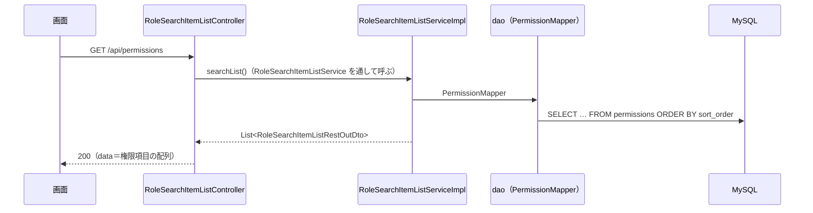

# API詳細設計：H-06 権限項目の一覧

| 項目 | 内容 |
|---|---|
| 版 | v1.0 2026-11-28 |
| Jira | ZPOP-99（サブタスク：[詳細設計] ZPOP-305） |
| 状態 | 作成中（12章の No.1・2・5 は、人の確認済み 2026-11-28） |
| まとまり | [role](role.md)（api.role） |
| もとにした設計書 | API設計.md v1.5 の2.3・2.4・2.5・3.8、画面設計.md v1.10 の20章、データ設計.md v1.0 の2章・5.3、機能一覧.md v1.2 の8章 |

## 1. API基本情報

写したもと：API設計.md v1.5 の3.8

| 項目 | 内容 |
|---|---|
| ID | H-06 |
| 名前 | 権限項目の一覧 |
| 操作 | GET |
| URL | /api/permissions |
| 内容 | 権限項目の一覧（18件） |
| 権限項目 | PERMISSION_VIEW、PERMISSION_MANAGE のどちらか |
| 使う画面 | S-17（権限登録・編集） |
| パッケージ | api.role.search.itemlist（API_パッケージとクラス名_決定版.md のとおり） |
| クラス名の頭（`<頭>`） | RoleSearchItemList |
| Controller のメソッド | RoleSearchItemListController#searchList |
| Service のメソッド | RoleSearchItemListService#searchList（中身は RoleSearchItemListServiceImpl） |
| Validator のメソッド | なし（業務チェックがない） |

## 2. リクエスト定義

### 2.1 パスの値

なし

### 2.2 クエリ（URL の ? の後ろ）

なし。API設計 2.5 は、一覧を返す API は page を受け取るとしているが、H-06 は18件で固定（機能一覧 8章の1）で、S-17 が全件を使うため、ページ分けをしない（2.5 の例外。12章の No.2）

### 2.3 本文（JSON）

なし

### 2.4 ファイル（CSV を受け取る API だけ）

なし

### 2.5 Service に渡す値（ServiceInDto）

なし（受け取る値がないので、RestInDto・ServiceInDto を作らない。CLAUDE.md 5章）

## 3. レスポンス定義

写したもと：API設計.md v1.5 の2.4（status・message・data・errors の形）・2.5（ページ分け。H-06 は例外）。data の中身は、API設計 4章に例がないため、画面設計.md v1.10 の20章（権限項目を区分ごとにまとめて並べる）と、データ設計.md v1.0 の5.3 の列から決めた（12章の No.1・2・5。2026-11-28 に人が確認）。

### 3.1 成功

| status | message |
|---|---|
| 200 | 処理が正常に完了しました。 |

data には、権限項目の1件（RestOutDto：`RoleSearchItemListRestOutDto`）の配列をそのまま入れる（K-01 と同じ形）。件数は、データ設計 5.3 の18件。並び順は5章の No.1。

| 項目名 | 型 | null になるか | もと（テーブル.列 ／ 計算） | 説明 |
|---|---|---|---|---|
| code | 文字 | ならない | permissions.code | 権限項目のコード（データ設計 5.3 のコード。H-02 の permissionCodes の値と同じ） |
| name | 文字 | ならない | permissions.name | 画面に出す名前（S-17 のチェックの名前）。説明としても使う（12章の No.1） |
| group | 文字 | ならない | permissions.group_name | 区分（備品／貸出／確認／ユーザ・権限）。S-17 が、区分ごとにまとめて並べるのに使う |

```json
{
  "status": 200,
  "message": "処理が正常に完了しました。",
  "data": [
    { "code": "EQUIPMENT_VIEW", "name": "備品一覧を見る", "group": "備品" },
    { "code": "EQUIPMENT_CREATE", "name": "備品を登録する", "group": "備品" }
  ],
  "errors": null
}
```

（例は、先頭の2件だけを載せている。実際は18件）

### 3.2 失敗

9章のとおり。

## 4. 処理フロー

1. Spring Security が、ログインしているかを確かめる（10章）。していなければ 401。
2. `@PreAuthorize` が、権限項目 PERMISSION_VIEW か PERMISSION_MANAGE のどちらかを持っているかを確かめる（10章）。持っていなければ 403。
3. RoleSearchItemListController#searchList が、RoleSearchItemListService#searchList を呼ぶ（中身は RoleSearchItemListServiceImpl）。受け取る値がないので、ServiceInDto は作らない。
4. ServiceImpl が dao の PermissionMapper#selectByExample で、権限項目を並び順どおりに全件読む（7章の No.1）。
5. ServiceImpl が、1件ずつ RestOutDto（code・name・group）に変える。
6. Controller が `ApiResponse.ok(…)` で返す。



## 5. 条件分岐・業務ルール

| No. | 条件・ルール | 写したもと | 守る場所（クラス.メソッド） | 守れないとき | 同じルールを書いているほかの機能 |
|---|---|---|---|---|---|
| 1 | 権限項目は、並び順（permissions.sort_order。データ設計 5.3 の表の並び。1〜18）で返す（12章の No.6） | データ設計 5.3 ／ role.md 3章の No.3 | RoleSearchItemListServiceImpl#searchList（PermissionMapper#selectByExample の orderByClause） | ― | H-01（含む権限項目）、H-02（permissionCodes）で同じ順にそろえる |
| 2 | 権限項目の一覧はプログラムで決めておき、画面からは増やせない（返すのは、最初に入れた18件） | 機能一覧 8章の1 ／ role.md R-1 | （データは Flyway で入れる。この API は読むだけ） | ― | なし |
| 3 | 権限項目を見られるのは、PERMISSION_VIEW か PERMISSION_MANAGE を持つ人（S-17 を開ける人が、中の読み込みで 403 にならないように） | API設計 3.8 ／ role.md R-9 | RoleSearchItemListController の `@PreAuthorize`（10章） | 9章の No.2 | H-02 |

## 6. バリデーション仕様

なし（受け取る値がない）

## 7. DB操作仕様

写したもと：データ設計.md v1.0 の5.3

| No. | Mapper のメソッド | 使う所 | 操作 | テーブル | 条件（Criteria） | 読む・書く列 | 件数 |
|---|---|---|---|---|---|---|---|
| 1 | PermissionMapper#selectByExample | ServiceImpl#searchList | SELECT | permissions | 条件なし（全件）。orderByClause は `sort_order` | code, name, group_name, sort_order | 18件 |

- 手で書く Mapper を使う理由：使わない（MyBatis Generator が作った Mapper で足りる。dao.mapper.custom は足さない）。
- 複数のテーブルの突き合わせ方（JOIN とサブクエリは使わない）：テーブルは permissions 1つだけ。
- まとめて読む所（N+1 を防ぐ）：1回で全件読む。
- 削除済みを除く条件：permissions には deleted_at がない（データ設計 5.3）。条件は付けない。
- 更新した件数の見方：書き換えない。

## 8. トランザクション・排他制御

| 項目 | 内容 |
|---|---|
| @Transactional | 付けない（SELECT が1回だけで、ServiceInDto のチェックもない。12章の No.3） |
| 楽観ロック（version） | 使わない（permissions に version はない） |
| 同時に操作されたとき | 起きない（権限項目は、画面から変えられない。5章の No.2） |
| Slack を送るタイミング | 送らない |

## 9. エラー処理仕様

写したもと：API設計.md v1.5 の2.3・2.4

| No. | 場面 | 投げる例外 | status | message | errors |
|---|---|---|---|---|---|
| 1 | ログインしていない | （Spring Security） | 401 | ログインしてください。 | null |
| 2 | 権限項目 PERMISSION_VIEW・PERMISSION_MANAGE のどちらもない | （Spring Security。`@PreAuthorize`） | 403 | この操作を行う権限がありません。 | null |
| 3 | サーバーの不具合（データベースにつながらないなど） | （GlobalExceptionHandler が受ける） | 500 | 問題が発生しました。時間をおいて、もう一度お試しください。続く場合は総務に連絡してください。 | null |

入力の誤り（400）、見つからない（404）、ぶつかった（409）は起きない。

## 10. 認証・認可仕様

| 項目 | 内容 |
|---|---|
| ログイン | 要る |
| 権限項目 | `@PreAuthorize("hasAnyAuthority('PERMISSION_VIEW', 'PERMISSION_MANAGE')")`（どちらか1つを持っていれば呼べる） |
| 対象の確かめ（IDOR） | ID を受け取らない。権限項目は、全員で共有する固定の情報で、持ち主がいない |

## 11. 外部API連携仕様

なし

## 12. 設計書にない判断

| No. | 判断 | 理由 | 外から見えるか | 人の確認 |
|---|---|---|---|---|
| 1 | 返す項目を code・name・group の3つにする。画面設計 20章の「それぞれに説明を付ける」の説明は、別に返さず、name（例：備品を登録する）を説明として使う | API設計 4章に例がない。permissions テーブルに説明の列がない（データ設計 5.3）。列を足すと、データ設計・Flyway・dao の変更になる（2人で相談が要る）。name が処理を表す文なので、足りる扱いにした。説明の文を足したくなったら、S-17 の詳細設計か、データ設計の変更で決める | はい | 済（2026-11-28） |
| 2 | data は、権限項目の配列をそのまま入れる（K-01 と同じ）。API設計 2.5 の items・page・size・totalCount・totalPages の形にしない（ページ分けをしない）。sortOrder は返さない（並びで分かる）。区分ごとのまとめ方は、画面（S-17）が行う | 権限項目は18件で固定で、S-17 は全件を使う（page を受け取る意味がない）。2.5 の例外にする。K-01 と同じ扱い。並びは No.6 | はい | 済（2026-11-28） |
| 3 | `@Transactional` を付けない | SELECT が1回だけで、ServiceInDto のチェックもないため（K-01・C-01 と同じ）。H-02 は、チェックと3つの読み込みをそろえるために付けたが、H-06 には要らない | いいえ | ― |
| 4 | Controller・Service のメソッド名を searchList にした | 命名規則（CLAUDE.md 5章）に「権限項目の一覧を返す」メソッド名の決まりがない。パッケージの名前（search.itemlist）に合わせた（H-02 の searchDetails と同じ考え方） | いいえ | ― |
| 5 | RestOutDto の項目名を `group` にした（permissions.group_name の列名とは違う） | 画面が区分を扱いやすいように短くした。Java の予約語ではない | はい | 済（2026-11-28。No.1 の3項目（code・name・group）と同時に確認） |
| 6 | 権限項目は、権限項目の並び順（permissions.sort_order。データ設計 5.3 の表の並び。1〜18）で返す | 画面が並べ直さなくて済むように。H-02 の permissionCodes・H-01 と同じ順にそろえる（5章の No.1） | はい | 済（2026-11-28。No.2 と同時に確認） |

## 変更履歴

| 版 | 日付 | 内容 |
|---|---|---|
| v1.0 | 2026-11-28 | 初版（ZPOP-99） |
