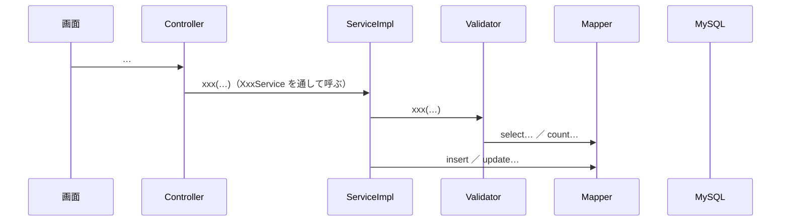

<!--
API詳細設計のテンプレート。1つの API に1ファイル。
置き場所：internaldesign/詳細設計/<機能名>/<APIのID>_<短い名前>.md（例：category/K-01_種別一覧.md）。
書き方は internaldesign/詳細設計/README.md。「<!- - … - ->」の書き方の説明は、書き終えたら消す。
設計書に書いてあることは、すべてここに写す。写した所には「写したもと：ファイル名 版 章」を書く。
食い違ったら設計書が正しい。設計書が直ったら、ここも直す。
当てはまらない章は、章ごと消さずに「なし」と書く。
-->
# API詳細設計：<ID> <名前>

| 項目 | 内容 |
|---|---|
| 版 | v1.0 YYYY-MM-DD |
| Jira | ZPOP-xx |
| 状態 | 作成中 ／ 人の確認済み（YYYY-MM-DD） |
| 機能 | [<機能名>](<機能名>.md) |
| もとにした設計書 | API設計.md vX.Y の○章、画面設計.md vX.Y の○章、データ設計.md vX.Y の○章、機能一覧.md vX.Y の○章 |

## 1. API基本情報

写したもと：API設計.md vX.Y の3.x

| 項目 | 内容 |
|---|---|
| ID | K-01 |
| 名前 | … |
| 操作 | GET ／ POST ／ PUT ／ DELETE |
| URL | /api/... |
| 内容 | （API設計の「内容」の文） |
| 権限項目 | XXX（データ設計 5.3 のコード）／ ログイン ／ なし |
| 使う画面 | S-xx（[S-xx_….md](S-xx_….md)） |
| controller のメソッド | XxxController#xxx |
| service のメソッド | XxxService#xxx（中身は XxxServiceImpl） |
| validator のメソッド | XxxValidator#xxx ／ なし（業務チェックがない） |

## 2. リクエスト定義

<!-- 受け取る値。API設計 4章に例があれば写す。なければ画面設計の項目から決める（決めたものは 12章に書き、人に確かめる）。 -->
写したもと：API設計.md vX.Y の4.x ／ 画面設計.md vX.Y の○章（例がないため、項目から決めた）

### 2.1 パスの値

| 名前 | 型 | 説明 |
|---|---|---|
| なし | | |

### 2.2 クエリ（URL の ? の後ろ）

| 名前 | 型 | 必須 | 最初の値 | 説明 |
|---|---|---|---|---|
| page | 数 | | 1 | 何ページ目か（API設計 2.5） |

### 2.3 本文（JSON）

dto：`dto.<機能名>.XxxRequest`

| 項目名 | 型 | 必須 | 制約 | 説明 |
|---|---|---|---|---|
| name | 文字 | ○ | 50文字まで | … |

```json
{ }
```

### 2.4 ファイル（CSV を受け取る API だけ）

<!-- 列の並び、文字コード（UTF-8・Shift_JIS）、大きさの上限（設定値）、1行目の見出し。なければ「なし」。 -->
なし

## 3. レスポンス定義

写したもと：API設計.md vX.Y の2.4・4.x

### 3.1 成功

| status | message |
|---|---|
| 200 ／ 201 ／ 202 | 処理が正常に完了しました。 |

dto：`dto.<機能名>.XxxResponse`

| 項目名 | 型 | null になるか | もと（テーブル.列 ／ 計算） | 説明 |
|---|---|---|---|---|
| id | 数 | ならない | xxx.id | … |

```json
{
  "status": 200,
  "message": "処理が正常に完了しました。",
  "data": { },
  "errors": null
}
```

### 3.2 失敗

9章のとおり。

## 4. 処理フロー

<!-- 受け取る → 入力チェック → 権限の確認 → 業務チェック → 書き換え → 返す、の順に番号で書く。順番が大事なものは Mermaid の図も描く。業務チェックがなければ Validator の行と参加者を消す。 -->

1. controller が受け取る。`@Valid` で入力チェック（6章）。
2. `@PreAuthorize` で権限項目を確かめる（10章）。
3. controller が XxxService#xxx を呼ぶ（中身は XxxServiceImpl。`@Transactional` を付けるなら、ここから8章の範囲）。
4. ServiceImpl が XxxValidator#xxx を呼び、業務チェックをする（5章・6章）。守れなければ例外を投げる（9章）。
5. ServiceImpl が mapper で書き換える（7章）。
6. `ApiResponse.ok(…)` で返す。



## 5. 条件分岐・業務ルール

<!-- 機能全体のファイルの 1.3 のルール（R-x）と、この API だけのルール。どこで守るかを書く。確かめて止めるもの（業務チェック）は XxxValidator、決まりに沿って値を作る・書き換えるものは XxxServiceImpl（CLAUDE.md 5章）。 -->

| No. | 条件・ルール | 写したもと | 守る場所（クラス.メソッド） | 守れないとき | 同じルールを書いているほかの機能 |
|---|---|---|---|---|---|
| 1 | （例）使われている種別は消せない | 機能一覧 ○章 ／ R-1 | XxxValidator#xxx | 9章の No.x | なし ／ mine |
| 2 | （例）消すときは deleted_at に今の日時を入れる | データ設計 ○章 | XxxServiceImpl#xxx | ― | なし |

## 6. バリデーション仕様

写したもと：画面設計.md vX.Y の○章（メッセージは一字も変えずに写す）

| 項目 | 決まり | メッセージ | 確かめる場所 |
|---|---|---|---|
| name | 必須 | 「…」 | dto の `@NotBlank` |
| name | 50文字まで | 「…」 | dto の `@Size(max = 50)` |
| name | ほかと重ならない | 「…」 | XxxValidator#xxx（業務チェック。データベースを見て確かめる） |

## 7. DB操作仕様

写したもと：データ設計.md vX.Y の○章

| No. | mapper のメソッド | 操作 | テーブル | 条件 | 読む・書く列 | 件数 |
|---|---|---|---|---|---|---|
| 1 | XxxMapper#selectById | SELECT | xxx | id = ? AND deleted_at IS NULL | id, name, version | 0〜1件 |

- 複数のテーブルの突き合わせ方（JOIN とサブクエリは使わない）：…
- まとめて読む所（N+1 を防ぐ。`IN` と `<foreach>`）：…
- 削除済みを除く条件：…
- 更新した件数の見方（0件のとき）：…

## 8. トランザクション・排他制御

| 項目 | 内容 |
|---|---|
| @Transactional | 付ける ／ 付けない（書き換えが1つだけ、または読むだけ）。付けるメソッド：XxxServiceImpl#xxx（Validator の呼び出しも、この中に入る） |
| 楽観ロック（version） | 使う ／ 使わない。古い version のときは 409（API設計 2.7） |
| 同時に操作されたとき | … |
| Slack を送るタイミング | 送らない ／ 書き込みが確定してから（11章） |

## 9. エラー処理仕様

写したもと：API設計.md vX.Y の2.3・4.x、画面設計.md vX.Y の○章

| No. | 場面 | 投げる例外 | status | message | errors |
|---|---|---|---|---|---|
| 1 | 入力の誤り | （Bean Validation） | 400 | 入力内容に誤りがあります。 | 入力欄ごとのメッセージ（6章） |
| 2 | ログインしていない | （Spring Security） | 401 | ログインしてください。 | null |
| 3 | 権限項目がない | （Spring Security） | 403 | この操作を行う権限がありません。 | null |
| 4 | … | BusinessRuleException ／ NotFoundException ／ ConflictException | 400 ／ 404 ／ 409 | 「…」 | null |

## 10. 認証・認可仕様

| 項目 | 内容 |
|---|---|
| ログイン | 要る ／ 要らない |
| 権限項目 | `@PreAuthorize("hasAuthority('XXX')")` |
| 対象の確かめ（IDOR） | ID を受け取らない ／ （例）貸出履歴の借用者が、ログインしている人かを XxxValidator で確かめる（ServiceImpl から呼ぶ）。違えば 9章の No.x |

## 11. 外部API連携仕様

<!-- Slack の DM を送る API だけ。送らなければ「なし」。 -->
なし

| 項目 | 内容 |
|---|---|
| 送る相手 | … |
| 文面 | （画面設計 9章の文を写す） |
| 送るタイミング | 書き込みが確定してから（@Transactional の外） |
| 送れなかったとき | … |

## 12. 設計書にない判断

<!-- この API で自分が決めたことと理由。「外から見えるか」が「はい」のものは、実装の前に人に確かめる。 -->

| No. | 判断 | 理由 | 外から見えるか | 人の確認 |
|---|---|---|---|---|
| 1 | … | … | はい／いいえ | 済（YYYY-MM-DD）／まだ |

## 変更履歴

| 版 | 日付 | 内容 |
|---|---|---|
| v1.0 | YYYY-MM-DD | 初版（ZPOP-xx） |
